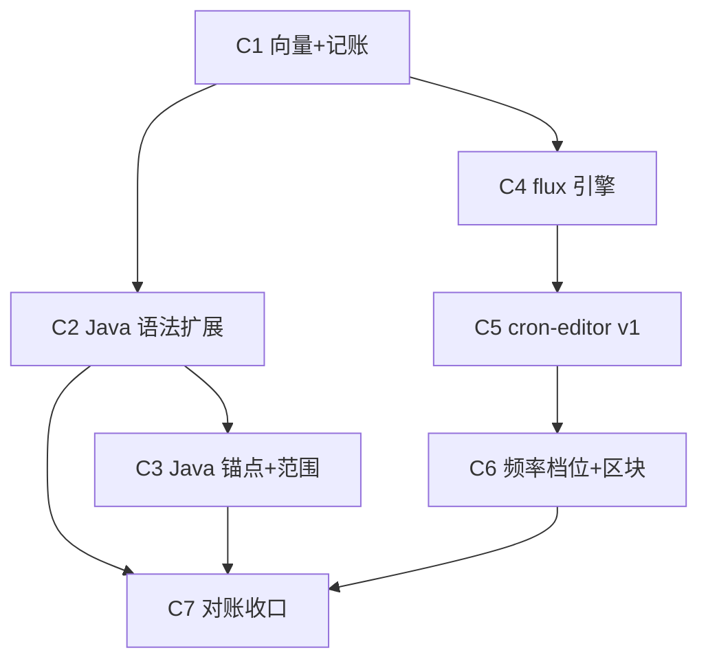

# cron-editor 设计文档 + 示例 JSON + 跨仓路线图

> Plan Status: draft
> 日期: 2026-10-06
> 性质: 纯文档交付（零代码变更），产出后由用户审阅再进入 roadmap 执行闭环
> 模式: 本会话只写文档；实现按新拟制的 roadmap 逐工作项立 plan 执行
> 文件说明: 本文件是 opencode 计划模式的**会话工作稿**（供用户审阅计划用），不是项目交付物，不进 docs/、不提交；项目交付物见下表。

## 1. 目标与交付物

用户需求：低代码项目需要 cron 表达式编辑控件，**语法支持 `~/app/nop-entropy`（Nop 平台）的 cron 方言，且能力要达到 Office 定时配置同等水平；达不到就改 Java 端**；交付形态为**按 roadmap guide 拟制的、含多个工作项的 roadmap**；**必须包含完整 UI 测试**。

| #   | 交付物                                                                          | 路径                                                                           |
| --- | ------------------------------------------------------------------------------- | ------------------------------------------------------------------------------ |
| A   | 组件设计文档（12 节 + 原则审计）                                                | `docs/components/cron-editor/design.md`                                        |
| B   | 示例 JSON（目标契约）                                                           | `docs/components/cron-editor/example.json`                                     |
| C   | 路线图（按 `docs/backlog/00-roadmap-authoring-guide.md` 10 节结构，7 个工作项） | `docs/backlog/cron-scheduling-roadmap.md`                                      |
| D   | 登记（4 处，见 §7）                                                             | index.md 目录清单 / examples.manifest / amis-baseline-matrix / roadmap.md 指针 |
| E   | 日志                                                                            | `docs/logs/2026/10-06.md`                                                      |

## 2. 已拍板决策（用户确认，执行不得更改）

1. **含下次触发时间预览**：把 nop 的 Spring 版 `getTimeAfter` 移植成 TS 纯模块，预览未来 N 次触发，并用 nop 的 Java 测试向量做对账。
2. **可视化 + 文本双模式 + 预设**：`mode: 'visual' | 'text'`，内置常用预设。
3. **方言 = Office 同等能力**；nop 现有语法达不到的部分，**改 nop-entropy 的 Java 实现**（不是在前端绕过）。
4. **结构性缺口处置 = cron + Java 锚点字段**：编辑器值仍以 cron 字符串为本体；「每 N 周 / 每 N 天锚点」由 nop `TriggerSpec` 新增字段 + 触发层锚点过滤承接，**不发明非标 cron 语法**。
5. **首版一并做重复范围**（开始日期 / 结束日期 / 重复 N 次），承接字段用 `TriggerSpec` 已有的 `minScheduleTime` / `maxScheduleTime` / `maxExecutionCount`。
6. **交付形态 = roadmap**（多个工作项，每项一个 execution plan），不是单份执行计划。
7. **必须包含完整 UI 测试**（分层矩阵见 §6.3，逐工作项落位）。

## 3. 调研结论速查（执行时直接引用，勿重复调研）

### 3.1 nop-entropy 的 cron 语法事实

- 解析器唯一：`io.nop.job.core.utils.CronExpression`（`nop-job/nop-job-core/.../utils/CronExpression.java`，487 行，vendored 自 Spring `CronSequenceGenerator`，Apache 2.0 文件头）。接口 `ICronExpression` 只依赖 `getTimeAfter`，**扩展语法无需改接口**。
- **严格 6 段**：秒(0-59) 分(0-59) 时(0-23) 日(1-31) 月(1-12 或 JAN-DEC) 周(0-7 或 SUN-SAT，0/7=周日)。5 段 / 7 段一律拒。
- 支持 `*` `,` `-` `/`；`?` **仅日/周位且等价 `*`**（整段被替换）；**不支持** `L` `W` `#`、`@daily` 别名、年份段。
- **日与周是 AND 语义**（`findNextDay` L227 `!dom.get(d) || !dow.get(d-1)`），与 Quartz 的 `?` 互斥、POSIX 的 OR 都不同。
- 内部是**构造期一次性 BitSet**：`#`（第 N 个周几）可纯解析期静态展开（注意用 `and()` 交集，不许 `set()` 覆盖日字段位，且混合 N 会过匹配）；`L`/`W`/`LW`/`nL`/`L-n` **本质不能静态**，需把 `findNextDay` 的判定抽成 `matchesDay()` 动态谓词（主循环 `doNext`/`findNext`/两道守卫 366 天 + 4 年 runaway **原样不动**）。`equals`/`hashCode` 必须纳入新描述符。
- 影响面：生产代码只改 `CronExpression.java` 一个文件；消费方 `TriggerBuilder` / `CronTrigger` / `CronCalendar` 自动继承。**现网零 L/W/# 数据，零迁移风险**。
- `TriggerSpec`（`nop-job-api/.../spec/TriggerSpec.java`）已有 `cronExpr`、`minScheduleTime`（≈开始）、`maxScheduleTime`（≈结束）、`maxExecutionCount`（≈次数）、`misfireThreshold`、`pauseCalendars`；**无 timezone**（`TriggerBuilder` 走 JVM 默认时区）。
- 顺带缺陷：`nop-datav` 的 `NopDatavReportTaskBizModel.validateCron` 放行 5-7 段且注释称「quartz 分 时 日 月 周」，与引擎严格 6 段不符；`docs-for-ai/03-modules/nop-job.md` 称「标准 Unix cron」也与实现不符。
- 测试：`./mvnw test -pl nop-job/nop-job-core -am -Dtest=TestCronExpression`（纯 JUnit5，无容器）；现有 3 用例只测 equals/hashCode（免费回归网），`getTimeAfter` 语义覆盖只在 `TestTrigger`/`TestJobTriggerCalculator` 各 1 个时间点。
- 真实向量（可用作黄金样例）：`0 0 6,19 * * *`（from 2022-02-10 → 2022-02-10T06:00）、`0 0 12 ? * MON-FRI`、`0 30 9 ? * *`、`0 0/5 * * * ?`、`0 0/1 * * * ?`、`0/5 * * * * ?`、`0 0 * * * ?`、`0 0 8 * * ?`、`* * 0-7,18-23 ? * *`、病态负例 `0 0 0 30 2 ?`（永不匹配）与 `not-a-valid-cron`。
- nop 前端（`nop-frontend-support`）里 `cronExpr` 是纯文本输入（`_NopJobSchedule.xmeta` 无自定义 editor），**无任何可视化编辑器**；本次不在 nop 前端做控件，只扩引擎 + 提供映射契约。

### 3.2 Office 能力对照与缺口处置

| Office 能力                                                           | 处置                                                                                                                         |
| --------------------------------------------------------------------- | ---------------------------------------------------------------------------------------------------------------------------- |
| 每天 / 每 N 天 / 仅工作日；每周 + 周几多选；每月第 N 天；每年指定日期 | 现有 6 段可表达 → 编辑器直出                                                                                                 |
| 每月第 X 个周几、每月最后一天/最后周几、N 号遇周末就近工作日          | **需扩 Java**：`#` `L` `nL` `L-n` `LW` `nW`（Quartz 兼容语法，前端 TS 同步实现）                                             |
| 每 N 年                                                               | **需扩 Java**：可选第 7 段年份（Quartz 兼容）                                                                                |
| 每 N 周（隔周）、每 N 天跨月连续锚点                                  | **cron 族（含 Quartz/Spring/EventBridge/croniter）都表达不了** → §2 决策 4：`TriggerSpec` 新增锚点字段 + 触发层取模过滤      |
| 重复范围（开始/结束/次数）                                            | `TriggerSpec` 三个现成字段承接（决策 5）                                                                                     |
| 持续时长、时区、例外日期、运行时策略（overlap/misfire）               | **首版不采纳**，记入 design.md Flux 决策表「不采纳」行 + roadmap Deferred（cron 之外的配套能力，另有 misfire/calendar 机制） |

### 3.3 本仓规范与校验陷阱（必须遵守）

- design.md 结构：`docs/components/index.md:49-62` 的 12 节清单**逐字对齐标题**，另加「原则审计」节（`docs/references/new-renderer-introduction-audit.md` §4 模板）。体量基准取 `icon-picker`（约 8 KB / 13 节）；**< 40 KB**（condition-builder 40 KB 是反面教材）。
- example.json 与 design.md 同目录；新实现组件进 `runtime`，**未实现的进 `targetContract`**（manifest 三数组语义见 `docs/components/index.md:15-19`；当前 `targetContract` 52 项、字母序）。
- **反引号路径陷阱**：`scripts/check-active-doc-code-anchors.mjs` 会校验 `docs/components/*.md` 反引号内以 `apps|packages|docs|scripts|tests/` 开头且以扩展名结尾的路径**必须存在**，否则 `pnpm check`/`pnpm lint` 直接红。→ design.md/roadmap 中**不得**用反引号引用尚不存在的未来文件（如未创建的 renderer 源文件、未创建的 plan）。计划用纯文本或不带仓库前缀的相对写法（如 `renderers/cron-editor-renderer.tsx` 不匹配该正则）。已存在的文档路径（如 `docs/references/renderer-implementation-guidelines.md`）可正常反引号。
- 行数红线：`check-oversized-code-files` warn 500 / error 700 → 未来 renderer 单文件 ≤500 行（roadmap Cross-Cutting 注明）。
- 命名：`docs/references/naming-conventions.md` §4/§5——布尔肯定式、枚举受控词表、选项 `{label,value}`、无平行词汇表、组件级禁 `api/initFetch/interval` 短路径（**值对象内 `repeat` 命名即为此避开 `interval`**）、handle 用 `component-handle-vocabulary.md` 核心词。
- 已有先例可复用：`mode` 枚举（crud/form/industrial editor 已用）、`show*` 布尔（showWeekends/showToday/showWordLimit 等 100+ 处）、`previewCount` 无冲突。
- 新组件交付铁律 8 项：`docs/backlog/missing-components-and-designer-roadmap.md` §1；cron-editor 现状为 survey-owned / demand-gated（survey L113、backlog L181、QA.7 L66），**本次用户需求即 demand 确认**，记账放工作项 C1。
- roadmap guide：`docs/backlog/00-roadmap-authoring-guide.md`——结构 10 节、Phase Status 是唯一动态区、状态只 `todo/planned/done`、**每工作项必须一个 plan 能做完**、不做实现步骤/不写 checkbox、依赖表与图一致（表优先）。

## 4. 交付物 A — `docs/components/cron-editor/design.md`

### 4.1 结构（12 节标题逐字 + 原则审计）

1 组件定位 / 2 与 AMIS 或既有产品的能力对照（含 `### Flux 决策表`）/ 3 Flux 中的 renderer/type 定义 / 4 schema 设计（TS interface + `### 与 AMIS 对照`）/ 5 字段分类 / 6 regions 与 slot 约定 / 7 运行期状态归属 / 8 事件、动作与组件句柄能力 / 9 数据源、表达式、导入能力接入点 / 10 样式与 DOM marker 约定 / 11 实现拆分建议 / 12 风险、取舍与后续阶段 / **原则审计（INV-1~5 + Checklist A-G + 例外）**。

§2 必含：**Office 定时配置能力对照表**（§3.2 的 5 类处置）+ nop 方言语法表（段数/取值域/特殊字符/AND 语义/不支持清单）+ Flux 决策表（采纳：双模式、分段编辑、频率档位、预设、预览、L/W/#、年段、repeat/range；不采纳：RRULE、时区字段、持续时长、例外日期、@别名、5 段 Unix 兼容模式——附理由）。

### 4.2 必须写死的设计裁定（执行照抄，不再开放设计）

**值形状（唯一 source of truth 的一部分）**

```ts
interface CronScheduleValue {
  cron: string; // 必填；6 段，或扩展后 7 段（年）
  repeat?: { every: number; unit: 'day' | 'week'; anchor?: string }; // 锚点周期（cron 表达不了的每 N 天/周）
  range?: { start?: string; end?: string; count?: number }; // 重复范围，end 与 count 互斥
}
```

规则：`repeat.every ≥ 1`；`anchor` 为 `YYYY-MM-DD`，缺省回退 `range.start`，两者皆缺 → 诊断 `cron-repeat-anchor-missing`；`range.end` 与 `range.count` 同时出现 → `cron-range-conflict`；`start > end` 或 `count < 1` → 诊断；值可为 `undefined`（`clearable` 清空）。日期一律 `YYYY-MM-DD` 纯日期，避免时区漂移。

**schema 字段（`cron-editor` extends 标准表单字段）**

| 字段           | 类型                                            | 默认       | 说明                                          |
| -------------- | ----------------------------------------------- | ---------- | --------------------------------------------- |
| `mode`         | `'visual' \| 'text'`                            | `'visual'` | 编辑模式                                      |
| `showRepeat`   | `boolean`                                       | `true`     | 是否显示「重复周期」区块（每 N 天/周 + 锚点） |
| `showRange`    | `boolean`                                       | `true`     | 是否显示「重复范围」区块                      |
| `showPreview`  | `boolean`                                       | `true`     | 是否显示下次触发预览                          |
| `previewCount` | `number`                                        | `5`        | 预览条数，clamp 1–20                          |
| `presets`      | `{ label: string; value: CronScheduleValue }[]` | 内置 8 条  | 覆盖默认预设（`{label,value}` 形状）          |

继承字段：`name`/`label`/`value`/`required`/`disabled`/`readOnly`/`hidden`/`placeholder`/`clearable`/`className`/`testid` + 事件 `onChange`。**不新增** `minDate/maxDate`/`timezone`（记 §12 后续阶段）。

**两种模式的 UI 结构**

- `visual`：频率档位 `每天 | 每周 | 每月 | 每年 | 自定义`（对齐 Outlook 四档）
  - 每天：每 N 天 / 仅工作日 + 起始时刻（时:分:秒）
  - 每周：每 N 周（≥1，写 `repeat`）+ 周几多选 + 起始时刻
  - 每月：第 N 天 / 第 X 个周几(first…last) / 最后一天 / 最后周几 + 每 M 个月 + 时刻
  - 每年：指定 月-日 / 指定月第 X 个周几 + 每 N 年（7 段年）+ 时刻
  - 自定义：6/7 段分段编辑器（每段 chips + 输入，秒段可见）
  - 档位由 cron **render-time 派生**（parse 识别），识别不了 → 落「自定义」；档位编辑 → 重编译 cron。**cron 是唯一真源，UI 状态不回写成镜像 state**（React 19：render-time derivation，不用 effect 同步）。
- `text`：单行输入 + 实时诊断列表 + 预览；非法草稿保留在 local state，**不提交进值**。
- `repeat`/`range` 区块在两模式下均可见（受 `show*` 控制），编辑写入值对象的对应子字段。
- 预设（8 条，cron-only）：每分钟 `0 0/1 * * * ?`、每 5 分钟 `0 0/5 * * * ?`、每小时整点 `0 0 * * * ?`、每天 09:00 `0 0 9 * * ?`、工作日 12:00 `0 0 12 ? * MON-FRI`、每天 06:00 与 19:00 `0 0 6,19 * * *`、每月最后一天 23:00 `0 0 23 L * ?`、每月第 3 个周五 10:00 `0 0 10 ? * FRI#3`。

**诊断错误码（i18n 双语，前缀 `cron-`）**：`cron-field-count`（须 6/7 段）、`cron-bad-token`、`cron-out-of-range`、`cron-inverted-range`、`cron-step-invalid`、`cron-question-mark`（`?` 只许日/周位）、`cron-unsupported-token`（`L/W/#` 用错字段、`@别名`、5 段输入）、`cron-impossible`（永不匹配，如 `0 0 0 30 2 ?`，**error 级拦截**，避免后端 job FAILED）、`cron-repeat-anchor-missing`、`cron-range-conflict`。

**预览语义**：未来 N 次绝对时间（浏览器本地时区，`YYYY-MM-DD HH:mm:ss`），经 `repeat` 锚点过滤 + `range`（end/count）截断；有 `count` 时显示「第 k/N 次」；永不匹配显示占位错误。**时区差异（浏览器 vs nop JVM 默认）写入 §12 风险**。

**host 映射契约（§9）**：`cron → cronExpr`；`repeat → TriggerSpec 新增锚点字段（C3 定名）`；`range.start/end/count → minScheduleTime/maxScheduleTime/maxExecutionCount`；映射由宿主动作/表达式完成，renderer 不发请求（INV-1/2 满足，零 IO）。

**其余各节要点**：§3 `type: 'cron-editor'`、`category: 'form'`、`sourcePackage: '@nop-chaos/flux-renderers-form'`、`wrap: true`、validation 走表单字段规则；§5 字段分类表（`value` = `CronScheduleValue`，其余 `value`，`onChange` = event，无 region）；§6 **无子 region**（自包含控件），slot：`segment-group|segment|text-input|diagnostics|presets|frequency|repeat|range|preview`；§7 值与校验归 form runtime，`mode 草稿/焦点/档位派生` 归 local；§8 句柄 `clear/reset/focus`（须与 `componentCapabilityContracts` 成对）；§10 根 marker `nop-cron-editor` + `data-slot` + 无 BEM + 用 `@nop-chaos/ui` 组件（Button/Input/Select/Checkbox/Tabs/Badge…）；§11 拆分三层——**cron 纯 helper 模块**（解析/序列化/诊断/next-run/repeat/range/派生/预设）、**local controller hook**（模式草稿、焦点、预览游标）、**renderer view**（JSX + 组合 ui），引用 `docs/references/renderer-implementation-guidelines.md`；§12 风险：跨仓契约漂移、值结构化 vs 宿主字符串列、时区、500 行红线、C5/C6 两段交付。

**原则审计节**：INV-1（零外部 IO，通过）/ INV-2（无新 IO 类型）/ INV-3（复用 FormRuntime + `@nop-chaos/ui` + FormulaCompiler 表达式）/ INV-4（域内部态 local，不进 scope）/ INV-5（标准签名与 props 读取、selector hooks）；Checklist A-F 逐条、**G 不适用（零新包）**；例外与未决项列「值对象 vs 宿主字符串列的映射责任在宿主」。

## 5. 交付物 B — `example.json`（完整内容照抄）

```json
{
  "type": "form",
  "body": [
    {
      "type": "cron-editor",
      "name": "dailyReportSchedule",
      "label": "日报生成计划",
      "value": { "cron": "0 0 9 ? * MON-FRI" },
      "required": true
    },
    {
      "type": "cron-editor",
      "name": "biweeklySync",
      "label": "双周同步会议",
      "mode": "visual",
      "value": {
        "cron": "0 0 10 ? * MON",
        "repeat": { "every": 2, "unit": "week", "anchor": "2026-01-05" },
        "range": { "start": "2026-01-05", "count": 12 }
      }
    },
    {
      "type": "cron-editor",
      "name": "monthEndSettlement",
      "label": "月末结算（每月最后一天 23:00）",
      "mode": "text",
      "value": { "cron": "0 0 23 L * ?" },
      "clearable": true,
      "previewCount": 3
    }
  ]
}
```

字段全部落在 §4.2 schema 表内；三实例分别覆盖：基础 cron、repeat+range（Office 隔周 + 次数）、text 模式 + `L` 扩展语法。

## 6. 交付物 C — `docs/backlog/cron-scheduling-roadmap.md`

### 6.1 结构（严格按 guide 10 节，镜像本仓 `docs/components/roadmap.md` 文风）

Header（Last Updated 2026-10-06 + Source：本计划、design.md、survey L113）→ Purpose（引用 `docs/backlog/00-roadmap-authoring-guide.md`，声明本文是编排层非 plan）→ **Phase Status（唯一动态区，C1–C7 全 `todo`）** → Framework / Platform Reuse → Current Baseline → Phases 表（Phase/Status/Owner Doc/Dependencies/Reuse/Plan link，plan link 暂空 `—`）→ Phase Details（每项 3-6 行交付范围，无 checkbox）→ Dependency Graph（mermaid）→ Cross-Cutting（§6.3 UI 测试矩阵等）→ Rule（引用 guide + 状态流转 + 「本轨道主入口是本文，组件主 roadmap 只放指针」）。

### 6.2 工作项 C1–C7（每项 = 一个 execution plan；状态全 `todo`）

| ID  | 工作项                                                                                                                                                                                                                                                                | 仓库        | Owner doc                                    | 依赖       | Test Strategy                                     |
| --- | --------------------------------------------------------------------------------------------------------------------------------------------------------------------------------------------------------------------------------------------------------------------- | ----------- | -------------------------------------------- | ---------- | ------------------------------------------------- |
| C1  | **黄金向量 + 治理记账**：共享判别性向量集（基础 6 段 / L/W/# / 年段 / repeat 过滤 / range 截断 / 病态负例，含期望 next-run 序列）；backlog §10 L7.8 与 §13 demand-gate 记账翻转；survey L113 双向链接                                                                 | flux        | design.md §2/§4 + fixtures                   | —          | 不适用：纯文档与测试数据（消费测试在 C2/C4 落地） |
| C2  | **nop Java：语法扩展**（`L`/`nL`/`L-n`/`W`/`LW`/`#` + 可选 7 段年；`matchesDay` 动态谓词；equals/hashCode；判别性测试吃 C1 向量；`nop-datav validateCron` 对齐 6 段；cron 文档勘误）                                                                                  | nop-entropy | `CronExpression.java` + `TestCronExpression` | C1         | 必须自动化（Proof 先行）                          |
| C3  | **nop Java：锚点与范围**（`TriggerSpec` 新增 repeat 锚点字段 + 触发层/排除日历取模过滤；`minScheduleTime/maxScheduleTime/maxExecutionCount` 语义核对与 entity/xmeta 暴露；全链路 next-fire 测试）                                                                     | nop-entropy | `TriggerSpec` + trigger 层                   | C1, C2     | 必须自动化                                        |
| C4  | **flux：cron 引擎纯模块**（parse/serialize/诊断/next-run/repeat 过滤/range 截断/档位派生/预设数据）+ C1 向量对账测试（Proof 先行）                                                                                                                                    | flux        | design.md §4/§11                             | C1         | 必须自动化                                        |
| C5  | **flux：cron-editor v1**（text 模式 + 自定义分段编辑 + 诊断 + 预览 + `clear/reset/focus` 句柄；definition/i18n/playground route+lab+coverage manifest；文档登记翻 `runtime`：index 清单、manifest、matrix、quick-reference、backlog 状态回写；单测 + RTL + e2e 冒烟） | flux        | design.md 全文                               | C4         | 必须自动化                                        |
| C6  | **flux：Office 频率档位 + 区块**（每天/每周/每月/每年 向导、`repeat`/`range` 区块与互斥校验、presets、a11y 键盘与 aria、e2e 全量旅程）                                                                                                                                | flux        | design.md §4.2                               | C5         | 必须自动化                                        |
| C7  | **跨仓对账与收口**（Java/TS 向量一致性审计；宿主映射示例：`CronScheduleValue → TriggerSpec`；完整 UI 测试覆盖审计 + 视觉复核；`pnpm test`/`pnpm test:e2e` 与 `mvnw test` 全绿；roadmap/日志回写）                                                                     | 两仓        | design.md §9/§12                             | C2, C3, C6 | 必须自动化                                        |

### 6.3 Cross-Cutting — 完整 UI 测试矩阵（用户硬要求）

| 层           | 工具/位置                                                                                        | 必须覆盖                                                                                                                                                                                                                                 | 落位                         |
| ------------ | ------------------------------------------------------------------------------------------------ | ---------------------------------------------------------------------------------------------------------------------------------------------------------------------------------------------------------------------------------------- | ---------------------------- |
| L1 引擎单测  | Vitest（纯函数）                                                                                 | 解析/序列化往返、10 类诊断、next-run 对账黄金向量、repeat 锚点过滤、range 截断、病态永不匹配                                                                                                                                             | C4                           |
| L2 组件测试  | Vitest + Testing Library（`flux-renderers-form/src/__tests__/`）                                 | 双模式编辑与切换往返、档位派生与回编译、预设应用、预览列表递增、repeat/range 交互与互斥、required/disabled/readOnly、句柄 clear/reset/focus、marker 与 `data-slot` 契约、键盘导航与 aria、诊断文案（zh/en）、example.json 零 diagnostics | C5（基础）/ C6（档位与区块） |
| L3 守卫测试  | `route-matrix.test.ts`、definition contracts、package exports、`check:schema-prop-coverage`      | 路由 + lab page + 注册完整性 + propContracts/fields 成对                                                                                                                                                                                 | C5 / C6                      |
| L4 E2E       | Playwright `tests/e2e/cron-editor.spec.ts` + lab page + `coverage-manifest-entries-form.ts` 登记 | 完整用户旅程：编辑→值读回、文本模式非法输入报错且不提交、模式切换、预设、预览时间严格递增、repeat/range 写值、表单 submit 回写、`assertTrackedPageErrors` 零页面错误、键盘可达                                                           | C5 冒烟 / C6 全量            |
| L5 视觉复核  | visual spec / ui-review（截图仅供人审，**通过与否必须程序化断言**；artifacts 不入库）            | 档位面板、分段编辑、预览与区块布局                                                                                                                                                                                                       | C7                           |
| L6 Java 对账 | `mvnw test -pl nop-job/nop-job-core -am`                                                         | 同一向量集在 Java 端全部命中（含 L/W/# 动态月、闰年、跨年守卫）                                                                                                                                                                          | C2 / C3 / C7                 |

规则：C2–C7 一律 `必须自动化`，**Proof 项排在实现项之前**；每个 plan 的 Closure Gates 跑全量 `pnpm typecheck/build/lint/test/check`（Java plan 跑 `mvnw test`），全绿才许回写状态与提交。

### 6.4 依赖图



## 7. 登记项（本次会话完成，4 处 + 日志）

1. `docs/components/index.md` → `### 表单高级与复合组件` 列表加 `- \`cron-editor/\``（**不动**「当前代码已注册」清单，未注册）。
2. `docs/components/examples.manifest.json` → `targetContract` 数组按字母序插入 `"cron-editor"`。
3. `docs/components/amis-baseline-matrix.md` → `### 7. Flux-Only Form Component Families` 表加行：`cron-editor | nop 方言 cron 调度字段（双模式+范围） | none | targetContract | docs/components/cron-editor/design.md`。
4. `docs/components/roadmap.md` → `## Rule` 节加一行指针（仿 mobile-roadmap 先例）：cron 调度轨道主入口是 `docs/backlog/cron-scheduling-roadmap.md`，本文不镜像其状态。
5. `docs/logs/2026/10-06.md` 按 `docs/logs/00-log-writing-guide.md` 记录本次文档交付。

**明确不做（留给 C1/C5）**：backlog §10/§13 demand-gate 翻转、survey 双向链接、quick-reference 登记、i18n 键、任何代码。

## 8. 执行步骤（顺序）

1. 建目录 `docs/components/cron-editor/`，写 `design.md`（按 §4.1 结构 + §4.2 裁定；控制 < 40 KB；反引号路径只指向已存在文件）。
2. 写 `example.json`（§5 照抄），`python3 -m json.tool` 校验。
3. 写 `docs/backlog/cron-scheduling-roadmap.md`（§6；所有未来 plan 链接用纯文本或 `—`，避免反引号路径陷阱）。
4. 完成 §7 的 4 处登记 + 日志。
5. 跑 §9 验证清单；发现问题即修。

## 9. 验证清单

- [ ] 三份交付物存在；design.md 章节标题与 12 节清单逐字一致 + 原则审计节齐全
- [ ] `python3 -m json.tool docs/components/cron-editor/example.json` 通过；manifest 仍可解析且 `cron-editor` 在 `targetContract` 字母序正确位置
- [ ] `pnpm check:active-doc-code-anchors` 通过（**重点**：design.md/roadmap 无反引号的未来路径）
- [ ] `pnpm check:docs-garbled` 通过；design.md < 40 KB
- [ ] `pnpm check` 全绿（零新增红；docs-only 无代码，typecheck/build/lint 不涉，但 `pnpm check` 必跑）
- [ ] roadmap：10 节齐全、Phase Status 唯一动态区、C1–C7 全 `todo`、无 checkbox/实现步骤、依赖表与 mermaid 图一致、每项标注 test strategy 档位
- [ ] UI 测试矩阵 6 层齐全且每层有明确落位工作项
- [ ] grep 复核 4 处登记一致；`git status` 仅含预期文件（不含 `tests/e2e/artifacts/`、`_tmp/`）

## 10. 风险与边界

- **反引号路径陷阱**是本次唯一会被 CI 立刻抓到的错误来源，写作时逐条自查。
- 值结构化（`CronScheduleValue`）与 nop `cronExpr` 字符串列之间靠宿主映射——design.md §9 写清责任边界，C7 给映射示例，避免被误判为破坏兼容。
- 时区：预览用浏览器时区、nop 用 JVM 默认时区，两者不一致属已知风险（§12 + C7 对账时记录口径）。
- 双动态状态面风险：不把 cron 状态写进 `docs/components/roadmap.md`，只留指针。
- 本会话**不主动 commit**；若用户要求提交，按 AGENTS 规则先跑测试取 full-green 并写日志后再提交。
