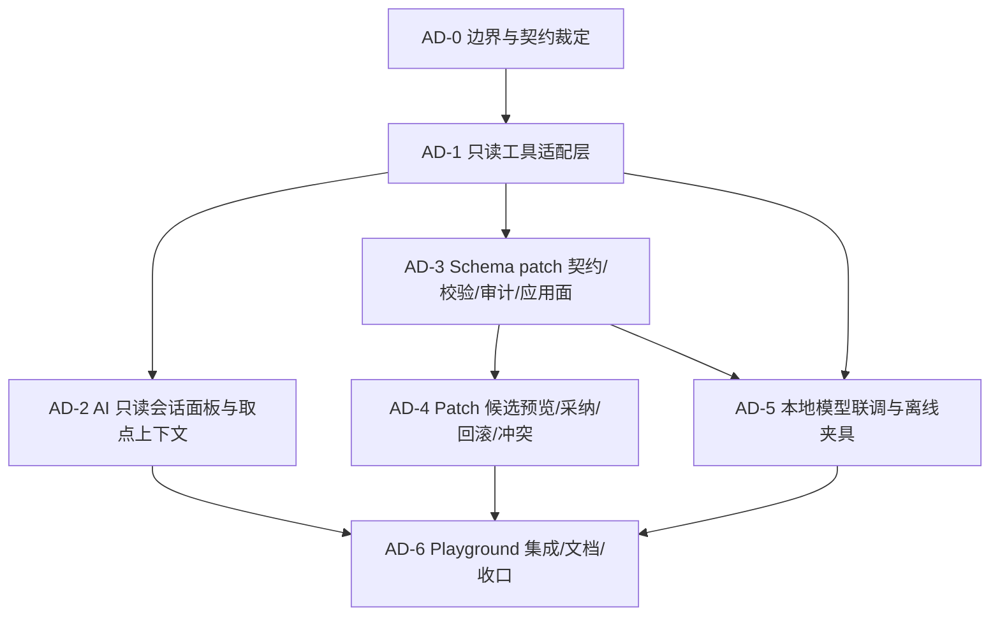

# AI Debugger Copilot Roadmap（nop-debugger 的 AI 集成）

> 本文件按 `docs/skills/roadmap-and-mission-authoring-with-consensus-review.md` 产出；结构依 `docs/backlog/00-roadmap-authoring-guide.md`；mission 档 `missions/ai-debugger-copilot.json`
> Created: 2026-10-26（用户指令：分析本项目能否采用 page-harness 的观念，为 nop-debugger 增加 AI 集成处理能力）
> 状态: **active**（Round 2 独立共识审查 `approved`，执行队列已开放）
> 分析种子：对照 `~/ai/page-harness`（Tencent/page-harness，commit `32f2f2e`）与本仓 live 代码的可行性分析（结论：可迁移“结构化工具面 + 取点 + 会话 + 候选变更 + 评审”观念，不迁移反向代理/书签/外部 CLI 改源码/本地 Node 服务）
> 事实基线：2026-10-26 live 核对（`packages/nop-debugger`、`packages/flux-renderers-ai`、`apps/playground`、`docs/architecture/debugger-runtime.md`、`docs/architecture/renderer-env.md`）
> Authority 关系：debugger 运行时语义权威 = `docs/architecture/debugger-runtime.md`；AI 扩展面 owner doc = `docs/architecture/nop-debugger-ai.md`（AD-0 已建立，2026-10-27）；宿主 IO 契约权威 = `docs/architecture/renderer-env.md`；AI 引擎/renderer 权威 = `packages/flux-renderers-ai`。本文件只做编排，不重述业务规则。

---

## 1. Purpose

本文件是 **nop-debugger 的 AI 集成** 的编排层。回答：复用本仓已有的结构化诊断面与 AI 对话基础设施，需要哪些 work item 才能把 debugger 从“人读面板 + 自动化查询 API”扩展为“人和 Agent 共用的诊断/解释/修复协作面”，以及这些 work item 如何被 AI 按 closed loop 依次收口。

本路线图**不**是执行计划：不写实现步骤、不加复选框、不写 closure criteria；每个 work item 的细节由对应 execution plan 承载。

## 2. Framework / Platform Reuse（已存在，禁止重建）

| 共享件                                                                                              | 位置                                                                                                           | 现有证据 / 消费者                                                                                                                                                                                                                                                                                                      |
| --------------------------------------------------------------------------------------------------- | -------------------------------------------------------------------------------------------------------------- | ---------------------------------------------------------------------------------------------------------------------------------------------------------------------------------------------------------------------------------------------------------------------------------------------------------------------- |
| 结构化自动化 API（事件查询、节点诊断、四类 explain、交互 trace、失败查询、报告/会话导出、面板控制） | `packages/nop-debugger/src/automation.ts`、`packages/nop-debugger/src/types.ts`                                | `createAutomationApi()` + `NopDebuggerAutomationApi`                                                                                                                                                                                                                                                                   |
| window 暴露契约                                                                                     | `packages/nop-debugger/src/automation.ts`（`registerAutomationApi`）                                           | `window.__NOP_DEBUGGER_HUB__` / `window.__NOP_DEBUGGER_API__`；playground `exposeAutomationApi: true`                                                                                                                                                                                                                  |
| 节点身份与取点                                                                                      | `data-cid`、`inspectByCid` / `inspectByElement`、`packages/nop-debugger/src/panel/use-inspect-mode.ts`         | `docs/architecture/debugger-runtime.md` Identity / DOM Inspect                                                                                                                                                                                                                                                         |
| 脱敏边界                                                                                            | `packages/nop-debugger/src/redaction.ts`                                                                       | 已在 event/export 边界生效；inspect 的 form/scope 数据不在此边界脱敏，按 AD-0 逐工具处理（2026-10-27 勘误：automation 出口的 inspect/evaluate 三方法已有 key 级 `redactData` 包裹，见 `controller.ts` 刻意差异注释；真实 gap 是该包裹仅按键名模式匹配且无逐工具裁剪/上限，AD-1 在其上做逐工具脱敏+裁剪+字节/深度上限） |
| 事件预算与性能纪律                                                                                  | `docs/architecture/debugger-runtime.md`「Event Budget And Retention Rules」「Snapshot And Payload Discipline」 | bounded ring、面板虚拟化                                                                                                                                                                                                                                                                                               |
| AI 消息引擎 + 工具调用循环 + 审批 UI 渲染面                                                         | `packages/flux-renderers-ai/src/engine/*`、`packages/flux-renderers-ai/src/renderers/ai-tool-call.tsx`         | `createMessageEngine`、`engine/tool-execution.ts`；审批工作流由宿主拥有                                                                                                                                                                                                                                                |
| 流式 connector 契约                                                                                 | `packages/flux-renderers-ai/src/index.ts`（`createStreamBasedAiConnector`）+ `RendererEnv.stream`              | `docs/architecture/renderer-env.md`                                                                                                                                                                                                                                                                                    |
| 宿主 connector 先例                                                                                 | `apps/playground/src/ai/openai-connector.ts`                                                                   | 密钥留在宿主，包内零密钥                                                                                                                                                                                                                                                                                               |

## 3. Current Baseline（2026-10-26 live，只读事实）

- `nop-debugger` 已导出完整 diagnostics/automation 面；其 `dependencies` 为 flux-core / flux-formula / flux-i18n / ui / use-sync-external-store，**无 AI 依赖**（另有 peer/devDependencies，但无 AI 包）。
- 面板有 `overview / timeline / network / node` 四个 tab（`packages/nop-debugger/src/types.ts` 的 `NopDebuggerTab`），**无 AI tab、无会话面**；`panel.tsx` 硬编码四个 tab，AI tab 需要先建立扩展 seam。
- `flux-renderers-ai` 已提供框架无关消息引擎、工具调用循环、流式 connector 与工具审批 UI；但**未与 debugger 自动化 API 对接**，也**未定义 debugger 工具白名单/prompt 规范/schema patch 协议**。
- 仓库**没有后端/server 包**（`packages/` 无 server/api/mcp），page-harness 的本地服务形态不可直搬；外部 Agent CLI 桥必须另立 sidecar 且需人工确认（本路线图列为 deferred，不进队列）。
- 取点基础已具备（`data-cid` + `inspectByElement` + inspect mode），但**未把节点上下文注入对话**。
- 随本路线图新增的可选本地 Qwen 27B 探针骨架（`scripts/__tests__/ai-debugger-local-qwen.optional.test.ts`，默认 `skipIf`）已带一个临时 4 名工具白名单与工具调用形状断言；它是**契约种子，不是生产契约**，生产白名单与脱敏由 AD-1/AD-3 落地。
- 主要 gap：AI tab 扩展 seam、工具定义、会话面、取点上下文注入、schema patch 契约/校验/应用面/预览/采纳/回滚、本地联调夹具、playground 集成与 owner-doc 收口。

## 4. Phases 总表

| Work item                                      | 内容（交付边界）                                                                                                                                                                                                                                                                     | Owner Doc                                                                                          | 依赖             | 复用                                                           | 状态                                                   |
| ---------------------------------------------- | ------------------------------------------------------------------------------------------------------------------------------------------------------------------------------------------------------------------------------------------------------------------------------------ | -------------------------------------------------------------------------------------------------- | ---------------- | -------------------------------------------------------------- | ------------------------------------------------------ |
| **AD-0 边界与契约裁定**                        | 新包边界与命名确认；connector 注入契约；**工具面安全裁定**（是否暴露 `evaluateNodeExpression`、inspect 返回的 form/scope 数据按工具脱敏/裁剪、prompt-injection 处理）；工具白名单；schema patch 协议草案（scope/审计/禁结构级）；AI tab 扩展 seam；`nop-debugger` 零 AI 依赖断言方式 | 新建 `docs/architecture/nop-debugger-ai.md`（写最终态，不写演进叙事）+ `debugger-runtime.md` 注记  | 无               | §2 全部                                                        | `done`（plan 768，closure audit approved，2026-10-27） |
| **AD-1 只读工具适配层**                        | 新包骨架；`NopDebuggerAutomationApi` → 模型工具定义适配；**白名单/逐工具脱敏/错误归一为可执行断言**；判别性单测；包边界断言                                                                                                                                                          | `docs/architecture/nop-debugger-ai.md`                                                             | AD-0             | `automation.ts`、`redaction.ts`                                | `done`（plan 769，closure audit approved，2026-10-27） |
| **AD-2 AI 只读会话面板与取点上下文**           | debugger `AI` tab（懒加载）+ 会话面；复用 `ai-chat`/消息引擎/工具卡片；prompt 构建与**注入断言（数据不当指令）**；空态/错误/重试/停止；i18n/a11y；**取点上下文卡片（cid/rendererType/schemaPath/关键表达式）+ 大小与脱敏截断 + 注入对话**；未启用零加载                              | `docs/architecture/nop-debugger-ai.md`                                                             | AD-1             | `flux-renderers-ai`、`use-inspect-mode.ts`、`inspectByElement` | `done`（plan 770，closure audit approved，2026-10-27） |
| **AD-3 Schema patch 契约、校验、审计与应用面** | patch 数据类型与显式 scope；schema/scope 校验；越权拒绝；审计；**确认/建立运行时 apply/revert 集成 seam 与对应 owner doc**；判别性测试                                                                                                                                               | `docs/architecture/nop-debugger-ai.md` + `docs/architecture/debugger-runtime.md`                   | AD-1             | `redaction.ts`、flux schema 编译面                             | `done`（plan 771，closure audit approved，2026-10-27） |
| **AD-4 Patch 候选预览、采纳、回滚与冲突**      | `propose_schema_patch` 候选生成；沙箱/虚拟渲染预览；候选切换与原版对比；采纳/放弃/回滚；预览期间 scope 变化冲突检测；链路测试（程序化断言）                                                                                                                                          | `docs/architecture/nop-debugger-ai.md`                                                             | AD-3             | AD-2 会话面、AD-3 应用 seam                                    | `done`（plan 772，closure audit approved，2026-10-27） |
| **AD-5 本地模型联调与离线夹具**                | 将探针接入 AD-1/AD-3 工具契约；**建立确定性 mock connector/离线夹具进入 CI**；环境变量契约；默认跳过门控；运行文档与失败解读；真实模型运行仅为可选人工验证，不作为 closure 前提                                                                                                      | `docs/architecture/nop-debugger-ai.md`                                                             | AD-1, AD-3       | `scripts/__tests__/ai-debugger-local-qwen.optional.test.ts`    | `todo`                                                 |
| **AD-6 Playground 集成、文档与收口**           | `debugger-lab` / playground 启用路径；`docs/index.md` 登记；`flux-runtime-module-boundaries.md` 更新；owner doc 最终态；全量验证（e2e 程序化断言）                                                                                                                                   | `docs/architecture/nop-debugger-ai.md`、`debugger-runtime.md`、`flux-runtime-module-boundaries.md` | AD-2, AD-4, AD-5 | `apps/playground`                                              | `todo`                                                 |

执行顺序建议：**AD-0 → AD-1 →（AD-2）与（AD-3 → AD-4）并行 → AD-5 → AD-6 收口**。

## 5. Phase Details（交付边界，无实现步骤）

- **AD-0**：只产出裁定与 owner doc 草案；不写产品代码。必须裁定三件事：① 新包命名与依赖方向（拟 `@nop-chaos/nop-debugger-ai`，依赖 `nop-debugger + flux-renderers-ai`，反向禁止）；② 工具面安全边界（默认不向模型暴露 `evaluateNodeExpression`；inspect 的 form/scope 数据逐工具白名单 + 脱敏 + 裁剪；schema/业务数据不当指令）；③ AI tab 扩展 seam（`nop-debugger` 不依赖 AI 包的前提下如何挂载）。
- **AD-1**：工具集首版只读；所有工具落在既有 automation API 语义上，不新增第二套诊断真相；白名单、逐工具脱敏、越权拒绝与非法参数归一均为可执行断言。
- **AD-2**：AI 能力默认关闭；未启用时不得加载新包 chunk；面板 chrome/i18n/a11y 沿用 debugger 既有基线；取点上下文只做“精确节点摘要”，不扩大脱敏边界；prompt 构建层负责“数据不当指令”的可执行断言（schema/业务数据进入上下文时不得被当作工具指令）。
- **AD-3**：patch 是 schema/表达式层变更，不做源码编辑、不做页面控制、不做结构级操作；必须先明确运行时 apply/revert 的集成 seam（现有 automation API 无 apply/patch 能力），若需要新增 seam，其契约与 owner doc 在本 work item 内收口。
- **AD-4**：候选预览与采纳/回滚消费 AD-3 契约；冲突检测以“预览期间 scope 变化”为触发；应用路径属受保护变更，执行前需人工确认（保护区域按 `docs/context/ai-autonomy-policy.md`）。
- **AD-5**：确定性夹具必须进入 CI 且不依赖网络；真实本地模型运行是可选人工验证，不作为 closure 前提；模型输出不得成为回归基线。
- **AD-6**：owner doc 只写最终态；全量验证与独立 closure audit 通过后才回写本表 `done`；Playground 集成需可被用户显式启用/关闭。

## 6. 依赖图

## 7. Cross-Cutting

- **粒度纪律**：每个 work item 必须由一个 execution plan 收口；起草 plan 时若发现**过大**，先经人工确认再拆分，不得由 AI 自行增殖 work item；若发现**过小**，同样先经人工确认再与相邻 work item 合并。禁止 one-file/one-finding 级碎片 plan。
- **包边界红线**：`nop-debugger` 不得反向依赖 AI 包；AI 能力必须可整体移除且默认关闭；边界需机械断言。
- **安全红线**：密钥只在宿主 connector；工具白名单化；`evaluateNodeExpression` 默认不暴露；inspect 的 form/scope 数据按工具脱敏与裁剪；schema/业务数据不得当指令执行；沿用 `redaction.ts`。
- **性能红线**：AI 不得写入 debugger 热路径；沿用 bounded ring；面板懒加载；未启用零加载。
- **变更红线**：仅 schema/表达式 patch；scope 显式；原子应用/回滚；审计留痕；结构级与页面控制明确排除。
- **跨路线图协调**：`platform-hardening-roadmap.md` 的 PH-4/PH-5/PH-6 与 `ai-invariant-loop-roadmap.md` 操作同一 AI 引擎/runtime 面；本路线图与它们**无硬顺序依赖**，但每个 plan 起草时必须按 plan guide Rule 1 重新核对 live baseline，若契约发生冲突以当时 live 为准并在 plan 中记录协调结论。
- **测试策略档**：AD-1/AD-3/AD-4/AD-6（e2e 验证面）为 `必须自动化`（工具契约、patch 校验、应用/回滚、越权拒绝、prompt 注入断言需判别性测试）；AD-2 为 `应有测试`（空态/错误/i18n/a11y/取点行为）；AD-5 为 `必须自动化夹具 + 可选真实模型`；AD-0 为 `Decision`，AD-6 的文档面按实际行为面定档。
- **e2e 纪律**：UI/e2e 的 pass/fail 必须程序化断言（`page.evaluate` / locator / computed style）；截图仅作诊断，不作通过证据。
- **提交纪律**：`commitFormat` 以 mission 字段 `feat(ai-debugger-copilot): <description>` 为准（逐字符一致）；纯文档项可用 `docs(ai-debugger-copilot): <description>`。
- **mission 说明**：`moduleDir` 取 `.`，因为新包尚不存在；AD-0 裁定并创建包后再按需收窄。`auditsDir` 目录按需创建（先例同 `report-designer-nop-report`）。
- **每 work item 一个 execution plan**；closure audit 由独立 fresh 子 agent 执行，通过后才回写 §4 状态。

## 8. 范围排除与 Deferred（明确不在本队列）

以下项不属于本路线图执行队列；解禁须人工确认并触发共识审查：

- **外部 Agent MCP 桥（dev-only sidecar）**：无后端包，需独立进程、本地监听、只读子集、token 鉴权；属结构性新增，deferred 至人工立项。
- page-harness 式的反向代理、书签注入、本地 Node 服务。
- 驱动外部 CLI 修改源码；变更限定为 schema/表达式 patch。
- 页面控制（click/input/scroll）与自动提交表单。
- 多 Agent 编排、团队评审/分享、产物托管服务。
- 跨会话记忆、向量检索/RAG。
- 非 debugger 场景的通用 AI Copilot。

## 9. Rule

1. 本文件是编排层：细节看 owner doc 与对应 execution plan；不重述业务规则、不写实现步骤/复选框。
2. 状态只更新 §4 Phases 总表（`todo` → `planned` → `done`）；与 §6 依赖图保持一致，表优先。
3. **work item 粒度 = 一个 plan 能完成，且工作量适中**；过大须拆分、过小须合并，二者都必须先经人工确认（见 §7 粒度纪律）。
4. **无 Loop Rule**：本路线图为线性 roadmap（AD-0→…→AD-6），不自行派生新 work item；新增/删除/重排 work item 一律须人工确认并触发共识审查（Rule 7）。
5. 完成的 work item 须同步受影响 owner doc（`docs/architecture/nop-debugger-ai.md`、`debugger-runtime.md`、必要时 `flux-runtime-module-boundaries.md`）与 daily log。
6. **closure audit 由独立 fresh 子 agent 执行**；执行 session 不得自审、不得自行勾签 audit gate；审计未通过不得回写 §4 `done`。
7. 本文件或 mission 的任何修订（含新增/删除/重排 work item）须经独立子 agent 共识审查（`docs/skills/roadmap-and-mission-authoring-with-consensus-review.md` 步骤 4）。
8. 范围排除（§8）如需解禁，属结构性变更，先经人工确认再修订本文件。
9. 结构性变更人工门控：AD-1（新建包）、AD-3（跨包 apply/revert seam）、AD-4（patch 应用路径）执行前均须人工确认；保护区域按 `docs/context/ai-autonomy-policy.md`。

## 10. 共识审查记录

> 每次修订追加一轮记录。由独立 fresh session 执行（review-only）。

- **Round 1**（独立 fresh session，2026-10-26）：verdict `revised`——2 Blocker（B1 可选/人工门控导致队列停滞；B2 工具面安全裁定缺失）+ 5 Major（M1 AD-5 依赖矛盾；M2 包名预提交；M3 跨路线图未协调；M4 apply/rollback 运行时面未指明；M5 AD-6 closure 含糊）+ 12 Minor。
- **Round 2 修订**（2026-10-26，执行者）：B1→移除 AD-7 出队列、AD-5 closure 改为夹具+文档（真实模型仅可选验证）、AD-6 不再依赖可选真实模型；B2→AD-0 新增三项安全裁定、AD-1 落可执行断言；M1→重排为 AD-3→AD-4 且图/表/顺序一致；M2→commitFormat 改为 `feat(ai-debugger-copilot)`；M3→§7 增加跨路线图协调；M4→AD-3 明确建立 apply/revert seam 与 owner doc；M5→AD-5 明确 closure；m1–m12 逐条修正（含探针定位为契约种子、HITL 措辞、依赖表述、e2e 纪律、owner doc、moduleDir 说明）。
- **Round 2 审查**（独立 fresh session，2026-10-26）：verdict **`approved`**——0 Blocker / 0 Major；B1/B2 与 M1–M5 全部确认 FIXED，Round 1 的 m1–m12 全部确认修正；粒度逐项判定 AD-0…AD-6 全部 `OK`（AD-2/AD-3 为最宽项，若拆分触发已在 Rule 3 要求人工确认）。非阻塞 Minor（N-1…N-10）已就地修正：人工门控补齐 AD-1/AD-3、commitFormat 逐字符对齐 mission、AD-3 owner doc 点名、AD-6 e2e 归入 must-automate、prompt 注入断言归 AD-2、基线白名单措辞 AD-1/AD-3、脱敏边界措辞、owner doc 最终态、auditsDir 按需创建、mission ④ 补自动修复指针。
