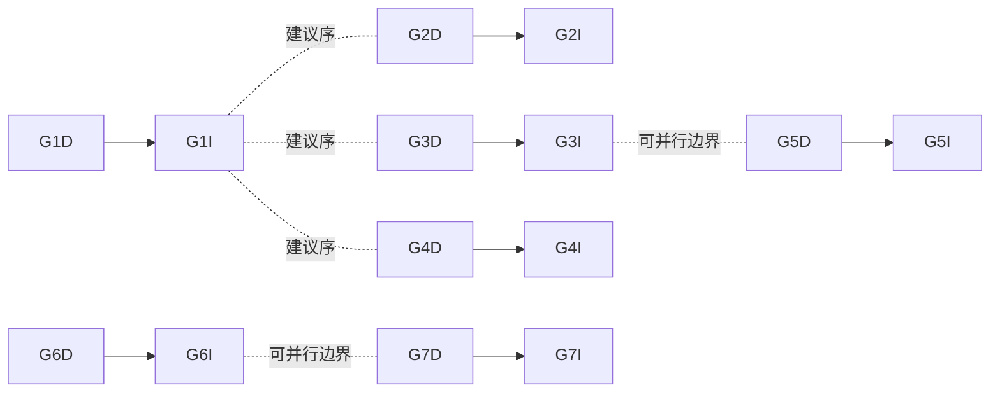

# Arc Component Gap Roadmap（Arc 对照控件补充）

> Created: 2026-10-21（用户下达：基于 Arc 组件体系对照新增 roadmap 负责补充控件——先设计、后实现；每个控件必须给出必要性与整体一致性分析；成稿后经独立子 agent 反复审查至共识方可激活）
> Status: **active**（2026-10-22 经用户执行指令激活——指令即 §11 激活前置条件 2 的人确认；详见 §11）
> 拟制与共识流程：`docs/skills/roadmap-and-mission-authoring-with-consensus-review.md`
> Mission: `missions/arc-component-gap.json`
> Sources:
>
> - Arc 对照分析（2026-10-21，live 实测）：`~/sources/arc-library`（`registry/components` 116 项、`registry/blocks` 18 项）↔ flux 154 个注册 renderer type（15 个 `flux-renderers-*` 包 152 + `code-editor`/`xlang-debug-editor` 相邻注册 2）
> - `docs/analysis/visual-quality/2026-09-24-missing-component-gap-analysis.md`（P0–P3 / composition / keep-out 裁定）
> - `docs/backlog/missing-components-and-designer-roadmap.md`（L0–L8、交付铁律 8 项、demand-gated 登记）
> - `docs/components/amis-baseline-matrix.md`（retention 权威）、`docs/components/roadmap.md`（AMIS 基线编排）
> - `docs/components/existing-components-improvement-analysis.md`（既有控件能力扩展登记）
> - by-design 事实源：`docs/components/button/design.md`、`docs/components/input-password/design.md`、`docs/components/text/design.md`
>
> Authority 关系：
>
> - **retention 权威 = `amis-baseline-matrix.md`**。本文裁决出的任何**新增 retained type**，其第一个执行动作都是 matrix 增行/flip（human gate）；`todo` 不等于 flip 完成。
> - **本文范围 = Arc 对照新发现、且未被既有权威立项的候选**。已登记者（§5.2）只做单向指针，不重复立项；既有 roadmap 无需回指本文——两条线范围独立（声明而非伪交叉引用）。
> - AMIS 基线编排 = `docs/components/roadmap.md`；既有类型之外的新类型线 = `missing-components-and-designer-roadmap.md`；既有控件能力扩展登记 = `existing-components-improvement-analysis.md`。
> - 状态流转：`proposed`（待人确认）→ `todo` → `planned`（对应 plan 独立草案审查通过）→ `done`（closure audit 通过后回写）。
> - 提交纪律：`feat(arc-component-gap): <description>`（与 mission `commitFormat` 逐字符一致）。

---

## 1. Purpose

本文承接 Arc（React 组件库）与 flux（低代码 schema 渲染器体系）的组件体系对照结论，把"值得补充的控件"固化为可追踪、可恢复、可闭环的执行队列：每个入选控件拆 **Design → Implement 两个 work item**（先设计、后实现），每个候选在 §5 给出**必要性分析**与**整体一致性分析**并落到 `立项 / 已登记指针 / 拒绝` 三选一裁决。

本文是编排层，不是 execution plan、不是设计文档：控件契约看 `docs/components/<type>/design.md`；retention 决策看 matrix；编写与状态规则见 `docs/backlog/00-roadmap-authoring-guide.md`；plan 生命周期见 `docs/plans/00-plan-authoring-and-execution-guide.md`。

闭环规则：AI 读 §2 取第一个 `todo`（按表序，不重排）→ 起草 plan（`> Source:` 指向本文行）→ 独立草案审查 → 执行 → 独立 closure audit → 回写 `done` → 下一项。结构性变化（增删/重排工作项）由人裁决，AI 只标注 flag。

## 2. Work Item Status

> **本文件唯一的动态状态区。** 状态词表：`proposed`（待人确认——工作项集合与优先序整体经人确认后才转 `todo`，沿用 `docs/components/roadmap.md` 词表）/ `todo` / `planned`（plan 草案审查通过）/ `done`（closure audit 通过）。**Wave 只是组织标签，不带状态。**

| Work item                                           | 状态   | 依赖 | 说明                                                                                                                                            |
| --------------------------------------------------- | ------ | ---- | ----------------------------------------------------------------------------------------------------------------------------------------------- |
| G1D `input-password` 强度指示设计（`showStrength`） | `done` | —    | 能力扩展，非新 type；登记 improvement-analysis                                                                                                  |
| G1I `input-password` 强度指示实现                   | `done` | G1D  | 按交付铁律落地                                                                                                                                  |
| G2D inline-edit 落点裁决与设计                      | `done` | —    | 先裁决 detail-field `editable` 扩展 vs 独立 type〔勘误 2026-10-23，G2D 定稿名 `editMode`（'surface'\|'inline'），见 detail-field/design.md §2〕 |
| G2I inline-edit 落地                                | `done` | G2D  | 按 D 阶段裁决落点执行（closure audit approved 2026-10-24，R1 fail→R2 approved）                                                                 |
| G3D 声明式 context-menu 设计                        | `done` | —    | 若出新 type → matrix 增行（human gate）〔勘误 2026-10-24：裁决为 contextMenu meta 能力扩展，见 §5.1 G3 勘误附注〕                               |
| G3I context-menu 落地                               | `done` | G3D  | closure audit R1 issues→R2 approved（plan 717）                                                                                                 |
| G4D 只读 code-block 落点裁决与设计                  | `done` | —    | 裁决复用 code-editor 静态 pre / markdown 扩展 / 新 type（closure audit approved，plan 718）                                                     |
| G4I code-block 落地                                 | `todo` | G4D  |                                                                                                                                                 |
| G5D split-button 落点裁决与设计                     | `todo` | —    | 裁决 dropdown-button `variant="split"` 扩展 vs 独立 type                                                                                        |
| G5I split-button 落地                               | `todo` | G5D  |                                                                                                                                                 |
| G6D 列表重排（list-reorder）落点裁决与设计          | `todo` | —    | 裁决 `list` 能力扩展 vs 独立 type                                                                                                               |
| G6I 列表重排落地                                    | `todo` | G6D  |                                                                                                                                                 |
| G7D image-compare 设计                              | `todo` | —    | 最低优先级波次                                                                                                                                  |
| G7I image-compare 落地                              | `todo` | G7D  |                                                                                                                                                 |

建议执行序：**G1 →（G2、G3、G4 可并行）→（G5、G6 可并行）→ G7**。`proposed` → `todo` 的人确认发生在本文激活时（§11 激活前置条件）。

## 3. Framework / Platform Reuse

以下能力已存在，实现各 work item 时**不得重建**，只做组装与 renderer definition（基线均 live 实测）：

| 能力                                                                                                                                                                                                       | 出处                                                                                                                                                   | 供谁复用                                                        |
| ---------------------------------------------------------------------------------------------------------------------------------------------------------------------------------------------------------- | ------------------------------------------------------------------------------------------------------------------------------------------------------ | --------------------------------------------------------------- |
| ui `Skeleton` primitive（已导出）                                                                                                                                                                          | `packages/ui/src/index.ts:52`                                                                                                                          | G1 之外的加载态（skeleton type 本身归 missing-components L7.1） |
| ui `Avatar` / `Breadcrumb` / `ContextMenu` / `HoverCard` primitive（已导出）                                                                                                                               | `packages/ui/src/index.ts` 对应行                                                                                                                      | G3（右键菜单壳）；avatar/breadcrumb 本体归 5.2 指针             |
| `env.confirm` / `env.notify` 宿主通道                                                                                                                                                                      | notify 签名 `packages/flux-core/src/utils/renderer-env.ts:18`，消费点 `flux-runtime/src/runtime-owned-factories.ts:249`；confirm 走 action 层          | 5.3 拒绝 popconfirm 的替代依据                                  |
| table 行拖拽排序底座                                                                                                                                                                                       | `packages/flux-renderers-data/src/table-renderer/use-row-drag-sort.ts`                                                                                 | G6（列表重排的拖拽交互参考实现）                                |
| `dropdown-button` 动作协议（items + action 派发 + 关闭）                                                                                                                                                   | `flux-renderers-layout` W3b 既有                                                                                                                       | G3、G5                                                          |
| `detail-field` / `detail-view` 只读对〔勘误 2026-10-23，G2D 执行时核实：detail-view 为 scope 级独立编辑复合字段（`detail-view/design.md:5`），并非只读——两字段真正差异是 name 绑定（字段级 vs scope 级）〕 | `flux-renderers-form-advanced`                                                                                                                         | G2（editMode 落点首选；暂定名 editable 已定稿 editMode）        |
| `text` 的 `maxLine` + `maxLineToggle` 展开/收起                                                                                                                                                            | `docs/components/text/design.md:18,24`（含 `line-clamp-(--nop-line-count)` 机制）                                                                      | ExpandableText 对照项（§5.2 已覆盖）                            |
| `code-editor` colorize 只读高亮 pre 模式（`colorize` prop，E3 已落地）+ CodeMirror 语言包（js/ts/json/md/python/sql/html/css）                                                                             | `packages/flux-code-editor/src/code-editor-renderer.tsx:78,85`、`package.json` 依赖表、`docs/components/existing-components-improvement-roadmap.md:58` | G4（落点裁决的复用方一）                                        |
| `diff-view` 行级语法高亮 adapter                                                                                                                                                                           | `packages/flux-renderers-content/src/diff-view/adapters/`                                                                                              | G4（落点裁决的复用方二）                                        |
| `chart`（recharts）+ `echarts` 双渲染器                                                                                                                                                                    | `docs/backlog/echarts-integration-roadmap.md`                                                                                                          | Arc 13 图表对照项（§5.2 已覆盖，不 mint 图表 type）             |
| `markdown` 代码块滚动容器（无高亮）                                                                                                                                                                        | `packages/flux-renderers-content/src/markdown.tsx:136-137`                                                                                             | G4（现状事实与扩展点）                                          |
| mobile `notice-bar` / `countdown` / `swipe-cell`                                                                                                                                                           | `flux-renderers-mobile`                                                                                                                                | 5.2/5.3 对照指针                                                |

## 4. Current Baseline（live 实测，2026-10-21）

- flux 共 **154** 个注册 renderer type：`flux-renderers-*` **15 包** 152（basic 18 / form 31 / form-advanced 19 / data 13 / content 20 / layout 9 / mobile 16 / scheduling 4 / ai 14 = 9 包 144；3d 1 / dashboard 2 / graph 1 / industrial 2 / map 1 / pivot 1 = 6 包 8）+ 相邻注册 2（`code-editor`、`xlang-debug-editor`）。
- Arc 对照源 live：`~/sources/arc-library/registry/components` **116** 个目录、`registry/blocks` **18** 个（浅克隆 `main`，`--depth 1`）。
- **by-design 既存裁决**：`docs/components/button/design.md` §BY-DESIGN——按钮确认语义走 action 层，不在 button 内置 dialog（popconfirm 对照项的否决依据）。
- **能力预留既存**：`docs/components/input-password/design.md:40`——"后续如果增加 strength，优先使用 `showStrength` 这类直接语义字段"；`:77` 提示 strength 属需谨慎引入的增强。
- **expandable-text 已覆盖**：`text` 的 `maxLine` + `maxLineToggle`（`docs/components/text/design.md:18,24`，plan `2026-06-22-1137-2` 已收口）——Arc `ExpandableText` 对照项无缺口。
- **既有权威已登记（不重复立项）**：skeleton = missing-components L7.1 demand-gated（`missing-components-and-designer-roadmap.md:174`）；toast 容器 = L3（同文件 `:43`）；mentions / avatar / nav·anchor-nav / tooltip-wrapper·popover-wrapper = gap-analysis `:112-115,197,334` demand-gated 非 item；segmented = gap-analysis `:267` "stays composition, do not mint types"；comment 类 = gap-analysis `:265` keep-out；bottom-sheet = 移动端响应式分支（`existing-components-improvement-analysis.md:35`）；phone mask / money format / input-range = missing-components L4.12 / L2 / L4.3。
- **ui 无 primitive**：`SplitButton`、`StrengthMeter` 在 `packages/ui/src/components/ui/` 零命中（live `rg`）。
- `markdown` 代码块无语法高亮（`markdown.tsx` 仅做溢出滚动容器）；高亮底座现成三处：`code-editor` colorize 只读高亮（E3 done）+ CodeMirror 语言包、`diff-view` 行级 adapter。
- 既有 mission 先例 27 个（`rg roadmapPath missions/*.json`）；共识审查先例：`docs/backlog/platform-hardening-roadmap.md` §Review Record（7 轮，R1–R6 fail、R7 pass 后待人确认）。
- 保护区域（`docs/context/ai-autonomy-policy.md`，经 skills README 定制层核对）：`flux-core/src`、schema/contract validation、renderer 定义字段、样式契约 = `plan-first`；`packages/ui/src/index.ts` = `ask-first`（G1/G5 若新增 ui primitive 会触碰）。

**剩余 gap（本文立项面）**：password-strength、inline-edit、声明式 context-menu、只读高亮 code-block、split-button、列表重排、image-compare（见 §5.1）。

## 5. 候选裁决：必要性与一致性分析

> 每个候选两段分析后落三选一：**立项**（进 §6/§7 队列）/ **已覆盖·已登记**（§5.2 指针，不立项）/ **拒绝**（§5.3 记录否决理由）。裁决为静态裁定；任何后续改判触发新一轮共识审查（§10 Rule）。

### 5.1 立项候选（7 项 → 14 个 work item）

#### G1 `input-password` 强度指示（`showStrength` 能力扩展）

- **必要性**：注册/改密/账号体系表单是后台系统最高频表单之一；强度反馈是 antd/arc/shadcn 生态的标配（Arc `password-strength`）。缺失时宿主只能在 schema 之外自拼 DOM，绕开低代码的一致渲染与校验链，属"高频能力缺口"而非"锦上添花"。评为 **P1**。
- **一致性**：**不 mint 新 type**——`input-password/design.md:40` 已预留 `showStrength` 直接语义字段命名，落点即既有 type 能力扩展，包不迁移（`flux-renderers-form`）；属"既有控件能力扩展"，按交付铁律登记 `existing-components-improvement-analysis.md`；强度等级文案走 `flux-i18n`；ui 无 StrengthMeter primitive，新增属 `packages/ui/src/index.ts` **ask-first** 保护区域（mission 已声明授权边界）。与 `naming-conventions.md` shadcn 对齐原则无冲突（strength 是内容不是命名体系）。
- **裁决**：立项 G1D/G1I。Design 阶段产出 `showStrength` 协议（等级划分、颜色语义、a11y `aria-describedby`、与 `pattern`/校验的关系）并完成 improvement-analysis 登记；Implement 阶段按交付铁律 2–8 落地。

#### G2 inline-edit（点即编辑）

- **必要性**：详情页字段级轻编辑、列表行内改名是企业应用常见交互（Arc `InlineEdit`）；AMIS 仅有表格 cell editable，flux 详情侧只有只读 `detail-field`/`detail-view` 对〔勘误 2026-10-23：detail-view 实为 scope 级独立**编辑**复合字段（缺的是 name 绑定），"只读对"表述失实；字段级 inline 编辑仍归绑定态 detail-field，见 `docs/components/detail-field/design.md` §2〕。用户要在"展示型页面"里改一个字段时，现状只能整表单弹窗，编辑成本高。评为 **P2**。
- **一致性**：两个候选落点必须先裁决——(a) `detail-field` 增加 `editable`〔定稿名 `editMode`，勘误 2026-10-23〕能力（复用既有输入原语与校验链，type 数不增）；(b) 独立 type `inline-edit`（对齐 Arc 命名但偏离 flux 既有 detail 家族）。flux 命名/类型增殖约束（`naming-conventions.md`：新 type 归属需过主 roadmap 权威）使 (a) 为默认倾向；D 阶段一票裁决并给出被拒方理由。若裁出新 type，matrix 增行为 Implement 前置 human gate。
- **裁决**：立项 G2D/G2I。Design 阶段先落点裁决，再出协议（触发方式 click/dblclick、编辑态原语选择、失焦/ESC/回车提交、disabled/只读态）。

#### G3 声明式 context-menu（右键菜单）

- **必要性**：桌面数据密集 UI（table 行、tree 节点、卡片）的右键操作是平台惯例；Arc 有 `ContextMenu`。flux 现状：常规 renderer 树内仅 industrial 编辑器有私有实现（`flux-renderers-industrial/src/editor/context-menu.tsx`；page/flow/spreadsheet 设计器另有画布专属右键），schema 作者无法在通用渲染树上声明右键菜单，只能靠宿主自绑事件——属低代码能力缺口。评为 **P2**。
- **一致性**：ui `ContextMenu` primitive 已导出（零新 primitive 成本）；菜单项协议直接复用 `dropdown-button` 的 items + action 派发（Reuse 表）；落点 `flux-renderers-layout`（actions 家族）。核心设计问题是**挂载契约**（wrapper region vs meta 属性 vs 目标节点 `contextmenu` 事件委托），D 阶段裁决；若裁出新 retained type，matrix 增行（human gate）先于 I。与 `tooltip-wrapper` 裁定（decorator sugar，5.2 指针）不冲突——本项是动作派发能力而非装饰包裹。
- **裁决**：立项 G3D/G3I。
  - **勘误附注（G3D，2026-10-24，plan 716，不改写上文）**：一致性分析中"落点 `flux-renderers-layout`（actions 家族）"的前提被 live repo 事实推翻——挂载契约裁决为 meta 属性能力扩展（`META_FIELDS` 增列 + `node-frame-wrapper` wrap 层附着 + ui `useContextMenuShell`），flux-react 分层不可 import layout，代码不落 layout 包；完整裁决与被拒方理由见 `docs/components/context-menu/design.md` §2。该勘误按 §10 Rule 6 经独立共识审查（证据入 §11）。

#### G4 只读高亮 code-block

- **必要性**：文档页、教程、审批意见中的代码片段展示是低代码常见内容形态；Arc 有 `CodeBlock`（配色 + 高亮 + 复制）。现状：`markdown` 代码块仅滚动无高亮；`code-editor` 已有 colorize 只读高亮模式（E3 done），但其 schema 形态属于编辑器包（lazy 依赖、编辑器包络、`code`-editor type 语义）。展示型场景的真实缺口是**轻量只读的 schema 形态与 markdown 内嵌高亮**，而非高亮底座（底座已有三处：colorize、diff-view adapter、CodeMirror 语言包）。评为 **P2**。
- **一致性**：三个落点必须裁决——(a) 复用 `code-editor` colorize 只读高亮模式（已含高亮，无需新底座）作为展示形态；(b) `markdown` 渲染器 code fence 高亮扩展（服务内嵌场景）；(c) 独立只读 `code-block` type（服务独立声明场景）。高亮一律复用既有底座（colorize / `diff-view` adapter / CodeMirror 语言包），禁止引入新高亮依赖，除非 `pnpm check` 通过论证（工作空间依赖检查为硬门禁）；D 阶段完成复用裁决后 I 才允许动依赖。
- **裁决**：立项 G4D/G4I。

#### G5 split-button（主按钮 + 附着下拉）

- **必要性**："提交 + 更多操作""新建 + 模板选择"是工具栏/表单页高频模式（Arc `SplitButton`）。现状 `dropdown-button` 是单按钮+下拉，`button-group-select` 是选择语义，主/次分体触发没有声明入口。评为 **P2**。
- **一致性**：ui 无 SplitButton primitive（live 实测）——先裁决 (a) `dropdown-button` 增 `variant="split"` 能力（协议已含 items/触发/关闭，改动面最小）vs (b) ui 新增 primitive + 独立 type（触碰 `ui/src/index.ts` ask-first）。默认倾向 (a)（能力扩展优先于 type 增殖，与 G1/G2 裁决口径一致）。落点 `flux-renderers-layout` actions 家族不变。
- **裁决**：立项 G5D/G5I。

#### G6 列表重排（reorderable list）

- **必要性**：优先级排序、问卷项排序、菜单项整理是表单/管理页常见需求（Arc `ReorderableList`）。现状：`combo`/`input-table` 有条目上下移与 table 行拖拽（`use-row-drag-sort.ts`），但展示型 `list` 与简单数组场景没有拖拽重排声明入口，宿主只能自写。评为 **P2**。
- **一致性**：默认落点为 `list` 能力扩展（`selectionMode` 之外增 `reorderMode`，D 阶段按 shadcn/`naming-conventions` 出命名），拖拽交互复用 `use-row-drag-sort` 底座与 DnD 约定；独立 type 仅当 D 阶段证明 list 契约无法承载（如需跨容器排序）才裁出，且需 matrix 增行。避免与 combo/input-table 既有排序能力重复造轮子——D 阶段必须写清三者边界。
- **裁决**：立项 G6D/G6I。

#### G7 image-compare（前后对比滑块）

- **必要性**：影像对比（修图前后、地图变更、商品图差异）在垂直场景真实存在（Arc `ImageCompare`），flux media 家族（image/audio/video/carousel）缺对称能力；但通用后台低代码场景频率低于 G1–G6。诚实评估为 **P3（场景型中低频）**，排最低波次；实现完全自包含（拖动分隔线 + 双图裁切，Playwright 可程序化断言）。
- **一致性**：落点 `flux-renderers-content` media 家族，与 `image` 共享加载/占位/错误降级约定；ui 无 primitive，renderer 内部自绘或新增 ui primitive（若新增 → ask-first，I 阶段人工确认）；`value` 形状（双图 URL/路径）遵循数据下沉约束（不发明组件级 fetch 字段）。
- **裁决**：立项 G7D/G7I（最低优先序；若执行期出现更强权威的同项立项，按 §10 改判流程合并）。

### 5.2 已覆盖或已登记（指针，不立项）

**A. 能力已覆盖（Arc type ↔ flux 现状，live 核对）**

| Arc 对照                                                                                                                   | flux 现状                                                                         | 出处                                                                   |
| -------------------------------------------------------------------------------------------------------------------------- | --------------------------------------------------------------------------------- | ---------------------------------------------------------------------- |
| ExpandableText                                                                                                             | `text.maxLine` + `maxLineToggle`（截断 + 展开/收起）                              | `docs/components/text/design.md:18,24`                                 |
| 13 图表（Line/Bar/Donut/Streamgraph/Brush/Waffle/Slope/Sparkline/Gauge/ActivityHeatmap/AnimatedCounter/Ridgeline/Treemap） | `chart`（recharts）+ `echarts` 双渲染器 + `sparkline`；不为图表 mint type         | `echarts-integration-roadmap.md`、`naming-conventions.md` §1           |
| SortableDataTable / TreeView / FilterToolbar / JsonViewer                                                                  | `table`（列排序）/ `tree` / `query-filter` / `json-view`                          | `flux-renderers-data`、`content` 注册表                                |
| Toast（命令式）                                                                                                            | `env.notify` 宿主通道                                                             | `renderer-env.ts:18`（签名）、`runtime-owned-factories.ts:249`（消费） |
| CopyButton                                                                                                                 | `text` 的 `copyable` 能力 + copy action（既有）                                   | `docs/components/text/design.md` copyable 字段；copy action 链         |
| RichTextEditor                                                                                                             | `editor`（TipTap，W3d 已落地）                                                    | `flux-renderers-form-advanced` 注册表                                  |
| RadioCards                                                                                                                 | `radio-group` 语义覆盖（卡片视觉属样式变体，无独立契约边界）                      | `flux-renderers-form` 注册表                                           |
| SwipeActions / HoldToConfirm（移动语义）                                                                                   | mobile `swipe-cell`；桌面危险操作走 confirm action 链                             | `flux-renderers-mobile`、button by-design                              |
| AnnouncementBar / Countdown（移动语义）                                                                                    | mobile `notice-bar` / `countdown`                                                 | `flux-renderers-mobile`                                                |
| Blocks（18 项页面组合）                                                                                                    | playground `complex-pages` + `page`/`container`/`wizard` 组合范式；非 renderer 层 | `docs/plans/` complex-pages 先例                                       |

**B. 已在他处立项/登记（单向指针，范围独立声明见 Authority）**

| 候选                                         | 权威位置                                                                           | 指针依据（live 行号）                                      |
| -------------------------------------------- | ---------------------------------------------------------------------------------- | ---------------------------------------------------------- |
| skeleton                                     | missing-components **L7.1** demand-gated（host 骨架屏需求触发）                    | `missing-components-and-designer-roadmap.md:174`           |
| notification / toast 容器（声明式）          | missing-components **L3** host channels（proposed）                                | 同文件 `:43`                                               |
| mention-input（表单 @ 提及）                 | gap-analysis P2 demand-gated 非 item（AI tiptap mentions 已存在于 ai 包）          | `2026-09-24-missing-component-gap-analysis.md:114,197,334` |
| avatar / avatar-group                        | matrix not-retained + gap 行（ui Avatar 已导出、组合替代）                         | `amis-baseline-matrix.md:285`、gap `:112`                  |
| tooltip / popover / hover-card 独立 renderer | matrix `tooltip-wrapper` not-retained（decorator sugar）；button tooltip prop 已有 | `amis-baseline-matrix.md:296`、gap `:113`                  |
| segmented                                    | gap 裁定"stays composition, do not mint types"（`button-group-select` 近似承接）   | gap `:267`                                                 |
| comment-thread                               | gap keep-out："not worth adding as types…comment types"                            | gap `:265`                                                 |
| breadcrumb（独立 type）                      | `page` 的 `breadcrumb` 槽位承接；ui Breadcrumb 导出未注册                          | `basic-renderer-definitions.ts:47-53`、gap `:112`          |
| bottom-sheet（桌面 type）                    | 移动端 = 既有组件响应式分支（Select 小屏变 bottom-sheet），不建 type               | `existing-components-improvement-analysis.md:35`           |
| PIN / number-keyboard                        | O1 demand-gated                                                                    | gap `:217`                                                 |
| phone-input / money-input / input-range      | missing-components **L4.12** / **L2** / **L4.3**（demand-gated 或在办）            | `missing-components-and-designer-roadmap.md`               |
| splitter / descriptions / anchor / back-top  | gap "stays composition" 或 O1 demand-gated                                         | gap `:267`                                                 |

### 5.3 拒绝立项（记录否决理由，防止反复重提）

| 候选                                                                                                                        | 必要性结论                                                       | 一致性结论                                                                                                                              | 裁决                                  |
| --------------------------------------------------------------------------------------------------------------------------- | ---------------------------------------------------------------- | --------------------------------------------------------------------------------------------------------------------------------------- | ------------------------------------- |
| popconfirm / button confirm / ConfirmMorph / HoldToConfirm                                                                  | 必要性由 action 层 confirm 链满足（`env.confirm`），非缺口       | **by-design 否决**：`button/design.md` §BY-DESIGN"确认语义走 action 层，不在 button 内置 dialog"；引入 popover confirm 将造成双确认通道 | 拒绝（改提案须先勘误 by-design 裁定） |
| ElasticSlider                                                                                                               | 花式滑块非低代码刚需；`slider` 已覆盖                            | 弹簧动效无底座（本仓无 motion 引擎），落地必违背 styling-system transition 约定                                                         | 拒绝                                  |
| 文字效果 4 件（TextReveal / InViewTitle / TextMorph / TextShimmer）                                                         | 装饰性动效，与信息密度导向冲突                                   | 无动效引擎；与 text/markdown 渲染职责纠缠                                                                                               | 拒绝（4 项整体）                      |
| IconMorph / ThemeSwitcher / MorphSelect / FloatingButtonGroup / ExpandingButtonGroup / Reactions / CookieConsent / UserMenu | 低频或宿主职责（主题切换/cookie 同意归宿主；UserMenu 归宿主 IA） | 依赖 Arc 动效体系或产品形态假设                                                                                                         | 拒绝（8 项整体）                      |
| UsageMeter                                                                                                                  | `statistics` + `progress` 组合即可表达                           | 无独立契约边界                                                                                                                          | 拒绝                                  |
| ScrubInput / ShortcutRecorder                                                                                               | 专业输入低频；快捷键录制属宿主命令系统                           | 与 keyboard renderer（宿主接线）职责冲突                                                                                                | 拒绝（2 项整体）                      |
| CardStack / AvatarGroup                                                                                                     | 低频展示花活；`card`+`carousel`、`avatar` 组合可替代             | 无 owner 边界                                                                                                                           | 拒绝（2 项整体）                      |
| AnnouncementBar（桌面独立 type）                                                                                            | `alert` 已覆盖横幅语义（定位/固定属样式层）                      | 移动 `notice-bar` 已存在，桌面再立 type 造成同语义三实现                                                                                | 拒绝                                  |
| desktop Countdown（独立 type）                                                                                              | 秒杀/倒计时场景低频                                              | mobile `countdown` 已存在；桌面需求出现时按能力扩展复评                                                                                 | 拒绝（demand 出现再提）               |

### 5.4 Out of Scope

- **Arc Pro 组件**（许可受限，不复刻代码/样式/文档）。
- **Arc 弹簧动效引擎对照**：TKCode.Arc 的 SpringSolver/MotionValue 体系对应的缺口属样式/动效底座演进（`docs/architecture/styling-system.md` 方向），不是控件补充；本线组件的动效一律遵循现有 transition 约定，不引入新动效引擎。
- **Arc Blocks 页面组合（block 形态）**：页面级组合归 playground complex-pages 范式，不 mint renderer。覆盖 `arc-library/registry.json` 中 block 类型条目（共 22 条，如 `notification-center`）与 TKCode.Arc Blocks 目录（如 `SettingsPage`）等整页形态。
- **Arc 其余对照项整批映射（已覆盖，不逐项立项）**：accordion→`collapse`、file-upload→`input-file`/`input-image`、timeline→`timeline`、stepper→`steps`/`wizard`、sortable→`table` 列排序——与 §5.2A 同一口径，读时两表合并。
- **移动端新增**：mobile 包归 `mobile-roadmap.md`；本线不新增 `*-mobile` 变体（gap keep-out）。

## 6. Phases（work item 索引）

| Wave    | Work item                  | 状态   | Owner doc                                                                                                                   | 依赖 | Reuse                                                                               | Plan                                                         |
| ------- | -------------------------- | ------ | --------------------------------------------------------------------------------------------------------------------------- | ---- | ----------------------------------------------------------------------------------- | ------------------------------------------------------------ |
| 1（P1） | G1D strength 设计          | `done` | `docs/components/input-password/design.md` + `existing-components-improvement-analysis.md`                                  | —    | input-password 预留字段                                                             | —                                                            |
| 1       | G1I strength 实现          | `done` | 同上                                                                                                                        | G1D  | ui 新 primitive（ask-first）                                                        | —                                                            |
| 2（P2） | G2D inline-edit 落点+设计  | `done` | `docs/components/detail-field/design.md`（或新 type design.md，按裁决）                                                     | —    | detail-field、输入原语                                                              | —                                                            |
| 2       | G2I inline-edit 落地       | `done` | 按 G2D 裁决                                                                                                                 | G2D  | 同上                                                                                | [arc-gap-g2i](../plans/arc-gap-g2i-inline-edit-impl-plan.md) |
| 2       | G3D context-menu 设计      | `done` | `docs/components/context-menu/design.md`（勘误：G3D 裁决为 meta 能力扩展，design.md 已按能力文档落稿，见 §5.1 G3 勘误附注） | —    | ui ContextMenu、dropdown-button 协议；若裁出新 type → matrix 增行 human gate 先于 I | [716](../plans/716-arc-g3d-context-menu-design.md)           |
| 2       | G3I context-menu 落地      | `done` | 同 G3D                                                                                                                      | G3D  | 同上                                                                                | [717](../plans/717-arc-g3i-context-menu-implement.md)        |
| 2       | G4D code-block 落点+设计   | `done` | `docs/components/markdown/design.md` §2a + `docs/components/code-editor/design.md`（双落点裁决）                            | —    | code-editor colorize（复用方一）、CodeMirror 语言包、diff-view adapter              | [718](../plans/718-arc-g4d-code-block-design.md)             |
| 2       | G4I code-block 落地        | `todo` | 按 G4D 裁决                                                                                                                 | G4D  | 同上                                                                                | —                                                            |
| 3（P2） | G5D split-button 落点+设计 | `todo` | `docs/components/dropdown-button/design.md`（或新 type）                                                                    | —    | dropdown-button 协议                                                                | —                                                            |
| 3       | G5I split-button 落地      | `todo` | 按 G5D 裁决                                                                                                                 | G5D  | 同上                                                                                | —                                                            |
| 3       | G6D list-reorder 落点+设计 | `todo` | `docs/components/list/design.md`（或新 type）                                                                               | —    | use-row-drag-sort                                                                   | —                                                            |
| 3       | G6I list-reorder 落地      | `todo` | 按 G6D 裁决                                                                                                                 | G6D  | 同上                                                                                | —                                                            |
| 4（P3） | G7D image-compare 设计     | `todo` | `docs/components/image-compare/design.md`（新 type 时）                                                                     | —    | content media 家族                                                                  | —                                                            |
| 4       | G7I image-compare 落地     | `todo` | 同 G7D                                                                                                                      | G7D  | 同上                                                                                | —                                                            |

## 7. Phase Details（交付范围，短清单）

> 每个 work item = 一个 execution plan 可交付完毕。Design item 与 Implement item 分属两个 plan（先设计、后实现，用户铁律）。

- **G1D**：`showStrength` 协议设计（等级/配色/文案 i18n/a11y/与校验关系）；`existing-components-improvement-analysis.md` 登记；命名 pass（`naming-conventions.md` §2。〔勘误 2026-10-22，G1D 执行时就地附注：操作节应为 §5"新增字段审查 Checklist"，§2 是 shadcn 映射表〕）。
- **G1I**：ui 强度条 primitive（如 D 裁定需要，触 `ui/src/index.ts` ask-first）+ renderer 字段接线 + focused 单测 + e2e + 交付铁律 3/5/6/8。
- **G2D**：落点二选一裁决（`detail-field.editable`〔定稿名 `editMode`，勘误 2026-10-23〕 vs 独立 type）+ 协议（触发/提交/取消/只读降级）；若新 type → matrix 增行提案（human gate）。
- **G2I**：按裁决落地 + 测试 + 登记（铁律 2–8）。
- **G3D**：挂载契约裁决（wrapper region / meta 属性 / 事件委托）+ 菜单项协议（复用 dropdown-button items 形状）+ matrix 增行提案（若新 type）。
- **G3I**：按裁决落地；右键打开/键盘（Shift+F10/菜单键）/关闭与 a11y + 测试登记。
- **G4D**：复用裁决（复用 code-editor colorize 只读高亮模式 / markdown fence 扩展 / 新只读 type 三选一）+ 高亮底座一律复用既有三处（colorize / diff-view adapter / CodeMirror 语言包，禁止新增依赖除非 check 通过论证）+ 协议（语言/行号/复制/溢出）。
- **G4I**：按裁决落地 + 测试登记。
- **G5D**：落点二选一（`dropdown-button variant="split"` vs ui primitive+新 type）+ 协议（主/次触发、禁用分裂态、键盘）。
- **G5I**：按裁决落地 + 测试登记。
- **G6D**：落点二选一（`list.reorderMode` vs 新 type）+ 与 combo/input-table 排序能力边界声明 + 协议（手柄/键盘排序/受控值）。
- **G6I**：按裁决落地（复用拖拽底座）+ 测试登记。
- **G7D**：双图输入协议、交互（拖动/键盘/触摸）、降级（单图/加载失败）设计。
- **G7I**：落地 + Playwright 程序化断言（canvas/视觉类）+ 测试登记。

## 8. Dependency Graph

实线 = 强依赖（D 未闭环不得开 I）；虚线 = 建议执行序（不阻塞并行，表序优先）。

## 9. Cross-Cutting

1. **设计先行**：任何 I 项开 plan 前，对应 D 项必须 `done`（其 plan 过 closure audit）。D 产出的 design.md 裁决落点后，被拒落点的排除理由必须写入该 design.md 决策表（防止后续反复）。
2. **type vs 能力扩展**：默认能力扩展优先（G1/G2/G5/G6 口径）；裁出新 type 时 matrix 增行是 I 前的人工门禁（`proposed` 项不得由 AI 自行 flip）。
3. **登记链**：新 type → `new-renderer-introduction-audit.md` 全量 INV 审计；能力扩展 → `existing-components-improvement-analysis.md` 登记；两者最终都落交付铁律 3/5/6（example + manifest/quick-reference/index + i18n）。
4. **保护区域**：renderer 定义字段/样式契约为 `plan-first`（plan 流程天然覆盖）；`packages/ui/src/index.ts` 为 `ask-first`（G1I/G5I 触碰前人工确认）。
5. **动效边界**：本线不引入新动效引擎、不复制 Arc 弹簧参数；过渡一律走 styling-system 现有约定（§5.4）。
6. **依赖硬门禁**：G4 若论证必须新增高亮依赖，`pnpm check`（workspace-manifest-deps / oversized 等）为不可降级硬约束。
7. **命名**：实现前必须过 `docs/references/naming-conventions.md`；type 暂定名（如 `inline-edit`）在 D 阶段定稿。

## 10. Rule

1. 状态权威区 = §2；§6 的状态列是 §2 的镜像，随 Rule 7 同步回写、不独立演化。§5 裁决表为静态裁定，改判须经共识审查（skill 步骤 4）并同步 §2/§6/§11。
2. 状态流转由 plan 生命周期驱动：草案审查通过 `todo`→`planned`；closure audit 通过 `planned`→`done`（不得提前）。
3. work item 粒度 = 一个 plan 可交付；D/I 不得合并为单 plan（先设计后实现是本线铁律），也不得再拆子项。
4. `proposed` → `todo` 只能由人确认（§11 激活条件 2）；AI 只执行 `todo` 队列，不重排、不新增工作项、不自行 flip matrix。
5. 提交纪律：`feat(arc-component-gap): <description>`（与 mission `commitFormat` 逐字符一致）。
6. 每次 roadmap/mission 修订（含 §5 改判）必须经独立子 agent 共识审查至 `approved`（零 Blocker），证据入 §11。
7. stale status 是反模式：plan 关闭当日必须回写 §2 与 §6；"最近一个 item done"≠整表复核免除。

## 11. Review Record（共识审查）

> 按 `docs/skills/roadmap-and-mission-authoring-with-consensus-review.md` 步骤 4：每轮由独立子 agent（fresh session，review-only）按六维度（合规 / 内部一致性 / 事实基础 / mission 对齐 / 门禁纪律 / 遗漏风险）出具 Blocker / Major / Minor + verdict；`revised` → 修正附证据 → 换新 session 复审，直至 `approved`（零 Blocker）。先例：`platform-hardening-roadmap.md` 7 轮收敛。

| 轮次 | 审查者                                                                             | 结论           | 处置                                                                                                                                                                                                                                                                                                                                                                                                                                                                                                                                                                                                                                                                                                                                                                                                                       |
| ---- | ---------------------------------------------------------------------------------- | -------------- | -------------------------------------------------------------------------------------------------------------------------------------------------------------------------------------------------------------------------------------------------------------------------------------------------------------------------------------------------------------------------------------------------------------------------------------------------------------------------------------------------------------------------------------------------------------------------------------------------------------------------------------------------------------------------------------------------------------------------------------------------------------------------------------------------------------------------- |
| R1   | 独立子 agent（fresh session，`ses_ea2409abeffex2DOI89zaxpqoj`）                    | **`revised`**  | 2 Blocker / 2 Major / 7 Minor：① TKCode.Arc "110 组件 22 分组"实测不符（138/25）→ 删除该句（不驱动工作项）；② "10 个 flux-renderers-\* 包"与自身枚举矛盾 → 改 **15 包**（两处）；③ G4"补高亮"失实——code-editor colorize 已含只读高亮（E3 done，`code-editor-renderer.tsx:85`）→ 必要性改口为"schema 形态/内嵌高亮缺口"、落点 (a) 改复用 colorize、Reuse/Baseline 同步；④ Rule 1"状态只改 §2"与 Rule 7 回写 §6 矛盾 → 改"§2 权威、§6 镜像同步"；⑤ mission 修复机制节 §1–§7 → 编号条目 1–8；⑥ Wave-2 标签 P1–P2→P2；⑦ G3D 依赖列混入 gate → 移 Reuse 列；⑧ G1 登记归属 D/I 错位 → 归 G1D；⑨ notify 引用改 `renderer-env.ts:18`（消费点 `runtime-owned-factories.ts:249`）；⑩ 激活条件"降级有据"→"经人确认降级"；⑪ 补 copy-button / rich-text-editor / radio-cards 覆盖行与 §5.4 整批映射行（Arc 116 名全量抽查无其他遗漏）。 |
| R2   | 独立子 agent（fresh session，`ses_ea229ec43ffewP1ADtYu5tsF0y`）                    | **`revised`**  | 0 Blocker / 1 Major / 3 Minor（R1 12 项修复全部落地并复核通过）。① [Major] §7 G4D 仍写"静态 pre 补高亮/两套底座"与 §4/§5.1 矛盾 + §6 G4D Reuse 缺 colorize → 改"复用 colorize 只读高亮"、底座统一三处、Reuse 补 colorize；② [Minor] §5.4 Blocks 归因不准 → 改 registry.json block 类型 22 条（`notification-center`）+ TKCode.Arc Blocks（`SettingsPage`）分源表述；③ [Minor] "image viewer→mobile image-viewer" 在两源均不存在 → 删除；④ [Minor] G3 "仅 industrial 有私有实现"过绝对 → 改"常规 renderer 树内仅 industrial"并注记三个设计器画布专属右键。                                                                                                                                                                                                                                                                  |
| R3   | 独立子 agent（fresh session，`ses_ea20a4d1cffel0GF5f6lj4phV8`）                    | **`approved`** | **0 Blocker / 0 Major / 0 Minor**。六维度全 PASS：R2 四项修复复核落地（含 grep 无残留、registry:block=22/SettingsPage/四个私有右键文件 live 复测）；~35 处事实抽查全中（154 逐包 15 包 152、BY-DESIGN:39、Skeleton:52、colorize:78/85、notify:18/:249、matrix/missing/gap 行号）；§2=§6=§7=§8 14 项零矛盾、commitFormat 三处逐字符一致；mission 13 字段对齐；Arc 116 名全量复扫零遗漏零重复立项。                                                                                                                                                                                                                                                                                                                                                                                                                          |
| R4   | 独立子 agent（fresh session，2026-10-24，plan 716 closure audit 附带 Rule 6 审查） | **`approved`** | **0 Blocker / 0 Major / 2 Minor（随回写同 commit 消化）**。六维度全 PASS：勘误附注不改写原文（§5.1 G3 原句在案）；五项 live 事实核对全中（flux-react 依赖无 layout、META_FIELDS 九字段、node-frame-wrapper:24-26 wrap:none 无帧根、useContextMenuShell 归 ui、design.md §2 裁决表）；与 §9 CC2/CC3 口径一致；未提前 flip。Minor：§6 G3D Owner doc 残留条件句（已就地附注勘误）、附注时序表述（本行即证据，同 commit 落地）。                                                                                                                                                                                                                                                                                                                                                                                               |

**激活前置条件**（全部满足后才可 `draft` → `active`）：

1. ✅ 共识审查 `approved`——R3（2026-10-21，`ses_ea20a4d1cffel0GF5f6lj4phV8`）零 Blocker / 零 Major，§11 表记满；
2. ✅ 人确认 G1–G7 工作项集合与优先序（§2 全表 `proposed` → `todo`）——2026-10-22 用户执行指令："新建worktree，执行docs/backlog/arc-component-gap-roadmap.md直到彻底完成。每个plan完成后自动提交一次"。该指令即本 gate 的人确认（用户明确下令整体执行至彻底完成，即确认工作项集合与优先序），随激活提交入仓；
3. ✅ mission 字段与 roadmap 的 `commitFormat`/`roadmapPath` 逐字符对账通过（R3 审查维度④ PASS）。
