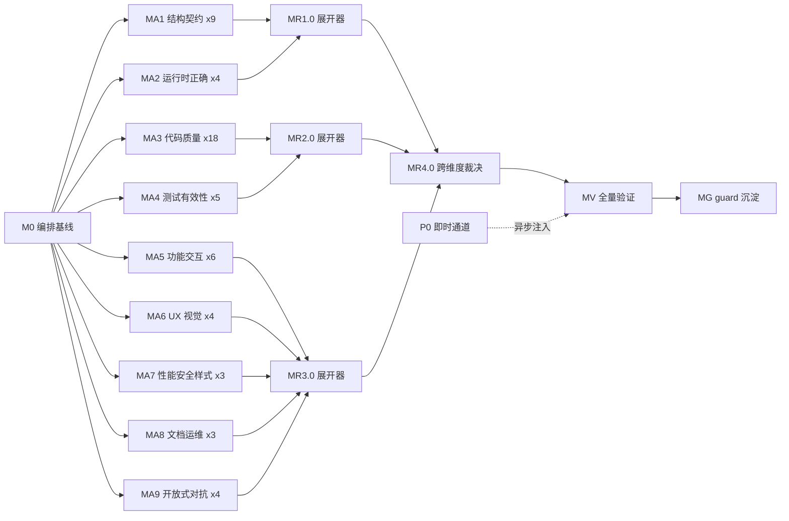

# 审计-修复路线图 R2（全新视角全面审计 + P0/P1 彻底修复）

> 按 `docs/skills/roadmap-and-mission-authoring-with-consensus-review.md` 产出（线性 roadmap 选型，理由见 Purpose）；方法论母本：`docs/skills/audit-remediation-roadmap-authoring-prompt.md`
> Last Updated: 2026-10-19
> Source: 2026-10-19 用户指令——"写一个审计 roadmap，这是一个彻底的审计和修复，不要考虑历史上已经审计发现的问题……就把它当作是一个新的项目来审计，包括各种角度以及开放式的审计，参考 docs/skills 下的各种历史上积累的审计经验。包含且不限于功能、性能、美观、易用性等。"
> Mission: `missions/audit-remediation-r2.json`
> 状态: **active**（2026-10-19 共识审查 3 轮通过，见文末 Review Record）——执行队列已开放，M0 可立即立项

## Purpose

本文件是 nop-chaos-flux 的第二轮全面审计-修复路线图（R2），按 `docs/backlog/00-roadmap-authoring-guide.md` 编排。AI 或维护者读完本文即知哪些工作项未开始（`todo`）、已计划（`planned`）、已完成（`done`）。

### 全新视角原则（本轮最高纪律，来自用户指令）

**把整个仓库当作一个从未被审计过的新项目。** 具体化为三条：

1. **零预载**：12 个包簇 × 9 个维度组的全部格子一律按"未审计"起步。历史审计结论——第一轮 audit-remediation 的 `docs/audits/arm-*` 报告与已 done 的 roadmap、FM 收官轮台账、component-audit 两轮台账、`docs/audits/` 下全部 `multi-audit-*` / `open-audit-*`——**不得**作为"已覆盖/已修复/可跳过"的证据。某区域哪怕昨天刚被审过，本轮仍按新项目重审；审出"与历史结论不符"本身就是本轮的有效产出（回归或历史误判）。
2. **历史材料仅有三种合法用途**：① `docs/skills/` 下的方法论提示词——解决"怎么审"；② 审计工具脚本与基线机制（`check:audit-*` / `audit:*` / `check:scanner-baselines`）——解决"用什么审"；③ `docs/skills/README.md §已知失败模式`、`docs/lessons/`、`docs/bugs/` 作为**检测启发清单**——解决"往哪探"。用途 ③ 命中任何一处时必须按本轮流程重新取证定级，不得直接引用历史编号结案。
3. **审计不去重、修复去重**：审计执行与其他活跃 roadmap 重叠的工作面**照常独立审计**（截至 2026-10-19 live 核对，活跃集 = FM 收官轮字母批 FM-1b-b/FM-6-b/FM-7-b、cross-roadmap UR-15、report-designer-nop-report NRP-1..5；renderer-metamodel 已收官不列入；该清单以 M0 现场 live 复核为准）；仅当修复展开（MR\*.0）时，发现该面已由某个活跃 owner roadmap 在修，才在 `docs/audits/arm2-index.md` 记 `delegated: <指针>`，不重复排修复工作项。MV 校验全部 delegated 指针仍有效。

### 覆盖面承诺（用户点名"包含且不限于"）

功能（MA5 实操走查 + MA2 运行时正确性）、性能（MA7.1）、美观（MA6 视觉走查 + MA7.3 样式契约）、易用性（MA5 交互状态 + MA6 UX 口径）、开放式审计（MA9 对抗审计 + 每个审计项的双风格执行）——以及不限于：结构与包边界（MA1）、代码质量与 React 19（MA3）、测试保护力（MA4）、安全（MA7.2）、文档契约与运维（MA8）。

### 选型：线性 roadmap（非持续闭环）

这是一次**覆盖面补全轮**（fresh sweep），不是"反复复发、防回退失效"的不变式缺失问题——后者由 `docs/backlog/ai-invariant-loop-roadmap.md` 先例与本轮 MG 的 guard 沉淀承接。因此走线性形态：M0 编排基线 → MA1–MA9 九个维度组审计（P0 即时止血）→ MR1–MR3 P1 批量修复（R\*.0 展开）→ MR4 跨维度裁决 → MV 全量验证 → MG guard 与沉淀。执行为**串行**：closed loop 按文档顺序取第一个 `todo`，不跳跃、不并行。

## Work Item Status

> **全文件唯一的动态状态区。更新状态只改这里。** 状态流转：plan 通过独立 draft review → `todo` 改 `planned`；closure audit 通过 → `planned` 改 `done`（不得提前）。Skill 列为 `docs/skills/` 下文件名；Owner Doc 列为 `docs/architecture/` 下文件名（另有目录前缀的除外）。带字母后缀的行（如 R1.1-a）是 MR 展开器追加的修复项，各自携带状态。

| Work Item | 名称                                                                                                                                                                                                                                           | Status    | Owner Doc                                        | Dependencies        | Skill                                                  |
| --------- | ---------------------------------------------------------------------------------------------------------------------------------------------------------------------------------------------------------------------------------------------- | --------- | ------------------------------------------------ | ------------------- | ------------------------------------------------------ |
| M0        | R2 审计编排基线（矩阵/工具基线/绿色基线/arm2-index）                                                                                                                                                                                           | `done`    | `docs/context/codebase-map.md`                   | —                   | audit-remediation-roadmap-authoring-prompt.md          |
| MA1.1     | 结构层—core 簇依赖、边界、导出面、schema 契约审计                                                                                                                                                                                              | `done`    | flux-runtime-module-boundaries.md                | M0                  | deep-audit-prompts.md                                  |
| MA1.2     | 结构层—runtime 簇依赖、边界、导出面审计                                                                                                                                                                                                        | `done`    | flux-runtime-module-boundaries.md                | M0                  | deep-audit-prompts.md                                  |
| MA1.3     | 结构层—basic 渲染器定义字段与注册完整性审计                                                                                                                                                                                                    | `done`    | renderer-runtime.md                              | M0                  | flux-component-design-review-prompt.md                 |
| MA1.4     | 结构层—content 族定义与样式契约审计                                                                                                                                                                                                            | `done`    | renderer-markers-and-selectors.md                | M0                  | flux-component-design-review-prompt.md                 |
| MA1.5     | 结构层—domain 族（industrial/3d/graph/map）定义与样式契约审计                                                                                                                                                                                  | `done`    | renderer-markers-and-selectors.md                | M0                  | flux-component-design-review-prompt.md                 |
| MA1.6     | 结构层—scheduling + ai 定义、导出面与 marker 审计                                                                                                                                                                                              | `done`    | renderer-runtime.md                              | M0                  | flux-component-design-review-prompt.md                 |
| MA1.7     | 结构层—designer 族边界与一致性审计                                                                                                                                                                                                             | `done`    | flux-runtime-module-boundaries.md                | M0                  | deep-audit-prompts.md                                  |
| MA1.8     | 结构层—office 族（spreadsheet/word/report）定义与边界审计                                                                                                                                                                                      | `done`    | flux-runtime-module-boundaries.md                | M0                  | flux-component-design-review-prompt.md                 |
| MA1.9     | 结构层—platform + print + xlang 导出面与 CSS exports 审计                                                                                                                                                                                      | `done`    | frontend-baseline.md                             | M0                  | deep-audit-prompts.md                                  |
| MA2.1     | 运行时层—core+runtime 簇裸读取/FieldFrame/硬编码分发/生命周期审计                                                                                                                                                                              | `done`    | renderer-runtime.md                              | M0                  | deep-audit-prompts.md                                  |
| MA2.2     | 运行时层—basic 渲染器分发、action 链路、校验参与审计                                                                                                                                                                                           | `done`    | action-scope-and-imports.md                      | M0                  | deep-audit-prompts.md                                  |
| MA2.3     | 运行时层—content+mobile+domain+scheduling+ai 异步安全与 IO 边界审计                                                                                                                                                                            | `done`    | renderer-env.md                                  | M0                  | deep-audit-prompts.md                                  |
| MA2.4     | 运行时层—designer+office+platform+print+xlang 状态机与序列化边界审计                                                                                                                                                                           | `done`    | renderer-runtime.md                              | M0                  | deep-audit-prompts.md                                  |
| MA3.1     | 代码质量—flux-core                                                                                                                                                                                                                             | `done`    | flux-core.md                                     | M0                  | code-quality-audit-prompt.md                           |
| MA3.2     | 代码质量—formula + compiler + action-core                                                                                                                                                                                                      | `done`    | flux-core.md                                     | M0                  | code-quality-audit-prompt.md                           |
| MA3.3     | 代码质量—flux-runtime                                                                                                                                                                                                                          | `done`    | renderer-runtime.md                              | M0                  | code-quality-audit-prompt.md                           |
| MA3.4     | 代码质量—flux-react + flux-bundle                                                                                                                                                                                                              | `done`    | renderer-runtime.md                              | M0                  | code-quality-audit-prompt.md                           |
| MA3.5     | 代码质量—renderers-basic + renderers-form                                                                                                                                                                                                      | `done`    | renderer-runtime.md                              | M0                  | code-quality-audit-prompt.md                           |
| MA3.6     | 代码质量—renderers-form-advanced + renderers-data                                                                                                                                                                                              | `done`    | renderer-runtime.md                              | M0                  | code-quality-audit-prompt.md                           |
| MA3.7     | 代码质量—content + layout + dashboard + pivot + mobile                                                                                                                                                                                         | `done`    | renderer-runtime.md                              | M0                  | code-quality-audit-prompt.md                           |
| MA3.8     | 代码质量—renderers-industrial                                                                                                                                                                                                                  | `done`    | renderer-runtime.md                              | M0                  | code-quality-audit-prompt.md                           |
| MA3.9     | 代码质量—renderers-3d + renderers-graph + renderers-map                                                                                                                                                                                        | `done`    | renderer-runtime.md                              | M0                  | code-quality-audit-prompt.md                           |
| MA3.10    | 代码质量—renderers-scheduling                                                                                                                                                                                                                  | `done`    | renderer-runtime.md                              | M0                  | code-quality-audit-prompt.md                           |
| MA3.11    | 代码质量—renderers-ai（含 message engine）                                                                                                                                                                                                     | `done`    | renderer-runtime.md                              | M0                  | code-quality-audit-prompt.md                           |
| MA3.12    | 代码质量—flow-designer-core + flow-designer-renderers + editor-core                                                                                                                                                                            | `done`    | flow-designer/design.md                          | M0                  | code-quality-audit-prompt.md                           |
| MA3.13    | 代码质量—page-designer-core + page-designer-renderers                                                                                                                                                                                          | `done`    | frontend-programming-model.md                    | M0                  | code-quality-audit-prompt.md                           |
| MA3.14    | 代码质量—spreadsheet-core + spreadsheet-renderers                                                                                                                                                                                              | `done`    | report-designer/design.md                        | M0                  | code-quality-audit-prompt.md                           |
| MA3.15    | 代码质量—word-editor-core + word-editor-renderers                                                                                                                                                                                              | `done`    | report-designer/design.md                        | M0                  | code-quality-audit-prompt.md                           |
| MA3.16    | 代码质量—report-designer-core + report-designer-renderers                                                                                                                                                                                      | `done`    | report-designer/design.md                        | M0                  | code-quality-audit-prompt.md                           |
| MA3.17    | 代码质量—ui + theme-tokens + tailwind-preset + flux-i18n                                                                                                                                                                                       | `done`    | styling-system.md                                | M0                  | code-quality-audit-prompt.md                           |
| MA3.18    | 代码质量—code-editor + nop-debugger + print ×2 + xlang ×2                                                                                                                                                                                      | `done`    | frontend-programming-model.md                    | M0                  | code-quality-audit-prompt.md                           |
| MA4.1     | 测试层—core+runtime 簇契约覆盖审计                                                                                                                                                                                                             | `done`    | flux-core.md                                     | M0                  | unit-test-logic-and-contract-coverage-audit-prompt.md  |
| MA4.2     | 测试层—basic 渲染器契约覆盖审计                                                                                                                                                                                                                | `done`    | form-validation.md                               | M0                  | unit-test-logic-and-contract-coverage-audit-prompt.md  |
| MA4.3     | 测试层—content+mobile+domain+scheduling+ai 契约覆盖审计                                                                                                                                                                                        | `done`    | renderer-runtime.md                              | M0                  | unit-test-logic-and-contract-coverage-audit-prompt.md  |
| MA4.4     | 测试层—designer+office+platform+print+xlang 契约覆盖审计                                                                                                                                                                                       | `done`    | renderer-runtime.md                              | M0                  | unit-test-logic-and-contract-coverage-audit-prompt.md  |
| MA4.5     | 测试层—全仓 e2e 有效性 + mutation 抽样 + 测试泄漏复扫                                                                                                                                                                                          | `done`    | `docs/testing/e2e-standards.md`                  | M0                  | exploratory-e2e-testing-prompt.md                      |
| MA5.1     | 功能交互—designer 族 + 调试面实操走查                                                                                                                                                                                                          | `done`    | flow-designer/design.md                          | M0                  | complex-component-display-operability-audit-prompt.md  |
| MA5.2     | 功能交互—scheduling 实操走查（gantt/kanban/calendar/barcode）                                                                                                                                                                                  | `done`    | renderer-runtime.md                              | M0                  | complex-component-display-operability-audit-prompt.md  |
| MA5.3     | 功能交互—office 族编辑器实操走查                                                                                                                                                                                                               | `done`    | report-designer/design.md                        | M0                  | complex-component-display-operability-audit-prompt.md  |
| MA5.4     | 功能交互—form/data/basic 功能走查（AMIS 对标）                                                                                                                                                                                                 | `done`    | form-validation.md                               | M0                  | interaction-state-audit-prompt.md                      |
| MA5.5     | 功能交互—domain+content+mobile+dashboard+print 预览实操走查                                                                                                                                                                                    | `done`    | renderer-runtime.md                              | M0                  | interaction-state-audit-prompt.md                      |
| MA5.6     | 功能交互—ai 族功能走查（流式/工具调用/HITL/会话）                                                                                                                                                                                              | `done`    | renderer-runtime.md                              | M0                  | interaction-state-audit-prompt.md                      |
| MA6.1     | UX 视觉—basic+form+data 页面视觉走查（light+dark）                                                                                                                                                                                             | `done`    | styling-system.md                                | M0                  | visual-page-quality-inspection-prompt.md               |
| MA6.2     | UX 视觉—content+dashboard+mobile+ai 页面视觉走查（含 AI 文案轻量抽查）                                                                                                                                                                         | `done`    | styling-system.md                                | M0                  | visual-page-quality-inspection-prompt.md               |
| MA6.3     | UX 视觉—scheduling+domain 页面视觉走查                                                                                                                                                                                                         | `done`    | theme-compatibility.md                           | M0                  | visual-page-quality-inspection-prompt.md               |
| MA6.4     | UX 视觉—designer/office 界面视觉 + 全局主题一致性与 ui 原语易用性                                                                                                                                                                              | `done`    | theme-compatibility.md                           | M0                  | ux-design-pattern-audit-prompt.md                      |
| MA7.1     | 性能—可疑点扫描、重渲染热点、perf 阈值裁决                                                                                                                                                                                                     | `done`    | renderer-runtime.md                              | M0                  | react19-best-practices-review.md                       |
| MA7.2     | 安全—XSS/动态执行/依赖/浏览器 IO 边界                                                                                                                                                                                                          | `done`    | renderer-env.md                                  | M0                  | deep-audit-prompts.md                                  |
| MA7.3     | 样式—契约合规、BEM 漂移、marker 完整性、暗色覆盖                                                                                                                                                                                               | `done`    | renderer-markers-and-selectors.md                | M0                  | deep-audit-prompts.md                                  |
| MA8.1     | 文档—owner docs 与 live code 一致性审计                                                                                                                                                                                                        | `done`    | `docs/context/source-of-truth-and-precedence.md` | M0                  | doc-evaluation.md                                      |
| MA8.2     | 运维—i18n 完整性 + deprecation 清理 + todo-exitless                                                                                                                                                                                            | `done`    | `flux-guide/README.md`                           | M0                  | deprecated-feature-cleanup.md                          |
| MA8.3     | 运维—CI guard 激活与工具基线有效性验证                                                                                                                                                                                                         | `done`    | `docs/context/project-context.md`                | M0                  | deep-audit-prompts.md                                  |
| MA9.1     | 开放式—核心链路对抗审计（compile→scope→render→action）                                                                                                                                                                                         | `done`    | flux-design-principles.md                        | M0                  | open-ended-adversarial-review-prompt.md                |
| MA9.2     | 开放式—渲染器族对抗审计（跨簇信号驱动）                                                                                                                                                                                                        | `done`    | flux-design-principles.md                        | M0                  | open-ended-adversarial-review-prompt.md                |
| MA9.3     | 开放式—designer+office 族对抗审计                                                                                                                                                                                                              | `done`    | flux-design-principles.md                        | M0                  | open-ended-adversarial-review-prompt.md                |
| MA9.4     | 开放式—全仓端到端对抗审计（真实旅程/异常输入/并发）                                                                                                                                                                                            | `done`    | flux-design-principles.md                        | M0                  | open-ended-adversarial-review-prompt.md                |
| MR1.0     | P1 修复展开器—结构+运行时（追加 R1.n 行）                                                                                                                                                                                                      | `done`    | flux-runtime-module-boundaries.md                | MA1、MA2            | test-first-implementation-prompt.md                    |
| R1.1      | 结构契约修复—owner doc drift 收敛（P1-MA1.1-001 validation 归属三处 + P1-MA1.2-001 Bundle 注册面 7↔9 族）                                                                                                                                      | `done`    | flux-runtime-module-boundaries.md                | MR1.0               | test-first-implementation-prompt.md                    |
| R1.2      | 结构契约修复—3d 语义根 marker 补齐（P1-MA1.5-001，锚点 live `renderer/three-canvas.tsx:144`）                                                                                                                                                  | `done`    | renderer-markers-and-selectors.md                | MR1.0               | test-first-implementation-prompt.md                    |
| R1.3      | 结构契约修复—flow-designer BEM 清理与测试锚点同步（P1-MA1.7-001，16 处：6 状态修饰符 + 10 `__` 元素类）                                                                                                                                        | `done`    | renderer-markers-and-selectors.md                | MR1.0               | test-first-implementation-prompt.md                    |
| R1.4      | 运行时修复—barcode-input 媒体 IO env 通道治理（P1-MA2.3-001，四通道收敛单点边界 barcode-media-io.ts + INV-2 提案待人审——**部分收敛**：env 通道实施后 finding 转 closed，提案 docs/discussions/2026-10-24-env-camera-channel-inv2-proposal.md） | `done`    | renderer-env.md                                  | MR1.0               | test-first-implementation-prompt.md                    |
| MR2.0     | P1 修复展开器—代码+测试（追加 R2.n 行）                                                                                                                                                                                                        | `done`    | renderer-runtime.md                              | MA3、MA4            | test-first-implementation-prompt.md                    |
| R2.1      | 契约补测—core 簇（P1-MA4.1-001/002/003/004/008：defineRendererFamily 归一化 / 公式播种链 / xui:actions 解析 / built-in 遮蔽序 / 错误必 notify 分支）                                                                                           | `done`    | flux-core.md                                     | MR2.0               | test-first-implementation-prompt.md                    |
| R2.2      | 契约补测—运行时交接面+react（P1-MA4.1-005/006/007 + P1-MA4.2-001：structuralWhen 交接 / lastChange 新鲜度 / imports overlay / meta 投影 gate）                                                                                                 | `planned` | renderer-runtime.md                              | MR2.0               | test-first-implementation-prompt.md                    |
| R2.3      | 修复+重测—mutation 测量装置（P1-MA4.5-001 stryker×vitest 四层失效 + P1-MA4.1-009 基线行勘正同根；修复后 mutation 基线重测登记）                                                                                                                | `todo`    | `docs/testing/known-good-baselines.md`           | MR2.0               | test-first-implementation-prompt.md                    |
| R2.4      | 契约补测—form/data 族（P1-MA4.2-003/004/005：array-field 标量校验链 / stale-result 治理族 / serverPagination 写回；〔MR4.0 案 B：4.2-002 族成员归并 R3.12〕）                                                                                  | `todo`    | form-validation.md                               | MR2.0               | test-first-implementation-prompt.md                    |
| R2.5      | 契约补测—content+3d（P1-MA4.3-001/005：carousel autoplay interval 生命周期 / three-canvas events.onReady 三方漂移 live defect）                                                                                                                | `todo`    | renderer-runtime.md                              | MR2.0               | test-first-implementation-prompt.md                    |
| R2.6      | 契约补测—mobile 族（P1-MA4.3-002/003/004：wheel-time-picker 组件级 / wheel 家族表单写入正路径 / image-viewer 双指 pinch）                                                                                                                      | `todo`    | renderer-runtime.md                              | MR2.0               | test-first-implementation-prompt.md                    |
| R2.7      | 契约补测+scheduling（P1-MA4.3-006/007/009：kanban WIP 旁路 / gantt 改期 undo〔MA5.2 改判测试接线补强〕/ kanban Ctrl+Z 消费链与 e2e 补强〔MR4.0 案 A：根因修复归 R3.4/5.2-002，本行守测试面〕）                                                 | `todo`    | renderer-runtime.md                              | MR2.0               | test-first-implementation-prompt.md                    |
| R2.8      | 契约补测—designer 族（P1-MA4.4-001/002/003/004：flow readonly 全链 / xyflow remove→delete / 端口六步校验 / page-designer transient 分离）                                                                                                      | `todo`    | flow-designer/design.md                          | MR2.0               | test-first-implementation-prompt.md                    |
| R2.9      | 契约补测—office 族（P1-MA4.4-005/006：spreadsheet 公式错误值谓词 live defect / word save-recovery 链 J-01+D-01）                                                                                                                               | `todo`    | report-designer/design.md                        | MR2.0               | test-first-implementation-prompt.md                    |
| R2.10     | 契约补测—platform 族（P1-MA4.4-007/008/009：tokens↔preset 变量集闭合 / code-editor label 转发 bug19 复发 / code-editor 受控值模型）                                                                                                            | `todo`    | styling-system.md                                | MR2.0               | test-first-implementation-prompt.md                    |
| R2.11     | 契约补测—print+xlang（P1-MA4.4-010/011：xlang-debug env 适配层 envelope / print-core bind.ts 错误分类 3/7 发射点）                                                                                                                             | `todo`    | frontend-programming-model.md                    | MR2.0               | test-first-implementation-prompt.md                    |
| R2.12     | 门禁治理—e2e strict 诊断策略（P1-MA4.5-002：fixtures 零 console.error 门 × strict schema 诊断全 severity console.error，238/263 红同根）                                                                                                       | `todo`    | `docs/testing/e2e-standards.md`                  | MR2.0               | test-first-implementation-prompt.md                    |
| R2.13     | e2e 红批—playground demo 面（P1-MA4.5-003/004/005：dashboard-demo panel / antdpro 批量删除链 / 加号按钮拦截裁剪）                                                                                                                              | `todo`    | `docs/testing/e2e-standards.md`                  | MR2.0               | test-first-implementation-prompt.md                    |
| R2.14     | 运行时修复—form valuesPath 初始快照发布（P1-MA4.5-006，form-runtime.ts:236-281 + owner doc 快照承诺）                                                                                                                                          | `todo`    | form-validation.md                               | MR2.0               | test-first-implementation-prompt.md                    |
| MR3.0     | P1 修复展开器—功能/UX/性能/安全/文档/开放式（追加 R3.n 行）                                                                                                                                                                                    | `done`    | styling-system.md                                | MA5–MA9             | test-first-implementation-prompt.md                    |
| R3.1      | 交互修复—flow-designer 族+导入校验（P1-MA5.1-001/002 + P1-MA9.3-001：撤销/恢复恒 disabled / Escape 不取消拖拽 / taskflow 导入 kind 校验〔宿主 lib dsl.ts；与 P1-MA9.4-001/R3.2 同族、判别测试设计共享〕）                                      | `todo`    | flow-designer/design.md                          | MR3.0               | test-first-implementation-prompt.md                    |
| R3.2      | 交互修复—page-designer+导入校验（P1-MA5.1-003 + P1-MA9.4-001：滚动插入 scrollTop 归零 / 导入 region 形状校验〔与 P1-MA9.3-001/R3.1 同族、判别测试设计共享〕）                                                                                  | `todo`    | flux-runtime-module-boundaries.md                | MR3.0               | test-first-implementation-prompt.md                    |
| R3.3      | 交互修复—调试面（P1-MA5.1-004/005/006：debugger 时间线 scroll 归零 / xlang-debug 零样式表 / 断连不可见）                                                                                                                                       | `todo`    | frontend-programming-model.md                    | MR3.0               | test-first-implementation-prompt.md                    |
| R3.4      | 交互+性能修复—scheduling（P1-MA5.2-001 列级 drop 注册覆盖 / P1-MA7.1-001 kanban 虚拟化布局击穿 / 〔MR4.0 案 A：P1-MA5.2-002 kanban 拖拽焦点根因修复归本行，测试守护归 R2.7/009〕）                                                             | `todo`    | renderer-runtime.md                              | MR3.0               | test-first-implementation-prompt.md                    |
| R3.5      | 交互修复—office 族（P1-MA5.3-001 spreadsheet 焦点落 body / P1-MA5.3-002 report 双 undo 栈 / P1-MA9.3-002 word 深栈 undo 回退失真）                                                                                                             | `todo`    | report-designer/design.md                        | MR3.0               | test-first-implementation-prompt.md                    |
| R3.6      | 交互修复—CRUD query/reset 工作流可达性（P1-MA5.4-001）                                                                                                                                                                                         | `todo`    | form-validation.md                               | MR3.0               | test-first-implementation-prompt.md                    |
| R3.7      | 交互+数据安全修复—dashboard（P1-MA5.5-001 resize 手柄死区 / P1-MA5.5-002 Save 往返清空面板=数据丢失类，判别测试必须自动化档）                                                                                                                  | `todo`    | renderer-runtime.md                              | MR3.0               | test-first-implementation-prompt.md                    |
| R3.8      | 交互修复—ai demo 装配（P1-MA5.6-001 ai-conversations 切换不换装）                                                                                                                                                                              | `todo`    | renderer-runtime.md                              | MR3.0               | test-first-implementation-prompt.md                    |
| R3.9      | 视觉修复—dark 主题与预览（P1-MA6.1-001 ui JsonViewer dark 第三方字面色〔系统级，涉 packages/ui 公共面时 ask-first〕 / P1-MA6.2-001 pivot canvas dark 机制级 / P1-MA6.2-002 print 预览第 2 页不可达）                                           | `todo`    | theme-compatibility.md                           | MR3.0               | test-first-implementation-prompt.md                    |
| R3.10     | 文档修复批（P1-MA8.1-001/002/003：quick-reference Data Source Schemas 三重错误 / monitor 幻影 prop / refreshDataSource 签名过时）                                                                                                              | `todo`    | `docs/context/source-of-truth-and-precedence.md` | MR3.0               | test-first-implementation-prompt.md                    |
| R3.11     | guard 链治理（P1-MA8.3-001 knip-baseline standing 双源红 / P1-MA8.3-002 audit:deps 未入链未基线化）                                                                                                                                            | `todo`    | `docs/context/project-context.md`                | MR3.0               | test-first-implementation-prompt.md                    |
| R3.12     | 契约收敛—capability 声明族（P1-MA9.2-001 ComponentHandle 声明⊂实现漂移 5 成员）                                                                                                                                                                | `todo`    | flux-design-principles.md                        | MR3.0               | test-first-implementation-prompt.md                    |
| MR4.0     | 跨维度 P1 裁决与冲突修复                                                                                                                                                                                                                       | `done`    | flux-design-principles.md                        | MR1.0、MR2.0、MR3.0 | discussion-grilling-prompt.md                          |
| MV        | 全量验证与回归（含工具基线对比与 arm2-index 完整性校验）                                                                                                                                                                                       | `todo`    | `docs/testing/known-good-baselines.md`           | MR4.0               | diff-standards-and-spec-review-prompt.md               |
| MG        | guard 激活与知识沉淀                                                                                                                                                                                                                           | `todo`    | `docs/skills/README.md`                          | MV                  | roadmap-and-mission-authoring-with-consensus-review.md |

## Framework / Platform Reuse

### 方法论 skill（`docs/skills/` 全部 30 个 prompt 的映射清算：26 个映射到工作项 Skill 列或方法集；4 个流程/排除类见末行，零未声明遗留）

| 类型                                            | 资产                                                                                                                                                                                                                                          |
| ----------------------------------------------- | --------------------------------------------------------------------------------------------------------------------------------------------------------------------------------------------------------------------------------------------- |
| 多维深度审计                                    | `docs/skills/deep-audit-prompts.md`                                                                                                                                                                                                           |
| 开放式对抗审计                                  | `docs/skills/open-ended-adversarial-review-prompt.md`                                                                                                                                                                                         |
| 结构 / 架构深化机会发现                         | `docs/skills/architecture-deepening-review-prompt.md`（MA1 方法集；深化重构的**落地**不在本轮范围，发现记录为 systemic finding，落地前人工确认）                                                                                              |
| 代码质量 / React19 / 重构候选 / workaround 嗅探 | `docs/skills/code-quality-audit-prompt.md`、`react19-best-practices-review.md`、`code-refactor-discovery-prompt.md`、`workaround-code-smell-audit-prompt.md`                                                                                  |
| 组件设计 / 可操作性 / 交互状态                  | `docs/skills/flux-component-design-review-prompt.md`、`complex-component-display-operability-audit-prompt.md`、`interaction-state-audit-prompt.md`                                                                                            |
| UX 模式 / 视觉走查                              | `docs/skills/ux-design-pattern-audit-prompt.md`、`visual-page-quality-inspection-prompt.md`、`ai-tone-and-filler-review.md`（轻量）                                                                                                           |
| 测试三件套                                      | `docs/skills/unit-test-logic-and-contract-coverage-audit-prompt.md`、`exploratory-contract-testing-prompt.md`、`exploratory-e2e-testing-prompt.md`                                                                                            |
| 文档 / 契约 / diff                              | `docs/skills/doc-evaluation.md`、`implementation-contract-review-prompt.md`、`diff-standards-and-spec-review-prompt.md`                                                                                                                       |
| 修复期方法                                      | `docs/skills/test-first-implementation-prompt.md`、`bug-diagnosis-prompt.md`、`bug-diagnosis-execution-template.md`（前者执行模板）、`code-refactor-prompt.md`、`deprecated-feature-cleanup.md`                                               |
| 流程类与显式排除                                | `discussion-grilling-prompt.md`（MR4 裁决方法）、`plan-grilling-question-document-prompt.md`、`branch-merge.md`（流程类，按需使用）；`next-gen-lowcode-attractor-discovery-prompt.md`（**显式排除**：新能力探索类，属 Non-Goals，非审计维度） |

### 工具脚本（live 实测自根 `package.json`，M0 逐一跑基线）

- 维度扫描器（24 个）：`check:audit-suspects`、`check:audit-runtime-raw-schema-reads`、`check:audit-fieldframe-bypasses`、`check:audit-async-failure-paths`、`check:audit-hardcoded-type-dispatch`、`check:audit-missing-renderer-markers`、`check:audit-test-global-leaks`、`check:audit-performance-suspects`、`check:audit-styling-suspects`、`check:audit-non-retained-renderer-references`、`check:audit-reactive-render-reads`、`check:audit-react19-optimization-candidates`、`check:audit-as-any-casts`、`check:audit-canvas-wrapper-a11y`、`check:audit-event-dispatch-ctx`、`check:audit-renderer-browser-io`、`check:audit-renderer-metamodel-residue`、`check:audit-todo-exitless`、`check:audit-ui-consistency-gaps`、`check:ai-engine-invariants`、`check:react19`、`check:i18n-keys`、`check:schema-prop-coverage`、`check:renderer-definition-fields-only`
- 仓库级审计：`audit:deps`（dependency-cruiser）、`audit:knip`、`audit:mutants`（stryker）、`audit:semgrep`、`audit:react-doctor`，加 `pnpm check`（26 项静态检查链——MA8.3 勘误：windows-safe-filenames 2026-10-22 入链）与 `check:scanner-baselines`
- 测试基建：`pnpm test`（Vitest）、`pnpm test:e2e`（Playwright；watch-only 隔离开关 `E2E_EXCLUDE_WATCH_ONLY=1`）

### 可复用基建（历史轮次的机制资产，非结论）

- FM 轮交互走查台账结构（`docs/audits/interaction-state/`）与 visual-quality 截图矩阵基建（`docs/audits/visual-quality-r2/`）——MA5/MA6 直接复用机制，重新取证。
- r1 报告索引机制（`docs/audits/arm-index.md`）——R2 用独立索引 `docs/audits/arm2-index.md`，不混写。
- AMIS 对标参考源 `~/sources/amis`（本机）——MA5.4 等功能对标用，仅作机制参照，实现为本仓自有代码。

## Current Baseline（2026-10-19 live 核对）

- **规模**：`ls packages/` 实测 **43 包**；包簇表口径（`find packages/*/src -name '*.ts' -o -name '*.tsx'`，排除 `__tests__/`、`test-support/` 与 `*test*` 辅助文件）非测试源文件约 **1,553**、测试文件约 **1,783**。apps 仅 `playground`。计数为 2026-10-19 快照，可能随后续提交漂移，M0 重新实测入册。
- **R1 之后的增量是本轮立项的实证**：r1 首个提交为 2026-07-27（`git log --diff-filter=A -- docs/backlog/audit-remediation-roadmap.md` 实测），arm 审计报告自 07-27 当日产出（与首提交同日；07-28 为其 MV 复跑日）；git 实测此后新增至少 11 包——`flux-renderers-industrial`(08-03)、`flux-renderers-graph`(08-05)、`flux-renderers-map`/`flux-renderers-dashboard`/`flux-renderers-pivot`/`editor-core`(08-10)、`flux-print-core`(09-06)、`flux-renderers-3d`(09-14)、`page-designer-core`(09-27)、`flux-xlang-lang`(10-16)（及配套 renderers 包）。r1 的 10 包簇矩阵（`docs/audits/audit-remediation-scope-and-dimension-matrix.md`）未覆盖这些包的完整维度。
- **历史轮次状态（仅作事实，不作结论）**：r1 roadmap（`docs/backlog/audit-remediation-roadmap.md`）全部工作项（原始编排 25 项及后续 R\*.n 展开行）均为 `done`、零 todo/planned；FM 收官轮（`final-maturity-audit-roadmap.md`）FM-0..FM-8 `done`，字母批 FM-1b-b / FM-6-b / FM-7-b 滚动中；`renderer-metamodel-roadmap.md` RM-0..RM-14 已全部 `done`（收官，不属活跃委托目标）；cross-roadmap UR-1..UR-20 仅 UR-15 仍 in-flight。按全新视角原则，这些结论不预载入本轮任何格子。
- **验证基线**：unit 全绿基线记录于 2026-08-09（project-context，10,703 passed）；此后仓库大量演化，**当前绿色基线由 M0 重新实测建立**，不沿用旧数字。e2e 存在 watch-only 裁决机制（`@watch-only` 标记 + `E2E_EXCLUDE_WATCH_ONLY=1` 干净运行）；project-context 记录 scada-editor-perf 3 个阈值测试未经裁决（plan 623 盘点）——归属 MA4.5 现场重新取证。**MA4.5 勘误注记（2026-10-22）**：M0 登记的 `audit:mutants` 1.63% 为测量装置失真产物（stryker 9.6.1 × vitest 5.0.1 四层失效，P1-MA4.5-001），MR2 修复装置并重测前该基线无效、MV 对 mutation 维度不做"不得高于 M0"比较；scada-editor-perf 3 阈值 live 实测全部达标，其 e2e 红为零 console.error 门（P1-MA4.5-002），非性能回归。
- **静态检查现状**：`pnpm check` 存在注册制既有红名单（`docs/logs/` 登记）；本轮门禁口径 = **零新增命中**（与 AGENTS.md 一致），不要求清零既有注册债。

## 包簇划分与复杂度分级（2026-10-19 实测）

| 簇              | 包                                                                                                                                                                          | src/test 文件数 | 级别 |
| --------------- | --------------------------------------------------------------------------------------------------------------------------------------------------------------------------- | --------------- | ---- |
| C1 core         | flux-core(75/51)、flux-formula(20/14)、flux-compiler(35/43)、flux-action-core(11/20)                                                                                        | 141/128         | S    |
| C2 runtime      | flux-runtime(89/153)、flux-react(65/76)、flux-bundle(3/3)                                                                                                                   | 157/232         | S    |
| C3 basic 渲染器 | renderers-basic(35/72)、form(94/127)、form-advanced(71/173)、data(120/184)                                                                                                  | 320/556         | S    |
| C4 content 族   | content(40/45)、layout(21/23)、dashboard(15/12)、pivot(8/4)、mobile(9/16)                                                                                                   | 93/100          | A    |
| C5 domain 族    | industrial(158/152)、3d(23/24)、graph(10/7)、map(9/6)                                                                                                                       | 200/189         | S    |
| C6 scheduling   | renderers-scheduling(92/114)                                                                                                                                                | 92/114          | A    |
| C7 ai           | renderers-ai(71/104)                                                                                                                                                        | 71/104          | A    |
| C8 designer 族  | flow-designer-core(30/14)、flow-designer-renderers(57/49)、editor-core(6/2)、page-designer-core(13/10)、page-designer-renderers(26/22)                                      | 132/97          | S    |
| C9 office 族    | spreadsheet-core(29/21)、spreadsheet-renderers(49/28)、word-editor-core(15/15)、word-editor-renderers(30/24)、report-designer-core(14/12)、report-designer-renderers(21/23) | 158/123         | S    |
| C10 platform    | ui(84/72)、theme-tokens(1/2)、tailwind-preset(1/1)、flux-i18n(6/2)、flux-code-editor(26/17)、nop-debugger(28/21)                                                            | 146/115         | S    |
| C11 print       | flux-print-core(10/9)、flux-print-renderers(11/8)                                                                                                                           | 21/17           | B    |
| C12 xlang       | flux-xlang-lang(4/2)、flux-xlang-debug(18/6)                                                                                                                                | 22/8            | B    |

S 级簇在行为型维度（MA3 代码质量、MA4 测试）按包拆分；机械型维度（MA1 结构、MA2 工具扫描）可整簇一项。

## 审计维度 × 包簇覆盖矩阵

> 覆盖**定义**表（非状态表——状态只在 Work Item Status）。按全新视角原则，全部格子在执行时一律按"未审计"处理；格内为覆盖该簇×该维度的工作项编号。

| 簇 \ 维度     | MA1 结构契约 | MA2 运行时正确 | MA3 代码质量 | MA4 测试 | MA5 功能交互                             | MA6 UX 视觉 | MA7 性能/安全/样式 | MA8 文档运维 | MA9 开放式 |
| ------------- | ------------ | -------------- | ------------ | -------- | ---------------------------------------- | ----------- | ------------------ | ------------ | ---------- |
| C1 core       | MA1.1        | MA2.1          | MA3.1/2      | MA4.1    | MA9.1                                    | —           | MA7.1/2            | MA8.1/3      | MA9.1      |
| C2 runtime    | MA1.2        | MA2.1          | MA3.3/4      | MA4.1    | MA9.1                                    | —           | MA7.1/2            | MA8.1/3      | MA9.1      |
| C3 basic      | MA1.3        | MA2.2          | MA3.5/6      | MA4.2    | MA5.4                                    | MA6.1       | MA7.1/2/3          | MA8.1        | MA9.2/4    |
| C4 content    | MA1.4        | MA2.3          | MA3.7        | MA4.3    | MA5.5                                    | MA6.2       | MA7.1/2/3          | MA8.1        | MA9.2/4    |
| C5 domain     | MA1.5        | MA2.3          | MA3.8/9      | MA4.3    | MA5.5                                    | MA6.3       | MA7.1/2/3          | MA8.1        | MA9.2/4    |
| C6 scheduling | MA1.6        | MA2.3          | MA3.10       | MA4.3    | MA5.2                                    | MA6.3       | MA7.1/2/3          | MA8.1        | MA9.2/4    |
| C7 ai         | MA1.6        | MA2.3          | MA3.11       | MA4.3    | MA5.6                                    | MA6.2       | MA7.1/2/3          | MA8.1        | MA9.2/4    |
| C8 designer   | MA1.7        | MA2.4          | MA3.12/13    | MA4.4    | MA5.1                                    | MA6.4       | MA7.1/2/3          | MA8.1        | MA9.3/4    |
| C9 office     | MA1.8        | MA2.4          | MA3.14–16    | MA4.4    | MA5.3                                    | MA6.4       | MA7.1/2/3          | MA8.1        | MA9.3/4    |
| C10 platform  | MA1.9        | MA2.4          | MA3.17/18    | MA4.4    | MA5.1（调试面）/MA6.4（ui 原语经宿主面） | MA6.4       | MA7.2/3            | MA8.1/2/3    | MA9.4      |
| C11 print     | MA1.9        | MA2.4          | MA3.18       | MA4.4    | MA5.5（预览面）                          | MA6.2       | MA7.3              | MA8.2        | MA9.4      |
| C12 xlang     | MA1.9        | MA2.4          | MA3.18       | MA4.4    | MA5.1（调试面）                          | —           | MA7.2              | MA8.2/3      | MA9.4      |

## Milestones（Work Item Details）

> 每项交付范围一句话 + 产物。审计项产物 = 审计报告（`docs/audits/YYYY-MM-DD-HHmm-arm2-<工作项>-<维度>.md`，如 `arm2-MA1.1-core-structure.md`）+ 同步更新 `docs/audits/arm2-index.md`；修复项产物 = 代码/文档变更 + 判别测试。所有审计项**双风格执行**：先按维度清单（multi），再以 live 信号做一轮开放式追问（open）——追问记录并入同一报告。

### M0 — R2 审计编排基线

交付范围：产出 `docs/audits/arm2-scope-and-dimension-matrix.md`（把本文件矩阵展开为逐格取证模板）与 `docs/audits/arm2-index.md`（索引骨架，含 P0/P1/delegated 追踪区）；逐个运行全部 24 个维度扫描器 + 5 个 `audit:*` + `pnpm check` + `check:scanner-baselines` 并记录**当前基线值**；全量 `pnpm typecheck && pnpm build && pnpm lint && pnpm test` 实测基线（写入 `docs/logs/`）；live 复核活跃 owner roadmap 清单（本文件 Purpose 第 3 条）。基线在当前 HEAD 实测；工作区存在未提交变更时先记录状态再测，避免基线漂移。

### MA1 — 结构与契约层（9 项，机械维度，按簇执行）

每项：依赖图与跨包引用（`audit:deps`）、模块边界合规、renderer 定义字段正确性与注册完整性、公共导出面（`packages/*/src/index.ts`）稳定性、样式契约 marker（`check:audit-missing-renderer-markers`、`check:renderer-definition-fields-only`）；方法集叠加 `architecture-deepening-review-prompt.md`（深化机会记 systemic finding，落地不在本轮）。MA1.7 额外跑 `check:page-designer-boundary` + `check:designer-conformance`；MA1.9 额外核 `check:package-css-exports` 与 ui 导出面分类。

### MA2 — 运行时正确性层（4 项，工具扫描 + 抽样人工审读）

扫描器维度：裸 schema 读取、FieldFrame 绕过、硬编码类型分发、异步失败路径、event dispatch ctx、非 retained 引用、reactive render reads、AI engine invariants。抽样审读：scope 生命周期与 StrictMode 双触发、action scope→import→dispatch→handler 链路、表单校验参与（`docs/architecture/form-validation.md` 契约）、错误传播与取消安全。MA2.3 额外核浏览器 IO 边界（`check:audit-renderer-browser-io`，对照 `docs/architecture/renderer-env.md` 的 INV-1/INV-2）；MA2.4 额外核 undo/redo 状态机与序列化往返。

### MA3 — 代码质量与 React 19 层（18 项，行为维度，S 级按包拆分）

每项四个口径：① 实现质量（`code-quality-audit-prompt.md`：真实质量而非指标表演）；② React 19 实践（`react19-best-practices-review.md` + `check:react19` + `'use no memo'` 文件未被破坏）；③ 重构候选（超大文件对照 `check:oversized-code-files` 注册债、重复模式 `check:duplicates-baseline`）；④ workaround 嗅探（`workaround-code-smell-audit-prompt.md`：临时方案/复制粘贴/被绕过的设计缝）。发现一律归族：local（本文件）/ family（同簇同模式）/ systemic（跨簇根因）。MA3.18 覆盖 6 包跨三簇，处于单 plan 收口上限，closure 时预期按字母批拆分（Cross-Cutting 5）。

### MA4 — 测试有效性层（5 项）

MA4.1–4.4：契约覆盖审计（`unit-test-logic-and-contract-coverage-audit-prompt.md`——测的是稳定契约还是实现细节；每簇列出"高价值无守护契约"清单）；测试全局泄漏复扫（`check:audit-test-global-leaks`）；jsdom pragma 白名单合规。MA4.5：e2e 有效性（watch-only 台账全量重裁决、阈值类测试环境依赖归因、skip 治理）、mutation 抽样（`audit:mutants` 按核心契约模块抽样）、探索式契约测试（`exploratory-contract-testing-prompt.md`，写失败测试探针验证契约，探针转正或删除）。

### MA5 — 功能与交互层（6 项，browser-use 实操驱动）

证据纪律：**真实操作**（点击/输入/拖拽/滚动）+ 程序化 pass/fail（`page.evaluate` / locator 断言 / getComputedStyle）；截图仅作诊断评审。口径：`interaction-state-audit-prompt.md` 的状态完备性（loading/empty/error/disabled/readonly/selected）。MA5.4 以 AMIS（`~/sources/amis`）作机制对标。范围：MA5.1 flow/page designer + editor-core + nop-debugger + xlang-debug 调试面（双设计器 + 双调试面处于单 plan 收口上限，closure 时预期按字母批拆分）；MA5.2 gantt/kanban/calendar/barcode（拖拽、滚动同步、跨天、职能视图）；MA5.3 spreadsheet 编辑/公式/选区、word 编辑、report designer；MA5.4 表单校验/提交/联动、CRUD、分页、树表、弹层；MA5.5 3d/graph/map/industrial(scada)、mobile 手势（pull-refresh/swipe-cell/infinite-scroll/countdown）、dashboard 布局、print 预览（面多，closure 时预期按字母批拆分）；MA5.6 消息流/流式输出/工具调用/HITL 中断恢复/会话管理。

### MA6 — UX 与视觉层（4 项）

`visual-page-quality-inspection-prompt.md` 口径：逐页 light+dark 双主题，交互/色彩/布局/间距/排列，程序化取证；叠加 `ux-design-pattern-audit-prompt.md` 易用性口径（反馈缺失、焦点丢失、不可达操作、AI 味布局）。簇名按家族理解：MA6.2 的"content"含 layout/dashboard/pivot，另含 mobile 与 print 预览面。MA6.4 含全局主题一致性（CSS 变量覆盖、`check:audit-ui-consistency-gaps`、`check:ui-family-nesting`、对比度抽查）与 ui 原语经宿主面的易用性（焦点陷阱、键盘可达）。MA6.2 含 AI 文案语气轻量抽查（`ai-tone-and-filler-review.md`，记录级，不展开改写）。

### MA7 — 性能、安全与样式层（3 项）

MA7.1 性能：`check:audit-performance-suspects` + `check:audit-reactive-render-reads` + `check:audit-react19-optimization-candidates` 全量扫描与人工复核、渲染循环/大列表/重渲染热点取证（React Profiler 或 Performance API）、perf 阈值 e2e 逐条裁决（环境阈值 or 回归）。MA7.2 安全：HTML 渲染 sanitize 门禁全量路径验证、动态执行（eval/Function/new Function）路径、`audit:semgrep` + `audit:deps` 漏洞、浏览器 IO 越界。MA7.3 样式：`check:audit-styling-suspects`、BEM 漂移（`--` 修饰符）、marker 完整性、暗色模式变量覆盖缺口。

### MA8 — 文档契约与运维层（3 项）

MA8.1：`docs/architecture/`、`docs/references/quick-reference.md`、`flux-guide/` 抽样对照 live code（`check:active-doc-code-anchors` + `doc-evaluation.md` 四问：准确/强契约/决策质量/时效）；发现漂移按 `docs/context/source-of-truth-and-precedence.md` 裁决谁对。MA8.2：i18n key 全量核对（`check:i18n-keys` + 硬编码字符串 grep）、`@deprecated` 注记与实际移除流程合规（`deprecated-feature-cleanup.md`）、`check:audit-todo-exitless`。MA8.3：`pnpm check` 26 项逐一激活验证（MA8.3 勘误：原 25 项）、knip/dependency-cruiser/semgrep 配置有效性、`check:scanner-baselines` 基线机制是否真实防回退（含"基线 key 是否行号脆弱"抽查）。

### MA9 — 开放式对抗审计层（4 项，无固定清单，`open-ended-adversarial-review-prompt.md`）

以 live 信号（git log 热点、`audit:knip` 死代码、console 基线、skip/watch-only 清单、MA1–MA8 报告中被标 watch-only 的项）驱动探针设计，明确允许"清单外"发现。MA9.1 核心链路（compile→scope→render→action→update 主干 + 并发/StrictMode/取消/错误传播交叉）；MA9.2 渲染器族跨簇探测（同族不一致、定义字段漂移）；MA9.3 designer+office 族（长会话编辑器状态、undo/redo、序列化往返、大文档）；MA9.4 全仓端到端（playground 装配真实页面的异常 schema 输入、边界值、组合滥用、内存泄漏长会话）。每项产出探针清单 + 判别证据；有价值的失败模式沉淀候选记入 MG。

### MR1.0 / MR2.0 / MR3.0 — P1 修复展开器

各自 plan 的产物不是修复代码，而是**向本 roadmap 追加具体修复工作项行**（R1.1、R1.2… / R2.x / R3.x），每行引用 finding 编号（`P1-<工作项>-<序号>`），并按粒度规则判定单 plan 可收口；大批次允许字母批滚动（R1.2-a…，Rule 6 预授权）。追加行同步登记 `docs/audits/arm2-index.md`。P0 永不进入本区（走即时通道）。

### MR4.0 — 跨维度裁决

处理同一问题被多维度报告、修复方案冲突、需全局视角定级的 P1；产出裁决记录（并入 arm2-index 的裁决区）。无冲突时直接 `done` 并注明"无跨维度冲突"。

### MV — 全量验证与回归

全量 `pnpm typecheck && pnpm build && pnpm lint && pnpm test`；工具基线对比（24 个扫描器输出**不得高于** M0 记录基线，降低允许并记录）；`pnpm check` 零新增命中；arm2-index 完整性校验（每个 P0/P1 可追溯到：已修复 / 显式 deferred / delegated 指针有效）；抽样 e2e 回归；独立 fresh-session 子代理对全部 P0 修复与关键 P1 修复做 closure audit。

### MG — guard 激活与知识沉淀

本轮新失败模式沉淀 `docs/lessons/`；稳定的重复审计维度沉淀 `docs/skills/` 新提示或更新 `README.md §已知失败模式`；扫描器新规则与基线更新入库（防回退棘轮）；更新 `docs/context/project-context.md` 文档新鲜度；本轮经验回写 `audit-remediation-roadmap-authoring-prompt.md` 的来源 B 维度（若适用）。

## Dependency Graph

> 注：MA9 在依赖图上汇入 MR3（开放式发现走第三修复批）；执行顺序仍为文档顺序串行（MA1→…→MA9→MR1.0→…）。表vs图冲突时以 Work Item Status 表为准。

## Cross-Cutting

1. **串行执行**：closed loop 按文档顺序取第一个 `todo`，实际轨迹 M0→MA1.1→…→MA9.4→MR1.0→…→MG。不声称并行。
2. **双风格执行**：每个审计工作项 = 维度清单（multi）+ live 信号开放式追问（open），两段记录并入同一份 arm2 报告。
3. **P0 即时通道**：审计 plan 执行中发现 P0（运行时崩溃/XSS/数据损坏/核心渲染循环断裂/功能核心操作无法完成），必须当即处理：就地修复（plan 内加修复 Phase）或异步注入独立修复 plan（`docs/plans/YYYY-MM-DD-HHmm-arm2-fix-P0-<id>.md`，Status: draft）。P0 不得留到 MR 批量。每条 P0 在 arm2-index 的 P0 追踪区记录路径与状态。
4. **R\*.0 展开机制（预授权）**：MR\*.0 追加修复工作项行为本 Rule 预授权，不违反"AI 不发明工作项"；除此以外的 roadmap 结构变更须人工确认并触发新一轮共识审查。
5. **字母批滚动（预授权）**：MR 修复批或审计批在 closure 时裁定拆出字母后缀行（如 R1.1-a、MA5.5-b），附触发证据即可追加，不需新共识审查（沿用 FM 轮先例）。
6. **报告归档纪律**：`arm2-` 前缀；Finding ID = `P<级别>-<工作项>-<序号>`（如 `P1-MA3.8-014`），ID 落索引后不可变；报告产出即更新 `docs/audits/arm2-index.md`；修复 done 即回填。历史 `arm-*` / `multi-audit-*` 文件一律不改写。
7. **全新视角再申明**：审计报告中允许引用历史 finding 编号作为"检测启发/对照"，但定级与结论必须基于本轮独立取证；禁止"历史上已修所以跳过"类推理出现在任何 `[x]` 依据里。
8. **修复去重**：MR\*.0 展开时发现与活跃 owner roadmap 重叠的面，记 `delegated: <roadmap/plan 指针>`，不排重复修复项；MV 校验指针有效。保护区修复授权：P0/P1 自动修复预授权覆盖 plan-first 保护区（flux-core/src、schema validation、renderer 定义字段、样式契约——工作项 plan 即所需 plan）；`packages/ui/src/index.ts` 公共导出与认证/安全边界为 ask-first，修复前需人工确认；结构性重构（公共 API 变更、包边界移动）执行前人工确认（按 `docs/context/ai-autonomy-policy.md`）。
9. **审计项不改代码**：审计工作项的 plan 除 P0 即时修复外零代码变更；其 BUILD_VERIFY 跑全量 `pnpm test`（约数分钟）确认基线未漂移，在 plan Closure Gates 预声明。
10. **绿色基线保持**：每个 MR 里程碑收口时全量 `pnpm typecheck && pnpm build && pnpm test` 必须通过；`pnpm check` 零新增命中。
11. **判别性测试纪律**：所有修复项（含 P0）必须点名"旧实现必挂、新实现必过"的判别测试（先红后绿）；仅有套件总数不算数（plan guide Rule 13）。

## Rule

1. 结构、状态机、更新触发遵循 `docs/backlog/00-roadmap-authoring-guide.md`；工作项粒度 = 单 plan 可收口（5 条判定：单会话可完成/产物单一/可独立验证/不跨多包边界除非本项即跨层审计/可被独立子代理审计）。
2. 严重性定义与通道绑定：
   - **P0（即时通道）**：运行时崩溃、XSS 未 sanitize、数据损坏风险、核心渲染循环断裂、功能核心操作无法完成（易用性阻断级）、公共导出面破坏性变更未通知。
   - **P1（MR 批量）**：功能错误、交互状态破损（禁用态可点/加载态缺失/焦点丢失）、用户可感知性能热点、样式契约违反（marker 缺失/BEM 漂移/暗色失效）、文档与实现实质 drift、关键契约无判别测试、包边界突破。
   - **P2/P3**：记录在审计报告 deferred 区，不排工作项（范围纪律）。
3. 状态只存在于 Work Item Status 表；里程碑/矩阵/明细节一律不带状态。Plan 列的链接出现不代表 `planned`，以 Status 列为准。
4. commitFormat：`fix(audit-r2): <description>`（与 mission `commitFormat` 逐字符一致）。全绿收口提交标题须含 `full-green verification`（AGENTS.md）。
5. 审计报告与修复 plan 共存 `docs/plans/`（修复 plan）与 `docs/audits/`（报告），靠 `arm2-` 前缀 + 时间戳区分。
6. 字母批滚动预授权见 Cross-Cutting 5；除该机制与 R\*.0 展开外，AI 不新增/重排工作项，结构变更标记供人工审查。
7. 本文件不因执行进展回写历史轮次（r1/FM）文档；发现历史文档失实按 plan guide Rule 21 处理（就地勘误注记，不改写）。

## Review Record

> 按 `docs/skills/roadmap-and-mission-authoring-with-consensus-review.md` 步骤 4，由独立 fresh-session 子代理审查至共识。执行期间除 Cross-Cutting 4/5 预授权派生外的任何修订触发新一轮共识审查。

### Round 1（2026-10-19，fresh session agent_33598150）

- Verdict: `revised`（2 Blocker + 2 Major + 6 Minor）
- B1 包计数失实（42→live 43，且与簇表求和矛盾）；B2 活跃 roadmap 清单陈旧（renderer-metamodel 已收官、UR 仅剩 UR-15）；M1 `pnpm check` 项数 26→25；M2 skill 映射声称失实（3 个 prompt 无映射无排除）；m1–m6（checkbox/Owner Doc 口径/矩阵格/计数漂移/工具计数/粒度注记）。
- 处置：全部修正落盘；industrial/nop-debugger 计数差异经同口径复测确认为审查方法差异，保留原值并加快照注记。

### Round 2（2026-10-19，新 fresh session agent_1a3b6f71）

- Verdict: `revised`（0 Blocker + 1 Major + 4 Minor）；上轮 10 条修正 9 条完全落实，43 包/1553/1783、活跃集四事实、25 项 check、30 skill 清算、mission 对齐、门禁纪律全部 live 精确复核通过。
- N1（Major）：基线节"审计报告自 07-28 产出"被 live 证据推翻（19 份 arm 报告 Audit Date 均为 2026-07-27，07-28 为 MV 复跑日）；N2 计数口径串不完整；N3 依赖图缺 M0→MA9 边；N4 矩阵 C10×MA5 格漏 MA5.1；N5"25 工作项"表述易误读（应为"原始编排 25 项及 R\*.n 展开行"）。
- 处置：N1–N5 全部修正落盘。

### Round 3（2026-10-19，新 fresh session agent_bb0e4628）

- Verdict: **`approved`**（N1–N5 五处修订逐条 live 核验 PASS；127 个 done 状态格复证 r1 收盘结论；全文扫查无新引入矛盾）
- 共识达成，roadmap 状态 `draft` → `active`，mission status 同步 `active`。
