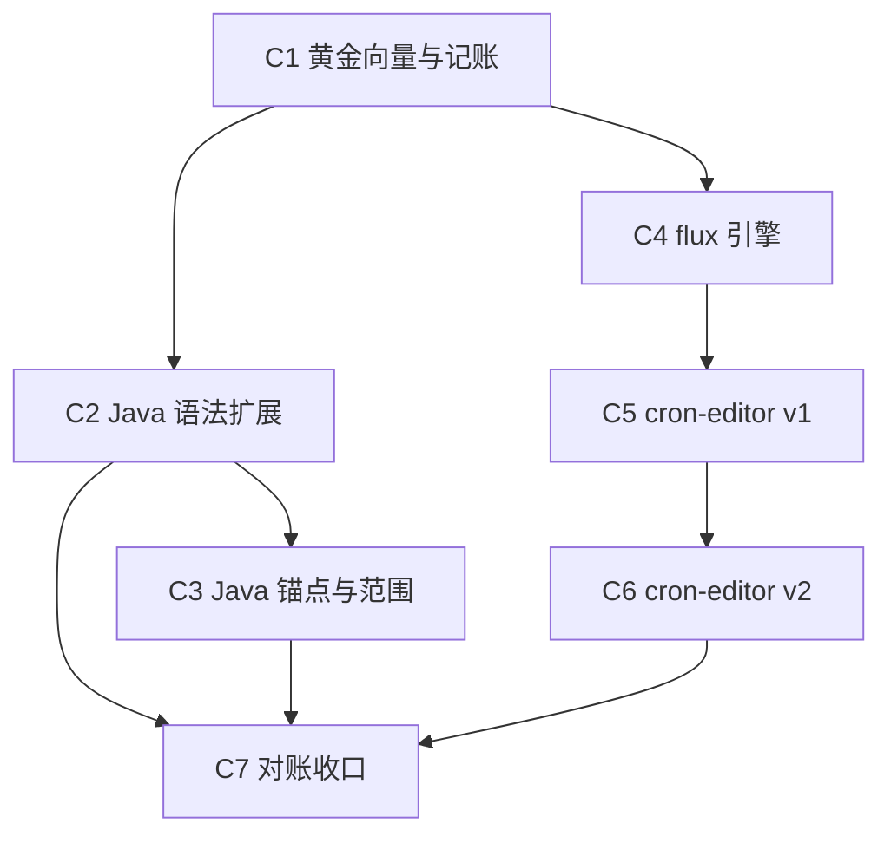

# Cron Scheduling Roadmap

> Last Updated: 2026-10-06
> Source: `docs/backlog/00-roadmap-authoring-guide.md`, `docs/components/cron-editor/design.md`, `docs/analysis/2026-08-04-control-gap-survey.md`, 2026-10-06 用户需求确认（demand 确认）

## Purpose

本文是 cron 定时计划能力轨道的阶段索引与状态面，按 `docs/backlog/00-roadmap-authoring-guide.md` 拟制：AI 或维护者读完 Phase Status 即知哪些工作项未开始（`todo`）、已立 plan（`planned`）、已完成（`done`），无需重走全部文档与代码。

本文是编排层，**不是 execution plan、不是设计文档**。组件契约看 `docs/components/cron-editor/design.md`；调度引擎语法权威是 nop-entropy 的 `CronExpression` 实现。

本轨道横跨两个仓库：`nop-chaos-flux`（编辑器 renderer + TS cron 引擎移植）与 `nop-entropy`（Java 调度引擎语法扩展 + 锚点/范围字段）。

## Phase Status

> **这是全文件唯一的动态状态区。更新状态只改这里。**
> 状态流转：plan 通过独立 draft review → `todo` 改 `planned`；plan 通过 closure audit → `planned` 改 `done`（不得提前）。一个 plan 对应本文一个工作项。

- C1. 黄金向量与治理记账: `done`（plan 535）
- C2. nop Java 语法扩展（`L`/`W`/`#`/年段）: `done`（plan 536）
- C3. nop Java 锚点周期与重复范围字段: `done`（plan 537）
- C4. flux cron 引擎纯模块: `done`（plan 539）
- C5. flux cron-editor v1（文本 + 分段编辑 + 诊断 + 预览）: `todo`
- C6. flux cron-editor v2（Office 频率档位 + repeat/range 区块 + 预设）: `todo`
- C7. 跨仓对账与收口（UI 测试覆盖审计 + 视觉复核 + 全绿）: `todo`

## Framework / Platform Reuse

以下能力已存在，**不得重建**，只做组装：

| 能力                    | 提供方                                                                                      | 说明                                                                                                                   |
| ----------------------- | ------------------------------------------------------------------------------------------- | ---------------------------------------------------------------------------------------------------------------------- |
| 表单字段装配            | `flux-react` / `flux-renderers-form` 字段工具                                               | `useFormFieldFromProps`、`useInputComponentHandle`、`formFieldContracts` / `formFieldRules`、`createFieldValidation()` |
| UI 组件                 | `@nop-chaos/ui`                                                                             | Button / Input / Select / NativeSelect / Checkbox / Tabs / Badge / Label / ScrollArea 等，禁止裸 HTML                  |
| 日期时间底层            | 日期族既有底层（W2b：react-day-picker + 原生 Date/Intl，无重型日期库）                      | 预览时间格式化与 `YYYY-MM-DD` 解析复用，不引新日期库                                                                   |
| 校验管线                | 表单 validation + `schemaValidator`                                                         | cron 诊断码走既有错误展示与 `showErrorOn` 机制                                                                         |
| 调度语法权威            | nop-entropy `io.nop.job.core.utils.CronExpression`                                          | Java 端是唯一权威实现；TS 侧是**移植 + 向量对账**，不是另立方言                                                        |
| 调度范围字段            | nop `TriggerSpec`（`minScheduleTime` / `maxScheduleTime` / `maxExecutionCount`）            | 重复范围直接承接，不新增同义字段                                                                                       |
| 渲染器注册 / 设计器收录 | `registerDefaultFluxRenderers` + palette catalog                                            | 注册后设计器自动收录，无额外登记逻辑                                                                                   |
| 测试基建                | Vitest + RTL、Playwright lab 页 + coverage manifest、`route-matrix.test.ts`、Maven surefire | 见 Cross-Cutting 测试矩阵                                                                                              |
| 文档登记机制            | `docs/components/index.md`、`examples.manifest.json`、`amis-baseline-matrix.md`             | targetContract → runtime 的既有翻转流程                                                                                |

## Current Baseline

- **flux 侧零实现**：`packages/` / `apps/` / `flux-guide/` 全文无 cron 渲染器、无 cron 解析代码；survey 已把 `cron-editor` 登记为 Tier 2 候选、demand-gated。
- **已立约未实现**：`docs/components/cron-editor/design.md` + `example.json` 已就位（manifest `targetContract`、matrix `targetContract`）。
- **nop-entropy 侧**：`CronExpression` 严格 6 段、日/周 AND 语义、构造期 BitSet 静态化；不支持 `L`/`W`/`#`、可选年段、`@` 别名；`TriggerSpec` 已有范围三字段但无锚点字段、无时区字段；前端 `cronExpr` 为纯文本输入。<!-- 勘误 2026-10-07（plan 536 后）：CronExpression 已扩为 6/7 段方言，支持 L/L-n/nW/LW/d#N/dL/单独L(=周六) 与可选年段（1970-2099）；本条为 C2 前历史基线。 -->
- **主要缺口**：① Office 同等能力所需的语法扩展；② 每 N 天/周锚点机制；③ 重复范围的编辑与映射；④ 编辑器本体与全套 UI 测试。

## Phases

| Phase                      | Status | Owner Doc                                     | Dependencies | Reuse                                                     | Plan |
| -------------------------- | ------ | --------------------------------------------- | ------------ | --------------------------------------------------------- | ---- |
| C1 黄金向量与治理记账      | `done` | `docs/components/cron-editor/design.md` §2/§4 | —            | 本 roadmap + survey/backlog 既有登记表                    | 535  |
| C2 nop Java 语法扩展       | `done` | nop `CronExpression` + `TestCronExpression`   | C1           | C1 向量、现有 equals/hashCode 回归网                      | 536  |
| C3 nop Java 锚点与范围字段 | `done` | nop `TriggerSpec` + 触发层                    | C1, C2       | `TriggerSpec` 范围三字段、trigger 装饰器/排除日历既有模式 | 537  |
| C4 flux cron 引擎纯模块    | `done` | design.md §4/§11                              | C1           | C1 向量、日期族底层                                       | 539  |
| C5 flux cron-editor v1     | `todo` | design.md 全文                                | C4           | 字段装配、ui 组件、注册与登记机制                         | —    |
| C6 flux cron-editor v2     | `todo` | design.md §4/§7                               | C5           | C5 骨架与测试基建                                         | —    |
| C7 跨仓对账与收口          | `todo` | design.md §9/§12                              | C2, C3, C6   | C1 向量、全套测试基建                                     | —    |

## Phase Details

### C1 黄金向量与治理记账

- 产出跨仓共享的判别性向量集（表达式 → 期望 next-run 序列 / 期望诊断），覆盖：基础 6 段、`L`/`W`/`#` 动态月与闰年、可选年段、`repeat` 锚点过滤、`range` 截断、病态永不匹配与非法输入负例。
- 治理记账：backlog 需求门（demand 已确认）状态翻转、survey 候选行双向链接。
- 档位：不适用（纯文档与测试数据；消费测试在 C2/C4 落地）。

### C2 nop Java 语法扩展

- 扩展 nop `CronExpression` 支持 Quartz 兼容的 `L` / `nL` / `L-n` / `W` / `LW` / `d#N` 与可选第 7 段年；动态日判定以谓词方式接入，主循环与两道守卫保持不动。
- 同步修正引擎外的段数预检与 cron 语法文档表述，使其与严格 6 段口径一致。<!-- 勘误 2026-10-07（plan 536 交付后）：C2 交付为 6/7 段方言（第 7 段年可选），"严格 6 段"指实现前的历史口径；预检/文档已同步 6/7 口径。历史表述不改写。 -->
- 判别性测试吃 C1 向量；档位：必须自动化（Proof 先行）。

### C3 nop Java 锚点与范围字段

- `TriggerSpec` 增加锚点周期字段（每 N 天/周 + 锚点日期），触发链路按锚点取模过滤触发时刻（复用既有触发装饰器或排除日历模式）。
- 核对并接通 `minScheduleTime` / `maxScheduleTime` / `maxExecutionCount` 与实体/元数据的暴露，使重复范围端到端可用。
- 档位：必须自动化（全链路 next-fire 测试）。

### C4 flux cron 引擎纯模块

- 移植解析 / 序列化 / 诊断 / next-run（含动态日谓词）到 TS 纯模块，并实现 `repeat` 锚点过滤、`range` 截断、频率档位派生、预设数据。
- C1 向量对账测试（Proof 先行）；零 IO、零 React 依赖。档位：必须自动化。

### C5 flux cron-editor v1

- 渲染器落地：文本模式 + 6/7 段分段编辑 + 实时诊断 + 下次触发预览 + `clear`/`reset`/`focus` 句柄；definition / i18n / playground 路由与 lab 页 / coverage manifest 登记。
- 文档登记翻 `runtime`（index 清单、manifest、matrix、quick-reference、backlog 状态回写）。
- 测试：L1 之组件层 + L3 守卫 + L4 e2e 冒烟。档位：必须自动化。

### C6 flux cron-editor v2

- Office 频率档位（每天 / 每周 / 每月 / 每年 / 自定义）向导、`repeat` 与 `range` 区块（含互斥与锚点校验）、预设应用、a11y 键盘与 aria 完整覆盖。
- 测试：L2 扩展 + L4 e2e 全量用户旅程。档位：必须自动化。

### C7 跨仓对账与收口

- Java 与 TS 两端向量一致性审计；宿主映射示例（值对象 → `TriggerSpec` 拆列）。
- 完整 UI 测试覆盖审计 + 视觉复核；两端测试全绿（`pnpm test` / `pnpm test:e2e`、`mvnw test`）。
- 回写本 roadmap 状态、design.md 未决项、日志。档位：必须自动化。

## Dependency Graph

## Cross-Cutting

### 完整 UI 测试矩阵（用户硬要求）

| 层           | 工具 / 位置                                                                       | 必须覆盖                                                                                                                                                                                              | 落位              |
| ------------ | --------------------------------------------------------------------------------- | ----------------------------------------------------------------------------------------------------------------------------------------------------------------------------------------------------- | ----------------- |
| L1 引擎单测  | Vitest（纯函数）                                                                  | 解析/序列化往返、全部诊断码、next-run 对账向量、锚点过滤、范围截断、病态表达式                                                                                                                        | C4                |
| L2 组件测试  | Vitest + RTL                                                                      | 双模式编辑与切换往返、档位派生与回编译、预设、预览递增、repeat/range 交互与互斥、required/disabled/readOnly、句柄、marker 与 `data-slot` 契约、键盘与 aria、诊断文案双语、example.json 零 diagnostics | C5 / C6           |
| L3 守卫测试  | route-matrix、definition contracts、package exports、schema-prop-coverage         | 路由 + lab 页 + 注册完整性 + propContracts/fields 成对                                                                                                                                                | C5 / C6           |
| L4 E2E       | Playwright + lab 页 + coverage manifest 登记                                      | 编辑→值读回、非法输入报错且不提交、模式切换、预设、预览严格递增、repeat/range 写值、submit 回写、零页面错误、键盘可达                                                                                 | C5 冒烟 / C6 全量 |
| L5 视觉复核  | visual spec / ui-review（截图仅供人审，通过与否必须程序化断言；artifacts 不入库） | 档位面板、分段编辑、预览与区块布局                                                                                                                                                                    | C7                |
| L6 Java 对账 | `mvnw test`（nop-job-core）                                                       | 同一向量集在 Java 端全部命中（动态月、闰年、跨年守卫）                                                                                                                                                | C2 / C3 / C7      |

### 跨仓对账规则

- 黄金向量是两端唯一契约来源（C1 产出）；任一端改语义必须同步另一端并过 C7 审计。
- 语法能力以 nop `CronExpression` 为权威；TS 移植若与 Java 不一致，**以 Java 为准修 TS**。

### 其他横切约束

- 时区口径：预览用浏览器时区、引擎用 JVM 默认时区，不一致风险在 design.md §12 记录，`timezone` 字段延后。
- 行数红线：renderer 单文件 ≤500 行（超 700 直接让 `pnpm check` 变红），超限按 view 子组件拆分。
- 状态面唯一：本文 Phase Status 是本轨道唯一动态状态；`docs/components/roadmap.md` 与组件主 roadmap 只放指针，不镜像状态。

## Rule

- 本文遵循 `docs/backlog/00-roadmap-authoring-guide.md`：工作项可由单个 execution plan 交付；roadmap 不写实现步骤与 checkbox。
- 状态只在 Phase Status 变更，且必须由 plan 生命周期驱动（draft review 通过 → `planned`；closure audit 通过 → `done`）。
- AI 按 Phase Status 顺序取第一个 `todo` 立 plan 并执行，不自行增删、跳序或重排工作项；结构性调整提交人类裁决。
- 本轨道主入口是本文；组件主 roadmap（`docs/components/roadmap.md`）只保留指针。
