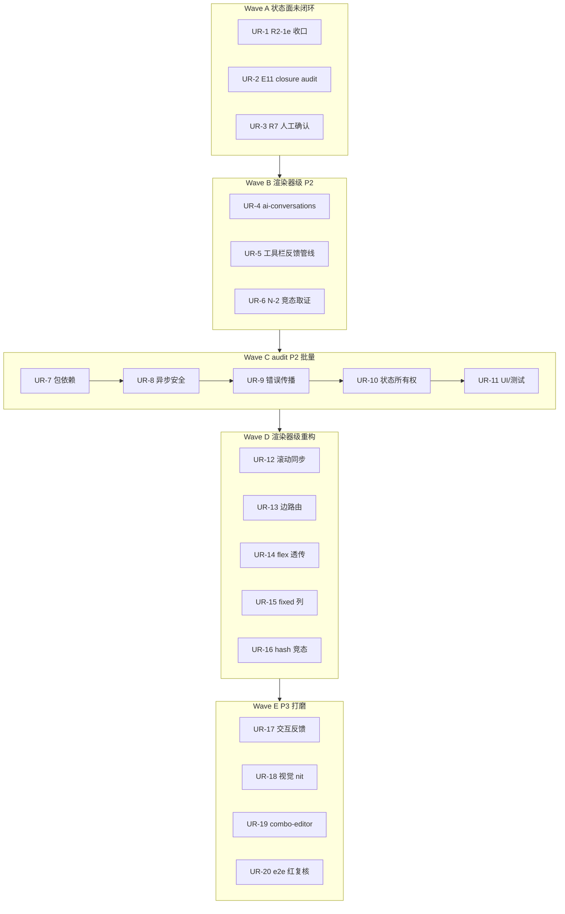

# 跨 Roadmap 未完成项收口路线图（Cross-Roadmap Remediation Roadmap）

> 最后更新：2026-10-17
> 立项依据：用户 2026-10-17 指令——汇聚全仓 roadmap 中"未完成且需要完成"的工作项，完成后回写原始 roadmap
> 撰写依据：`docs/backlog/00-roadmap-authoring-guide.md`
> 来源盘点：2026-10-17 全量 roadmap 盘点（`docs/backlog/` 20 份 + `docs/components/` 8 份 + `docs/audits/check/` 1 份 + `docs/analysis/` 3 份，共 32 份；`docs/archive/` 归档件与 `docs/skills/` 撰写模板除外）

## Purpose

本文件是既有 roadmap 遗留项的**执行编排层**，不是任何领域的新权威：各原始 roadmap 仍是各自领域的权威状态面。本文件把散落在 7 份 roadmap 的"状态非 done 工作项 + 状态 done 但显式挂账的 follow-up"汇聚为一份可按 plan 生命周期推进的工作队列，并给每个工作项声明**回写映射**——closure audit 通过后，执行方必须按映射更新原始 roadmap，本表条目才置 `done`。

本文件只汇聚既有登记，不发明新工作项；若执行中发现新的跨 roadmap 遗留，登记到对应领域 roadmap 后再由人工审查决定是否纳入本表。

## Phase Status

> 唯一动态状态块。初始全 `todo`；状态转换由 plan 生命周期驱动（draft review pass → `planned`；closure audit pass → `done`）。

| Work Item | Status | 摘要                                                                                                                                                                                                              |
| --------- | ------ | ----------------------------------------------------------------------------------------------------------------------------------------------------------------------------------------------------------------- |
| UR-1      | `done` | R2-1e 增量走查收口（R2-1b 残留复检 + P3×7 设计债人工裁决；2026-10-17 plan 632 收口）                                                                                                                              |
| UR-2      | `done` | E11 scada-editor-canvas 审计收口（审计卡实为 closed——勘误后补登 Phase Status，plan 632）                                                                                                                          |
| UR-3      | `done` | R7 编辑态包络数字人工最终确认（2026-10-17 人工确认通过，plan 632）                                                                                                                                                |
| UR-4      | `done` | ai-conversations 会话列表渲染传播链闭合（P2；2026-10-17 plan 633 收口）                                                                                                                                           |
| UR-5      | `done` | 设计器工具栏动作反馈管线（静默成功 P2；2026-10-17 plan 633 收口）                                                                                                                                                 |
| UR-6      | `done` | N-2 linear-issues 首屏空面板竞态取证（P2 调查；2026-10-17 plan 633 取证+修复收口）                                                                                                                                |
| UR-7      | `done` | audit-remediation P2：包依赖与 peer-dep 治理（12 条；2026-10-17 plan 634 收口——5 项已被 624/07-28 先行闭合、1 项登记失效、devDep 降级 + sideEffects 实修、裁决注释核验 delta）                                    |
| UR-8      | `done` | audit-remediation P2：异步取消安全统一（10 条；2026-10-17 plan 635 核验回写——全部已于 07-28 治理轮修复，06-10 文档化注记落地）                                                                                    |
| UR-9      | `done` | audit-remediation P2：错误传播与诊断通道（13 条；2026-10-17 plan 636 收口——12 条已于 07-28 治理轮修复核验回写；19-16 部分修复，非严格外发收尾经判别实验改判 Deferred → flux-compiler report-only 通道 successor） |
| UR-10     | `done` | audit-remediation P2：状态所有权与渲染杂项（6 条；2026-10-17 plan 637 收口——04-04 已修复回写、P2-F/L/G 与 04-07 裁定注记、04-05 successor 行内注册）                                                              |
| UR-11     | `todo` | audit-remediation P2：UI 组件与测试质量杂项（7 条）                                                                                                                                                               |
| UR-12     | `todo` | GT-3 Gantt 双区滚动容器同步机制重构                                                                                                                                                                               |
| UR-13     | `todo` | 边路由引擎（TF-1/GR-2 家族：自动避障/端口感知路由）                                                                                                                                                               |
| UR-14     | `todo` | container className-flex 作者陷阱渲染器层契约透传                                                                                                                                                                 |
| UR-15     | `todo` | 表格 fixed 粘性列宽度预留（不透明底已落地）                                                                                                                                                                       |
| UR-16     | `todo` | SPA hash 导航竞态观测（仅自动化测试关注）                                                                                                                                                                         |
| UR-17     | `todo` | P3 交互反馈批（零选中反馈/校验文案/弹窗自关/toast 本地化/空 patch/键盘可达）                                                                                                                                      |
| UR-18     | `todo` | P3 视觉 nit 快扫（9 项轻量）                                                                                                                                                                                      |
| UR-19     | `todo` | combo-editor 双删除 affordance 收敛（共享 composite 组件）                                                                                                                                                        |
| UR-20     | `todo` | HEAD 既有 e2e 红复核（flow-designer-dingtalk ×2 + taskflow-ui ×1）                                                                                                                                                |

## Framework / Platform Reuse

- **审计→批量修复→全量验证方法论**：`docs/backlog/audit-remediation-roadmap.md` 的 MA（分域审计）→ MR（批量修复）→ CV（全量验证）节奏，UR-7~UR-11 直接沿用。
- **独立 fresh-session closure audit 纪律**：`AGENTS.md` Collaboration Discipline + industrial-hmi-editor roadmap 的 gate review 先例（E6/E8/E10），UR-1/UR-2/UR-20 的裁决环节复用。
- **watch-only e2e 标记机制**：plan 623（2026-10-17）建立的标题级 `@watch-only` 标记 + `E2E_EXCLUDE_WATCH_ONLY=1` 干净运行开关，UR-20 复核时可作裁决出口之一。
- **错误文案收敛先例**：`describeActionFailure`（full-traversal W-A1 P1 修复）与 `failureHandled` 补标（W-A1 P2 修复）已入 `flux-action-core`/`flux-runtime`，UR-5/UR-9/UR-17 的 toast 类修复不重复造轮子。
- **程序化复检工具**：visual-quality-r2 的形态探针（G/V7）与 audit-suspects ratchet（plan 626/627）在 UR-1 复检环节按需复用。

## Current Baseline

2026-10-17 盘点结论：32 份在册 roadmap 中 25 份全部收口；7 份存在未完成内容，汇聚为本表 UR-1~UR-20（约 70 条源登记）。

**不纳入本表（demand-gated / watch-only，无当前完成义务）**：

- `docs/components/existing-components-improvement-roadmap.md` X6 input-number money format（`proposed`，DESIGN-ACK-NOT-IMPL，实现待 host demand）。
- `docs/backlog/missing-components-and-designer-roadmap.md` L4.12 / L5.8 / L7.x demand-gated 终态登记（QA.7 残余债登记册统一兜底）。
- `docs/backlog/editor-designer-standardization-roadmap.md` P1.1（createEditorCore 全状态接管，plan 546 Deferred 改判不落）/ P4.3（逐家族句柄 helper Deferred）——状态值均为 done。
- watch-only 观察项：`docs/backlog/ai-invariant-loop-roadmap.md` W1–W4/W-E/W-⑨-a/W-⑨-c；`docs/components/roadmap-industrial-hmi-editor.md` [E1.1-sg]（rAF fps 测量口径）；full-traversal §七 master-detail 子表加载 >2s（性能观测）；`docs/backlog/workaround-code-smell-audit-roadmap.md` 44 条 watch-only 台账（台账登记，非 roadmap 工作项）。

**已由其他工作闭合、不再立项**：OP-1 渠道占比卡溢出（2026-10-03 修复）、多源同步（裁定保留显式 refreshSource）、antdpro form-basic/detail-basic 背景接缝（改判非缺陷）、linear replica 家族 css 债（2026-10-03 修复）、designer-ux R12 的 perf e2e 红 ×3（plan 623 watch-only 裁决，2026-10-17）。

**范围边界**：plan 层在途工作（如 620/621/624-627）由 plan 生命周期自跟踪，不入本表；plan 623 盘点发现的 scada-editor-perf 3 个阈值测试待独立裁决，登记在 `docs/plans/623-e2e-skip-governance-plan.md`，归该 plan 收口。

## Work Items 表

> 状态只在 Phase Status；本表为索引（来源登记 / 依赖 / Plan / 回写动作）。

| Work Item | 来源登记                                                                                                                                                                                                                                                                                                                               | 依赖 | Plan                                                              | 回写动作                                                           |
| --------- | -------------------------------------------------------------------------------------------------------------------------------------------------------------------------------------------------------------------------------------------------------------------------------------------------------------------------------------- | ---- | ----------------------------------------------------------------- | ------------------------------------------------------------------ |
| UR-1      | `docs/backlog/visual-quality-r2-roadmap.md` Work Item Status 表 R2-1e 行（`open`）                                                                                                                                                                                                                                                     | —    | `docs/plans/632-cross-roadmap-wave-a-status-closure-plan.md`      | R2-1e 置 `done` 并注明裁决结论                                     |
| UR-2      | `docs/components/roadmap-industrial-hmi-editor.md` §E11（E11.1/E11.2，未进 Phase Status）；审计卡 `docs/audits/per-component/scada-editor-canvas.md`（~~`fixed-pending-closure`~~【2026-10-17 勘误：实为 closed——2026-08-08 独立 closure audit PASS `ses_0202ae215ffeqrZBtX2DOumfch`，盘点误载；剩余工作仅 E11 组补登 Phase Status】） | —    | `docs/plans/632-cross-roadmap-wave-a-status-closure-plan.md`      | 审计卡 → closed；E11 组登记进 Phase Status 为 `done`               |
| UR-3      | `docs/components/roadmap-industrial-hmi-editor.md` R7（头部与 Cross-Cutting 多处"待人工最终确认"）                                                                                                                                                                                                                                     | —    | `docs/plans/632-cross-roadmap-wave-a-status-closure-plan.md`      | R7 确认结论回写全部相关处                                          |
| UR-4      | `docs/analysis/2026-10-03-playground-full-traversal-ux-roadmap.md` §七 W-D 执行期新增登记（P2 改判）                                                                                                                                                                                                                                   | —    | `docs/plans/633-cross-roadmap-wave-b-renderer-p2-plan.md`         | 登记条目追加"已修复（日期 + plan 链接）"注记                       |
| UR-5      | `docs/analysis/2026-10-03-playground-full-traversal-ux-roadmap.md` §七 W-B 执行期新增登记（P2 改判，plan-first）                                                                                                                                                                                                                       | —    | `docs/plans/633-cross-roadmap-wave-b-renderer-p2-plan.md`         | 同上                                                               |
| UR-6      | `docs/analysis/2026-10-01-playground-designer-ux-roadmap.md` 收敛复审计登记 N-2                                                                                                                                                                                                                                                        | —    | `docs/plans/633-cross-roadmap-wave-b-renderer-p2-plan.md`         | 登记条目标注调查结论与去向                                         |
| UR-7      | `docs/backlog/audit-remediation-roadmap.md` Follow-up Backlog：D01 组 01-01/02/03/04/05/06/09/11 + Open Audit P2-A/B/J/K                                                                                                                                                                                                               | —    | `docs/plans/634-cross-roadmap-ur7-package-deps-plan.md`           | 对应行追加"已修复（日期 + plan 链接）"；整表清零时节首登记清零声明 |
| UR-8      | 同上：D06 组 06-05/09/10 + D15 组 15-S1a~f + P2-E                                                                                                                                                                                                                                                                                      | —    | `docs/plans/635-cross-roadmap-ur8-async-safety-writeback-plan.md` | 同上                                                               |
| UR-9      | 同上：D19 组 19-02/05/07/08/10/11/12/13/14/15/16/18/20                                                                                                                                                                                                                                                                                 | —    | `docs/plans/636-cross-roadmap-ur9-error-propagation-plan.md`      | 同上                                                               |
| UR-10     | 同上：D04 组 04-04/05/07 + P2-F/G/L                                                                                                                                                                                                                                                                                                    | —    | `docs/plans/637-cross-roadmap-ur10-state-ownership-plan.md`       | 同上                                                               |
| UR-11     | 同上：D11 组 11-02/03/04 + P2-C/D/H/I                                                                                                                                                                                                                                                                                                  | —    | —                                                                 | 同上                                                               |
| UR-12     | `docs/analysis/2026-10-01-playground-designer-ux-roadmap.md` R8 收口记录 GT-3 follow-up                                                                                                                                                                                                                                                | —    | —                                                                 | follow-up 条目标注已修复                                           |
| UR-13     | 同上 R7 收口记录 TF-1（归边路由引擎家族）+ 收敛复审计登记 GR-2                                                                                                                                                                                                                                                                         | —    | —                                                                 | TF-1/GR-2 条目标注已修复                                           |
| UR-14     | 同上 R12 补充登记（container className-flex）+ `docs/analysis/2026-10-03-complex-pages-browser-confirmation-roadmap.md` §三渲染器级 1 + full-traversal §七                                                                                                                                                                             | —    | —                                                                 | 三处登记同步标注已修复                                             |
| UR-15     | 同上 R12 补充登记（表格 fixed 列）+ complex-pages §三渲染器级 2 + full-traversal §七                                                                                                                                                                                                                                                   | —    | —                                                                 | 三处登记同步标注已修复                                             |
| UR-16     | complex-pages §三渲染器级 3 + full-traversal §七                                                                                                                                                                                                                                                                                       | —    | —                                                                 | 两处登记同步标注结论                                               |
| UR-17     | full-traversal §七 W-A1 执行期新增登记 P3×6                                                                                                                                                                                                                                                                                            | —    | —                                                                 | 对应条目标注已修复                                                 |
| UR-18     | designer-ux 收敛复审计登记 PR-1/DF-1 + P3 nits ×5 + complex-pages §三在册（approval-tasks 查询卡空区）+ full-traversal §七（event-prevention 死开关）                                                                                                                                                                                  | —    | —                                                                 | 各源登记处标注修复或裁决结论                                       |
| UR-19     | designer-ux R12 补充登记（combo-editor P3）+ complex-pages §三在册 + full-traversal §七                                                                                                                                                                                                                                                | —    | —                                                                 | 三处登记同步标注已修复                                             |
| UR-20     | designer-ux R12 补充登记（HEAD 既有 e2e 红 3 项）                                                                                                                                                                                                                                                                                      | —    | —                                                                 | 登记条目标注复核结论                                               |

## Work Item Details

### Wave A — 状态面未闭环（原始 roadmap 状态非 done）

- **UR-1 R2-1e 增量走查收口**：① R2-1b 残留疑似现役项（A3-01×2、E4-01、B5-02 族、B1-01、C5-01）程序化复检；② P3×7 design-debt candidates（report-designer 检查器裸文本、spreadsheet 操作条 EN-CN 混排、scada 页头 7 同权重 primary、scada 按钮 EN-CN 混排、dashboard Back 钮、print-designer 双面板折叠、report-designer B2 光标残影）整理裁决材料 → **人工裁决**（修复或书面维持）；③ 落地裁决结果。走查报告已在 plan 558 Closure Evidence，不重走全量。
- **UR-2 E11 closure audit**：E11.1（18 维审计 + 自动修复）与 E11.2（Bug & Lesson 总结）修复均已落地（1302 tests 全绿），仅差独立 fresh-session closure audit；通过后审计卡 closed、E11 组补登 Phase Status。
- **UR-3 R7 编辑态包络人工确认**：E9.2 复测报告（primary ①②④ 全部达标）即确认材料；本项不写代码，产出人工确认提交物并记录结论。可与 UR-2 同批推进（同源 roadmap）。

### Wave B — 渲染器级 P2 follow-up（playground 遍历书面改判）

- **UR-4 ai-conversations 会话列表传播链**：`ai:createConversation` dispatch 成功但侧栏不渲染；修复 store → pageData memo → schema `data` → 渲染器 `${conversations}` prop 的 live 传播（对照 ai-persistence React 直连形态）；补可视循环 e2e 断言。
- **UR-5 设计器工具栏动作反馈管线**：`flow-designer-renderers/src/designer-toolbar.tsx` invokeAction 直连 provider.invoke()，绕过 ActionDispatcher then/messages 管线；先出管线设计（schema then 支持 or 内建成功反馈）再实现；taskflow Save/Export、word-editor/report-designer-host/dashboard-demo 保存全量复验。
- **UR-6 N-2 竞态取证**：linear-issues 负载下首屏偶发空面板，mount/dispose 时序取证、复现优先；"dependsOn 根未初始化"主张已被源码证伪（source-registry.ts 无条件 start），不得沿该方向修。

### Wave C — audit-remediation Follow-up Backlog P2 批量（48 条，按族拆 5 个 plan）

- **UR-7 包依赖与 peer-dep 治理（12 条）**：D01 跨包依赖耦合 8 条（rule(c) 文本过期、mobile 缺 flux-react、data→basic / form-advanced / ai→content / code-editor→form / report→spreadsheet 耦合核验）+ P2-A/B/J/K（peer dep `"*"`、recharts 疑残留、mobile 显式依赖、CSS subpath export 格式）。
- **UR-8 异步取消安全统一（10 条）**：AbortController 缺失/双态混用 6 条（15-S1a~f；其中 15-S1d 与 06-05 同文件 `use-dict-options.ts`，合并修）+ handleRef 覆盖竞态（06-09）+ dispose 双 abort 文档化（06-10）+ reaction-runtime subscribe 竞态（P2-E）。
- **UR-9 错误传播与诊断通道（13 条）**：monitor 错误不可见、console.error 丢 cause、静默 no-op 伪成功、fire-and-forget onClose、诊断默认关、编译错误不走诊断通道等（19-02~19-20 全表）；统一走诊断通道 + cause 保留。
- **UR-10 状态所有权与渲染杂项（6 条）**：props→state 镜像 3 条（04-04/05/07）+ componentProps 每渲染新容器（P2-F）+ effect 同步 refs（P2-G）+ rememberParsedPath rehashing（P2-L）。
- **UR-11 UI 组件与测试质量杂项（7 条）**：playground 原生 label/select/checkbox 3 条（11-02/03/04，换 `@nop-chaos/ui`）+ flux-core 测试归位 `__tests__/`（P2-C）+ 低断言测试加固（P2-D）+ deprecated 导出清理（P2-H）+ inline style 转 Tailwind（P2-I）。

### Wave D — 渲染器级 plan-first 重构

- **UR-12 GT-3 滚动同步重构**：Gantt 左网格/时间线双横向滚动条错位 + 悬停 tooltip 缺失；重构滚动容器同步机制（R8 Recorded Scope adjudication 已裁定超出有界修复）。
- **UR-13 边路由引擎**：连线自动避障/端口感知路由（TF-1 三变体探针证伪偏移弧线机制 + GR-2 邻接边小环归此家族）；design-first。
- **UR-14 container className-flex 契约透传**：`container-body` 无类名包装使 schema 外层 flex 类静默失效；渲染器层修法（免包装或透传）属行为契约变更，design-first 后实现。
- **UR-15 表格 fixed 列宽度预留**：`fixed: "right"` 粘性列盖液态列；不透明底已落地（R12e），余宽度预留。
- **UR-16 SPA hash 导航竞态观测**：goto 同文档 hash 偶发不触发重挂载；用户手点无碍，仅自动化测试关注——产出观测/规避约定，不强制产品修复。

### Wave E — P3 打磨

- **UR-17 P3 交互反馈批（6 项）**：批量操作零选中无反馈（standard-crud/antdpro-list）、sundial-detail 校验文案用原始键名（schema 补 label）、approval-tasks 审批成功弹窗不自动关、剪贴板失败 toast 收敛本地化短语（复用 describeActionFailure 先例）、linear-detail 空 patch 禁用「应用」、master-detail 列表项键盘可达（a11y）。
- **UR-18 P3 视觉 nit 快扫（9 项）**：event-prevention schema 死开关清理、print 样式区输入占位（PR-1，含 Y 浮点拖拽期复查）、diff 新增行行号列空白（DF-1）、dashboard-demo KPI 裁边、code-editor SQL 灰条、kanban 卡无日期、page-designer 叶子字段容器徽标、debugger launcher 压 palette、approval-tasks 查询卡右侧空区（**布局偏好类，允许裁决为不修**）。
- **UR-19 combo-editor 双删除 affordance 收敛**：× 与 trash 双删除冗余；涉共享 composite 组件语义，先小设计再改，全 composites 消费方回归。
- **UR-20 HEAD 既有 e2e 红复核**：flow-designer-dingtalk-visual "end variant" ×2 + taskflow-designer-ui "playground 入口导航卡"（R12 登记，疑与并行会话 flux-core WIP 相关）；复核现行状态 → 修复或按 watch-only 机制裁决。

## Dependency Graph

无硬依赖；执行顺序即 Wave A → E 的规划优先序（AI 不重新仲裁）。

## Cross-Cutting

- **回写纪律（本路线图的核心约定）**：UR-x 的 closure audit 通过后，**同一收口批次内**按 Work Items 表"回写动作"列更新源 roadmap/审计卡/登记节；源条目回写完成后 UR-x 才置 `done`。回写前先核对源条目——若已被其他工作先行闭合，只做状态同步不重复修复。
- **人工确认阈值**：UR-1 的 P3×7 裁决、UR-3 的包络数字、UR-18 的"布局偏好"类处置、UR-20 的 watch-only 裁决——AI 产出材料并停给人工，不自确认。
- **验证纪律**：每项 closure 前全量 `pnpm typecheck && pnpm build && pnpm lint && pnpm test`（涉及 e2e 断言的加跑对应 spec）；`pnpm check` 零新增红；UI 修复必须程序化断言（截图不作证明）。
- **一 plan 一 commit 边界**：closure/实现提交严格对应单 plan diff，验证声称与该 commit 自身 diff 对应（daily log 2026-10-17 F1 教训）。
- **报告与卡片**：UR-2 复用 per-component 审计卡；UR-7~UR-11 修复回填沿用 audit-remediation 的 finding 编号（01-xx/04-xx/06-xx/11-xx/15-S1x/19-xx/P2-x），不新造编号体系。

## Rule

- 状态转换遵从 `docs/plans/00-plan-authoring-and-execution-guide.md` 生命周期：draft review pass → `planned`；closure audit pass → `done`。禁止 closure audit 通过前置 `done`。
- Work Items 表"回写动作"列是回写义务的权威定义；与本表 Details 冲突时以表行为准。
- 本文件与源 roadmap 的状态冲突时，以源 roadmap 为准（它是领域权威面），并视为本表状态 stale 需立即同步。
- 新增/删除/重排本表工作项属结构变更，标记人工审查，AI 不自行裁定。
