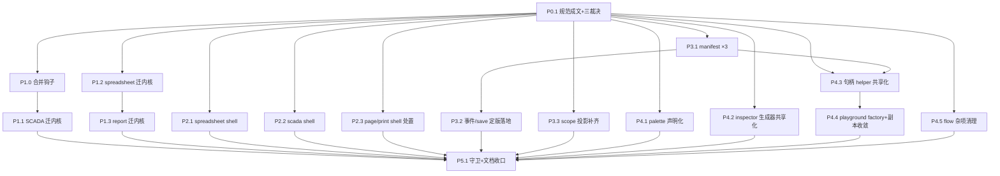

# Editor/Designer 实现规范化 Roadmap

> 本文件按 `docs/skills/roadmap-and-mission-authoring-with-consensus-review.md` 产出；mission 档 `missions/editor-designer-standardization.json`；每次修订须经独立子 agent 共识审查（该 skill 步骤 4）。
> Created: 2026-10-04（用户下达：核对所有 editor/designer 是否复用同样基本结构、有无基础支撑，写 roadmap 规范化 editor/designer 实现，含 scope 对外 publish、manifest 等；所有能标准化的部分逐一裁定是否应标准化）
> 事实基线：2026-10-04 全仓走查（flow/page/report/spreadsheet/word/scada/dashboard/print 八家族 + 跨切面机制逐包核对，证据以文中文件路径为准）
> Authority 关系：
>
> - 会话内核权威：`docs/architecture/editor-core.md`；Shell 权威：`docs/architecture/designer-workbench-shell.md`；Manifest 权威：`docs/architecture/capability-projection-manifest.md`；Inspector 权威：`docs/architecture/report-designer/inspector-design.md`；INV 不变式：`docs/references/new-renderer-introduction-audit.md`（INV-1~5，域内部 state 不进 scope = INV-4）。
> - 本文件只管**跨家族实现契约收敛**（内核/shell/manifest/scope publish/事件/元数据/注册/消费侧）。各设计器作为**产品**的功能路线不在此处：标准页面设计器产品线见 `missing-components-and-designer-roadmap.md` L6（已终态），SCADA 补全见同文件 L5（已终态），域内设计文档见 `docs/architecture/flow-designer/`、`docs/architecture/report-designer/` 等。
> - 状态流转沿用主 roadmap 规则：`todo` → `planned`（draft review 通过）→ `done`（closure audit 通过后回写）；§6 Phases 总表（内联状态列）是唯一权威动态区（Round 1 审查修正：原文误标 §3，§3 为只读基线）。

---

## 1. Purpose

本文件是 editor/designer 家族**实现契约标准化**的编排层。回答两个问题并驱动收口：

1. 八个 editor/designer 家族是否复用了同一套基本结构？——**部分复用**：四大共享件（editor-core 会话内核、WorkbenchShell、HostCapabilityProjectionManifest/hostContract、useHostScope+useStatusPathPublication 投影）均已存在且有消费者，但没有任何一个家族四件全齐，也没有成文的"设计器实现规范"把四件定为强制契约。
2. 哪些部分应该标准化、哪些明确保留域内自治？——§5 给出逐维裁定（含负面清单），§6/§7 把"应标准化"部分拆为可执行 work item。

## 2. 基础支撑盘点（已存在、可直接复用，禁止重建）

| 共享件                                                                                                                                               | 位置                                                                                                                             | 现有消费者                                                                                                                      |
| ---------------------------------------------------------------------------------------------------------------------------------------------------- | -------------------------------------------------------------------------------------------------------------------------------- | ------------------------------------------------------------------------------------------------------------------------------- |
| **editor-core 会话内核**（working/committed 双态、forward/inverse diff 命令栈、事务、manual/auto 提交策略、mode、selection 修剪、域 adapter 注册表） | `packages/editor-core`                                                                                                           | dashboard-editor、page-designer-core、flux-print-renderers（print-designer）                                                    |
| **WorkbenchShell**（header/leftPanel/canvas/rightPanel/dialogs 槽位、collapsed rail、可调宽）                                                        | `packages/flux-react/src/workbench/workbench-shell.tsx`                                                                          | 包内：flow-designer、report-designer、word-editor、dashboard-editor；包外：playground `report-designer-demo.tsx` 自建一处（§3） |
| **HostCapabilityProjectionManifest / RendererHostContract / CapabilityPublicationAttribution**                                                       | `packages/flux-core/src/schema-diagnostics/manifest.ts`、`src/types/renderer-authoring-contract.ts`                              | flow、report、spreadsheet、word 四家族各有 `*_MANIFEST_V1`                                                                      |
| **scope 投影三 hooks**：`useHostScope` / `useStatusPathPublication` / `useNamespaceRegistration`（+ `useBridgeSnapshot`/`DomainBridge`）             | `packages/flux-react/src/workbench/hooks.ts`、`src/status-path.ts`                                                               | useHostScope：flow/report/spreadsheet/word（+ai-chat）；statusPath：flow/report/spreadsheet/word                                |
| **渲染器注册**：`registerRendererDefinitions` / `defineRendererFamily` / `createLazyRendererComponent` / `createDefaultRegistry`                     | `packages/flux-core/src/registry.ts`、`renderer-definition-builder.ts`；`packages/flux-react/src/defaults.ts`                    | flow（6 定义）、report（5）、spreadsheet（1）、word（1）、scada-editor（`/editor` 子路径）、dashboard（1）                      |
| **inspector 声明式生成**：propContracts→SchemaInput transient schema（`resolveRendererAuthoringContract`）                                           | `packages/page-designer-core/src/inspector-schema.ts`（参照实现）；`packages/flux-core/src/types/renderer-authoring-contract.ts` | page-designer（原生）、report（SchemaInput+form runtime 同理）                                                                  |
| **ui 基元**（Button/Dialog/Tabs/Toolbar 复合件/Resizable/Sidebar 等）                                                                                | `packages/ui/src/index.ts`                                                                                                       | 全部家族                                                                                                                        |
| **域 adapter 注册表先例**：`registerEditorDomain`/`getEditorDomain`（覆盖语义）                                                                      | `packages/editor-core/src/domain-registry.ts`；蓝本 `flow-designer-core/src/tree-domain.ts`                                      | editor-core 消费者                                                                                                              |

## 3. 现状基线（2026-10-04 走查快照，只读事实；冲突以代码为准）

八个家族 × 七个标准维度（✓=符合 ✗=自研/缺失 ◐=部分）：

| 家族（包）                                              | editor-core 内核                 | WorkbenchShell    | Manifest V1 | RendererDefinition 注册             | useHostScope 投影 | statusPath 发布 | 保存契约（对外出口）                                               |
| ------------------------------------------------------- | -------------------------------- | ----------------- | ----------- | ----------------------------------- | ----------------- | --------------- | ------------------------------------------------------------------ |
| flow-designer（flow-designer-core/renderers）           | ✗ 自研 history（上限 50）+事务   | ✓                 | ✓           | ✓ ×6                                | ✓                 | ✓               | host 方法 `save`（dirty 拉取）+ `exportDocument()`                 |
| page-designer（page-designer-core/renderers）           | ✓                                | ✗ 手拼 aside/Tabs | ✗           | ✗ 私有 registry（"零共享"隔离架构） | ✗                 | ✗               | `exportedJson` memo（props 钻取）                                  |
| report-designer（report-designer-core/renderers）       | ✗ 自研全量快照栈（50）           | ✓                 | ✓           | ✓ ×5                                | ✓                 | ✓               | `report-designer:save` + scope `reportDocument`                    |
| spreadsheet（spreadsheet-core/renderers）               | ✗ 自研快照栈（100）+事务         | ✗ 手拼 section    | ✓           | ✓ ×1                                | ✓                 | ✓               | host 拉取 `exportDocument()`（无 save 命令）                       |
| word-editor（word-editor-core/renderers）               | ✗ 引擎内 undo（canvas-editor）   | ✓                 | ✓           | ✓                                   | ✓                 | ✓               | `onSave` 事件（SavedDocumentData）+ statusPath + localStorage 兜底 |
| scada-editor（flux-renderers-industrial/src/editor）    | ✗ 自研 UndoStack（100）+coalesce | ✗ 手拼 flex       | ✗           | ✓（`/editor` 子路径隔离 leafer）    | ✗                 | ✗               | `scada-editor:save {serializedConfig}`                             |
| dashboard-editor（flux-renderers-dashboard/src/editor） | ✓                                | ✓                 | ✗           | ✓                                   | ✗                 | ✗               | `dashboard-editor:save {serialized}`                               |
| print-designer（flux-print-renderers）                  | ✓                                | ✗                 | ✗           | ✗ 裸组件导出                        | ✗                 | ✗               | core `onCommitted`（组件 props 回调）                              |

主要重复/漂移点（证据文件）：

- **三套 undo/redo 并存于"已有 editor-core"的仓库里**：`flow-designer-core/src/core/history.ts`、`spreadsheet-core/src/command-handlers/history-handlers.ts`、`report-designer-core/src/core.ts`（快照栈）、`flux-renderers-industrial/src/editor/undo-redo/undo-stack.ts`（带 coalesce），与 `editor-core/src/undo-command-stack.ts` 语义同构但互不相认；editor-core 唯一登记缺口 = 无跨操作合并 API（`editor-core.md` §6.1：需 `replaceUndoTop`/合并钩子）。
- **save 事件 payload 键不统一**：`serializedConfig`（scada）vs `serialized`（dashboard）vs `SavedDocumentData`（word）vs 无事件（page-designer/print/spreadsheet/flow 走拉取）。事件面集合也不齐：scada 有 7 事件（ready/error/selectionChange/modeChange/sessionChange/save/load），dashboard 只有 save/error。
- **句柄/action provider 五套平行实现**：`flux-renderers-industrial/src/editor/renderer/hooks/use-editor-handles.ts`、`flux-renderers-dashboard/src/editor/use-dashboard-editor-handles.ts`（文件头自注"derived copy of the industrial wiring"）、flow `designer-action-provider.ts`、report/spreadsheet `host-action-provider.ts`、word `word-editor-action-provider.ts`。
- **Palette 元数据来源四种**：scada 符号注册表（`listScadaSymbols`，声明式✓）、flow `DesignerConfig.palette.groups`（声明式✓）、dashboard 硬编码 `DASHBOARD_PALETTE_TYPES`、page-designer 代码内白名单+scaffold。
- **Inspector 三种形态**：page-designer propContracts→SchemaInput 生成器（规范化方向）、report SchemaInput+form runtime（同方向）、scada `schema-extractor.ts`/dashboard/word/print 手拼面板。
- **playground 宿主胶水逐页重复**：`apps/playground/src/pages/*-demo.tsx` 每页重复 `createDefaultRegistry()` + 手挑 register\* 清单（word-editor-page/dashboard-demo/scada-editor-demo/taskflow-designer-page 等；page-designer-demo/print-designer-demo 因隔离架构不在此列）；`apps/playground/src/flow-designer/` 还保留一套包外私有 flow shell（toolbar/palette/inspector）；`apps/playground/src/pages/report-designer-demo.tsx` 更是绕开 report-designer-renderers 的 page-renderer、自建 `WorkbenchShell` 组合 spreadsheet 件（Round 1 审查发现的第 5 处 shell 消费者）。
- **杂项**：flow-designer-core 声明 zustand peerDep 但零导入；`DesignerEvent` 混入 `nodes:moved`/`nodes:updated` 命名外事件；`nop-designer:test-connect` 测试专用 window 事件未在契约中声明。

## 4. 规范目标形态（一个合格 designer 家族的"八层契约"，细节由 P0.1 成文）

1. **会话内核**：working/committed 双态 + undo/redo diff 栈 + 事务 + 提交策略，一律经 `@nop-chaos/editor-core`（域只写 `EditorDomainAdapter`：load/serialize/validate/diff/applyDiff）；域 state 不进 flux scope（INV-4）。
2. **Shell**：三栏工作台一律 `WorkbenchShell` 槽位组合（header/leftPanel/canvas/rightPanel/dialogs），面板存在性由家族 config 驱动（见 `designer-workbench-shell.md` family mapping）；画布引擎是家族私有实现，只经由 canvas 桥接进 shell。
3. **Manifest**：每家族一份 `HostCapabilityProjectionManifest`（family 名 + version + projection 形状 + capabilities 方法契约）+ `RendererHostContract`，挂到 RendererDefinition 的 `hostContract`；capability publication 声明 region 归属。
4. **Scope 对外 publish（只读投影，分层出口）**：域内 state 不进 scope（INV-4）；对外只读投影经 `useHostScope(scopeData, path, familyLabel)`，label=family 名；运行状态经 `useStatusPathPublication`（kind=family 名，统一含 dirty/busy/error/canUndo/canRedo/selection 摘要）。
5. **命令面**：`actionScope.registerNamespace(family, provider)`，方法清单与 manifest capabilities 一一对应（validator 用 manifest shapes）。
6. **事件面**：宿主事件经 `helpers.dispatch` + `eventContracts` 声明；命名 `<family>:<event>`；save 事件 payload 统一 `{ serialized: string }`；最小事件集 = `ready/error/sessionChange/save`（selectionChange/modeChange/load 按需），禁用裸 DOM CustomEvent 作宿主契约（测试通道须显式豁免声明）。
7. **注册与元数据**：RendererDefinition（propContracts + eventContracts + actionScopePolicy）经 `registerRendererDefinitions` 注册；palette 目录声明式（来自注册表/家族 config 元数据，非硬编码）；inspector 优先 propContracts→SchemaInput 生成，域内特殊控件走 `xui:inspectorAdapter` 扩展点。
8. **消费侧**：句柄注册用共享 helper（同一形状：save/undo/redo/serialize…）；playground 宿主胶水走统一 factory；i18n `flux.<family>.*`、testid 沿用 `meta.testid` + `data-slot`/`nop-<family>-*` marker 约定。

**负面清单（明确不标准化，域内自治）**：画布引擎（xyflow/leafer/canvas-editor/自研 grid）、域 diff 模型（ScadaConfigDiff/TreePatch/DashboardLayoutDiff/报表模板 codec）、flow tree-mode 的 epoch/ack 回写协议、ELK 布局、公式引擎、报表↔电子表格双核同步内部机制（P1.3 落地后自然消解对外漂移）、选择模型的**域语义**（node-id/caret/cell-range/element-id 各域自有——只统一"selection 存于 EditorSessionState 并可修剪"这一容器形状）、实时协作（当前无此需求）。

## 5. 逐维标准化裁定（"能标准化的是否都应标准化"）

| 维度                                         | 裁定                                 | 理由                                                                                                                                                        |
| -------------------------------------------- | ------------------------------------ | ----------------------------------------------------------------------------------------------------------------------------------------------------------- |
| 会话/undo/提交内核                           | **标准化**（editor-core 单一事实源） | 四套自研语义同构；editor-core 已被 3 家族验证；缺口仅合并钩子一项                                                                                           |
| WorkbenchShell                               | **标准化**                           | 已有 4 家族先例 + shell owner doc；手拼 shell 均为 shell doc 定版前的历史产物                                                                               |
| Manifest/hostContract                        | **标准化**                           | 类型已进 flux-core 并被编译器校验消费；缺的只是 4 家族补声明                                                                                                |
| scope 投影/statusPath                        | **标准化**                           | hooks 现成；补齐后宿主可用统一 API 读任一设计器状态                                                                                                         |
| 事件/save payload                            | **标准化**（定版词汇表）             | 现三套 payload 键并存，宿主无法写通用保存接线                                                                                                               |
| 渲染器注册                                   | **标准化**（已有事实标准）           | 唯一例外是刻意隔离的 page-designer/print（见下行的豁免裁定，不是放任）                                                                                      |
| palette/inspector 元数据                     | **标准化为声明式**，分两档推进       | palette registry 驱动全量可行；inspector 生成器先共享、采纳按家族节奏                                                                                       |
| 句柄/action provider                         | **标准化**（共享 helper）            | 复制体已出现（dashboard←industrial），是漂移实证                                                                                                            |
| playground 宿主胶水                          | **标准化**（factory）                | 逐页手抄 register 清单是 registry 漂移温床（L0 前科）                                                                                                       |
| 画布引擎/域 diff/选择语义/tree 协议/公式引擎 | **不标准化**（负面清单）             | 域本质复杂度；强统一会造出错误抽象层                                                                                                                        |
| page-designer/print 的"独立组件"形态         | **裁决项**（P0.1）                   | page-designer 隔离架构是 L6 S1 已过 gate 的裁定（"与宿主应用零共享"）；本 roadmap 不默认推翻，只要求：或迁入八层契约，或把豁免与 props 契约成文为正式豁免档 |
| flow-designer 自研 history                   | **裁决项**（P0.1，默认豁免）         | 先于 editor-core 存在、含 viewport 不入栈等域语义；迁移收益 vs 1400+ 测试回归面需权衡；默认保持 + 清理杂项                                                  |

## 6. Phases 总表

| Phase | Work item                                                  | 内容                                                                                                                                                                                                                                                                                                                                                                                                                              | 依赖                                     | 复用                                        | 状态                                                                                                                                                 |
| ----- | ---------------------------------------------------------- | --------------------------------------------------------------------------------------------------------------------------------------------------------------------------------------------------------------------------------------------------------------------------------------------------------------------------------------------------------------------------------------------------------------------------------- | ---------------------------------------- | ------------------------------------------- | ---------------------------------------------------------------------------------------------------------------------------------------------------- |
| P0    | **P0.1 设计器实现规范成文 + 三项前置裁决**                 | 新 owner doc `docs/architecture/editor-designer-standard.md`（§4 八层契约定版 + 正/负面清单 + MUST/SHOULD 分级 + 豁免流程）；裁决① flow 自研 history 豁免与否；② page-designer/print 隔离形态豁免与否；③ 事件词汇与 save payload 定版                                                                                                                                                                                             | 无                                       | §2 全部共享件、`editor-core.md` §6 迁移矩阵 | `done`（plan 544）                                                                                                                                   |
| P1    | **P1.0 editor-core 合并钩子补齐**                          | `UndoCommandStack` 增 `replaceUndoTop`/coalesce 合并 API（向后兼容新增，锁定单测）——editor-core.md §6.1 登记的唯一语义缺口，P1.1 的硬前置                                                                                                                                                                                                                                                                                         | P0.1                                     | editor-core                                 | `done`（plan 545）                                                                                                                                   |
| P1    | **P1.1 SCADA editor 迁移 editor-core**                     | ScadaEditorSession/UndoStack → `createEditorCore` + 域 adapter（ScadaConfigDiff→diff/applyDiff；18 句柄→domainCommands；leafer 事务保持一拖拽一 undo 步）；failing-first 增量替换（回归面 ~1400 测试）                                                                                                                                                                                                                            | P1.0                                     | editor-core 迁移矩阵（`editor-core.md` §6） | `done`（部分：plan 546——栈存储单源 + 域 adapter/domainCommands 落地；createEditorCore 全状态接管按 plan 546 Deferred 改判不落，追认归 §10 Rule 3/5） |
| P1    | **P1.2 spreadsheet-core 会话迁移 editor-core**             | 快照栈→diff 栈、transactionDoc→事务三件套、`acceptCurrentDocumentAsSaved`→commit 语义映射；公式引擎/命令面不动                                                                                                                                                                                                                                                                                                                    | P0.1                                     | editor-core                                 | `todo`                                                                                                                                               |
| P1    | **P1.3 report-designer-core 会话迁移 editor-core**         | 双 store 归一、`report-designer:save` 级联 `spreadsheetCore.acceptCurrentDocumentAsSaved()` 的手工同步消除                                                                                                                                                                                                                                                                                                                        | P1.2                                     | editor-core                                 | `todo`                                                                                                                                               |
| P2    | **P2.1 spreadsheet page shell → WorkbenchShell**           | 手拼 section/header → shell 槽位；toolbar/网格/tab bar 变为槽内内容                                                                                                                                                                                                                                                                                                                                                               | P0.1                                     | WorkbenchShell                              | `todo`                                                                                                                                               |
| P2    | **P2.2 SCADA editor shell → WorkbenchShell**               | 手拼 flex 三栏 → shell 槽位；leafer 画布作为 canvas 槽内容；`/editor` 子路径 bundle 隔离保持                                                                                                                                                                                                                                                                                                                                      | P0.1（可与 P1.1 并行，注意同包冲突错峰） | WorkbenchShell                              | `todo`                                                                                                                                               |
| P2    | **P2.3 page-designer / print-designer shell 处置**         | 按 P0.1 裁决执行：迁 WorkbenchShell 或豁免成文                                                                                                                                                                                                                                                                                                                                                                                    | P0.1 裁决②                               | WorkbenchShell                              | `todo`                                                                                                                                               |
| P3    | **P3.1 manifest 补齐 ×3**                                  | dashboard-editor / scada-editor / print-designer 各立 `*_MANIFEST_V1` + hostContract 挂到既有 RendererDefinition（print 若维持裸组件则改为 props 契约文档档）                                                                                                                                                                                                                                                                     | P0.1 裁决③                               | HostCapabilityProjectionManifest 类型       | `todo`                                                                                                                                               |
| P3    | **P3.2 事件词汇/save payload 统一落地**                    | `serializedConfig`→`serialized` 迁移（过渡期兼容读）、dashboard 补 sessionChange/modeChange、各家族对齐最小事件集 + eventContracts 声明                                                                                                                                                                                                                                                                                           | P0.1 裁决③、P3.1                         | flux-core eventContracts                    | `todo`                                                                                                                                               |
| P3    | **P3.3 scope 投影补齐**                                    | scada-editor / dashboard-editor 增 `useHostScope` + `useStatusPathPublication`（projection 形状从各自 session 投影，label=family 名）                                                                                                                                                                                                                                                                                             | P0.1                                     | useHostScope/useStatusPathPublication       | `todo`                                                                                                                                               |
| P4    | **P4.1 palette 目录声明化**                                | 定 palette catalog 契约（注册表/家族 config 元数据 → items）；dashboard 硬编码目录、page-designer 白名单迁移；scada/flow 为既存先例                                                                                                                                                                                                                                                                                               | P0.1                                     | RendererRegistry 元数据                     | `todo`                                                                                                                                               |
| P4    | **P4.2 inspector schema 生成器共享化**                     | page-designer-core `inspector-schema.ts` 提取为共享模块（归宿随 P0.1 裁决：flux-core 或 editor-core 配套 react 层）；scada `schema-extractor`、dashboard/word/print 采纳评估（允许分档）                                                                                                                                                                                                                                          | P0.1                                     | propContracts→SchemaInput 管线              | `todo`                                                                                                                                               |
| P4    | **P4.3 句柄/action provider 共享 helper**                  | flux-react workbench 层出统一 `useEditorHandles`/action provider 形状；dashboard 复制体首先消灭，其余家族逐个对齐                                                                                                                                                                                                                                                                                                                 | P0.1、P3.1（方法清单以 manifest 为准）   | useNamespaceRegistration                    | `todo`                                                                                                                                               |
| P4    | **P4.4 playground 宿主胶水 factory + 私有 shell 副本收敛** | 统一 designer demo host factory（registry recipe 声明式）；`apps/playground/src/flow-designer/` 私有 toolbar/palette/inspector 改消费包内导出；`apps/playground/src/pages/taskflow-designer-page.tsx`（playground 本地组合页，`taskflow-designer-lib/` + flow-designer 渲染器）、`report-designer-demo.tsx`（自建 WorkbenchShell 绕开包内 page-renderer）及另一手拼 glue 页 `report-designer-host-demo.tsx` 并入同一 factory 消费 | P4.3                                     | createDefaultRegistry                       | `todo`                                                                                                                                               |
| P4    | **P4.5 flow-designer 杂项清理**                            | 删 zustand 死 peerDep；`nodes:moved`/`nodes:updated` 杂散事件处置；`nop-designer:test-*` 测试事件显式声明化                                                                                                                                                                                                                                                                                                                       | P0.1 裁决①                               | —                                           | `todo`                                                                                                                                               |
| P5    | **P5.1 designer 契约符合性守卫 + 文档收口**                | 可复用符合性断言套件（manifest 存在/事件有 eventContracts/statusPath 发布/内核来源/editor-core 消费/i18n 键/marker 规范），新家族接入即检查；`editor-core.md`/`designer-workbench-shell.md`/`capability-projection-manifest.md` 交叉引用 + quick-reference 登记                                                                                                                                                                   | P1–P4 收口                               | 既有 test 基建                              | `todo`                                                                                                                                               |

执行顺序建议：**P0 → P1.0 → P1.1（P1.2→P1.3 可并行推进）；P2/P3 在 P0 后各自并行；P4 穿插；P5 收口**。同包冲突错峰：P1.1 与 P2.2 同在 flux-renderers-industrial，串行执行。

## 7. Phase Details（交付边界，无实现步骤）

- **P0.1**：规范文档 + 三裁决记录（允许"豁免"结论，但豁免必须成文并登记 owner doc），过独立 review gate。产出即后续所有 work item 的验收依据。
- **P1.x**：行为不变迁移（对外事件/scope/schema 契约零变化）；failing-first；每项独立 plan 含回归面清单。
- **P2.x**：视觉与交互不变（shell doc 的 family mapping 规则为准）；面板宽度/折叠持久化归属家族 core。
- **P3.x**：宿主可见契约变更允许 breaking，但 payload 键迁移须留一个版本的兼容读 + dev log 声明。
- **P4.x**：允许分档（先共享件，后逐家族采纳）；每项必须消灭至少一处已登记的重复实现。
- **P5.1**：守卫只做"契约存在性与一致性"断言，不做视觉断言；豁免家族按豁免档检查；守卫入 CI（随 `pnpm check` / `pnpm test` 链执行，归宿由该 plan 裁定）。
- **Owner doc 归属**（§6 表不设列，此处统一）：P0.1 产出 `docs/architecture/editor-designer-standard.md` 并为后续各项目 owner；P1.x → `editor-core.md`；P2.x → `designer-workbench-shell.md`；P3.x → `capability-projection-manifest.md`；P4.x → `editor-designer-standard.md`；P5.1 → `editor-designer-standard.md` + `docs/references/quick-reference.md` 登记。
- **粒度注记**：P1.1 为最重单项（会话内核 + 18 句柄 + ~1400 测试回归面），其 plan 内可预授权"会话内核先行、句柄次之"两个内部工作流（仍属同一 plan，不拆 roadmap 项）；P3.2 跨 ≥6 包，其 plan 按"payload 键迁移先行（scada→dashboard→其余）+ 逐家族事件集对齐"声明内部工作流。

## 8. 依赖图

## 9. Cross-Cutting

- **INV-4 纪律**：一切迁移不得把 working/undo 栈/selection 写进 flux scope；投影只读。
- **回归面纪律**：P1.1（industrial ~1400 测试）、P1.2/P1.3（spreadsheet/report 全量）按 failing-first 增量替换；同包 work item 串行。
- **豁免登记**：所有"不标准化"结论（§5 负面清单 + P0.1 裁决豁免项）必须登记在规范文档的豁免表，不留暗债；新家族入场（`new-renderer-introduction-audit.md`）时按八层契约逐层核对。
- **测试策略档**：P1/P2/P3/P4 代码线一律 `必须自动化`；P0.1 纯文档线按 plan guide 纯文档变体。
- **提交纪律**：`refactor(editor-designer-standardization): <description>`（纯文档项 scope 改 `docs`，前缀与其余部分逐字符一致）；与 `missions/editor-designer-standardization.json` 的 `commitFormat` 一致。
- **每 work item 一个 execution plan**；closure audit 通过才回写 §6 状态。

## 10. Rule

1. 本文件是编排层：契约细节看 §2 各 owner doc，产品功能线看 `missing-components-and-designer-roadmap.md` 等既有 roadmap；本文件不重述业务规则。
2. 状态只更新 §6 表（Phases 总表内联状态列）；冲突以本表为准。
3. 豁免（负面清单新增/裁决改判）属结构变更，需人确认后修订 §5。
4. 完成的 work item 须同步受影响 owner doc（editor-core/designer-workbench-shell/capability-projection-manifest）与 `docs/references/quick-reference.md`。
5. **closure audit 由独立 fresh 子 agent 执行**（输入仅「work item 清单 + diff 摘要 + 验证输出」三件套），执行 session 不得自审、不得自行勾签 audit gate；审计未通过不得回写 §6 `done`；本文件或 mission 的任何修订同样须过独立共识审查（见文件头）。
