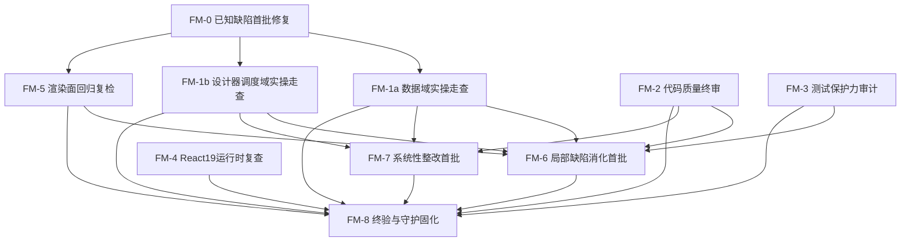

# 最终成熟度审计路线图（Final Maturity Audit: Release-Readiness Convergence Round）

> 按 `docs/skills/roadmap-and-mission-authoring-with-consensus-review.md` 产出（线性 roadmap 选型，见 Purpose）。
> Last Updated: 2026-10-18（FM-0/FM-2/FM-3/FM-4 收口（plan 642/643/644/645）；剩余 FM-1a/FM-1b/FM-5/FM-6/FM-7/FM-8）
> Source: 2026-10-17 用户终审指令（"对本项目进行最后的彻底的审计，确保达到成熟产品的稳定和可靠程度"）+ 两项已知缺陷现场反馈（CRUD 列宽拖拽不灵、固定列全选样式不生效）；`docs/skills/README.md`（提示词矩阵索引）；`docs/backlog/visual-quality-r2-roadmap.md`（视觉一期二期已 done 的基线与盲区诊断）；`docs/logs/2026/10-17.md`（gantt 拖拽 e2e 既有红归因）
> Mission: `missions/final-maturity-audit.json`
> 状态: **active**（2026-10-17 共识审查 3 轮通过，见文末 Review Record）——执行队列已开放，FM-0 可立即立项

## Purpose

本文件是项目**收官前最后一轮彻底审计**的阶段索引与状态面，按 `docs/backlog/00-roadmap-authoring-guide.md` 编排。目标：把项目收敛到"成熟产品的稳定与可靠程度"——交互操作全部真实可用、渲染面无回归、代码面无已知反模式、测试面有判别性守护、全量门禁绿。

**诊断优先（为什么审了多轮仍有问题，本轮改什么）**：

1. **视觉走查不等于交互实操**。R2 视觉走查（260 单元 uncovered=0，2026-09-24 收官）的证据 = 截图 + computed style 取证，pass/fail 程序化但**从不实际操作**——"拖得动吗、点完状态对吗"这类操作后状态只有真实交互才暴露。本轮两项已知缺陷（列宽拖不动、全选后固定列无选中样式）全部属于该盲区。
2. **没有与成熟产品对标的手感基准**。AMIS 参考源码就在 `~/sources/amis`，但表格列宽拖拽、固定列状态样式从未做过 AMIS 对标走查（本次代码定位已证实实现与 AMIS 的机制差距，见 Current Baseline）。
3. **审计提示词从未作为矩阵跑完最后一遍**。`docs/skills/` 积累了 20+ 个对象级审计提示词，分散在各 roadmap 中各自跑过部分维度，从未在同一收官轮中逐个过一遍并留下"已终审"标记。
4. **交互类守护缺位**。拖拽类交互 e2e 存在现役红（`gantt-bars-and-linkspec` 中 bar drag resize 5/5 失败，2026-10-17 日志既有红归因）——说明交互回归无判别性 e2e 兜底。

结论：这是**覆盖面问题**（交互实操维度 + 提示词矩阵终审从未成规模跑过），不是反复复发的不变式缺失 → 走**线性 roadmap**（FM-0 已知缺陷先修 → 交互实操走查 + 代码/测试/运行时/视觉四路终审 → 归族消化 → 终验固化），不做持续闭环。

## Work Item Status

> **全文件唯一的动态状态区。** 状态流转：plan 通过 draft review → `todo` 改 `planned`；closure audit 通过 → `planned` 改 `done`（不得提前）。带字母后缀的行是同一域内彼此独立的 closure 单元，各自携状态。Plan 列出现链接不代表 `planned`，一律以 Status 列为准。

| Work Item                                                                                                                                              | Status | Owner Doc                                                                                                                 | Dependencies                   | Plan                                                               |
| ------------------------------------------------------------------------------------------------------------------------------------------------------ | ------ | ------------------------------------------------------------------------------------------------------------------------- | ------------------------------ | ------------------------------------------------------------------ |
| FM-0. 已知交互缺陷首批修复（P0）：CRUD 表格列宽拖拽对标 AMIS 重构 + 固定列行级状态样式透传（选中/hover/斑马纹）+ 表头全选固定列视觉核验 + 表内同族清扫 | `done` | `docs/architecture/styling-system.md`、`docs/components/table/design.md`                                                  | —                              | `docs/plans/642-final-maturity-fm0-table-interaction-plan.md`      |
| FM-1a. 交互实操走查批一：数据域（CRUD/表格族/列表卡片/树/表单/弹层/分页）——browser-use 实操驱动，判别取证                                              | `todo` | `docs/skills/interaction-state-audit-prompt.md`、`docs/audits/interaction-state/`（台账）                                 | FM-0                           | —                                                                  |
| FM-1b. 交互实操走查批二：设计器/调度/移动/AI/3D 域——browser-use 实操驱动，判别取证                                                                     | `todo` | 同上 + `docs/skills/complex-component-display-operability-audit-prompt.md`                                                | FM-0                           | —                                                                  |
| FM-2. 代码质量与反模式终审批（code-quality + workaround 残余 + deep-audit 核心维度 + adversarial 抽查）                                                | `done` | `docs/skills/code-quality-audit-prompt.md`、`docs/skills/workaround-code-smell-audit-prompt.md`                           | —（可先行）                    | `docs/plans/643-final-maturity-fm2-code-quality-audit-plan.md`     |
| FM-3. 测试保护力审计批（单测契约覆盖审计 + 探索性契约测试 + 探索性 e2e）                                                                               | `done` | `docs/skills/unit-test-logic-and-contract-coverage-audit-prompt.md`、`docs/skills/exploratory-contract-testing-prompt.md` | —（可先行）                    | `docs/plans/644-final-maturity-fm3-test-protection-audit-plan.md`  |
| FM-4. React19 与运行时健壮性复查批（react19 review + `check:audit-*` 全家 + UR-8 异步安全/UR-9 错误传播门禁复核）                                      | `done` | `docs/skills/react19-best-practices-review.md`、`docs/backlog/cross-roadmap-remediation-roadmap.md`（UR-8/9 done 记录）   | —（可先行）                    | `docs/plans/645-final-maturity-fm4-react19-runtime-review-plan.md` |
| FM-5. 渲染面回归复检批（R2 基建增量复检轮 + ux-design-pattern audit）                                                                                  | `todo` | `docs/skills/visual-page-quality-inspection-prompt.md`、`docs/audits/visual-quality-r2/`                                  | FM-0                           | —                                                                  |
| FM-6. 局部缺陷消化·首批（**本行 = 首批，范围 = FM-1/FM-2 归族后台账中最大的 local 族，closure 时裁定登记**）                                           | `todo` | `docs/audits/final-maturity-audit/`（台账落点，FM-0 新建）                                                                | FM-1a、FM-1b、FM-2、FM-3、FM-5 | —                                                                  |
| FM-7. 系统性根因整改·首批（**本行 = 首批，范围 = 最大的 systemic 族**——设计系统令牌/契约层缺口）                                                       | `todo` | `docs/architecture/styling-system.md`、`packages/theme-tokens`                                                            | FM-1a、FM-1b、FM-2             | —                                                                  |
| FM-8. 终验与守护固化：browser-use 关键旅程 e2e 化 + 覆盖对账 uncovered=0 + 全量门禁 + 提示词矩阵终审标记 + 收官                                        | `todo` | `docs/references/e2e-test-diagnostic-guide.md`、`docs/logs/`                                                              | 全部                           | —                                                                  |

## Framework / Platform Reuse

- **交互实操手段**：ZCode 会话内 browser-use skill（`browser-use:control-browser` 导航/取证、`browser-use:web-gui-tester` 黑盒 GUI 探索）+ Playwright e2e 判别断言。快照截图仅用于诊断评审，pass/fail 判据必须程序化（AGENTS.md 快照政策）。
- **走查口径（不新造）**：`docs/skills/interaction-state-audit-prompt.md`（六类 A–F + 不变量 V1–V6）为 FM-1 主口径；`complex-component-display-operability-audit-prompt.md` 为设计器/调度复杂控件口径；`visual-page-quality-inspection-prompt.md` + R2 基建（清单枚举、截图矩阵 runner、台账对账命令、evidence card 模板）为 FM-5 复检口径。
- **R2 覆盖基建直接复用**：页面清单程序化枚举（route-model）、控件清单（renderer definitions）、`docs/audits/visual-quality-r2/` 台账与对账命令——FM-1 的走查清单与 FM-5 的复检范围都从它派生，不重建。
- **交互状态台账**：沿用 `docs/audits/interaction-state/` 的台账结构（逐条 ID + 三态归族）；本轮台账**落点**为 `docs/audits/final-maturity-audit/`（见 Cross-Cutting 2）。
- **审计脚本全家**：`pnpm check:audit-*`（suspects / runtime-raw-schema-reads / fieldframe-bypasses / async-failure-paths / hardcoded-type-dispatch / missing-renderer-markers / test-global-leaks / performance-suspects / styling-suspects 等）+ `pnpm audit:knip` / `audit:mutants` / `audit:semgrep` / `audit:react-doctor`——FM-2/FM-4 的程序化底座。
- **AMIS 对标源码**：`~/sources/amis`（本机参考源，非仓库内容）——FM-0 及 FM-1 交互手感争议时的对标依据；引用其文件路径 + 机制结论，不复制代码（注意许可证差异，实现须为本仓自有代码）。
- **mission-driver 闭环**：roadmap → plan → draft review → 执行 → closure audit → 回写，先例充分。

## Audit Prompt Matrix（docs/skills 提示词矩阵——FM-8 收官时逐行打终审标记）

| 提示词                                                                                                                                                                                                                                                                                                                              | 归属 Work Item       | 角色                                                                               |
| ----------------------------------------------------------------------------------------------------------------------------------------------------------------------------------------------------------------------------------------------------------------------------------------------------------------------------------- | -------------------- | ---------------------------------------------------------------------------------- |
| `interaction-state-audit-prompt.md`                                                                                                                                                                                                                                                                                                 | FM-1a、FM-1b         | 主口径（A–F 六类 + V1–V6）                                                         |
| `complex-component-display-operability-audit-prompt.md`                                                                                                                                                                                                                                                                             | FM-1b                | 复杂控件可操作性口径                                                               |
| `visual-page-quality-inspection-prompt.md`                                                                                                                                                                                                                                                                                          | FM-5                 | 渲染面复检口径                                                                     |
| `ux-design-pattern-audit-prompt.md`                                                                                                                                                                                                                                                                                                 | FM-5                 | UX 模式/成熟度口径（源码侧口径，与渲染面走查叠加使用，不替代 browser-use 取证）    |
| `code-quality-audit-prompt.md`                                                                                                                                                                                                                                                                                                      | FM-2                 | 代码质量主口径                                                                     |
| `workaround-code-smell-audit-prompt.md`                                                                                                                                                                                                                                                                                             | FM-2                 | 临时方案/反模式口径（WA 轮残余复核）                                               |
| `deep-audit-prompts.md`                                                                                                                                                                                                                                                                                                             | FM-2                 | 结构化多维审计（核心维度子集）                                                     |
| `open-ended-adversarial-review-prompt.md`                                                                                                                                                                                                                                                                                           | FM-2                 | 对抗性抽查（信号驱动）                                                             |
| `unit-test-logic-and-contract-coverage-audit-prompt.md`                                                                                                                                                                                                                                                                             | FM-3                 | 测试保护力主口径                                                                   |
| `exploratory-contract-testing-prompt.md`                                                                                                                                                                                                                                                                                            | FM-3                 | 失败测试先行的契约探查                                                             |
| `exploratory-e2e-testing-prompt.md`                                                                                                                                                                                                                                                                                                 | FM-3                 | e2e 失败探索                                                                       |
| `react19-best-practices-review.md`                                                                                                                                                                                                                                                                                                  | FM-4                 | React 19 口径                                                                      |
| `bug-diagnosis-prompt.md` / `bug-diagnosis-execution-template.md`                                                                                                                                                                                                                                                                   | 各 Fix 批执行期      | 缺陷诊断方法论（非批次口径）                                                       |
| `test-first-implementation-prompt.md`                                                                                                                                                                                                                                                                                               | 各 Fix 批执行期      | 实现方法论（非批次口径）                                                           |
| `implementation-contract-review-prompt.md` / `diff-standards-and-spec-review-prompt.md`                                                                                                                                                                                                                                             | 各 plan review 期    | 草案/差异审查工具                                                                  |
| `flux-component-design-review-prompt.md`                                                                                                                                                                                                                                                                                            | Out of scope（本轮） | 组件设计评审（pre-implementation design review；本轮为终审收口，无新组件设计评审） |
| `deprecated-feature-cleanup.md`                                                                                                                                                                                                                                                                                                     | FM-2 辅助            | deprecated 残留扫尾                                                                |
| `architecture-deepening-review-prompt.md`                                                                                                                                                                                                                                                                                           | Out of scope         | 结构性深化≠成熟度收口（不进本轮）                                                  |
| `ai-tone-and-filler-review.md`                                                                                                                                                                                                                                                                                                      | Out of scope         | 文案语气（不进本轮）                                                               |
| `doc-evaluation.md`                                                                                                                                                                                                                                                                                                                 | FM-8 辅助            | owner doc 终审一致性                                                               |
| `discussion-grilling-prompt.md` / `plan-grilling-question-document-prompt.md` / `next-gen-lowcode-attractor-discovery-prompt.md` / `roadmap-and-mission-authoring-with-consensus-review.md` / `audit-remediation-roadmap-authoring-prompt.md` / `code-refactor-discovery-prompt.md` / `code-refactor-prompt.md` / `branch-merge.md` | 元方法/后续方向      | 非对象审计，不进本轮                                                               |

## Current Baseline（2026-10-17 live 核对）

- **已知缺陷 1（列宽拖拽）**：拖拽命中区为全 th 高（`absolute h-full` + th `relative`），但仅 `w-1`（4px）宽、贴列缘内侧无外扩（`use-column-resize.ts` `createColumnResizeHandleProps` 的 `w-1` 类；AMIS 为 7px + `right:-4px` 越出列缘 + z-index:15）——命中困难；`.nop-table` 未设 `table-layout: fixed`（`packages/ui/src/components/ui/table.tsx` 仅 `w-full`，`packages/ui/src/styles/table.css` 无布局规则），auto 布局下拖拽宽度是"建议值"，被内容宽度反噬产生"拖不动"；pointermove 每像素 `setDraggingWidths` 触发整表重渲染，无 rAF 节流。AMIS 参照：`Table-content-colDragLine`（7px 宽、top:0/bottom:0 全高、`right:-4px` 外扩、z-index:15、hover/`is-resizing` 高亮）、`colWidths.width || realWidth` 锚定实测宽、`is-layout-fixed`（`table-layout: fixed`）+ `syncTableWidth` 同步整表宽、document 级 mousemove（`~/sources/amis/packages/amis-ui/src/components/table/index.tsx` onResizeMouseDown/Move/Up、`~/sources/amis/packages/amis-ui/scss/components/_table.scss`）。
- **已知缺陷 2（固定列选中样式）**：行级状态背景打在 `tr` 上（`table-row-class-name.ts`：`hover:bg-[var(--table-hover-bg)]`、`data-[state=selected]:bg-[var(--table-selected-bg)]`；斑马纹 `tbody tr[data-striped]`），而 sticky 单元格自带静态不透明背景 `.nop-table [data-fixed]{background:var(--table-fixed-bg,...)}`（`packages/ui/src/styles/table.css`）——单元格背景盖掉行级选中/hover/斑马纹。`fixed-columns.ts` 注释声称"AMIS `.is-sticky { background: inherit }` 等价语义"，live CSS 未实现该语义（注释漂移，须就地勘误）。表头全选 checkbox 的 checked 视觉在固定列场景的实际表现（state 公式在 `table-renderer.tsx` headerSelectAllChecked）待 FM-0 用 browser-use 现场复核定位。
- **同族现役证据**：`gantt-bars-and-links.spec.ts`「bar drag resize-right changes width」HEAD 既有红 5/5（2026-10-17 日志 D-1 既有红归因）——拖拽交互无守护的实证，FM-1b 走查必含。
- **视觉面基线**：R2 视觉走查 done（pages 121 + controls 139 = 260 单元 uncovered=0，2026-09-24 收官）——FM-5 复检以它为 diff 基线，只跑增量 + 抽样，不重跑全量。
- **姊妹审计队列现状（live 计数 2026-10-17，本 roadmap 不接管，见 Cross-Cutting 5）**：interaction-state（IS-0–IS-9 含字母后缀，14/14）、workaround-code-smell（WA-0–WA-16 + CX-1–CX-20 全部）、dom-structure（W0–W9）三条队列的工作项**已全部 done**；workaround 的真实残余 = 其 findings 台账的 watch-only / successor-required 处置项（`docs/audits/workaround-code-smell/ledger.md`）；cross-roadmap UR 队列 7 open（UR-14–UR-20 全 `todo`，UR-1–UR-13 已 done）。
- **在册相邻 plan**：`docs/plans/628-deep-audit-remediation-plan.md`（active）已承接验证基线恢复（playground vite.config 既有红、scada-editor-perf 裁决）与静态债全量 triage（knip/scanner/duplicates）——FM-2/FM-4 执行时以其为去重对照，重叠发现注记归属，不双记账。
- **全仓基线**：master 最近收口记录为全绿 − 既有登记红（playground vite.config typecheck 既有红 [10-16 归因]、playground 测试 4 项归因并发 plan 621、knip xlang hit 并发归属）——基线恢复由上述 plan 628 Phase ① 承接；逐 Wave 验证数字见 `docs/logs/2026/10-17.md` 各 Wave 节。

## Phase Details

### FM-0. 已知交互缺陷首批修复（P0）

交付：①列宽拖拽对标 AMIS 机制重构——全高外扩命中区（≥7px、越出列缘、补 z-index）、hover/拖拽中视觉反馈、保留并强化既有实测宽锚定（`measuredColumnWidth` 已按 getBoundingClientRect 取实测宽，勿重复造）、`table-layout` 策略裁决（fixed + 整表宽同步，或等价的确定性布局方案，须在 plan 中给出裁决与判别证据）、拖拽过程渲染节流、收缩钳制 minWidth；②固定列行级状态样式透传——`background: inherit` 语义（或等价令牌透传）使选中/hover/斑马纹在 sticky 单元格生效，修正 `fixed-columns.ts` 注释漂移；③表头全选 checkbox 固定列场景视觉核验（browser-use 现场复现 → 定位 → 修复）；④表内同族清扫——同包内全部 sticky 列消费者与全部 pointer 拖拽交互（行拖拽排序、列宽）逐个核对命中区/反馈/状态透传；⑤判别性单测 + e2e 先红后绿（旧实现必挂、新实现通过）；⑥建立 `docs/audits/final-maturity-audit/` 台账结构（沿用 interaction-state 台账模式：逐条 ID + 三态归族 + 对账口径），后续批次发现统一落此。AMIS 机制仅为对标参照，实现须为本仓自有代码。

### FM-1a / FM-1b. 交互实操走查（两批）

对所辖页面/控件做**真实操作**走查（browser-use 实操：拖、点、选、滚、开合、键入），每个交互点取证 = 操作前/中/后状态读数 + 程序化断言；按 interaction-state 口径六类 A–F 归档，发现三态归族（systemic→FM-7 / local→FM-6 / watch-only→台账）。FM-1a 范围：CRUD 全选/半选/cap/keepOnPageChange、行拖拽、列设置、筛选排序、分页、表单校验提交、弹层嵌套开合。FM-1b 范围：gantt/kanban/calendar/barcode、flow/report/spreadsheet/page/word 设计器、mobile 手势、AI 会话 HITL、3D 交互；gantt bar drag resize 既有红在本批收口或归因。批次超出单 plan 能力按 Rule 3 预授权字母后缀滚动。

### FM-2 / FM-3 / FM-4. 代码/测试/运行时三路终审（读代码与脚本驱动，可先行）

- FM-2：按 code-quality + workaround 口径对全仓跑最后一轮（输入 = workaround 台账 watch-only / successor-required 处置项现场复核 + plan 628 静态债 triage 去重对照），deep-audit 核心维度（contract drift/死代码/错误吞噬）+ adversarial 抽查；发现三态归族。
- FM-3：按单测契约覆盖口径审计测试保护力（重点：交互类判别测试缺位面，如拖拽/全选），exploratory contract testing 写失败测试探查契约洞；产出补测清单进 FM-6/FM-7 消化。
- FM-4：react19 review + `check:audit-*` 全家 + `audit:knip/semgrep/react-doctor` 全跑，UR-8 异步安全/UR-9 错误传播已 done 门禁复核无回退；新增可疑点按既有门禁治理惯例登记或修复。

### FM-5. 渲染面回归复检

复用 R2 基建：对 R2 收官（2026-09-24）后新增/改版的页面与控件全量复检 + 存量抽样复检（抽样比例 plan 裁定并记录），同探针口径输出评分卡对比；叠加 ux-design-pattern 口径。新发现三态归族。

### FM-6 / FM-7. 归族消化（首批 + 字母后缀滚动）

FM-6 = 最大 local 族按"审计卡 + test-first + 类别清扫"机制消化；FM-7 = 最大 systemic 族（令牌/契约层）整改。两者都在 closure 时裁定首批范围并登记台账；每批批内同探针复检通过后回写台账 `verified`；后续族按字母后缀另起新行滚动承接（预授权，见 Rule 3）。

### FM-8. 终验与守护固化

①FM-1 走查中价值最高的交互旅程沉淀为 Playwright e2e（browser-use 探索 → `tests/e2e/` 正式化，遵守 `_tmp` 提升纪律）；②覆盖对账 uncovered=0；③`pnpm typecheck/build/lint/test/check` 全绿（newHits=0，豁免基数不增）；④Audit Prompt Matrix 逐行打终审标记（已过/裁剪理由）；⑤owner docs 同步 + daily log 收官记录。

## Dependency Graph

## Cross-Cutting

1. **browser-use 实操强制**：FM-0/FM-1a/FM-1b/FM-8 的取证必须含真实操作（非仅截图）；pass/fail 判据程序化（DOM 状态 / computed style / 交互后状态读数），截图仅诊断评审用。无实操证据的走查卡复核驳回。
2. **发现强制归族 + 台账对账**：每个 finding 落 {systemic→FM-7 / local→FM-6 / watch-only→台账} 三态之一；台账落 `docs/audits/final-maturity-audit/`（FM-0 建结构，沿用 interaction-state 台账模式）；roadmap 关闭前置 = 台账 uncovered=0 且全部 work item done。
3. **判别性证据强制**：所有 Fix 必须先红后绿（旧实现必挂的具体测试点名），等价/兼容声称按 plan guide 规则点名判别测试。
4. **AMIS 对标纪律**：对标结论引用 AMIS 源文件路径 + 机制描述；实现为本仓自有代码（许可证与代码风格独立），不做逐行移植。
5. **姊妹 roadmap 不接管**：interaction-state / workaround / dom-structure / cross-roadmap UR 各队列的 open 项归属原队列收口；本 roadmap 审计批次对同一表面现场复核时，若姊妹项对应缺陷仍在，按发现三态归族消化并在台账注记姊妹行坐标（防双记账）；姊妹队列自身状态不回写本文件。
6. **状态纪律**：本表为唯一动态区；状态翻转同步 `Last Updated` 与 `docs/logs/`；执行期间任何结构性修订触发新一轮独立共识审查。

## Rule

1. 本文件 Work Item Status 是唯一动态状态区；状态流转只由 plan 生命周期驱动。
2. 执行顺序按依赖图；FM-0 / FM-2 / FM-3 / FM-4 无前置可立即启动，FM-0 优先（用户已点名的 live 缺陷）。
3. 字母后缀滚动拆分已预授权：FM-1a/FM-1b/FM-5/FM-6/FM-7 各行可拆字母后缀新行滚动承接，基础行即首批、完成后即 done，拆分记录落台账；FM-0/FM-8 不在预授权范围——若超出单 plan 收口能力，须人工评审拆分；其余结构性调整（新增非预授权 work item、优先级变更、口径更换）同样须人工评审。
4. 走查与审计统一使用上表矩阵口径，不得自造检查清单；更换口径属结构性调整。
5. 每次状态翻转同步更新 `Last Updated` 与 `docs/logs/`。
6. 审查记录（draft 阶段独立子 agent 共识审查）追加在文末 Review Record；生效后不再追加。

## Review Record

> 审查输入 = 本文件 + `missions/final-maturity-audit.json` + 两份 guide（roadmap/plan authoring）+ `docs/skills/README.md`（定制化层）+ live code 抽查点（`use-column-resize.ts`、`fixed-columns.ts`、`table.css`、`table-row-class-name.ts`），不复用起草者过程上下文。

### Round 1（2026-10-17，fresh session agent_ec95fde4）

- Reviewer / Agent: 独立审查员（fresh session，review-only；六维度 + live 实测）
- Verdict: `revised`（1 Blocker / 6 Major / 4 Minor）
- 已处理（Blocker B1）：姊妹队列 open 计数失实（起草时 grep 把正文提及误计为状态行）——经 live 复核改写为实测口径：interaction-state/workaround/dom-structure 三队列工作项全 done、workaround 真实残余=台账 watch-only/successor 处置项、cross-roadmap UR 7 open（UR-14..UR-20）；FM-2 输入集与 mission 排除句同步改写，并补 plan 628 去重对照注记。
- 已处理（Major）：M1 命中区基线勘误（handle 实为全 th 高，真实差距=4px 窄/无外扩/无 z-index）；M2 依赖图 vs 表不一致（表补 FM-5→FM-6 依赖）；M3 台账落点统一为 `docs/audits/final-maturity-audit/`；M4 FM-0 补交付⑥（建台账结构）；M5 全仓基线改"全绿−既有登记红"并点名三项既有红、指针改具体 Wave 节；M6 矩阵补 `flux-component-design-review-prompt.md` 行。
- 已处理（Minor）：m1 去掉"（如存在）"；m2 Rule 3 补 FM-0/FM-8 拆分须人工评审；m3 FM-0① 改"保留并强化既有实测宽锚定"；m4 ux 口径注明源码侧叠加。

### Round 2（2026-10-17，fresh session agent_a32c9da9）

- Reviewer / Agent: 独立复审员（fresh session；Round 1 修正逐条 live 验证 + 一致性扫描 + 新失实检查）
- Verdict: `revised`（1 Major / 3 Minor；Round 1 全部修正项 PASS）
- 已处理（Major-1）：plan 628 状态失实（draft → live 核实为 active）——Baseline 与 mission 排除句已改"active plan 628"。
- 已处理（Minor）：IS 队列组成删虚增"+ CX"改"IS-0–IS-9 含字母后缀，14/14"；workaround 枚举补全"WA-0–WA-16 + CX-1–CX-20"；AMIS scss 引用补全路径 `packages/amis-ui/scss/components/_table.scss`。

### Round 3（2026-10-17，fresh session agent_63b966f8 终审）

- Reviewer / Agent: 独立终审员（fresh session；4 项定点验证 + 短程一致性扫描）
- Verdict: `approved`（定点验证 4/4 PASS——plan 628 active 双处引用、姊妹队列逐队列计数、AMIS 引用路径与机制声称、mission JSON 合法性；扫描零 Blocker/Major/Minor，10 行状态面与依赖图/Phase Details/Rule/mission 零矛盾）
- 共识达成：**0 Blocker / 0 Major**，roadmap 与 mission 同批升 `active`。执行队列未启动，FM-0 立项待下一段执行会话按 Rule 2 顺序取第一个 `todo`。
