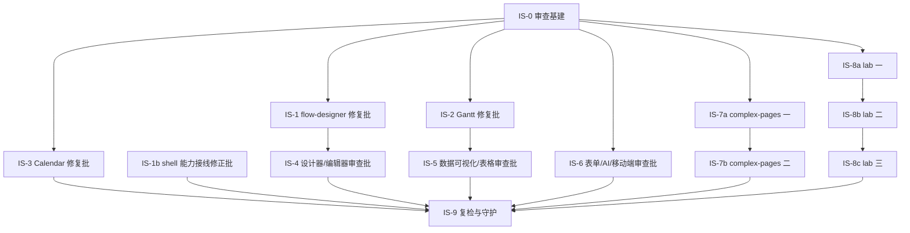

# 动态交互状态质量路线图（Interaction-State Quality Roadmap）

> Last Updated: 2026-10-07
> Source: 2026-10-07 用户报告五项交互缺陷（钉钉审批流/Action 编排"+"错位、插入节点后居中跳靠左、节点/边摘要边界不可辨、calendar 拖拽移动假反馈、gantt 拖拽后滚动归零）；`docs/skills/interaction-state-audit-prompt.md`（审查方法，随本 roadmap 新立）；`docs/references/ui-interaction-review-checklist.md`（分级与原则基线）

## Purpose

本文是动态交互状态质量轨道的阶段索引与状态面，按 `docs/backlog/00-roadmap-authoring-guide.md` 拟制：AI 或维护者读完 Phase Status 即知哪些工作项未开始（`todo`）、已立 plan（`planned`）、已完成（`done`）。

背景：此前三轮 UI 审查（ui-review R2/R3 一致性审查、visual-quality 一期读代码普查、二期渲染面静态走查）的证据形态全部是**静态状态**——代码结构或渲染后的单帧截图。已坐实缺陷全部属于"交互前-中-后状态连续性"与"家族能力接线 parity"维度，静态证据天然不可见，所以多轮审查全绿而体感仍差。本轨道是第三维专项：以 `docs/skills/interaction-state-audit-prompt.md` 为统一方法（六类缺陷 A–F、六条状态不变量 V1–V6、交互前后程序化读数对账 + 共享壳宿主 props 对账），对 playground 页面逐批做交互序列审查并修复，最后同探针复检 + e2e 守卫固化。

本文是编排层，**不是 execution plan、不是审查方法文档**；审查方法看 prompt，分级原则看 checklist。

## Phase Status

> **这是全文件唯一的动态状态区。更新状态只改这里。**
> 状态流转：plan 通过独立 draft review → `todo` 改 `planned`；plan 通过 closure audit → `planned` 改 `done`（不得提前）。一个 plan 对应本文一个工作项；执行顺序 = 本列表顺序。

- IS-0. 审查基建（页面交互清单程序化枚举 + findings 台账 + V1–V6 读数探针模板 + 序列 e2e 模板）: `done`（plan `docs/plans/543-interaction-state-is0-audit-infra-plan.md`，draft review 3 轮 R1/R2 fail→修订→R3 pass；closure audit 独立子 agent APPROVED 零 Blocker/零 Major，2 Minor 随收口回写修正、3 Trivial 记录在案）
- IS-1. flow-designer 域修复批（已坐实三项："+"几何锚定 / 插入节点后视口跳变 / 摘要卡边界对比度）: `done`（plan `docs/plans/544-interaction-state-is1-flow-designer-plan.md`，draft review R2 pass-with-minors；closure audit R1 issues 1M+5m 退回修复 → R2 APPROVED 零残留；批内新立 P1 004 一并修复，P2 005/006/007 裁决 watch/successor）
- IS-1b. shell 能力接线修正批（scada/dashboard WorkbenchShell collapsed 契约接线 + 面板头收起 affordance + 符合性守卫规则 + family mapping 契约硬化）: `done`（plan `docs/plans/538-shell-collapse-wiring-plan.md`，draft review R2 pass-with-minors；closure audit 独立子 agent APPROVED 零 Blocker/零 Major/零 Minor，2 Trivial 记 follow-up）
- IS-2. Gantt 域修复批（拖拽提交后滚动归零 + gantt 族三页序列审查）: `done`（plan `docs/plans/545-interaction-state-is2-gantt-plan.md`，draft review 4 轮 fail→修订→pass；closure audit 3 轮 R1/R2 issues 退回 → R3 APPROVED 零残留；根因 live 定位并修复，附带缺陷 002 一并修复，P2 观察项零静默）
- IS-3. Calendar 域修复批（移动语义闭环 + 区间选择可发现性/框选能力裁定 + calendar 族页面序列审查）: `done`（plan `docs/plans/546-interaction-state-is3-calendar-plan.md`，draft review R2 pass-with-minors；closure audit 3 轮 R1/R2 issues 退回 → R3 APPROVED 零残留；归属裁定 demo 接线、marquee 不做、perf 豁免、batchScheduling/SchemaRenderer 框架语义 watch 登记）（勘误 2026-10-07：原文 `#/complex-pages/cal-replica` 在 live 复合页模型中不存在，calendar 复刻面实为 `cal-booking`/`cal-confirm`/`cal-success` 三条复合页，批次归属按 plan 543 枚举器规则落 IS-3）
- IS-4. 其余设计器/编辑器域序列审查批（taskflow-designer、report×3、spreadsheet、word、print、dashboard-editor、scada-editor、debugger-lab 等）: `done`（plan `docs/plans/547-interaction-state-is4-designers-plan.md`，draft review 1 轮（基线取证即双审查组独立 live 报告）；closure audit R1 APPROVED（agent_a2f75da9——2 Major + 3 Minor + 3 Trivial 全部随收口修复：SS-1 fresh-load 过度解禁勘误、plan 终态文本矛盾重写、ledger 7 列幻影收敛、spec 死断言、host-1 abort 语义补强等，修复后 e2e 复跑 5/5）；P1 五项全落 e2e 先红后绿（taskflow-3 notify、taskflow-1 graph Save、taskflow-2 Delete 树路由——"keydown 零命中"证伪为陈旧 served 模块伪影、host-1 insertFieldWithBinding 写值、SS-1 demo hasSelection 按 selection kind 判别）；taskflow-002 残余（tree-tab Save + Import UI）显式 successor-required；22 findings（P1×5/P2×9/P3×8）+ watch 5 零静默；九页行 audited + 补翻 IS-2 批 gantt 三行，reconcile audited 18 / findings 36）（勘误 2026-10-07："report×3" 在 live 域路由中实为 2 条（`report-designer`、`report-designer-host`）；"dashboard-editor" 无独立域路由，该编辑器面内嵌于 `#/dashboard-demo`，随 IS-5 审查）（勘误 2026-10-09 plan 556：taskflow-002 残余已收口 **verified**——tree 投影同步（`syncFromTreeProjectionDoc` v1 契约）+ Export 改走 `designer:export` 内建 JSON panel（假 toast 删除）+ 页面级 Import 粘贴 dialog（画布文档注入重挂载）；e2e `taskflow-io-interaction-state` 5/5；顺带修复 `projectToTreeDocument` 的 `tf-*` 节点类型休眠缺陷、登记新 watch 行 IS-taskflow-designer-004（tree-tab entry 伪错误 toast）——详见 is4 证据卡 plan 556 附节）
- IS-5. 数据可视化与表格域序列审查批（dashboard / pivot / map / graph / three / 表格 CRUD 与分页等 domain 页）: `done`（plan `docs/plans/548-interaction-state-is5-data-viz-tables-plan.md`，draft review R1 pass 零 Blocker/Major；closure audit R1 APPROVED（agent_b5aa2b22——3 Minor + 2 Trivial 全部随收口落盘：ledger 翻转行 7 列幻影收敛、红态读数原始 error 行入卡 + spec 死区语义注记、计数口径对齐、roadmap IS-3 表行漂移清理）；15 页双审查组取证——双审查组 15 页取证 19 findings（P1×5/P2×7/P3×6+观察×1）+ n/a 豁免 4 + watch 8 全量入 ledger；P1 五项先红后绿修复（map bindings event 键 + demo toast、dashboard-editor save 求值面、shell resize change 通道、column-resize 实测锚点、perf-table perfDemo 宿主动作——对象展开表达式公式引擎不可编译的静默回退面登记框架语义 watch）；e2e data-viz-interaction-state 5/5（stash 对照红态取证）+ data/dashboard/map 包回归 1364 绿；reconcile audited 33 / findings 55）
- IS-6. 表单/AI/移动端与其余 domain 页序列审查批: `done`（plan `docs/plans/549-interaction-state-is6-form-ai-mobile-plan.md` Phase 1–3 completed、closure audit R1 APPROVED（agent_c0f3b242——1 Minor + 2 Trivial 全部随收口落盘：ledger 翻转行 7 列幻影收敛、calendar 注记精化、计数措辞）——三审查组 52 页取证 26 findings（P1×7/P2×7/P3×12）+ watch/n-a/豁免全量入 ledger；P1 七项先红后绿（ui Calendar components 身份churn 致日选静默失效——根因十探针定位、diff-view demo remount key、checkbox-group clear 句柄、form.reset 无参还原初值、ai-conversations bug-163 demo 缓解、mobile-components StrictMode 定时器、m5-showcase messages.success——按钮 ajax onSuccess 契约漂移登记框架 watch）；e2e form-ai-mobile-interaction-state 7/7（stash 对照 7/7 红）+ ui/runtime/form/mobile 回归 3017 绿；reconcile audited 85 / findings 81）
- IS-7a. complex-pages 序列审查批一（复刻页 + 工作台/编辑类复合页）: `done`（plan `docs/plans/550-interaction-state-is7a-complex-pages-a-plan.md`，draft review R1 pass 零 Blocker/Major；closure audit 两轮：R1 REJECTED（agent_580fef14，机械性发现 1B+2M+3m+1t——台账行页单元格非清单 id/计数 19→18 五面勘误/翻转行结构损坏/approval-002 缺 committed e2e/残余未注记/roadmap 预填；行为面复核绿）→ R2 APPROVED（agent_7a22a843 delta 复核：reconcile exit 0 audited 104 / findings 99、页行结构恢复、IS-approval-tasks-003 更名入账、e2e 8/8、残余注记落卡）——详见 plan Closure Audit Evidence——双审查组 19 页取证（20 条组 findings 去重合并 18 台账行）（P1×8/P2×8/P3×2）+ watch/n-a/撤案全量入 ledger；P1 八项先红后绿（advanced-query 客户端过滤匹配器补齐、数组行假校验双层修复、master-detail 操作列双层、business-doc 预留带、wizard engagement gate+发布时序、approval confirm-bridge 按需挂载/去死哨兵）；e2e complex-pages-interaction-state 8/8 + 全 workspace test ~15.8k 绿；reconcile audited 104 / findings 99）
- IS-7b. complex-pages 序列审查批二（其余复合页）: `done`（plan `docs/plans/551-interaction-state-is7b-complex-pages-b-plan.md`，draft review 两轮 R1 FAIL（1 Major 反模式出处误标）→修订→R2 pass 零 Blocker/Major；closure audit 两轮：R1 REJECTED（agent*df39dfbf——2 Blocker：首版三卡合一静默丢 4 字段 + 重置 componentId 悬空致台账 grouped-002 假 verified；1 Major：9 个 \_tmp-is7b-* 一次性 spec 滞留 tests/e2e 其一失败；+ minors：submitForm 合一落库语义未注记 / roadmap 预填 APPROVED / 类别记号不对齐；行为面复核绿）→ R2 APPROVED（agent*9554d886 delta 复核：reconcile exit 0 audited 122 / findings 113 = found 74 + verified 39、grouped 重建 10 字段在位 + 重置改指 + 卡 testid 存活、complex-pages-replica-interaction-state 4/4 含 fill→reset→cleared、ledger 页行 6 列 profile dynamic $4 清零、\_tmp-is7b-* 清零）——详见 plan Closure Audit Evidence——双审查组 18 页取证 14 findings（P1×6/P2×2/P3×6，无跨组合并）+ watch/n-a/撤案全量入 ledger；P1 五项先红后绿（antdpro 双死钮移除、grouped 三卡合一 form 通道、form-dialog mock 落库、inbox topbar 自适配带）+ airtable-001 如实降级 watch-only（三次受控复探未复现，复现配方待重建）+ render-host 校验拒绝结果不打 console.error；e2e complex-pages-replica-interaction-state 4/4（stash 对照 4/4 红）+ playground 407 绿；reconcile exit 0 audited 122 / findings 113）
- IS-8a. renderer lab 序列审查批一（basic / form / form-advanced / data）: `done`（plan `docs/plans/552-interaction-state-is8a-renderer-lab-a-plan.md`，draft review 两轮 R1 FAIL（1 Blocker 组 B 漏 lab-form 81≠82 + 1 Major 反模式⑨出处误标）→修订→R2 pass 零 Blocker/Major；closure audit 三轮：R1 REJECTED（agent_47592b5c 独立审计——行为面与台账力学全绿独立复核（reconcile exit 0 audited 204 / findings 145、e2e 10/10、flux-runtime 1494|1 skip、id 无撞号、82 翻转行结构完好）；退回仅限计数勘误 2 Major（严重度拆分 P2×13/P3×12 → 台账实际 P2×12/P3×13 三面勘误；plan Phase 2 verified 计数内部矛盾——实为 9 = 6 P1 + 3 P2，recurse P1 withdrawn）+ 2 Minor（raw 计数链 37→34→32 缺组内并账步注记；roadmap 预填 APPROVED））→ R2 REJECTED（agent_c49da75f——delta 复核：严重度拆分/计数链/roadmap 两轮记录三处修正在位，但 plan Phase 2 Proof「七 P1 verified」矛盾原文未改（R1 Major #2 指名落点未落盘））→ R3 APPROVED（agent_dbbcd3fc——delta 复核：R1 四项 + R2 一项六面勘误全在位——reconcile exit 0 audited 204 / findings 145 = found 97 + verified 48、e2e 10/10、IS-7a 行在位、无撞号）——详见 plan Closure Audit Evidence——四审查组 82 页取证 37 条组原始观察 → 组内并账 34 组行 → 32 台账行（P1×7/P2×12/P3×13 + recurse 撤案）；P1 六项 + P2 三项 verified、recurse-001 撤案单列（scope 通知层无重放共享根因、rating max 钳制、date-range 两击契约、city 非叶钻取、crud dialog dirty 链、lab 壳 notifyWithToast、password 死键）；recurse-001 撤案 artifact-proof e2e 防回归；e2e renderer-lab-interaction-state 10/10；reconcile exit 0 audited 204 / findings 145 = found 97 + verified 48）
- IS-8b. renderer lab 序列审查批二（content / layout / mobile / ai）: `done`（plan `docs/plans/553-interaction-state-is8b-renderer-lab-b-plan.md`，draft review 两轮 R1 FAIL（agent_ccf375f7——2 Major 出处误标：视口仿真先例 550 实为 549、AI 族求值结论 551 实为 549）→修订→R2 pass；closure audit 两轮：R1 REJECTED（agent_409cd645——行为面与台账力学独立复核全绿，退回仅限机械勘误：严重度拆分 P2×3/P3×11 → 实为 P2×6/P3×8 三面勘误、撤案计数 11 → 实为 9、dev log 553 条目缺位）→ R2 APPROVED（delta 复核）——详见 plan Closure Audit Evidence——四审查组 48 页取证 16 findings（P1×2/P2×6/P3×8，无合并）+ watch/n-a/撤案全量入 ledger；P1 两项先红后绿（wizard nav 门禁绕过——linear furthestReached+1 的 nav 点击禁用仅留 commit 通道；wizard back 丢值——mountOnEnter 默认翻转为保持挂载）；其余显式 watch-only；e2e renderer-lab-b-interaction-state 2/2（stash 对照 2/2 红）+ layout 145 绿；reconcile exit 0 audited 252 / findings 160 = found 110 + verified 50）
- IS-8c. renderer lab 序列审查批三（scheduling / graph / map / pivot / dashboard / 3d / industrial）: `done`（plan `docs/plans/554-interaction-state-is8c-renderer-lab-c-plan.md`，draft review 两轮 R1 FAIL（agent_77408fb4——1 Major 反模式④子锚点出处误标：kanban 空列投放属 549 非 550）→修订→R2 pass；closure audit 两轮：R1 REJECTED（agent_409cd645——行为面与台账力学独立复核全绿，退回仅限机械勘误：严重度拆分/撤案计数/dev log 条目缺位）→ R2 delta 复核 APPROVED——详见 plan Closure Audit Evidence——单审查组 4 页取证 8 findings（P1×1/P2×2/P3×5）；唯一 P1（gantt-001 对话框条逃逸）显式 successor-required（三候选诊断）；e2e 不建（零已验证修复面路径注记）；reconcile exit 0 audited 256 / findings 168 = found 118 + verified 50）（勘误 2026-10-07：live shared lab 路由中该组仅 scheduling 有 4 条；graph/map/pivot/dashboard/3d/industrial 无 lab 路由，其审查面为 domain 页、已归 IS-4/IS-5）（勘误 2026-10-09 plan 556：唯一 P1 `IS-lab-gantt-001` 经专案 live bisect 改判 **withdrawn（探针伪影）**——条 rect 超界系 scroll-content 布局坐标被误读为绘制逃逸、"条上 dismiss"系 backdrop outside-press 正确语义被 rect 瞄准误归因、满格拖拽提交落库且不 dismiss 经受控实验证实、三候选（transform/裁剪链/scroll-sync）全排除；`IS-lab-gantt-002` 随批复测同撤（手柄 rect 同类伪读数 + scrollLeft 0→54 定位为 useGanttInitialCenter 设计内对中今天）；守护 `tests/e2e/renderer-lab-c-interaction-state.spec.ts` 3 用例落位（554 留空位补齐）——详见 is8c 证据卡 plan 556 附节）
- IS-9. 复检与守护固化（同探针复检轮 + V1–V6 不变量共享 e2e helper 沉淀 + 覆盖对账 uncovered=0 + 门禁扩展评估）: `done`（plan `docs/plans/555-interaction-state-is9-recheck-guards-plan.md`；复检轮 10 committed interaction-state spec 50 通过全绿（2026-10-09 逐 spec 实测；声明 49 + flow-designer V4 双 Tab 展开例 1）；dingtalk-flow-demo 处置裁定 = 页面已删除（plan 2026-08-07-1053-2 删页），flip audited → **uncovered=0**；守护固化 = committed spec 即守护（10 spec × 49 用例按不变量组织，不另建 helper 层——V1 滚动/data-viz、V2 视口/551、V3 反馈全批、V4 几何/wizard、V5 取消全批、V6 实体/8a）；门禁扩展评估 = 静态可检子集留后续；IS-lab-gantt-001 P1 successor-required 正式登记于 plan Deferred（三候选诊断在 is8c 证据卡）；closure audit 两轮：R1 REJECTED（agent_5d399e92——行为面与台账力学全绿独立复核；退回仅限记录勘误 2 Major（用例计数 49 → 运行时 50 通过含 calendar 2 例与 flow-designer V4 双 Tab 展开例，三面勘误；closure audit 与 draft review 混写）+ 2 Minor（gantt-001 登记处措辞、helper 前提勘误入 IS-9 节））→ R2 delta 复核 APPROVED（agent_5d399e92 前置复核 + 收口确认））（勘误 2026-10-09 plan 556：IS-lab-gantt-001 successor-required 已由专案 live bisect 收口为 withdrawn——"successor-required 正式登记"的历史表述由本注记承接，现状见 IS-8c 行 556 勘误）
- Successor. successor-required 专案收口批（gantt-001 bisect 裁决 + gantt-002 复测 + taskflow-002 残余修复）: `done`（plan `docs/plans/556-interaction-state-successor-residuals-plan.md`，draft review 两轮 R1 FAIL（agent_418a0b48——1 Major：baseline draggable 因果写反 + 5 Minor）→修订→R2 pass；closure audit 见 plan Closure Audit Evidence——Phase 1：gantt-001/gantt-002 live bisect 双双改判 withdrawn（rect-vs-paint 探针伪影 + backdrop outside-press 误归因 + scrollLeft 定位为 useGanttInitialCenter 设计内对中），守护 `renderer-lab-c-interaction-state.spec.ts` 3 用例落位（554 留空位补齐）；Phase 2：taskflow lib tree 投影同步先红后绿（4 新例 + 既有 7 例 11/11，v1 契约：链式行走 + fan-out 即分支 + 载荷按 id 合并/默认、显示名默认节点 id——投影无 step 载荷如实入卡）+ import-json 补 `projectedTreeDoc`；Phase 3：Export 改 `designer:export` 真面删假 toast、页面级 Import 粘贴 dialog + 画布注入重挂载、顺带修复 `projectToTreeDocument` tf-\* 前缀休眠缺陷；新 watch 行 IS-taskflow-designer-004（tree-tab entry 伪错误 toast）零静默；e2e taskflow-io 5/5 + 四 spec 21/21；reconcile exit 0 audited 257 / findings 169 = found 118 + verified 51）

## Framework / Platform Reuse

以下能力已存在，**不得重建**，只做组装：

| 能力                         | 提供方                                                                                                                                                                                                                                                                                                                                                                                                                                                           | 说明                                                                                                    |
| ---------------------------- | ---------------------------------------------------------------------------------------------------------------------------------------------------------------------------------------------------------------------------------------------------------------------------------------------------------------------------------------------------------------------------------------------------------------------------------------------------------------- | ------------------------------------------------------------------------------------------------------- |
| 审查方法与分类法             | `docs/skills/interaction-state-audit-prompt.md`                                                                                                                                                                                                                                                                                                                                                                                                                  | 六类 A–F + 不变量 V1–V6 + 前后读数协议 + 共享壳宿主对账，所有批次统一口径                               |
| 契约符合性守卫               | `scripts/check-designer-conformance.mjs` + `scripts/__tests__/check-designer-conformance.test.ts`                                                                                                                                                                                                                                                                                                                                                                | F 类 finding 的守卫固化落点（进 `pnpm check` 链）                                                       |
| 分级与原则基线               | `docs/references/ui-interaction-review-checklist.md`                                                                                                                                                                                                                                                                                                                                                                                                             | P0–P3 分级、上下文连续原则（§4.2）                                                                      |
| 清单程序化枚举与覆盖台账机制 | visual-quality R2-0 先例（`docs/audits/visual-quality-r2/inventory/` + `ledger.md` + 对账命令）                                                                                                                                                                                                                                                                                                                                                                  | 状态机模式照搬（本轨道：`pending → found → fixed → verified`），台账落 `docs/audits/interaction-state/` |
| 浏览器真实驱动               | Playwright（`tests/e2e/`）、browser-use / web-gui-tester 技能                                                                                                                                                                                                                                                                                                                                                                                                    | 交互序列执行与取证                                                                                      |
| 计算样式/几何断言基建        | `tests/e2e/helpers/`                                                                                                                                                                                                                                                                                                                                                                                                                                             | boundingRect、computedStyle 读数断言                                                                    |
| e2e 诊断方法                 | `docs/references/e2e-test-diagnostic-guide.md`、`playwright.config.ts`                                                                                                                                                                                                                                                                                                                                                                                           | 序列测试编写与调试                                                                                      |
| 裁决台账惯例                 | `docs/analysis/ui-review/R2-consistency-audit.md` §R3（逐条 ID + 去向三态）                                                                                                                                                                                                                                                                                                                                                                                      | P2/P3 登记不修时的显式裁决                                                                              |
| playground 路由模型          | `apps/playground/src/route-model.ts` + `domain-route-pages.tsx`（75 domain 页；勘误 2026-10-07：live `DOMAIN_RENDERER_ROUTES` 为 80 条）+ `complex-pages-model.ts`（47 复合页；勘误 2026-10-07：live `COMPLEX_PAGE_ENTRIES` 为 40 条，47 是文件内 `id:` 出现次数的表面计数）+ `renderer-lab-registry.ts`（~133 lab 路由；勘误 2026-10-07：该文件实为 React 组件注册表不含路由 id，lab 路由清单在 `route-model.ts` `ALL_SHARED_RENDERER_ROUTES`，live 为 134 条） | 枚举源，禁止手抄清单                                                                                    |

## Current Baseline

- **已坐实问题种子清单**（2026-10-07 用户报告 + 代码定位，全部待修）：
  1. **"+"插入按钮错位**（钉钉审批流 + Action 编排两 Tab 共用）：按钮渲染 `packages/flow-designer-renderers/src/dingflow/ding-flow-plus-button.tsx`（TB: `bottom: -centerDistance; left: 50%`），几何常量单源 `packages/flow-designer-core/src/tree-projection.ts` L40-56（`BTN_CENTER_DIST=36` / `BTN_DIAMETER=28` / `MIN_CHAIN_GAP`）。候选根因：几何常量与实际节点壳渲染尺寸不一致，或分支/合并 overlay 投影（`dingflow/dingflow-overlays.ts`）在特定树形下过期。待 V4 读数对账定位。
  2. **插入节点后画布从整体居中跳为靠左**（同两 Tab）：候选根因：视口居中/fitView 策略只在初始挂载生效，插入后树重投影改变内容包围盒而视口 transform 不跟随（V2 违反）。待前后读数定位（参考既有 `tests/e2e/flow-designer-alignment.spec.ts`——它只断言节点间对齐，不断言视口变换稳定）。
  3. **节点/边摘要边界不可辨**：`packages/flow-designer-renderers/src/designer-node-card.tsx` L73 常态 `border border-border/60`（60% 透明度灰，接近不可见）；`designer-edge-row.tsx` L76 常态 `border-transparent`；缺失节点渲染裸 div 无占位（L52-63）。D 类 + V6 违反，坐实。
  4. **calendar 拖拽移动假反馈**：demo `apps/playground/src/pages/calendar-demo.tsx` L120 `onEventChange: { action: 'showToast' }` 且 `events` 为模块级静态常量——确认对话框走完只弹 toast，事件永不移动。C 类 + V3 违反，坐实。归属裁定随 IS-3：demo 必须接真实数据回写；renderer 事件载荷若不足以支撑业务闭环则 renderer 缺陷优先。
  5. **calendar 框选感知缺失**：已实现"长按 500ms 拖选单元格创建"（`use-calendar-drag-create.ts` + 类型选择器），但零引导暗示，用户感知为无此功能。E 类，坐实；是否补标准 marquee 框选为能力裁定项（Deferred But Adjudicated，不许静默）。
  6. **gantt 拖拽 bar 后滚动归零**：`packages/flux-renderers-scheduling/src/gantt/`。候选链路：拖拽提交 → store 内部更新 → `recalcLayout()` 重渲染 → 滚动容器内容瞬态变化 → 浏览器钳制 `scrollLeft` 归 0 → scroll 事件把 0 写回 store（`use-gantt-scroll.ts` producer 侧无瞬态守卫）→ 永久归零；另有 `ganttReady` 翻转重挂载、`zoomToFit` 重置 `_scrollLeft`（`gantt-store.ts` L424-452）两条候选。待 live 复现按 V1 读数定位。（勘误 2026-10-07，plan 545：三候选均不成立——live 写入 trap 铁证根因为挂载居中 effect（ux-r8 GT-1）依赖 compiler 增强 deps，拖拽提交换 scaleRange 引用即重跑 `scrollToToday` 写 0 + `scroll-behavior: smooth` 平滑归零；详见 plan 545 Current Baseline 与 `docs/audits/interaction-state/is2-gantt/findings.md`。）
  7. **scada/dashboard 面板无收起能力（F 类，已坐实）**：`WorkbenchShell`（`packages/flux-react/src/workbench/workbench-shell.tsx`）契约内置 collapsed rail 一族 props（`*Collapsed`/`on*Toggle`/`*Label`）+ resize 一族；flow/report/word 三家族 collapsed+resize 全套，而 `packages/flux-renderers-industrial/src/editor/scada-editor-canvas.tsx` 与 `packages/flux-renderers-dashboard/src/editor/dashboard-editor-renderer.tsx` 只接 resize 一族——dashboard 还把 collapse 文案键（`flux.dashboard.editor.collapsePalette/collapseInspector`）挂在 rail aria-label 上（半接线信号）。`designer-workbench-shell.md` L62 要求展开面板头部有可见收起 affordance；`editor-designer-standard.md` L30 写明 collapsed rail 规则沿用不得重写。守卫缺口：`scripts/check-designer-conformance.mjs` 无此规则。归属：renderer 宿主接线缺陷（F 类契约符合性漂移）。
- **方法论缺口（本轨道要补的根因）**：三轮既有审查均为静态证据；既有 e2e 断言命令与数据（插入命令成功、scroll sync 生效），不断言感知连续性（交互前后 scroll/viewport 读数不变、成功提示必有对应数据变化）。

## Phases

| Phase                         | Status | Owner Doc                                                                                                                    | Dependencies                | Reuse                                                                 | Plan                                                            |
| ----------------------------- | ------ | ---------------------------------------------------------------------------------------------------------------------------- | --------------------------- | --------------------------------------------------------------------- | --------------------------------------------------------------- |
| IS-0 审查基建                 | `done` | `docs/skills/interaction-state-audit-prompt.md` §4-§7、`docs/audits/interaction-state/`（本 item 新建）                      | —                           | R2-0 枚举/台账先例、e2e helpers                                       | `docs/plans/543-interaction-state-is0-audit-infra-plan.md`      |
| IS-1 flow-designer 域修复批   | `done` | 同上 + `docs/architecture/flow-designer/design.md`                                                                           | IS-0                        | 种子清单 1/2/3、flow-designer e2e 家族                                | —                                                               |
| IS-1b shell 能力接线修正批    | `done` | `docs/architecture/designer-workbench-shell.md`（collapsed rail 契约）、`scripts/check-designer-conformance.mjs`（守卫落点） | —（缺陷已诊断坐实，可先行） | 种子清单 7、WorkbenchShell 契约 props、report/word 家族 collapse 先例 | `docs/plans/538-shell-collapse-wiring-plan.md`                  |
| IS-2 Gantt 域修复批           | `done` | 同上 + gantt 组件文档                                                                                                        | IS-0                        | 种子清单 6、gantt e2e 家族                                            | `docs/plans/545-interaction-state-is2-gantt-plan.md`            |
| IS-3 Calendar 域修复批        | `done` | 同上 + calendar 组件文档                                                                                                     | IS-0                        | 种子清单 4/5、calendar e2e 家族                                       | `docs/plans/546-interaction-state-is3-calendar-plan.md`         |
| IS-4 设计器/编辑器域审查批    | `done` | prompt + `docs/audits/interaction-state/`                                                                                    | IS-0, IS-1                  | IS-1 沉淀的画布类序列模板                                             | `docs/plans/547-interaction-state-is4-designers-plan.md`        |
| IS-5 数据可视化与表格域审查批 | `done` | 同上                                                                                                                         | IS-0                        | IS-2 沉淀的滚动容器序列模板                                           | `docs/plans/548-interaction-state-is5-data-viz-tables-plan.md`  |
| IS-6 表单/AI/移动端域审查批   | `done` | 同上                                                                                                                         | IS-0                        | 既有序列模板                                                          | —                                                               |
| IS-7a complex-pages 审查批一  | `done` | 同上                                                                                                                         | IS-0                        | 枚举器 + 台账                                                         | `docs/plans/550-interaction-state-is7a-complex-pages-a-plan.md` |
| IS-7b complex-pages 审查批二  | `done` | 同上                                                                                                                         | IS-7a                       | 同上                                                                  | `docs/plans/551-interaction-state-is7b-complex-pages-b-plan.md` |
| IS-8a renderer lab 审查批一   | `done` | 同上                                                                                                                         | IS-0                        | 同上                                                                  | —                                                               |
| IS-8b renderer lab 审查批二   | `done` | 同上                                                                                                                         | IS-8a                       | 同上                                                                  | —                                                               |
| IS-8c renderer lab 审查批三   | `done` | 同上                                                                                                                         | IS-8b                       | 同上                                                                  | —                                                               |
| IS-9 复检与守护固化           | `done` | prompt §8、`docs/references/e2e-test-diagnostic-guide.md`                                                                    | IS-1–IS-8c                  | R2-5 复检/对账先例                                                    | —                                                               |

## Phase Details

### IS-0. 审查基建

- 页面×可交互面清单**程序化枚举**（复用 R2-0 枚举器口径，按 domain/complex/lab 三族生成，落 `docs/audits/interaction-state/inventory/`，带再生成命令）。
- findings 台账 `docs/audits/interaction-state/ledger.md`：逐条 ID（`IS-<page>-<seq>`）、状态机 `pending → found → fixed → verified`、对账命令（uncovered=0 为 IS-9 关闭前置）。
- V1–V6 读数探针模板库（`page.evaluate` 片段）+ 交互序列 e2e 模板（先红后绿、断言读数非截图）。
- 不做产品代码修改；种子清单 1–6 在各自修复批处理，不在 IS-0。

### IS-1. flow-designer 域修复批

- 修复种子清单 1–3 三项（每项先红后绿：V4 几何对账 e2e / V2 视口稳定 e2e / V6 边界对比读数 e2e）。
- 以 `#/flow-designer` 四 Tab（工作流/钉钉审批流/Action 编排/节点边摘要）+ `#/taskflow-designer` tree 模式为对象跑 prompt §4 全序列审查，新发现进台账，P0/P1 随批修，P2/P3 登记裁决。
- 沉淀画布类页面交互序列模板供 IS-4 复用。

### IS-1b. shell 能力接线修正批

- scada-editor 与 dashboard-editor 两个 WorkbenchShell 宿主补接 collapsed 契约（`leftCollapsed`/`onLeftToggle`/`rightCollapsed`/`onRightToggle`，家族会话态，沿 plan 532 宽度接线的 useState 口径）；四个面板组件（industrial `EditorPalettePanel`/`EditorInspectorPanel`、dashboard `EditorPalette`/`EditorInspector`）面板头加可见收起 affordance（shell doc L62 既有要求），i18n 双 locale 键补齐。
- 守卫固化：`scripts/check-designer-conformance.mjs` 新增规则——渲染侧板的 shell 宿主必须接线 collapsed 一族（i18n 键挂而无 handler 的半接线同判）；`designer-workbench-shell.md` family mapping 硬化（"有侧板的家族必须接线 collapsed 契约，resize-only 不合规"）。
- 判别性单测（旧实现下必挂：点面板头收起按钮必须出现 collapsed rail）+ scada/dashboard e2e 收起-展开交互用例。

### IS-2. Gantt 域修复批

- 按 V1 读数协议 live 复现并定位"拖拽提交后滚动归零"根因，修复（候选方向：scroll producer 瞬态守卫、layout 重渲染期间钳制抑制、`ganttReady`/zoomToFit 两条候选链路逐一证实或排除）。
- `#/gantt`、`#/gantt-states`、`#/gantt-perf-scale` 三页全序列审查；沉淀滚动容器类序列模板供 IS-5 复用。
- 补"滚动位置跨拖拽提交保持"回归 e2e（当前 e2e 家族无此链路覆盖）。

### IS-3. Calendar 域修复批

- 移动语义闭环：demo 页 `onEventChange`/`onEventCreate` 接真实数据回写（state 驱动），"排班已更新"文案与实际变化 V3 对账；若 renderer 事件载荷不足支撑闭环，renderer 侧修复优先并登记。
- 区间选择可发现性：给"长按拖选创建"加引导暗示（首次提示/空态文案/光标反馈，方案随 plan 裁定）；标准 marquee 框选是否新增 = 能力裁定项，结论显式登记（做/不做 + 理由），禁止静默搁置。
- `#/scheduling-calendar`、`#/calendar-perf-scale`、`#/complex-pages/cal-replica` 序列审查 + 回归 e2e。

### IS-4–IS-8. 各域序列审查批

- 每批 = 对本批页面跑 prompt §4 五步审查（枚举 → 读数集 → 驱动序列 → diff 定罪 → 归类归属），findings 全量进台账；P0/P1 随批先红后绿修复，P2/P3 登记裁决。
- 分批边界按 Phases 表；批次内页面清单以 IS-0 枚举器输出为准，不手抄。

### IS-9. 复检与守护固化

- 同探针复检轮（对已修页面重放序列，读数对账）+ 覆盖对账 uncovered=0。
- V1–V6 共享 e2e helper 沉淀——**勘误（555 收口裁决）**：IS-1..8c 每批的 committed interaction-state spec 已按不变量组织为可重放守护（10 spec × 50 通过），不再另建抽象 helper 层（避免 helper 与 spec 双维护成本）；静态可检子集（V4 几何常量对账、V6 border 令牌）留后续门禁扩展评估。
- 门禁扩展评估：可静态检测子集（V4 几何常量对账、V6 border 透明度令牌等）评估纳入 `check:audit-ui-consistency-gaps`；契约符合性类（F 类）固化为 `scripts/check-designer-conformance.mjs` 规则（IS-1b 已落首条：shell 宿主 collapsed 接线）；不可静态检测的记录豁免理由。

## Dependency Graph

## Cross-Cutting

- **归属裁定规则**：demo/playground 页是 renderer 契约的消费者。假反馈类缺陷（C 类）先裁定归属：若 renderer 事件载荷足以支撑业务闭环，则 demo 接线缺陷，修 demo；若不足以支撑，则 renderer 缺陷优先修。裁定结论写进台账，不得两边都改了却不留痕。
- **先红后绿**：每条 P0/P1 修复必须先把复现序列固化为 e2e 读数断言（红），修复转绿；禁止只修不加测试。
- **全量登记**：批次 findings 一律进台账；P2/P3 允许登记不修，但必须走裁决台账模式（逐条 ID + 去向三态），零静默跳过。
- **静态审查不回退**：本轨道审查不替代 visual-quality A–H 静态走查与一致性门禁；发现交叉问题登记转发，不扩本轨道范围。
- **更新规则**：按 `docs/backlog/00-roadmap-authoring-guide.md`（状态流转 draft review → `planned`、closure audit → `done`；表格与依赖图冲突时表格赢）。
