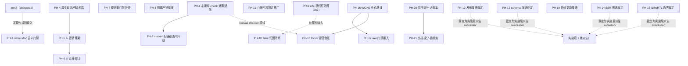

# 平台加固与集成基线路线图（Preventive Gates & Integration Baselines）

> 按 `docs/skills/roadmap-and-mission-authoring-with-consensus-review.md` 产出（诊断优先 → 选型 → 拟制）；结构依 `docs/backlog/00-roadmap-authoring-guide.md`
> Last Updated: 2026-10-26（**激活**：用户指令"执行这个 roadmap"构成前置条件 2 的人确认，PH-1..PH-21 全部 `proposed` → `todo`；§已委派 指针复核、基线 commit 固定、`docs/index.md` 登记同批完成）
> Source: 2026-10-19 用户指令——"本项目整体还有什么可改进可补充的内容" → "拟制一个 roadmap，安排需要安排的工作"；2026-10-26 用户指令——"执行这个 roadmap"（激活）
> 盘点依据：`docs/audits/arm2-index.md`、`docs/references/cross-plan-recurring-anomaly-patterns.md`、`docs/lessons/`、`docs/audits/final-maturity-audit/ledger.md`（FM-029）、`docs/plans/628-deep-audit-remediation-plan.md`、`docs/plans/2476-*.md`、`docs/audits/missing-components/QA.7-residual-debt-register.md`、`docs/audits/2026-10-19-1307-arm2-MA1.5-domain-structure.md`、`docs/logs/2026/10-18.md`，以及 2026-10-19 live 核对的 CI / 脚本 / 包清单
> 状态: **active**（R7 共识审查 **`pass`**；2026-10-26 人确认 PH-1..PH-21 工作项集合与优先级顺序，执行队列已开放——AI 取第一个 `todo`（PH-1）起执行，不重新仲裁）

## Purpose

本文件把**当前没有任何队列承接**的改进工作面收敛为可执行编排。它**不重复**审计 R2（arm2）、plan 628、FM/cross-roadmap/NRP/mobile 已承接的内容——那些面在 §已委派 中逐条登记指针，本表只做它们**未覆盖的增量**。

### 诊断优先：为什么"审了很多轮仍有一堆问题"

本轮盘点（2026-10-19 live 核对）结论：**当前仓的硬红极少**（typecheck 唯一红 = playground `vite.config.ts`；`pnpm check` 唯一红 = knip 的 `xlang-debug-mock-server.mjs`，均已登记归属），真正存量是**登记态开放项**。更值得处理的是其**产生机制**——按 authoring skill 步骤 0 的四类根因归因：

| 根因类别                                     | 本仓实证（附 live 证据；缺陷状态用现在时，历史事件用过去时）                                                                                                                                                                                                                                                                                                                                            | 对应本表项                                           |
| -------------------------------------------- | ------------------------------------------------------------------------------------------------------------------------------------------------------------------------------------------------------------------------------------------------------------------------------------------------------------------------------------------------------------------------------------------------------- | ---------------------------------------------------- |
| **零可执行门禁**——修复未沉淀为入 CI 的 check | **已有 43 个 `check:*`，但 `pnpm check` 只聚合 25 个**：**18 个** `check:*` 不在聚合链（完整清单见 §Current Baseline）——扫描器写了没接线，等于没有门禁                                                                                                                                                                                                                                                  | PH-1                                                 |
| **零可执行门禁**（marker 语义）              | `find-missing-renderer-markers` **现仍**因 `if (content.includes('nop-')) return []`（`scripts/audit/rules.mjs:149-150`）把 `@nop-chaos/*` import 路径命中视为整文件豁免，3d 包零语义根 marker 因此漏报（待 PH-2 修复）                                                                                                                                                                                 | PH-2                                                 |
| **零可执行门禁**（文档语义）                 | owner doc 与 live 代码的语义一致性**现仍无**任何机械校验：`check:active-doc-code-anchors` 只校验文档反引号路径**是否存在**（`scripts/check-active-doc-code-anchors.mjs` 的 `repoPathPattern` 仅做 `access()`）；arm2 的 4 条 open P1 中 2 条即该族                                                                                                                                                      | PH-3                                                 |
| **修实例不修类别**（有状态子系统）           | `renderers-ai` **曾**连续产出 40 个 bug note（编号 121–159，其中 154 有两条），同族兄弟路径反复击穿（ghost 写入 / 残余清理 / abort 打断 / plugin 隔离）——指向缺统一的取消/残余框架                                                                                                                                                                                                                      | PH-4, PH-5, PH-6                                     |
| **验证证据不可证伪**                         | perf spec **已在 e2e CI 运行**且**已有数值阈值**（`tests/e2e/scada-editor-perf.spec.ts:184,198,225`），但为**绝对 fps/耗时**，在 50Hz 环境不可证伪                                                                                                                                                                                                                                                      | **已委派** arm2 MA7.1 + plan 628（本表无对应工作项） |
| **存量无队列承接**                           | 2026-10-18 全量 e2e（`E2E_EXCLUDE_WATCH_ONLY=1`）实测 **1563 passed / 262 failed**，日志与 plan 2476 均记"归 e2e 治理线（`docs/audits/*` ledger 并行会话在记）"——但**该 ledger 文件不存在**（`find docs -iname "*ledger*"` 仅得 5 个：四个 `docs/audits/*/ledger.md` + 一个 `docs/archive/analysis/2026-05-10-*` 历史件，**无 e2e ledger**），arm2 与 plan 628 亦均未提及这 262 项（grep "262" 零命中） | PH-9                                                 |

**选型（混合形态）**：本表**不是**单一线性 roadmap。

- **B 组（PH-4/PH-5/PH-6）走持续闭环**：针对"反复复发 + 需防回退 + 有状态子系统"，符合 authoring skill 步骤 1b 判据。机制照搬先例 `docs/backlog/ai-invariant-loop-roadmap.md`：① 不变式 = 可执行门禁（非文档）；② 门禁集合单调（只增不减）；③ 表完备性门禁（不变式表 == 公共方法集）；④ 类别清扫强制（只修实例 = closure 拒绝）；⑤ Loop Rule 预授权派生下一轮。
- **A/C/D/E/F 组走线性**：产物是"一次性建成即长期生效的门禁/基线/裁定"，不需要飞轮。

### 与 arm2 / plan 628 的分工

R1 初稿曾声称"本表建门禁、arm2 只发现实例"——独立审查判定该切分**对 mutation/perf/安全面不成立**（MA4.5/MA7.1/MA7.2 的交付本身含裁决与抽样）。R2–R4 已据此把重叠项**改为委派**，只保留真实增量：

| 面                                                                                  | 已委派给                                       | 本表保留的增量                                                   |
| ----------------------------------------------------------------------------------- | ---------------------------------------------- | ---------------------------------------------------------------- |
| mutation 抽样与裁决                                                                 | arm2 **MA4.5**                                 | 无（FM-029 的"先修 stryker test-mapping"洞见作为输入移交 MA4.5） |
| perf 阈值逐条裁决 / 相对度量改造 / 全量 e2e sweep                                   | arm2 **MA7.1** + plan **628**（628:127-129）   | 无                                                               |
| 安全扫描**审计**（semgrep/deps 漏洞、浏览器 IO 越界）                               | arm2 **MA7.2**                                 | 无                                                               |
| semgrep/deps **入 CI 的接线**                                                       | arm2 **MG**（guard 激活与知识沉淀）/ MR 修复批 | 无（避免"审计做了但 CI 仍未接"落空）                             |
| BEM 漂移 / marker 完整性**审计实例**                                                | arm2 **MA7.3**                                 | 扫描器**语义升级 + 基线重建**（工具本身，见 PH-2）               |
| CI guard 激活与工具基线有效性                                                       | arm2 **MA8.3** + **MG**                        | PH-3 是二者 successor（语义层新规则）                            |
| playground `vite.config` 红 / knip triage / scanner triage / flux-compiler 测试归位 | plan **628**（628:126,230,249,250）            | 无                                                               |
| 台账漂移**实例**裁决                                                                | plan **628**（628:127）                        | PH-11 是内容锚定键的**全表推广**（非实例裁决）                   |

## 已委派（delegated）

> **本表只是指针快照（snapshot），不随状态维护；激活前必须逐条复核指针仍有效。** 各面状态以权威文件为准。

| 队列                       | 权威文件                                                                     | snapshot（2026-10-19 live）                                                                                                                                                                                                                                                                                                                                                                                                                                                                                                                                   | 委派关系                                                |
| -------------------------- | ---------------------------------------------------------------------------- | ------------------------------------------------------------------------------------------------------------------------------------------------------------------------------------------------------------------------------------------------------------------------------------------------------------------------------------------------------------------------------------------------------------------------------------------------------------------------------------------------------------------------------------------------------------- | ------------------------------------------------------- |
| 审计 R2（arm2）            | `docs/backlog/audit-remediation-r2-roadmap.md` + `docs/audits/arm2-index.md` | 2026-10-19 快照：工作项行（不含 M0/MV/MG 编排行）**60**：8 `done` + 0 `planned` + 52 `todo`。**2026-10-26 激活复核**：arm2 已于 2026-10-24 收官（commit `981eb8138`，"ROADMAP COMPLETE 107/107 done"；文件内 R3.2–R3.12 共 11 行仍标 `todo`，属 arm2 自身台账漂移，不归本表）；六个委派锚点 **MA4.5 / MA7.1 / MA7.2 / MA7.3 / MA8.3 / MG 全部 `done`**——委派面已交付，PH-2（MA7.3 successor）/ PH-3（MA8.3+MG successor）前置已解除；各 PH 项起草时须核对 arm2 MR/MG 交付是否已覆盖其部分范围（尤其 PH-1 的 18 项未接线基数——MG/R3.11 已动 `check:*`/基线面） | MA4.5 / MA7.1 / MA7.2 / MA7.3 / MA8.3 / MG（均 `done`） |
| plan 628（active）         | `docs/plans/628-deep-audit-remediation-plan.md`                              | scada-perf ×3 裁决、perf 阈值相对化、全量 e2e sweep、playground vite.config 红、knip/scanner triage、flux-compiler 测试归位（2026-10-26 复核：仍 `active`）                                                                                                                                                                                                                                                                                                                                                                                                   | 上表多个面                                              |
| FM 收官轮字母批            | `docs/backlog/final-maturity-audit-roadmap.md`                               | FM 主线 `done`；FM-1b-b `todo`、FM-6-b/FM-7-b 待立项                                                                                                                                                                                                                                                                                                                                                                                                                                                                                                          | 无                                                      |
| cross-roadmap 收口         | `docs/backlog/cross-roadmap-remediation-roadmap.md`                          | UR-1–UR-20 中仅 UR-15 `in-flight`                                                                                                                                                                                                                                                                                                                                                                                                                                                                                                                             | 无                                                      |
| report-designer nop-report | `docs/backlog/report-designer-nop-report-roadmap.md`                         | 2026-10-19 快照 NRP-1..5 全 `todo`；**2026-10-26 复核：NRP-1..5 全 `done`**（plans 749–753，commit `6aec33629` 收官），该队列已收官                                                                                                                                                                                                                                                                                                                                                                                                                           | 无                                                      |
| Mobile 扩展                | `docs/components/mobile-native-components-roadmap.md`                        | M6–M12 全 `proposed`                                                                                                                                                                                                                                                                                                                                                                                                                                                                                                                                          | 无（正交）                                              |
| QA.7 残余债登记册          | `docs/audits/missing-components/QA.7-residual-debt-register.md`              | A.1 仍 open **×8**；demand-gated **×16**；§C flake 台账                                                                                                                                                                                                                                                                                                                                                                                                                                                                                                       | PH-10（flake）/ PH-20/21（D-2 同规则先例）              |
| threejs                    | `docs/backlog/threejs-integration-roadmap.md`                                | I0–I4 主项 `done`；**I4 内的 Gemini 适配子项** `deferred` 待人裁决                                                                                                                                                                                                                                                                                                                                                                                                                                                                                            | 无（非本表工作项）                                      |

> **基线 commit 说明**：原 snapshot 基于 2026-10-19 HEAD（arm2 的 MA1.8 已由并发提交 `6c508a0ae` 转 `done`）。**激活基线固定于 2026-10-26，父 commit `6aec33629`**（NRP-5 收官提交）；激活复核结论见上表 arm2 / nop-report 两行。arm2 仍在并发推进——各 PH 项起草 plan 时须按 plan guide Rule 1 以当时 live 为准重写 Current Baseline，不得复述本 snapshot。

## Framework / Platform Reuse

- **`check:*` 门禁框架**：`package.json` 已有 **43 个 `check:*`**，其中 **25 个由 `pnpm check` 聚合**（`package.json:16`）；**18 个未接线**。PH-1/PH-2/PH-3 的规则与接线挂入该体系，不新建框架。
- **扫描器 + ratchet 机制**：`scripts/audit/find-*.mjs` + `scripts/baselines/scanner-baselines.json`（10-19 时点 7 类 2,110 条；**勘误 2026-10-26 plan 754**：PH-1 落地后为 **14 类**、登记合计 **2,403** 条——原 7 类 live 已漂至 2,189 + 新纳入 7 类 214；`check:scanner-baselines` 锁"只减不增"）。PH-2 沿用同一 ratchet，不建第二套基线。
- **闭环飞轮先例**：`docs/backlog/ai-invariant-loop-roadmap.md`（Cycle 1/2 全 done + watch-only 稳态暂停）——B 组机制**照搬**，不重新设计。
- **既有审计工具**：`audit:semgrep`（`.semgrep.yml` 已存在）、`audit:deps`、`audit:mutants`、`audit:knip`、`audit:react-doctor` 均已存在——相关审计与接线已委派 arm2 MA7.2 / MA4.5 / MG。
- **CI 管线**：`.github/workflows/ci.yml` 已有 8 个 job（check/typecheck/build/lint/test/coverage/e2e/format）；`e2e` job 运行全部 perf spec。PH-1 的"接入"项与 PH-17 并入既有 job。
- **`@watch-only` 机制**：plan 623 的标题级标记 + `E2E_EXCLUDE_WATCH_ONLY=1`（`playwright.config.ts:57`）——PH-9/PH-10 的既有出口。
- **内容锚定键先例**：commit `caf780ed1`（行号键 → 内容锚定键）——PH-11 的既有指令，推广即可。
- **UI 原语底座 = Base UI**：`packages/ui/package.json` 依赖 **`@base-ui/react: ^1.3.0`**（源码直接 `import ... from '@base-ui/react/*'`），**全仓无 `@radix-ui/*` 直接依赖**（`@radix-ui/react-dialog` 仅经 `cmdk` 传递）。Base UI 提供 ARIA/focus 原语——PH-17 的底座前提（**注意：不是 Radix**；plan 628:51 已记录该 description 失实）。
- **a11y 先例**：scheduling 包**已有包级 WCAG 2.1 AA 基线**（plan `2026-07-21-0800-2-scheduling-accessibility-plan.md` 已 `completed`，复核见 `2026-07-23-0000-1-scheduling-accessibility-reaudit.md:30`）——**PH-16** 须以其为输入并说明如何推广到全仓。
- **安全/XSS 基建**：DOMPurify 集中于 `flux-renderers-content/src/sanitize.ts`（有测试）；`flux-formula` 自研 evaluator 零 `eval(`/`new Function`。

## Current Baseline

> live 核对结论（2026-10-19），**每条附证据**。历轮独立审查（R1–R7）发现的事实错误已全部修正（含 a11y 底座 Radix→Base UI）。

| 维度              | live 状态                                                                                                                                                                                                                                                                                                                                                                                                                                                                                                                                                                                                                                                                            | 证据                                                                                                                                                                                 |
| ----------------- | ------------------------------------------------------------------------------------------------------------------------------------------------------------------------------------------------------------------------------------------------------------------------------------------------------------------------------------------------------------------------------------------------------------------------------------------------------------------------------------------------------------------------------------------------------------------------------------------------------------------------------------------------------------------------------------ | ------------------------------------------------------------------------------------------------------------------------------------------------------------------------------------ |
| CI 门禁面         | 8 job：check/typecheck/build/lint/test/coverage/e2e/format；`e2e` job 运行全部 perf spec                                                                                                                                                                                                                                                                                                                                                                                                                                                                                                                                                                                             | `.github/workflows/ci.yml`（job 列表 + `:117`）                                                                                                                                      |
| **扫描器接线**    | 43 个 `check:*` 中仅 25 个入 `pnpm check`；**18 个未接线**：`audit-as-any-casts`、`audit-async-failure-paths`、`audit-canvas-wrapper-a11y`、`audit-fieldframe-bypasses`、`audit-hardcoded-type-dispatch`、`audit-missing-renderer-markers`、`audit-non-retained-renderer-references`、`audit-performance-suspects`、`audit-react19-optimization-candidates`、`audit-reactive-render-reads`、`audit-styling-suspects`、`audit-suspects`、`audit-test-global-leaks`、`audit-todo-exitless`、`duplicates`、`duplicates:detail`、`finite-prop-contracts`、`renderer-definition-fields-only`                                                                                              | `package.json`（`check:*` 全集减 `pnpm check` 聚合集）                                                                                                                               |
| marker 扫描器缺陷 | `scripts/audit/rules.mjs:149-150` 为 `if (content.includes('nop-')) return []`——`@nop-chaos/*` import 路径命中即整文件豁免，故 `three-canvas.tsx` 零 `nop-*` 根 marker 漏报                                                                                                                                                                                                                                                                                                                                                                                                                                                                                                          | `rules.mjs`；arm2 P1-MA1.5-001 / P2-MA1.5-002                                                                                                                                        |
| 文档语义一致性    | **无机械门禁**：`check:active-doc-code-anchors` 仅校验反引号路径**是否存在**                                                                                                                                                                                                                                                                                                                                                                                                                                                                                                                                                                                                         | `scripts/check-active-doc-code-anchors.mjs`                                                                                                                                          |
| 扫描器基线规模    | 7 类合计 **2,110** 条（styling 240 / suspects 733 / test-global-leaks 108 / todo-exitless 1 / as-any-casts 41 / async-without-failure-path 337 / react19-candidates 650）。注：plan 628:37,250 记的 **2,093 为 2026-10-17 时点值**；live 2,110 为 10-18 重登记（plan 649/2476）后，委派 triage 以激活时 live 基线为准。**勘误 2026-10-26（plan 754 / PH-1 done）**：登记面扩为 **14 类合计 2,403**——原 7 类 live 255/772/115/1/41/342/663（=2,189），新纳入 canvas-wrapper-a11y 0 / hardcoded-type-dispatch 0 / missing-renderer-markers 0（假零，PH-2）/ fieldframe-bypasses 12 / reactive-render-reads 20 / performance-suspects 27 / non-retained-renderer-references 155（=214） | `scripts/baselines/scanner-baselines.json`                                                                                                                                           |
| 覆盖率门禁        | 43 包中 42 个有 vitest config（`editor-core` 无，仅 2 测试文件），**36 个含 thresholds**；缺 thresholds 的 6 个：`flux-print-core`、`flux-print-renderers`、`flux-xlang-debug`、`flux-xlang-lang`、`tailwind-preset`、`theme-tokens`                                                                                                                                                                                                                                                                                                                                                                                                                                                 | 各包 `vitest.config.ts`                                                                                                                                                              |
| 突变分            | `audit:mutants` 未入 CI；**1.63% 是测量假象**（FM-029：stryker coverage 映射趋零），successor = 先修 test-mapping 配置                                                                                                                                                                                                                                                                                                                                                                                                                                                                                                                                                               | `docs/audits/final-maturity-audit/ledger.md` FM-029                                                                                                                                  |
| 性能门禁          | perf spec 已在 CI 运行且有数值阈值（绝对 fps/耗时，50Hz 不可证伪）；3 项已裁决 `@watch-only`，`scada-editor-perf` ×3 未裁决                                                                                                                                                                                                                                                                                                                                                                                                                                                                                                                                                          | `tests/e2e/scada-editor-perf.spec.ts:184,198,225`；`tests/e2e` **顶层 8 个** `*perf*.spec.ts`（递归含 `exploratory/performance-table-deep-state.spec.ts` 共 9 个）；plan 628:127-129 |
| bundle size 预算  | **无** size-limit 类机制；React Compiler 仅 playground 启用                                                                                                                                                                                                                                                                                                                                                                                                                                                                                                                                                                                                                          | `apps/playground/vite.config.ts:30`；无 size 配置                                                                                                                                    |
| e2e 基线          | 最后一次 **0-failed** 全量基线 = **2026-10-05**；其后 10-07 run2（4 基线 failed）、10-09（13 failed）、**10-18 全量复跑（`E2E_EXCLUDE_WATCH_ONLY=1`）1563 passed / 262 failed（52.8m, exit 1）**。10-18 那 262 项的归因三分：主导 = 已提交代码 schema 诊断 + flaky 桶 + 并行在途代码 confound（已披露，config 还原抽样证明非该 diff 因果）。flake 家族（gantt / map-demo / ai-attachments / openPage 冷启动）另册登记未归因                                                                                                                                                                                                                                                          | `docs/plans/628-*.md:31`；`docs/logs/2026/10-05.md:28`；`docs/logs/2026/10-18.md:118`；`docs/plans/2476-*.md:72`；QA.7 §C                                                            |
| 版本化            | **空白**：43 包统一 `0.1.0`、根 `private: true`、无 `.changeset`、无 schema 版本字段（仅 `flux-print-core` 有 `schemaVersion`）                                                                                                                                                                                                                                                                                                                                                                                                                                                                                                                                                      | `ls -d .changeset` 无；`packages/*/package.json`                                                                                                                                     |
| SSR               | **空白（仅设计预留）**：零 `renderToString`/`hydrateRoot` 入口；架构声明 host 抽象"可跨 web/SSR/test"                                                                                                                                                                                                                                                                                                                                                                                                                                                                                                                                                                                | `docs/architecture/renderer-env.md`；全仓 grep 零命中                                                                                                                                |
| 安全自动化        | semgrep 配置存在但**未入 CI**；**无 renovate/dependabot**；`dangerouslySetInnerHTML` **5 处真实注入点**（`content/html.tsx:53`、`content/diff-view/components/diff-three-column-view.tsx:127`、`content/diff-view/components/diff-line.tsx:53`、`ui/chart.tsx:122`、`ai/renderers/ai-tool-call.tsx:196`），另 2 文件仅注释提及                                                                                                                                                                                                                                                                                                                                                       | `.semgrep.yml`；`.github/` 仅 workflows；grep                                                                                                                                        |
| a11y              | packages 内 **516** 个 `.ts/.tsx` 含 `aria-`（**排除 dist**；含 dist 为 531）；底座为 **Base UI**；**无全仓 WCAG 基线标准文档**（scheduling 包级 WCAG 2.1 AA 已建立，可作输入）；**无直接/测试用 axe 依赖**（`axe-core@4.11.4` 仅作 `eslint-plugin-jsx-a11y` 传递依赖存在于 `pnpm-lock.yaml:11637`，未进测试扫描）；**无全组件 focus 台账**                                                                                                                                                                                                                                                                                                                                          | grep；`packages/ui/package.json`；`pnpm-lock.yaml`                                                                                                                                   |
| i18n / RTL        | i18n：`zh-CN`/`en-US` 两语言，`SupportedLanguage` 类型锁死（`flux-i18n/src/i18n.ts:7`），门禁完善；RTL：**无产品级支持**，仅 Base UI/shadcn 继承的局部残留（`ui/sidebar-layout.tsx:49` 的 `dir` 透传、`ui/calendar.tsx:95-96` 的 `rtl:` variant）                                                                                                                                                                                                                                                                                                                                                                                                                                    | locales 目录；grep                                                                                                                                                                   |
| 活跃文档体积      | **「活跃」= `docs/architecture` + `docs/components` + `docs/references` + `docs/backlog` + `docs/skills`**（排除 logs/audits/analysis/archive/discussions）。live：**>40KB 共 51 个**（architecture 7 / components 25 / references 3 / backlog 12 / skills 4），**>50KB 共 31 个**（7 中 5 / 25 中 15 / 3 中 2 / 12 中 8 / 4 中 1）                                                                                                                                                                                                                                                                                                                                                  | 字节统计                                                                                                                                                                             |
| 已确认不缺        | 暗色/主题（classic/glass × light/dark 完整矩阵 + 专项批次 done）、文档即契约（138 design.md / 142 组件目录 + 三重门禁）、单测覆盖率阈值主面                                                                                                                                                                                                                                                                                                                                                                                                                                                                                                                                          | `docs/backlog/visual-quality-r2-roadmap.md`                                                                                                                                          |

## Work Item Status

> **全文件唯一动态状态区。** 状态流转：plan 通过 draft review → `todo` 改 `planned`；closure audit 通过 → `planned` 改 `done`（不得提前）。
> **状态取值说明**：草案期曾使用 `proposed`（`00-roadmap-authoring-guide.md` 三态之外的扩展状态，先例：`docs/components/mobile-native-components-roadmap.md`）；2026-10-26 经人确认已全部转 `todo`，此后仅使用 `todo` / `planned` / `done` 三态。
> **优先级顺序**：编号即推荐执行序（PH-1 → PH-21）；`planned order` 以本表行序为准。A/C/D/E/F 组线性，B 组闭环。
> 分组标题（A–F 组）是组织标签，**不携带状态**。

| Work Item                                    | 状态   | 摘要                                                                                                                                                                                         | Owner Doc                                                                                                                                                     | 依赖          | 复用                                      |
| -------------------------------------------- | ------ | -------------------------------------------------------------------------------------------------------------------------------------------------------------------------------------------- | ------------------------------------------------------------------------------------------------------------------------------------------------------------- | ------------- | ----------------------------------------- |
| **PH-1** 未接线 check 处置矩阵               | `done` | 18 个未接线 `check:*` 逐项处置（接入/废弃/手动专用）——plan `754`（2026-10-26 closure audit `approved`）：新门禁 `check:wiring-coverage` 入 `pnpm check`；棘轮 7→14 类                        | `docs/references/audit-tooling.md`                                                                                                                            | —             | 既有 `check:*` 框架                       |
| **PH-2** marker 扫描器语义升级               | `done` | 修整文件豁免逻辑 + 基线重建（MA7.3 successor）——plan `755`（2026-10-26 closure audit `approved`）：`marker-rules.mjs` 三门口径，基线 0→15                                                    | `docs/references/audit-tooling.md`                                                                                                                            | PH-1          | `check:scanner-baselines` ratchet         |
| **PH-3** owner-doc 语义一致性门禁            | `done` | 语义层文档-代码一致性 check（MA8.3/MG successor）——plan `756`（2026-10-26 closure audit `approved`）：`check:owner-doc-semantics` identifier-set + symbol-anchor，首批覆盖 module-boundaries | `docs/architecture/flux-runtime-module-boundaries.md`                                                                                                         | —             | `check:active-doc-code-anchors` 注入方式  |
| **PH-4** 异步取消/残余统一框架               | `done` | runtime/renderer 级 cancellation/residue 原语 + 不变式清单——plan `757`（2026-10-26 closure audit `approved`）：五原语 + 13 条可执行不变式                                                    | `docs/architecture/async-lifecycle-primitives.md`（勘误 2026-10-26 plan 757：原 `renderer-runtime.md` 已 121KB 超拆分线，改为新建 owner doc，原文件保留指针） | —             | ai-invariant-loop 闭环机制                |
| **PH-5** ai 迁移（骨架 + 首批族）            | `done` | ghost 写入 / 残余清理两族迁移——plan `758`（范围裁定：本批=K3 排水链接入 WriteDrain；stamp 重置 successor PH-6，closure audit R2 `approved` 2026-10-26）                                      | `docs/components/flux-renderers-ai/design.md`                                                                                                                 | PH-4          | `check:ai-engine-invariants`              |
| **PH-6** ai 迁移收口 + 门禁扩容              | `done` | abort 残留 / plugin 隔离收口 + 表完备性门禁——plan `759`（closure audit `approved` 2026-10-26；B 组稳态暂停）                                                                                 | 同上                                                                                                                                                          | PH-5          | 同上                                      |
| **PH-7** 覆盖率门禁补齐                      | `todo` | 6 包 thresholds + `editor-core` config 补齐或显式豁免                                                                                                                                        | `docs/testing/index.md`                                                                                                                                       | —             | 既有 80/80/80/80 口径                     |
| **PH-8** 构建产物基线                        | `todo` | bundle size 预算 + React Compiler opt-in 决策（同一 owner doc / 同一结果面）                                                                                                                 | `docs/architecture/frontend-baseline.md`                                                                                                                      | —             | 既有 CI job 框架                          |
| **PH-9** e2e 基线红治理（262 项）            | `todo` | 10-18 全量 262 项失败的权威台账建立与归因收口                                                                                                                                                | `docs/testing/known-good-baselines.md`                                                                                                                        | —             | `E2E_EXCLUDE_WATCH_ONLY=1`；`@watch-only` |
| **PH-10** e2e flake 归因闭环                 | `todo` | flake 家族归因与关闭机制（与 PH-9 分离的稳定性面）                                                                                                                                           | `docs/references/e2e-test-diagnostic-guide.md`                                                                                                                | —             | `@watch-only` 出口                        |
| **PH-11** 台账内容锚定推广                   | `todo` | 行号键 → 内容锚定键推广到全部台账                                                                                                                                                            | `docs/references/maintenance-checklist.md`                                                                                                                    | —             | commit `caf780ed1` 指令                   |
| **PH-12** 发布策略裁定（decision-only）      | `todo` | changeset / publishConfig / scope / 凭据通道裁定                                                                                                                                             | 拟建 `docs/architecture/release-strategy-decision.md`                                                                                                         | —             | —                                         |
| **PH-13** schema 演进裁定（decision-only）   | `todo` | schema 版本字段 + 旧 schema 兼容/迁移 hook 契约                                                                                                                                              | `docs/references/flux-json-conventions.md`                                                                                                                    | —             | `flux-print-core` `schemaVersion` 先例    |
| **PH-14** SSR 需求裁定（decision-only）      | `todo` | 是否有真实宿主 SSR 场景；破坏点清单或显式 non-goal                                                                                                                                           | `docs/architecture/renderer-env.md`                                                                                                                           | —             | —                                         |
| **PH-15** i18n/RTL 边界裁定（decision-only） | `todo` | 2 语言是否为产品边界；RTL non-goal 或支持路线                                                                                                                                                | `flux-guide/12-i18n.md`                                                                                                                                       | —             | `addResources` 动态加载                   |
| **PH-16** WCAG 全仓基线文档                  | `todo` | 全仓 WCAG 2.1 AA 基线（以 scheduling 包级先例为输入）                                                                                                                                        | 拟建 `docs/testing/wcag-2.1-aa-baseline.md`                                                                                                                   | —             | scheduling 包级 WCAG 先例                 |
| **PH-17** axe 门禁接入                       | `todo` | axe 扫描接入测试管线                                                                                                                                                                         | 同 PH-16                                                                                                                                                      | PH-16         | `eslint-plugin-jsx-a11y` 已在 lint 链     |
| **PH-18** focus 管理台账                     | `todo` | 全组件 focus 管理逐项核对台账                                                                                                                                                                | 同 PH-16                                                                                                                                                      | PH-16         | Base UI 原语 + canvas checker 模板        |
| **PH-19** 依赖更新策略                       | `todo` | renovate/dependabot 或等价流程决策 + 接入                                                                                                                                                    | `docs/references/maintenance-checklist.md`                                                                                                                    | —             | —                                         |
| **PH-20** 文档拆分·必拆集                    | `todo` | 31 个 >50KB 活跃文档按规则拆分                                                                                                                                                               | `docs/index.md`                                                                                                                                               | —             | QA.7 D-2（同规则先例）                    |
| **PH-21** 文档拆分·目标集                    | `todo` | 20 个 40–50KB 活跃文档按 40KB 目标拆分                                                                                                                                                       | `docs/index.md`                                                                                                                                               | PH-20（口径） | 同上                                      |

## Phase Details

> 只列交付范围，不含实现步骤与 closure 判据（后者属 plan）。

### A 组：门禁接线与扫描器修复（线性）

**PH-1 未接线 check 处置矩阵**：范围 = 18 个未接线 `check:*` 的逐项处置矩阵（接入 `pnpm check` / 标记废弃 / 说明为手动专用）；不以"评估"作为终态。接线机制（是否入 CI job、是否纳入 ratchet）在本项确立，供 PH-2 复用。注：`check:audit-missing-renderer-markers` 同时是 PH-2 的对象，其处置受 PH-2 约束（须为"接入"）；`check:audit-canvas-wrapper-a11y` 是**未接线 checker**（非现行门禁），其接线由本项承接，PH-18 的模板复用以此为前提。

**PH-2 marker 扫描器语义升级**：范围 = 扫描器语义修正与基线重建——仅 import 路径不再构成整文件豁免；升级后新增命中以 ratchet baseline 或显式 allowlist 承接（**不以"零新增"为目标**）；判定口径（null renderer / 子组件 / 非根 DOM 文件是否计入）在 plan 内定义。依据：源审计 `docs/audits/2026-10-19-1307-arm2-MA1.5-domain-structure.md` 的 P2-MA1.5-002 已预告"可能触发其他包新发现——升级时以棘轮基线承接"。与 arm2 关系：**MA7.3 的 successor**（MA7.3 审计漂移实例；本项修工具本身）。

**PH-3 owner-doc 语义一致性门禁**：范围 = 语义层一致性校验（超越 `check:active-doc-code-anchors` 的路径存在性），覆盖注册族清单类（种子 `P1-MA1.2-001`）、`Where-To-Add` 指向文件的真实接线校验（种子 `P1-MA1.1-001`）、owner doc 内部自相矛盾检测。与 arm2 关系：**MA8.3 + MG 的 successor**。保护区域：`docs/architecture/*` 属文档基线，改文档属 plan-first。

### B 组：运行时健壮性（**持续闭环**，机制照搬 `ai-invariant-loop-roadmap.md`）

**PH-4 异步取消/残余统一框架**：范围 = 统一 cancellation/residue 原语（abort 传播契约、dispose 后 continuation 抑制、in-flight guard 标准化）+ 可执行形式的不变式清单；种子为 `renderers-ai` bug 121–159（40 个 note）的去重根因归纳（抽共同生命周期缺口，不逐条修）。与 UR-8（cross-roadmap 异步取消安全统一，已 `done`）关系：UR-8 是逐条核验回写；本项是框架化 + 门禁化，plan 中须说明如何承接而非覆盖 UR-8 结论。保护区域：触及 `flux-runtime` 公共 API → plan-first。

**PH-5 ai 迁移（骨架 + 首批族）**：范围 = 迁移骨架 + ghost 写入 / 残余清理两族。

**PH-6 ai 迁移收口 + 门禁扩容**：范围 = abort 残留 / plugin 隔离收口 + `check:ai-engine-invariants` 扩容；闭环四机制（门禁单调 / 表完备性 / 类别清扫 / Loop Rule 派生）在本项落实。

> **Loop Rule 裁决（2026-10-26，plan 759 收口）**：PH-4..6 三轮未发现新失败类（stamp / 隔离 / 排水三族均由原语承接，AL-01/02/03/04/06/08 无迁移面即无真实命中可先红）→ **B 组进入稳态暂停**。复触发条件（任一满足即按 Loop Rule 预授权派生 PH-4′/PH-5′）：① `check:ai-engine-invariants` 或 `check:scanner-baselines` 在 ai 包面变红；② `flux-renderers-ai/src/engine` 或 `adapters/use-conversation*` 结构性变更（新增公共变更型方法 / 新钩子）；③ 周期复探（随 roadmap 下一次全量复核）。id-aware `switchVersionRef` 形态在 ≥2 处重现时扩展 `createLifecycleGuard` 为 per-key guard。

### C 组：验证与测试基建缺口（线性）

**PH-7 覆盖率门禁补齐**：范围 = 6 个无 thresholds 包（`flux-print-core`、`flux-print-renderers`、`flux-xlang-debug`、`flux-xlang-lang`、`tailwind-preset`、`theme-tokens`）与 `editor-core`（无 config、仅 2 测试文件）逐项处置：补齐或显式登记豁免理由，不留静默缺席。口径澄清：覆盖率 ≠ 判别力；**mutation 面已委派 arm2 MA4.5**，本项不涉入（FM-029 洞见作为输入移交）。

**PH-8 构建产物基线**：范围 = ① size-limit 类预算机制与超预算判定（现状无任何 size 门禁）；② React Compiler 包级 opt-in 决策（现状仅 playground 启用，`apps/playground/vite.config.ts:30`）。两项同属**构建产物面**、同一 owner doc（`docs/architecture/frontend-baseline.md`）、同一组证据面（构建输出 + 运行时回归/性能实测），故合并为一项（依 Rule 22 的合并判据）。perf 阈值裁决与相对化**已委派**（arm2 MA7.1 + plan 628），本项不涉入。

**PH-9 e2e 基线红治理（262 项）**

- 范围 = 为 2026-10-18 全量 e2e 的 **262 项失败**建立**权威台账**并完成归因收口。
- **背景（本项是当前最大的无队列存量）**：10-18 日志与 plan 2476 均记"归 e2e 治理线（`docs/audits/*` ledger 并行会话在记）"，但该 ledger **文件不存在**（`find docs -iname "*ledger*"` 仅得 5 个：四个 `docs/audits/*/ledger.md` + 一个 archive 历史件，**无 e2e ledger**），且 arm2 与 plan 628 均未提及这 262 项——即**无任何权威面承接**。
- 归因三分（10-18 已披露，本项须逐项落账）：主导 = 已提交代码 schema 诊断；flaky 桶；并行在途代码 confound（config 还原抽样已证明非该 diff 因果）。
- 若逐项归因后确认存在产品回归，须回报并可能反噬"当前仓硬红极少"的诊断叙事（见 §Cross-Cutting 风险）。
- 与 PH-10 的分界：本项管**基线红**（一次全量运行的失败集），PH-10 管**flaky 稳定性**（跨运行不稳定的家族）。

**PH-10 e2e flake 归因闭环**：范围 = flake 家族（gantt / map-demo 冷启动 / ai-attachments / openPage 冷启动，QA.7 §C 已登记）的归因与关闭机制——现状仅"顺手评估"。plan 628 覆盖 perf 阈值与全量 sweep，不覆盖 flake 治理。依赖一次可比的干净全量运行作参照（PH-9 的台账可作为其输入）。

**PH-11 台账内容锚定推广**：范围 = 把 `caf780ed1` 的"行号键 → 内容锚定键"指令推广到全部台账（已发生 scada residual 名称无法对账的失效案例）。plan 628:127 只裁决台账漂移**实例**，本项是全表机制推广。

### D 组：对外基线裁定（decision-only ×4，线性）

> 四项裁定各自拥有独立 owner doc 与结果面，故各自成项（依 `docs/plans/00-plan-authoring-and-execution-guide.md:62` Rule 22）。每项均为轻量 decision-only plan。

- **PH-12 发布策略裁定**：43 包统一 `0.1.0` + 无 `.changeset` 的处置；先核验发布通道（npm scope / `publishConfig` / 凭据）实际状态。
- **PH-13 schema 演进裁定**：schema 版本字段 + 旧 schema 兼容/迁移 hook 契约（现状仅 `flux-print-core` 有 `schemaVersion`）。
- **PH-14 SSR 需求裁定**：是否有真实宿主场景需要 `renderToString`；有则列破坏点清单（直接访问 window/document 的 renderer 面）+ 冒烟范围，无则显式 non-goal。
- **PH-15 i18n/RTL 边界裁定**：2 语言是否为产品边界（是 → 显式 non-goal + `SupportedLanguage` 锁死正当性说明；否 → `addResources` 扩展路线 + 第三语言试点）；RTL 同批裁定。
- 共同要求：**即使结论是"不做"也必须产出显式 non-goal 文档**。裁定为"实施"时，实施项作为 successor 另行立项（触公共导出面/包边界者 plan-first + 人确认）。

### E 组：合规与运维基线（线性）

**PH-16 WCAG 全仓基线文档**：范围 = 全仓级 WCAG 2.1 AA 基线标准文档（现状无全仓文档）；须以 scheduling 包级先例为输入（plan `2026-07-21-0800-2` 已 completed，复核见 `2026-07-23-0000-1:30`），说明如何从包级推广到全仓。

**PH-17 axe 门禁接入**：范围 = axe 扫描接入测试管线（现状无直接/测试用 axe 依赖；传递依赖不计）。

**PH-18 focus 管理台账**：范围 = 全组件 focus 管理逐项核对台账（**Base UI** 覆盖弹层/菜单类原语，但 renderer 组合面未经系统核对）。可复用 canvas checker 作模板（其接线由 PH-1 承接）。

**PH-19 依赖更新策略**：范围 = renovate/dependabot 或等价流程的决策与接入（现状全无）。与 arm2 分工：MA7.2 管 semgrep/deps 审计、MG 管入 CI 接线；本项管更新流程（谁在何时升级、如何验证）。

### F 组：文档债（线性）

**PH-20 文档拆分·必拆集**：范围 = **31 个 >50KB** 活跃文档（最大 201KB / 172KB / 128KB）按"50KB 必拆"规则拆分。

**PH-21 文档拆分·目标集**：范围 = **20 个 40–50KB** 活跃文档按"40KB 目标"规则拆分（口径随 PH-20 确立）。

> **「活跃文档」定义**（PH-20/21 共用）= `docs/architecture` + `docs/components` + `docs/references` + `docs/backlog` + `docs/skills`（排除 logs/audits/analysis/archive/discussions）。live 基线：>40KB 共 **51** 个（7/25/3/12/4），>50KB 共 **31** 个（5/15/2/8/1）。QA.7 D-2 是**同规则先例**（仅涉两份 coverage 报告），非同 scope successor。拆分须保持 `check:active-doc-code-anchors` / `check:schema-prop-coverage` 绿。

## Dependency Graph

> 实线 = 硬依赖。硬依赖链四条：**PH-1→PH-2**、**PH-4→PH-5→PH-6**、**PH-16→PH-17/PH-18**、**PH-20→PH-21**。虚线 = 输入关系。其余彼此独立；`planned order` 按 Work Item Status 表行序。

## Cross-Cutting

| 关注点                       | 说明                                                                                                                                                                                                                                                                     |
| ---------------------------- | ------------------------------------------------------------------------------------------------------------------------------------------------------------------------------------------------------------------------------------------------------------------------ |
| **门禁单调性**               | 产出的全部门禁遵循既有纪律：**只增不减，弱化需人工确认**（对齐 `check:scanner-baselines` ratchet）。须 ratchet/allowlist 化的项：**PH-1、PH-2、PH-3、PH-7、PH-17**，以及 **PH-18 若产出可执行 check 时**（PH-7/PH-17 落地必然对存量开红，需基线或显式 allowlist 口径）。 |
| **先红后绿纪律**             | 门禁类工作项的 committed 回归测试必须**先以真实存量失败、修法后转绿**（AGENTS.md Bug Fix Test Coverage Rule）。纯"加一个通过的 check"不算交付。                                                                                                                          |
| **不重复已委派面**           | 执行中发现某族已由 arm2 MR 阶段或 plan 628 在修，本表对应项记 `delegated: <指针>` 并从本表移除。                                                                                                                                                                         |
| **保护区域**                 | PH-4 触及 `flux-runtime` 公共 API（plan-first）；PH-3/PH-20/PH-21 触及 `docs/architecture/*`（plan-first）；PH-12/PH-13 若裁定为实施则触及公共导出面/包边界（plan-first + 人确认）。见 `docs/context/ai-autonomy-policy.md`。                                            |
| **可证伪优先**               | PH-8/PH-9/PH-10 的判定必须**机械可判定**（相对基线/归一化），不得引入新的"环境噪声型红"。                                                                                                                                                                                |
| **决策类工作项的落文档要求** | PH-12..PH-15、PH-19 即使结论是"不做"，也必须产出**显式 non-goal 文档**。                                                                                                                                                                                                 |
| **验收门禁**                 | 每工作项 closure 须跑 `pnpm check`（零新增红）+ 相关包 typecheck/build/lint/test；门禁类另需证明"注入违规即红"（反向验证）。                                                                                                                                             |
| **闭环项额外验收**           | B 组 closure 除常规门禁外，须证明四条闭环机制实际生效，照搬 `ai-invariant-loop-roadmap.md` 口径，且 **closure audit 必须独立 fresh session**。                                                                                                                           |
| **⚠ 诊断叙事的潜在反噬**     | 本表的"当前仓硬红极少"基于 typecheck / `pnpm check` 两处唯一红。但 **PH-9 的 262 项 e2e 失败**若归因后确认含产品回归，该叙事须修正——本表不预判其结论，只确保其**有队列承接**。                                                                                           |

## Rule

- 本文档是状态索引，不是 execution plan；工作项增删/优先级重排需人确认。
- 全部 PH-1..PH-21 原为 AI 起草提案（`proposed`），**2026-10-26 已经人确认转 `todo` 进入执行队列**；后续工作项增删/重排仍需人确认，AI 不得自行转换。
- 每个工作项 = 一个 execution plan 的交付范围；plan 通过 closure audit 后标 `done`，不得提前。
- 本表不重复维护已委派队列（arm2 / plan 628 / FM / cross-roadmap / NRP / mobile / QA.7）的状态。
- 分组标题（A–F 组）是组织标签，**不携带状态**；只有 PH-n 工作项出现在 Work Item Status。
- **本表不产出审计发现**（属 `audit-remediation-r2-roadmap.md`）；本表消费其发现作为门禁规则输入，或直接委派。
- 若某工作项演变为"再修一批实例"而非"建成机械门禁/基线/裁定"，说明粒度或定位有误，需回到人确认。
- 优先级即行序（PH-1 → PH-21）；AI 激活后取第一个 `todo` 执行，不重新仲裁。

## Review Record

> 按 `docs/skills/roadmap-and-mission-authoring-with-consensus-review.md`，roadmap 修订必须经**独立子 agent 反复审查至共识**后方可激活。

| 轮次 | 审查者                        | 结论       | 处置                                                                                                                                                                                                                                                                                                                                                                                                                                                                                |
| ---- | ----------------------------- | ---------- | ----------------------------------------------------------------------------------------------------------------------------------------------------------------------------------------------------------------------------------------------------------------------------------------------------------------------------------------------------------------------------------------------------------------------------------------------------------------------------------- |
| R1   | 独立子 agent（fresh session） | **`fail`** | 10 Blocker / 6 Major / 10 Minor：8 处事实错误修正（check 43、聚合 25、scanner 未接线、perf 已在 CI 且有阈值、基线 2,110、arm2 分解、注入点 5 处、覆盖率 36/43）；mutation/perf/安全面改委派；补 Owner Doc/Reuse 列；B 组改持续闭环；补 flake/覆盖率/文档体积三项遗漏                                                                                                                                                                                                                |
| R2   | 独立子 agent（fresh session） | **`fail`** | 9/10 Blocker 闭合；新增 1 Blocker + 5 Major：PH-9 粒度违反 Rule 22（引用对象错误——在 plan guide 非 roadmap guide）→ 拆四项裁定；PH-10 拆三项；PH-8 拆两项；PH-1 补 18 项处置矩阵；axe 表述修正；诊断表 perf 行改"已委派"；委派表计数勘误 + 标注 snapshot                                                                                                                                                                                                                            |
| R3   | 独立子 agent（fresh session） | **`fail`** | 1 Blocker + 2 Major + 7 Minor：PH-1 的"其他包零新增"与 live 矛盾（源审计已预告新发现）→ 改为 ratchet/allowlist 承接 + 定义判定口径；**a11y 底座误写 Radix，实为 Base UI**；PH-1 混装两个 closure 单元 → 拆 PH-1/PH-2；补 2,093 vs 2,110 时点、全量失败史、arm2 时点、canvas checker 未接线、scheduling WCAG 先例、「活跃文档」定义与精确计数、安全审计 vs CI 接线分工                                                                                                               |
| R4   | 独立子 agent（fresh session） | **`fail`** | 9/10 R3 项闭合；新增 3 Major + 6 Minor：**e2e 基线事实失实**（10-18 有一次全量复跑 1563/262，"10-10 起未复跑"被推翻）；**最大存量无队列承接**（262 项声称归"e2e 治理线 ledger"但该文件不存在，arm2/628 亦未提及）→ **新增 PH-9**；PH-19 粒度超单 plan → 拆 PH-20/PH-21；QA.7 demand-gated 改 ×16；Phase Details 去除实现步骤与 closure 判据措辞；单调性纳入 PH-3/PH-16/PH-17；`docs/testing/` 非"待建"改指具体文件；诊断表 tense 改"现仍"；PH-1 注明 markers check 处置受 PH-2 约束 |
| R5   | 独立子 agent（fresh session） | **`fail`** | R4 的 3 Major 全部闭合；新增 1 Major + 6 Minor：**陈旧交叉引用**（Framework 节 a11y 先例指向 PH-15，实应 PH-16——重编号残留）已修正；优先级范围 `PH-1 → PH-19` 改 `PH-21`；ledger 计数改 5（含 archive 件）并注明无 e2e ledger；去除 Phase Details 残留的 "closure 判据" 措辞；decision/a11y 类 owner doc 给出拟定文件名；诊断表 tense 统一（缺陷用"现仍"、历史事件用"曾"）；perf spec 计数注明"顶层 8 个"口径                                                                       |
| R6   | 独立子 agent（fresh session） | **`fail`** | R5 的 7 项全部闭合；新增 1 Major + 4 Minor：**重编号残留致 4 处 PH 交叉引用指向错误项**（`:44`/`:71` 台账锚定应为 PH-11、`:69` 入 CI 应为 PH-17、单调性列表应为 PH-17/PH-18）→ 已修正并做全文 PH 引用语义清扫；React Compiler 决策原指向不存在的"D 组裁定族"→ 折入 PH-8（同为构建产物面，符合 Rule 22 合并判据）；`rules.mjs` 行号区间改 `149-150`；PH-1→PH-18 的 canvas checker 输入关系补入依赖图；状态行同步 R6                                                                  |
| R7   | 独立子 agent（fresh session） | **`pass`** | 无 Blocker / 无 Major。R6 的 1 Major 闭合、4 Minor 中 3 项闭合；另附 6 条 Minor 建议已全部采纳：状态行同步、`rules.mjs` 行号统一 `149-150`、"前三轮"改"历轮"、PH-8 证据面表述补运行时回归、PH-18 的 ratchet 定位改"若产出可执行 check 时"、PH-1 并入 CI 的概括收窄为"接入项"。**共识达成。**                                                                                                                                                                                        |

**结论**：本 roadmap 经 **7 轮独立 fresh-session 审查**收敛（R1–R6 `fail`、R7 `pass`），累计修正 8 处 live 事实错误、3 处重复立项、4 处编号残留、2 处结构违规，并补入 1 个此前无队列承接的最大存量（262 项 e2e 基线红）。**待人工确认工作项集合后即可激活。**

**激活前置条件**（2026-10-26 全部满足，`draft` → `active`）：

1. ✅ 独立审查通过（无 Blocker/Major 未处置）——R7 `pass`；
2. ✅ 人确认 PH-1..PH-21 的工作项集合与优先级顺序（`proposed` → `todo`）——2026-10-26 用户指令"执行这个 roadmap"，集合与行序按 R7 定稿原样确认；
3. ✅ 逐条复核 §已委派 的指针仍有效——arm2 已收官（六个委派锚点全 `done`）、plan 628 仍 `active`、NRP 队列已收官（结论已就地回写 §已委派 表；委派面"已交付"而非"仍在修"，本表各项按 successor 关系起草时须核对交付覆盖）；
4. ✅ 固定一次 commit 并注明基线——父 commit `6aec33629`（见 §已委派 基线 commit 说明）；文档体积计数 51/31 为 2026-10-19 时点值，PH-20/PH-21 起草时按 Rule 1 重测；
5. ✅ 在 `docs/index.md` 路由表登记本文件——同批同步为 active 表述；
6. ✅ B 组 mission 文件——`missions/platform-hardening-b.json`（2026-10-26，PH-4 立项前创建，照搬 `missions/ai-invariant-loop.json` 形态；线性组 A/C/D/E/F 免）。
