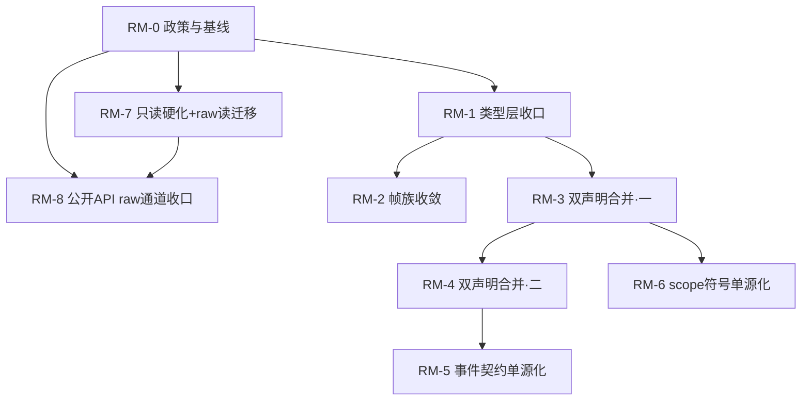

# Renderer 注册元模型与编译结构收口路线图（Renderer Metamodel & Compile-Structure Roadmap）

> 最后更新：2026-10-15（共识审查通过）
> 按 `docs/skills/roadmap-and-mission-authoring-with-consensus-review.md` 流程产出；配套 mission：`missions/renderer-metamodel.json`
> 共识审查记录：R1 `issues`（1B/2M/5m，独立 fresh 审查员，propSchema 迁移面枚举失实/预写审查通过/改名无主等）→ 修订；R2 `issues`（1B/2M/3m，独立 fresh 审查员，计数口径不可复现[66/33→66/41 勘误]/mission 字段缺口等）→ 修订；R3 `pass`（独立 fresh 审查员，25+ 点 live 抽查全命中，附 4 条非阻塞 Minor，其建议修法已逐字采纳：RM-6 补 $page 随迁注、Phases 表状态列同步注、分析报告 #7 计数口径括注、本记录即 m4 落点）。
> 事实源：`docs/analysis/2026-10-15-renderer-definition-metamodel-review.md`（元模型冗余分析 + 静态模板/运行时实例分层核实 + raw-schema 通道盘点，下称"分析报告"）
> 先例：`docs/backlog/component-audit-roadmap.md`（工作项=plan、successor 拆分）、`docs/backlog/workaround-code-smell-audit-roadmap.md`（WA 台账、判别变异纪律）、CX-16~18（共性重构的 full-green + 判别验证基线）

## 授权边界（本项目）

本轨道触及的保护区域（依 `docs/context/ai-autonomy-policy.md`）：`packages/flux-core/src/`（plan-first）、Renderer definition fields（plan-first）、Schema/contract validation（plan-first）。公开导出面增删（flux-core / flux-react）属结构性重构，各 plan 执行前人工确认授权链落字；plan 拟制本身不预授权执行。

## 选型裁定（skill 步骤 0/1）

- **诊断**：本轨道不是"反复审/修仍复发"型——分析报告是首次对注册元模型做全字段消费方追踪，发现的是**结构性多通道与类型层手抄**（A1~A8/B6~B7/C 类），根因类别属"机制并行生长、缺单源收口"，非"修实例不修类别"或"门禁缺失"（contract-honesty / schema-prop-coverage / hardcoded-type-dispatch 三门禁已在位）。
- **选型**：**线性 roadmap**（覆盖面/结构收口型）。不选持续闭环：终态有明确边界（死字段清零、双声明通道单源化、类型副本消灭、raw-schema 政策落字），不需要自驱动飞轮。门禁棘轮以 Cross-Cutting"只增不减"条款承载。

## 目的

本文件是"Renderer 注册元模型 + 编译结构收口"轨道的阶段索引与状态面，按 `docs/backlog/00-roadmap-authoring-guide.md` 拟制：AI 或维护者读完 Phase Status 即知哪些工作项未开始（`todo`）、已立 plan（`planned`）、已完成（`done`）。本文是编排层，**不是 execution plan、不是设计文档**；事实与论证看分析报告，执行纪律看 plan guide。

终态定义（四条，全部达成即轨道收口）：

1. `RendererDefinitionShape` 无死字段、无平行声明通道：每个 schema prop 的事实（分类 kind、值形状、tooling 元数据）**单源声明**；scope 符号（注入/导出契约）单源声明。
2. 类型层零手抄副本：`CompiledRendererContract` 等编译面类型全部派生自声明层子集，新增字段编译期必现漂移错误。
3. "编译期静态模板 ↔ 运行时实例"分层由类型钉住：`TemplateNode` 只读、模板零运行时写入从纪律升级为编译约束；框架内部 raw schema 读迁清或按政策钉面。
4. runtime schema-retention policy 有 owner 文档，12 条 raw 通道逐条裁决（契约保留钉面 / 迁移编译产物 / 删除），无未裁决通道。

## Phase Status

> **这是全文件唯一的动态状态区。更新状态只改这里。** Phases 表的状态列为 guide 规范模板列，随本列表机械同步，不构成第二状态面（R3 m2）。
> 状态流转：plan 通过独立 draft review → `todo` 改 `planned`；plan 通过 closure audit → `planned` 改 `done`（不得提前）。一个 plan 对应本文一个工作项；**执行顺序 = 本列表顺序**（AI 不得重排、不得跳项）。单个工作项执行中证实无法被一个 plan 收口时，经人工确认拆分为 successor 工作项（component-audit 先例），不得静默缩水验收口径。

- RM-0. 政策与基线（schema-retention policy owner 文档 + 元模型权威声明 + 两处死代码清理）: `done`（plan `docs/plans/602-rm0-retention-policy-plan.md`，closure audit agent_5203f11c approved 2026-10-15；裁决表 12 行生效，RM-8 范围钉定=保留通道钉文档+scanner 门禁）
- RM-1. 类型层收口（propSchema 死字段删除、CompiledRendererContract 派生化、registry 入参类型化）: `done`（plan `docs/plans/603-rm1-type-layer-plan.md`，closure audit agent_0714ce30 approved 2026-10-15；执行发现：CompiledRendererContract 派生形态受型变约束收敛为"S 仅协变槽+非泛型 ValidationContributor 引用+非泛型键 Pick"，涟漪约 185 文件声明级清扫，`pnpm -r typecheck` 42/42 口径入 plan）
- RM-2. 帧族收敛（wrap/frameRootTag/frameWrap 单权威路径 + FrameWrapMode 词表归一）: `done`（plan `docs/plans/604-rm2-frame-family-plan.md`，closure audit agent_c198acc9 approved 2026-10-15；definition 级 frameWrap 经 resolver 三参单路径生效，B3 fieldset 语义自此真实生效[此前死声明，分析报告 A5/roadmap 基线两处已就地勘误]）
- RM-3. fields+propContracts 合并·阶段一（新形态落地 + 编译器/门禁双读）: `done`（plan `docs/plans/605-rm3-field-contract-dual-read-plan.md`，closure audit agent_e5ad2fd8 approved 2026-10-15；新形态=fields 条目 contract 成员[shape 必填]，集中双读 helper resolveRendererPropContracts，七消费位切换含编译侧 schema-definition 分类；RM-4 承接全量迁移+旧形态删除）
- RM-4. fields+propContracts 合并·阶段二（全量迁移 + 旧形态删除）: `done`（plan `docs/plans/606-rm4-propcontracts-removal-plan.md`，closure audit agent_2bcd8d11 有条件批准→M1 coverage 双死分支删/M2 docs 三处单源终态清残→复验绿；84 声明文件迁移+~24 只读位，结构等价快照 155 renderer 逐字节零差异[判别变异自证]，旧形态全删[Shape 字段/helper 底座/utils 分支/coverage 死分支/finite-prop-contracts 8 项重锚]，flux-guide schema.d.ts 重生成；contract-honesty 零改动裁定在 plan）
- RM-5. 事件契约单源化（eventContracts 收敛至字段条目）: `done`（plan `docs/plans/607-rm5-event-contract-plan.md`，closure audit agent_dc0c3b14 有条件批准→M1 editor-designer-standard 五处 MUST 清残+4m 修复→批准；21+1 文件迁移[RendererEventFieldContract union 裁定]、harness 语义改写 discoveryBaseline 4 包同步、authoring/honesty 单源化、conformance 重锚、flux-guide 零差；events 视图快照 155 renderer 零差异）
- RM-6. scope 符号单源化（scopeExportContracts+injectedLocals 合并）: `done`（plan `docs/plans/608-rm6-scope-symbol-plan.md`，closure audit agent_444d83fc approved 2026-10-16；injectedLocals 条目单载体[Omit<SymbolInfo,'name'> & {shape?}]、crud+form 双写迁移、scopeExportContracts 通道删除、authoring scopeExports 切 helper[恒等探针 deepStrictEqual]；pushInjectedLocalSymbols 读法零变更）
- RM-7. 编译结构只读硬化 + 框架内部 raw schema 读迁移（name/modalContainer）: `done`（plan `docs/plans/609-rm7-readonly-raw-read-plan.md`，closure audit agent_8ca6c622 approved 2026-10-16；TemplateNode 30 成员 readonly+node-compiler 构造期折叠、#2 name 迁 resolved 通道[表达式 name 行为差钉]、#3 modalContainer 迁 compiled root canonical schema copy[行值再裁决]、owner-doc 前提勘误两处）。【scope 勘误 2026-10-16,plan 609 R1 M4:`schema/NodeState` 只读补全不可落地——NodeState 被 node-runtime 六处运行时写（解析缓存/依赖集），schema 顶层已由规范化拷贝提供 compile-once 语义；本项实际交付=TemplateNode 30 成员 readonly 补全】
- RM-8. renderer 契约面 raw-schema 通道按政策收口（公开 API 六通道）: `todo`

## 框架/平台复用

不重建以下既有能力，各 plan 直接引用：

- **契约门禁**：`contract-honesty.ts`（findUnreferencedContracts + buildPerRendererSourceResolver，G15 per-definition 隔离）、`schema-prop-coverage` 门禁测试族（flux-compiler）、`check:audit-hardcoded-type-dispatch` scanner——通道合并项（RM-3~5）的验收骨架。
- **strict validation 基建**（plan 595 刚落地）：`validate-pages.mjs --strict --setup`、playground 43 文件 0 error 门禁——RM-2~4 迁移后声明面正确性的全量语料验证器。
- **判别变异纪律**（CX-17/18 先例）：行为面改动的"先红后绿 + 外科手术式恢复"验证法。
- **`defineRendererFamily` builder**：RM-3/4 迁移 66 个声明文件时的批量改写辅助。
- **roadmap/mission 运行机制**：mission runner + plan guide 的 draft review / closure audit 链。

## 当前基线（与分析报告对齐，2026-10-15）

- `RendererDefinitionShape` 28 字段平铺 7 类关注点；`propSchema` 零生产声明（仅 2 个 test-support 与 12 个测试内联声明文件，见分析报告 A1 勘误注）；`fields` 与 `propContracts` 双写（声明文件数 66/41，统一口径：`grep -rln "<pattern>" packages/flux-renderers-*/src --include="*.ts" --include="*.tsx" | grep -v "\.test\."`（pattern 分别取 `fields: \[` 与 `propContracts:`），2026-10-15 实测；R2 勘误——初稿 66/33 系 fields 计入 .tsx 而 propContracts 漏计 .tsx 的不对称口径所致，执行时以 plan 内重新枚举为准）、`eventContracts` 与 `fields(kind:'event')` 双写、`scopeExportContracts`+`injectedLocals` 对 `$crud`/`$form` 双写。
- `CompiledRendererContract` 手抄 `ValidationContributor`/`RendererValidationDefaults`/`ScopePolicy`（compiled-renderer-contract.ts:12-24）；registry `component` 必填仅运行时 throw、类型 optional；`RendererDefinition` 重复声明 `type`。
- 帧族 4 层（wrap/frameRootTag/frameWrap + schema 覆盖 + meta 解析），`FrameWrapMode` boolean 双词表，definition.frameWrap 走 metaProgram 间接、wrap 直读。【勘误 2026-10-15,RM-2/plan 604 live 重枚举:definition.frameWrap 实为零消费死声明(无 metaProgram 种子注入、无运行时读取点,B3 语义从未生效),plan 604 以 resolver 第三入参使其单路径生效】
- 模板零运行时写入（grep 证），但无 freeze、`Readonly<>` 不完整；框架内部 raw schema 读 4 处（name/modalContainer/\_schema 死变量/getNodeSchemaFrameWrap 死函数），公开 API raw 通道 6 条，无 retention policy owner 文档；plan 132（归档）仅收口 data-source/reaction 两条。

## Phases 表

| 工作项                     | 状态   | Owner 事实源                          | 依赖       | 复用                                       | Plan                                                     |
| -------------------------- | ------ | ------------------------------------- | ---------- | ------------------------------------------ | -------------------------------------------------------- |
| RM-0 政策与基线            | `done` | 分析报告 §5.4 + `renderer-runtime.md` | 无         | 既有文档骨架                               | [602](../plans/602-rm0-retention-policy-plan.md)         |
| RM-1 类型层收口            | `done` | 分析报告 A1/B6/B7/C                   | RM-0       | contract 门禁                              | [603](../plans/603-rm1-type-layer-plan.md)               |
| RM-2 帧族收敛              | `done` | 分析报告 A5；plan 460 B3 语义         | RM-1       | strict validation 语料、判别变异           | [604](../plans/604-rm2-frame-family-plan.md)             |
| RM-3 双声明合并·一         | `done` | 分析报告 A2/A3                        | RM-1       | schema-prop-coverage、defineRendererFamily | [605](../plans/605-rm3-field-contract-dual-read-plan.md) |
| RM-4 双声明合并·二         | `done` | 同上                                  | RM-3       | contract-honesty、validate-pages --strict  | [606](../plans/606-rm4-propcontracts-removal-plan.md)    |
| RM-5 事件契约单源化        | `done` | 分析报告 A3                           | RM-4       | contract-honesty                           | [607](../plans/607-rm5-event-contract-plan.md)           |
| RM-6 scope 符号单源化      | `done` | 分析报告 A4                           | RM-3       | symbol-helpers 测试                        | [608](../plans/608-rm6-scope-symbol-plan.md)             |
| RM-7 只读硬化+raw 读迁移   | `done` | 分析报告 §5.2/5.4 #2#3                | RM-0       | node-runtime 解析缓存管线                  | [609](../plans/609-rm7-readonly-raw-read-plan.md)        |
| RM-8 公开 API raw 通道收口 | `todo` | RM-0 裁决表 §5.4 #7~#12               | RM-0、RM-7 | plan 132 先例                              | —                                                        |

## Phase Details（交付范围，无实现步骤）

- **RM-0 政策与基线**：`renderer-runtime.md` 增 "Runtime Schema-Retention Policy" 节——5.4 的 12 条通道逐条裁决表（契约保留/迁移/删除三值，每条一行理由）；`RendererComponentProps` 通道权威声明（templateNode 为权威、schema/id/path 为便利投影；props.props 与 props.meta 对 disabled/className/testid 的镜像关系钉面，含 `RendererResolvedProps` Omit 清单 frameWrap 漏项的勘误钉面）。删除 `node-frame-wrapper.tsx` `_schema` 死变量与 `node-renderer-utils.ts` `getNodeSchemaFrameWrap` 死函数（零行为）。RM-8 的范围由本项裁决表最终钉定；**#7~#12 的裁决值为"迁移/删除"时，裁决表随 RM-0 plan 的 draft review 提交人工确认后生效**（R1 m3：公开契约通道的范围决策属人类职权）。
- **RM-1 类型层收口**：删除 `RendererDefinitionShape.propSchema` 及 `shape-validation-utils` 分支（2 个 flux-compiler test-support 及 12 个内联声明的 `*.test.ts` 一并迁移——R1 勘误、R2 实测定数，以删除后 typecheck 全量枚举为准，见分析报告 A1 勘误注）；`CompiledRendererContract` 的 validation/validationDefaults/scopePolicy 改为派生自 `RendererDefinitionShape` 子集（Pick/泛型），消灭手抄；删除 `RendererDefinition` 重复 `type` 声明；`RendererRendererClass` 改名 `RendererClass`（留 alias 过渡导出，R1 M2 并入：同为类型层零行为收口）；registry `register` 签名收 `RegisteredRendererDefinition`（component 必填入类型，运行时 throw 保留为防御）。判别验证：在 Shape 加临时字段演示 CompiledRendererContract 侧编译期报错。
- **RM-2 帧族收敛**：definition 级帧默认（wrap/frameWrap）归一为单一生效路径；`FrameWrapMode` boolean 归一化收敛到单点（对外 schema 兼容 boolean 不变）；`resolveFrameWrapMode` 只读单源。plan 460 B3 的 radio/checkbox-group fieldset 语义不回退；判别变异覆盖 label/group/none × schema 覆盖四象限。
- **RM-3 双声明合并·阶段一**：字段条目新形态落地（单条目承载 kind + 值形状 + tooling 元数据，具体形态由 plan 拟制时定）；编译器、`hasClosedPropModel`/`getAcceptedSchemaKeys`、schema-prop-coverage 门禁改双读；旧形态只读不删。零迁移、零行为。
- **RM-4 双声明合并·阶段二**：66 个 `fields` 声明文件与 41 个 `propContracts` 声明文件（统一口径见基线节）之并集批量迁移（机械映射：同 key 的 propContracts 元数据吸收进字段条目）+ flux-guide/quick-reference 同步 + 旧形态与双读分支删除；contract-honesty 适配。迁移前后 registry 行为逐字节等价（结构等价验证）。
- **RM-5 事件契约单源化**：事件声明收敛到字段条目单源（payload shape 上移），`eventContracts` 转派生视图或删除；`findUnreferencedContracts` 的双源合并逻辑（contract-honesty.ts:438-450）随之简化；`resolveRendererAuthoringContract` 适配。
- **RM-6 scope 符号单源化**：`scopeExportContracts`+`injectedLocals` 合并为单条目（符号 kind + FluxValueShape 同载体）；`pushInjectedLocalSymbols` 与 `resolveRendererAuthoringContract` 适配；crud/form 两处声明迁移；若 plan 裁定删除 injectedLocals 方向，`page` 的 `$page` injectedLocals 位点（`basic-renderer-definitions.ts`，非双写但属同通道）必须随合并迁移（以 live 枚举为准，R3 m1）。
- **RM-7 只读硬化+raw 读迁移**：`TemplateNode`/`schema`/`NodeState` 只读类型补全（类型层，零深拷贝、零运行时成本）；`node-renderer-resolved.tsx:410` 的 raw `schema.name` 读迁移到 resolved 通道；`schema-renderer.tsx` modalContainer 读迁移到编译产物（root plan 或 metaProgram，plan 内定）。
- **RM-8 公开 API raw 通道收口**：按 RM-0 裁决表执行 #7~#12 六通道（`RendererComponentProps.schema`、renderFragment SchemaInput 分支、dispatch/executeSource raw 重载、evaluate raw、imports raw spec）——每通道落地其裁决值：契约保留则钉文档+守卫（禁止新增 raw 读的 scanner 级门禁），迁移则设计编译产物替代物。**预置拆分判据（R1 m2）：裁决为"迁移/删除"的通道 ≥2 时，默认按通道组预拆 successor plan（经人工确认），不等待执行中证实超宽。**

## 依赖图

执行顺序 = Phase Status 列表顺序（RM-0 → RM-8）；依赖图与列表冲突时以列表为准。

## Cross-Cutting（全程约束）

1. **模板零运行时写入不回退**：任何工作项不得在 `TemplateNode` 上引入运行时可变状态；RM-7 完成后由类型钉住。
2. **静态快照体积不增**：`CompiledRendererContract` 改造与字段条目合并均不得增加每节点编译快照的存储面（编译期展开后模板只存结果）。
3. **双写禁止**：RM-3~RM-6 过渡期允许编译器/门禁双**读**，声明面禁止长期双写——每个合并项的阶段二收口后旧形态必须删除，不允许"事实上转正"。
4. **保护区域与授权**：flux-core/src、renderer definition fields、schema validation 均为 plan-first；公开导出增删在 plan 执行前落字人工授权链（CX-18 先例）。
5. **验证基线**：每个工作项收口 = `pnpm typecheck`/`build`/`lint`/`test` 全绿 + `pnpm check` 零新增红（登记制，披露继承红）+ 契约门禁零豁免新增；行为面项（RM-2/4/5/7）加判别变异；e2e 未重跑须在 plan 与提交信息中披露。提交格式与 mission 逐字符一致：`refactor(renderer-metamodel): <description>`。
6. **门禁棘轮**：本轨道沉淀的新门禁（retention scanner、单源声明校验）入 CI 后只增不减，弱化需人工确认。

## 显式排除清单（R1 m5：防"静默遗漏"误读）

分析报告 C 表以下小项**不在本轨道收口范围**，理由：纯外观/低风险类型松动，与单源化主线无行为耦合——`events` 通道 `| undefined` 值类型、`defineRendererFamily` 双重断言、Shape 28 字段分组注释。`RendererResolvedProps` Omit 清单 frameWrap 漏项已并入 RM-0 钉面（不单独立项）。后续如需处理，单独立 plan，不顺手搭车。

## Rule

- 拟制与更新依 `docs/backlog/00-roadmap-authoring-guide.md`；本文件的任何修订（工作项增删/重排/范围变更）必须经独立 fresh 子 agent 共识审查至通过（skill 常设纪律），审查记录追加至 Header。
- 状态只改 Phase Status；先例与状态语义以 guide 为准。
- 事实论证不在本文重复——引用分析报告章节号；分析报告勘误时本文同步核对受影响工作项。
- 本文行号锚点（如 `contract-honesty.ts:438-450`）为拟制时点快照，各工作项 plan 拟制时必须对 live code 重新枚举，不得照抄（R2 m6）。
