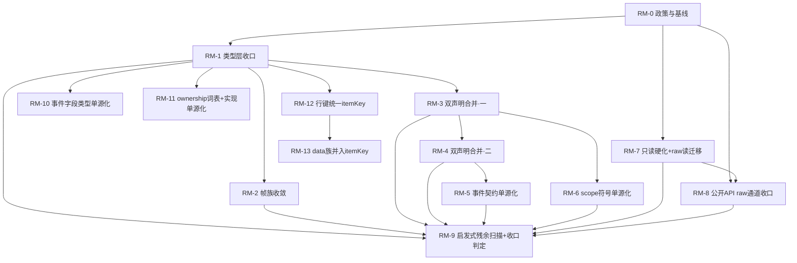

# Renderer 注册元模型与编译结构收口路线图（Renderer Metamodel & Compile-Structure Roadmap）

> 最后更新：2026-10-16（RM-13 增补：RM-12 裁决请求经用户指令处置为「统一」→ 新增 RM-13 承接 data 族作者面属性改名。**终态⑥ 的 data 族作者面归零项由 RM-13 补完**；RM-0~RM-12 保持 `done`，其余五条终态不受影响）
> **RM-13 授权 provenance**：RM-12 plan `## Human Adjudication Request` 的两方案（A 分族两名 / B 并入单标准）经 2026-10-16 用户指令处置——用户**将 A/B 选择权交由 AI 判断并授权拟制**（原话："不考虑修改成本，你认为是否统一更好？如果是，则拟制计划完成修改。"），AI 判定为**统一**（依据=live 实现对照，见下）——该指令同时构成 roadmap Rule 6「工作项增删先报人工确认」所要求的人工确认（人类确认的是『新增该工作项并执行』这一动作；A/B 方案选择由 AI 在授权范围内判定，属条件指令的字面授权）。RM-13 拟制依据另有 live 实现对照：容器族 `resolvePreferredObjectKey` 与 data 族 `normalizeRowKey` 为同一函数形状（同 fallback 链 `显式字段 ?? __rowKey ?? id`、同 `__rowKey` 兼容键、平行形参名），故"语义不同族"（RM-12 倾向方案 A 的理由）被否证；内部行身份结构命名保留 `rowKey` 词的理由与分工规则见 plan 615 与 naming-conventions §4.9。
> 按 `docs/skills/roadmap-and-mission-authoring-with-consensus-review.md` 流程产出；配套 mission：`missions/renderer-metamodel.json`
> 共识审查记录：R1 `issues`（1B/2M/5m，独立 fresh 审查员，propSchema 迁移面枚举失实/预写审查通过/改名无主等）→ 修订；R2 `issues`（1B/2M/3m，独立 fresh 审查员，计数口径不可复现[66/33→66/41 勘误]/mission 字段缺口等）→ 修订；R3 `pass`（独立 fresh 审查员，25+ 点 live 抽查全命中，附 4 条非阻塞 Minor，其建议修法已逐字采纳：RM-6 补 $page 随迁注、Phases 表状态列同步注、分析报告 #7 计数口径括注、本记录即 m4 落点）。
> R4 `approved`（RM-9 增补修订，两轮独立 fresh 审查员）：R4 `revised`（1B/3M/8m——A1~A8 悬空章节引用[报告实无 A6/A7]/scanner-baselines 计数级被误标逐条白名单/增补授权与审查记录未落字等）→ 修订（族枚举改 A1~A5、A8、B6~B7、C；白名单载体改为"RM-9 新建、形态仿 jsdom-pragma-whitelist"；Rule 增"工作项增删先报人工"条款；RM-9 预置拆分判据/排除清单括注/RM-8 承接句/mission prompts+check 字段同步）→ R5 `approved`（12/12 修正属实，零 Blocker，2 条非阻塞 Minor 其一已随落字同步）。**授权 provenance**：RM-9 增补系 2026-10-15 用户显式指令（工作项增删属人类职权，guide §Roadmap Role），RM-9 plan 拟制时授权链须引用该指令；**同 hunk 披露**：本次工作区 roadmap diff 另含并行会话在途的 RM-1 `todo→planned` 状态同步（plan 603 draft review R2 pass），非本修订所为。
> R6 `revised` → R7 `approved`（RM-10~RM-12 增补修订，两轮独立 fresh 审查员）：R6 `revised`（4B/1M/5m——A `ActionSchema.action` 误标可选型[live 实为必填，与 Like 同为 `action: string`]/B ownership 基线漏计[26 字面量口径+12 解析实现，`crud-renderer-ownership.ts` 非三态副本]/C 事件漏枚举[全口径 180 在范围 174+dashboard .tsx 4+word-editor .ts 2]/D flux-guide 清单混 data 族[input-table 仅 3 位点]；M1 RM-11 粒度）→ 修订（事实源勘误+literal closure rg 口径入三债裁决+R1 补漏位点/排除清单收字+预置拆分判据）→ R7 `approved`（零 Blocker；12/12 修正属实，附 P1 字段清单过计[target 6 字段两接口均已有、真实差异仅 4 项]及 P2~P4 Minor，已随 R7 同批修正落字；M1 以预置拆分判据承载，审查员认可不预拆）。**授权 provenance**：RM-10~RM-12 增补系 2026-10-15 用户显式指令（"补充新的工作项用于统一 ownership 前缀分裂、itemKey/rowKey 分叉、事件类型三态"，并裁定**不考虑兼容性、只采用一个标准方案**——工作项增删属人类职权，guide §Roadmap Role）；三债的"单一标准"裁决与无兼容分叉原则即以该指令为授权链，各 plan 拟制时须引用。**同 hunk 披露**：同上（并行会话 RM-1 状态同步在途），非本修订所为。
> 事实源：`docs/analysis/2026-10-15-renderer-definition-metamodel-review.md`（元模型冗余分析 + 静态模板/运行时实例分层核实 + raw-schema 通道盘点，下称"分析报告"）；`docs/analysis/2026-10-15-renderer-vocabulary-consistency-analysis.md`（schema 词汇三债：事件类型三态/ownership 分裂/itemKey-rowKey 分叉，下称"词汇报告"，RM-10~RM-12 的 Owner 事实源）
> 先例：`docs/backlog/component-audit-roadmap.md`（工作项=plan、successor 拆分）、`docs/backlog/workaround-code-smell-audit-roadmap.md`（WA 台账、判别变异纪律）、CX-16~18（共性重构的 full-green + 判别验证基线）

## 授权边界（本项目）

本轨道触及的保护区域（依 `docs/context/ai-autonomy-policy.md`）：`packages/flux-core/src/`（plan-first）、Renderer definition fields（plan-first）、Schema/contract validation（plan-first）。公开导出面增删（flux-core / flux-react）属结构性重构，各 plan 执行前人工确认授权链落字；plan 拟制本身不预授权执行。

## 选型裁定（skill 步骤 0/1）

- **诊断**：本轨道不是"反复审/修仍复发"型——分析报告是首次对注册元模型做全字段消费方追踪，发现的是**结构性多通道与类型层手抄**（A1~A5、A8、B6~B7、C 类），根因类别属"机制并行生长、缺单源收口"，非"修实例不修类别"或"门禁缺失"（contract-honesty 门禁测试、schema-prop-coverage 入 `pnpm check` 聚合链、hardcoded-type-dispatch 独立命令在位未入聚合链——三门禁已存在）。词汇报告所钉三债（RM-10~12）与之**同根因类别**：同一语义的多词表/多类型形态/多 hook 副本并行生长，缺单源收口。
- **选型**：**线性 roadmap**（覆盖面/结构收口型）。不选持续闭环：终态有明确边界（死字段清零、双声明通道单源化、类型副本消灭、raw-schema 政策落字、收口判定工具化），不需要自驱动飞轮。门禁棘轮以 Cross-Cutting"只增不减"条款承载。

## 目的

本文件是"Renderer 注册元模型 + 编译结构收口"轨道的阶段索引与状态面，按 `docs/backlog/00-roadmap-authoring-guide.md` 拟制：AI 或维护者读完 Phase Status 即知哪些工作项未开始（`todo`）、已立 plan（`planned`）、已完成（`done`）。本文是编排层，**不是 execution plan、不是设计文档**；事实与论证看事实源报告（声明结构层=分析报告、词汇层=词汇报告），执行纪律看 plan guide。轨道于 2026-10-15 经用户显式指令扩展纳入 schema **词汇层**三债收口（RM-10~RM-12，事实源为词汇报告），与原声明结构/编译结构主线同轨编排（同根因类别、同验证纪律）。

终态定义（六条，全部达成即轨道收口）：

1. `RendererDefinitionShape` 无死字段、无平行声明通道：每个 schema prop 的事实（分类 kind、值形状、tooling 元数据）**单源声明**；scope 符号（注入/导出契约）单源声明。
2. 类型层零手抄副本：`CompiledRendererContract` 等编译面类型全部派生自声明层子集，新增字段编译期必现漂移错误。
3. "编译期静态模板 ↔ 运行时实例"分层由类型钉住：`TemplateNode` 只读、模板零运行时写入从纪律升级为编译约束；框架内部 raw schema 读迁清或按政策钉面。
4. runtime schema-retention policy 有 owner 文档，12 条 raw 通道逐条裁决（契约保留钉面 / 迁移编译产物 / 删除），无未裁决通道。
5. 收口判定工具化：分析报告全部问题族编码为可执行启发式规则族，全仓扫描零"未裁决命中"（每命中只能是已修复或登记裁决白名单，白名单只减不增），"重构是否全部完成"由机器可复现的报告与 exit code 判定，不依赖人工记忆。
6. **schema 词汇单源**（RM-10~12）：事件字段类型单一形态（`ActionSchema | ActionSchema[]`——单值文件集==词汇报告 §债一显式排除的 4 文件、零 `BaseSchema` 事件误型）、ownership 单一类型/词表/hook 原语（三态字面量文件集==`OwnershipMode` 定义文件、别名类型 `ListPaginationOwnership` 删除、`kanbanOwnership` 松型与组件名前缀清零、三态解析实现集==原语文件）、行键单一命名（`itemKey`——input-table 与 data 族作者面 `rowKey` 均归零；渲染器内部行身份结构命名保留 `rowKey` 词属成文分工，见 naming-conventions §4.9）——各债以词汇报告裁决节的 literal closure 口径 rg 验证 + 全绿为达成证据；无兼容分叉（不留别名/双读过渡层）。

## Phase Status

> **这是全文件唯一的动态状态区。更新状态只改这里。** Phases 表的状态列为 guide 规范模板列，随本列表机械同步，不构成第二状态面（R3 m2）。
> 状态流转：plan 通过独立 draft review → `todo` 改 `planned`；plan 通过 closure audit → `planned` 改 `done`（不得提前）。一个 plan 对应本文一个工作项；**执行顺序 = 本列表顺序**（AI 不得重排、不得跳项）。单个工作项执行中证实无法被一个 plan 收口时，经人工确认拆分为 successor 工作项（component-audit 先例），不得静默缩水验收口径。

- RM-0. 政策与基线（schema-retention policy owner 文档 + 元模型权威声明 + 两处死代码清理）: `done`（plan `docs/plans/602-rm0-retention-policy-plan.md`，closure audit agent_5203f11c approved 2026-10-15；裁决表 12 行生效，RM-8 范围钉定=保留通道钉文档+scanner 门禁）
- RM-1. 类型层收口（propSchema 死字段删除、CompiledRendererContract 派生化、registry 入参类型化）: `done`（plan `docs/plans/603-rm1-type-layer-plan.md`，closure audit agent_0714ce30 approved 2026-10-15；执行发现：CompiledRendererContract 派生形态受型变约束收敛为"S 仅协变槽+非泛型 ValidationContributor 引用+非泛型键 Pick"，涟漪约 185 文件声明级清扫，`pnpm -r typecheck` 42/42 口径入 plan）
- RM-2. 帧族收敛（wrap/frameRootTag/frameWrap 单权威路径 + FrameWrapMode 词表归一）: `done`（plan `docs/plans/604-rm2-frame-family-plan.md`，closure audit agent_c198acc9 approved 2026-10-15；definition 级 frameWrap 经 resolver 三参单路径生效，B3 fieldset 语义自此真实生效[此前死声明，分析报告 A5/roadmap 基线两处已就地勘误]）
- RM-3. fields+propContracts 合并·阶段一（新形态落地 + 编译器/门禁双读）: `done`（plan `docs/plans/605-rm3-field-contract-dual-read-plan.md`，closure audit agent_e5ad2fd8 approved 2026-10-15；新形态=fields 条目 contract 成员[shape 必填]，集中双读 helper resolveRendererPropContracts，七消费位切换含编译侧 schema-definition 分类；RM-4 承接全量迁移+旧形态删除）
- RM-4. fields+propContracts 合并·阶段二（全量迁移 + 旧形态删除）: `done`（plan `docs/plans/606-rm4-propcontracts-removal-plan.md`，closure audit agent_2bcd8d11 有条件批准→M1 coverage 双死分支删/M2 docs 三处单源终态清残→复验绿；84 声明文件迁移+~24 只读位，结构等价快照 155 renderer 逐字节零差异[判别变异自证]，旧形态全删[Shape 字段/helper 底座/utils 分支/coverage 死分支/finite-prop-contracts 8 项重锚]，flux-guide schema.d.ts 重生成；contract-honesty 零改动裁定在 plan）
- RM-5. 事件契约单源化（eventContracts 收敛至字段条目）: `done`（plan `docs/plans/607-rm5-event-contract-plan.md`，closure audit agent_dc0c3b14 有条件批准→M1 editor-designer-standard 五处 MUST 清残+4m 修复→批准；21+1 文件迁移[RendererEventFieldContract union 裁定]、harness 语义改写 discoveryBaseline 4 包同步、authoring/honesty 单源化、conformance 重锚、flux-guide 零差；events 视图快照 155 renderer 零差异）
- RM-6. scope 符号单源化（scopeExportContracts+injectedLocals 合并）: `done`（plan `docs/plans/608-rm6-scope-symbol-plan.md`，closure audit agent_444d83fc approved 2026-10-16；injectedLocals 条目单载体[Omit<SymbolInfo,'name'> & {shape?}]、crud+form 双写迁移、scopeExportContracts 通道删除、authoring scopeExports 切 helper[恒等探针 deepStrictEqual]；pushInjectedLocalSymbols 读法零变更）
- RM-7. 编译结构只读硬化 + 框架内部 raw schema 读迁移（name/modalContainer）: `done`（plan `docs/plans/609-rm7-readonly-raw-read-plan.md`，closure audit agent_8ca6c622 approved 2026-10-16；TemplateNode 30 成员 readonly+node-compiler 构造期折叠、#2 name 迁 resolved 通道[表达式 name 行为差钉]、#3 modalContainer 迁 compiled root canonical schema copy[行值再裁决]、owner-doc 前提勘误两处）。【scope 勘误 2026-10-16,plan 609 R1 M4:`schema/NodeState` 只读补全不可落地——NodeState 被 node-runtime 六处运行时写（解析缓存/依赖集），schema 顶层已由规范化拷贝提供 compile-once 语义；本项实际交付=TemplateNode 30 成员 readonly 补全】
- RM-8. renderer 契约面 raw-schema 通道按政策收口（公开 API 六通道）: `done`（plan `docs/plans/610-rm8-raw-channel-guard-plan.md`，closure audit agent_f461dc8b approved 2026-10-16；六通道全契约保留的落地形态=Retained channel register 钉面[#1/#6/#7/#12 实标+覆盖边界]+scanner 守卫[enforcement exit 语义/include 扩框架包/12 处 retained(#N) 标记/入 check 链]）
- RM-9. 启发式残余扫描 + 收口判定工具（规则族编码→全仓扫描→零未裁决命中判定）: `done`（plan `docs/plans/611-rm9-residue-scan-plan.md`，closure audit agent_851591a3 approved 2026-10-16；16 条规则族+双段基线[suppressions 12/registry 4]+enforcement 扫描器入 check 链；终态条件 5 达成=零未裁决命中机器判定；Deferred：§5.3 机器化待人工确认、A8 零消费载体 successor）
- RM-10. 事件字段类型单源化（三态归一 `ActionSchema | ActionSchema[]` + ActionSchemaLike 对偶删除）: `done`（plan `docs/plans/612-rm10-event-field-type-plan.md`，closure audit agent_9a598ead approved 2026-10-16；改型面由 Phase 0 kind 分类枚举导出[在范围 125+误型 12，排除 55 处/20 文件六组——含嵌套 events 对象成员 16 新裁定]、Like/ActionShapeLikeFields 对偶删除并入、literal closure 单值文件集==20 排除文件/误型归零/联合型基数 220）
- RM-11. ownership 词表与实现单源化（OwnershipMode 单类型 + `<axis>Ownership` 词表 + hook 原语合一）: `done`（plan `docs/plans/613-rm11-ownership-unification-plan.md`，closure audit agent_0ea176f4 approved 2026-10-16；OwnershipMode 单源导出+26 行字面量口径收口+别名 `ListPaginationOwnership` 删除+`kanban*`→`board*` 52 处无兼容改名+12 处解析实现收敛 flux-react 单原语[两候选副本删除、三套订阅门禁契约测试重锚原语边界+真实零订阅计数判别钉]；三条 literal closure 口径单点闭合、判别变异自证逐字节还原；执行中行为差/边界如实登记 Deferred 7 条）
- RM-12. 数组容器行键统一 `itemKey`（input-table `rowKey` 改名 + flux-guide 同步）: `done`（plan `docs/plans/614-rm12-itemkey-plan.md`，closure audit agent_d3aef789 approved 2026-10-16；**【勘误 2026-10-16：本行原载「data 族行标识 `rowKey` 归属待人工裁决」——该悬置状态已由 2026-10-16 用户指令处置为「统一」并新增 RM-13 承接，见下】**`InputTableSchema.rowKey`→`itemKey`+渲染器四处同步+生成物/docs/apps 同步、无兼容分叉；三条应空口径+定向校验全满足、判别钉双面经变异自证；**data 族行标识 `rowKey` 归属待人工裁决**（plan `## Human Adjudication Request` 六类 live 枚举+两方案+建议，本 plan 未自行裁定、data 族零改动）
- RM-13. data 族行标识 `rowKey` 并入单标准 `itemKey`（作者面 schema 属性 + 作者面作用域符号统一 + 内部分工文档化）: `todo`

> **轨道收口（2026-10-16，RM-0~RM-12 范围）**：13 个工作项（RM-0~RM-12）全部 `done`；终态定义六条在该范围内逐条实证达成（**⑥ 的 data 族作者面归零项另由 RM-13 补完，见该行与 Header**）——①`RendererDefinitionShape` 无死字段/无平行声明通道（`propSchema`/`propContracts:`/`eventContracts:`/`scopeExportContracts:` 声明形式全仓 src 归零，余量为注释/历史叙述）②类型层零手抄副本（RM-1）③编译期静态模板↔运行时实例分层由类型钉住（RM-7：`TemplateNode` 30 成员 readonly；`NodeState` 只读不可落地已就地勘误）④retention policy owner 文档 + 12 条通道逐条裁决（RM-0/RM-8：裁决表 + Retained channel register 钉面 + scanner 守卫）⑤收口判定工具化（RM-9：规则族 16 条 + 双段基线，`check:audit-renderer-metamodel-residue` 挂 `pnpm check` 链；全仓扫描 `zero unadjudicated hits`）⑥schema 词汇单源（RM-10~12：事件字段联合型单形态、ownership `OwnershipMode`+`<axis>Ownership`+flux-react 单原语、数组容器 `itemKey`——各债 literal closure 口径单点闭合；⑥ 括注「零 `BaseSchema` 事件误型」限指事件通道字段，非事件 schema 载体（如 `composite-schemas.ts:215 pickerSchema?: BaseSchema` 便属合法用法）不在该口径内，轨道收口终审 m-1 澄清）。**原唯一遗留待人工裁决项已裁定**：data 族行标识 `rowKey` 归属于 2026-10-16 经用户指令处置（A/B 选择权交 AI 判断并授权拟制）为「并入单标准」→ 新增 **RM-13** 承接（作者面 schema 属性统一为 `itemKey`；内部行身份结构命名保留 `rowKey` 词并落 naming-conventions §4.9 成文分工）。故轨道**终态六条仍需 RM-13 完成后才完全成立**（⑥ 的 data 族作者面归零项），本注所述「六条达成」以 RM-0~RM-12 范围为准、RM-13 为终态⑥的补完项。轨道收口提交基线：五门禁全绿（typecheck 42/42、build、lint、test 16,557 passed/1,802 文件/0 FAIL、check 含 RM-9 零未裁决命中）。

## 框架/平台复用

不重建以下既有能力，各 plan 直接引用：

- **契约门禁**：`contract-honesty.ts`（findUnreferencedContracts + buildPerRendererSourceResolver，G15 per-definition 隔离）、`schema-prop-coverage` 门禁测试族（flux-compiler）、`check:audit-hardcoded-type-dispatch` scanner——通道合并项（RM-3~5）的验收骨架。
- **strict validation 基建**（plan 595 刚落地）：`validate-pages.mjs --strict --setup`、playground 43 文件 0 error 门禁——RM-2~4 迁移后声明面正确性的全量语料验证器。
- **判别变异纪律**（CX-17/18 先例）：行为面改动的"先红后绿 + 外科手术式恢复"验证法。
- **`defineRendererFamily` builder**：RM-3/4 迁移 66 个声明文件时的批量改写辅助。
- **roadmap/mission 运行机制**：mission runner + plan guide 的 draft review / closure audit 链。
- **启发式 scanner 族与登记制**：`scripts/audit/` 18 个 `find-*.mjs` 扫描器（含 `find-runtime-raw-schema-reads`、`find-hardcoded-type-dispatch`）、`check:scanner-baselines` 计数级数值基线（`scripts/baselines/scanner-baselines.json`，只比计数不比条目、超基线即红）、逐条白名单先例 `scripts/baselines/jsdom-pragma-whitelist.json`（`entries` + `_header.adjudication`，新增条目即红、`--update-baselines` 收窄）、`contract-honesty.ts`（flux-core）、`check:schema-prop-coverage`——RM-9 的规则族基座；逐条裁决白名单是 RM-9 须新建的载体（形态仿 jsdom 白名单），不重建扫描器本体。

## 当前基线（与分析报告对齐，2026-10-15）

- `RendererDefinitionShape` 28 字段平铺 7 类关注点；`propSchema` 零生产声明（仅 2 个 test-support 与 12 个测试内联声明文件，见分析报告 A1 勘误注）；`fields` 与 `propContracts` 双写（声明文件数 66/41，统一口径：`grep -rln "<pattern>" packages/flux-renderers-*/src --include="*.ts" --include="*.tsx" | grep -v "\.test\."`（pattern 分别取 `fields: \[` 与 `propContracts:`），2026-10-15 实测；R2 勘误——初稿 66/33 系 fields 计入 .tsx 而 propContracts 漏计 .tsx 的不对称口径所致，执行时以 plan 内重新枚举为准）、`eventContracts` 与 `fields(kind:'event')` 双写、`scopeExportContracts`+`injectedLocals` 对 `$crud`/`$form` 双写。
- `CompiledRendererContract` 手抄 `ValidationContributor`/`RendererValidationDefaults`/`ScopePolicy`（compiled-renderer-contract.ts:12-24）；registry `component` 必填仅运行时 throw、类型 optional；`RendererDefinition` 重复声明 `type`。
- 帧族 4 层（wrap/frameRootTag/frameWrap + schema 覆盖 + meta 解析），`FrameWrapMode` boolean 双词表，definition.frameWrap 走 metaProgram 间接、wrap 直读。【勘误 2026-10-15,RM-2/plan 604 live 重枚举:definition.frameWrap 实为零消费死声明(无 metaProgram 种子注入、无运行时读取点,B3 语义从未生效),plan 604 以 resolver 第三入参使其单路径生效】
- 模板零运行时写入（grep 证），但无 freeze、`Readonly<>` 不完整；框架内部 raw schema 读 4 处（name/modalContainer/\_schema 死变量/getNodeSchemaFrameWrap 死函数），公开 API raw 通道 6 条，无 retention policy owner 文档；plan 132（归档）仅收口 data-source/reaction 两条。
- **词汇层三债**（词汇报告 §债一~三，rg 口径见该报告"统一口径"节，2026-10-15 实测、共识审查 R1 勘误后口径——全 packages、.ts+.tsx、全键名）：事件字段类型三态——`ActionSchema | ActionSchema[]` 81 成员/14 文件（标准形态）、`ActionSchema` 单值 180 成员/29 文件（在范围 174 = flux-renderers-\* 168 + dashboard .tsx 4 + word-editor .ts 2，`kind:'event'` 已核；显式排除 6 处非事件单 action 字段）、`BaseSchema` 误型 12 处（data/schemas.ts）；ownership——三态字面量 26 处/10 文件 + 别名类型 `ListPaginationOwnership` 1 处、字段前缀 12 种、`kanbanOwnership?: string` 松型 1 处、三态解析实现 12 处（`useScopeSelector`∧`'controlled'` 11 + use-row-drag-sort 变体；原"3+1 份 hook"口径作废）；行键——`itemKey`（array-field+combo）与 `rowKey`（input-table 唯一孤例）分叉于同一 `composite-schemas.ts`。

## Phases 表

| 工作项                                          | 状态   | Owner 事实源                                       | 依赖       | 复用                                              | Plan                                                     |
| ----------------------------------------------- | ------ | -------------------------------------------------- | ---------- | ------------------------------------------------- | -------------------------------------------------------- |
| RM-0 政策与基线                                 | `done` | 分析报告 §5.4 + `renderer-runtime.md`              | 无         | 既有文档骨架                                      | [602](../plans/602-rm0-retention-policy-plan.md)         |
| RM-1 类型层收口                                 | `done` | 分析报告 A1/B6/B7/C                                | RM-0       | contract 门禁                                     | [603](../plans/603-rm1-type-layer-plan.md)               |
| RM-2 帧族收敛                                   | `done` | 分析报告 A5；plan 460 B3 语义                      | RM-1       | strict validation 语料、判别变异                  | [604](../plans/604-rm2-frame-family-plan.md)             |
| RM-3 双声明合并·一                              | `done` | 分析报告 A2/A3                                     | RM-1       | schema-prop-coverage、defineRendererFamily        | [605](../plans/605-rm3-field-contract-dual-read-plan.md) |
| RM-4 双声明合并·二                              | `done` | 同上                                               | RM-3       | contract-honesty、validate-pages --strict         | [606](../plans/606-rm4-propcontracts-removal-plan.md)    |
| RM-5 事件契约单源化                             | `done` | 分析报告 A3                                        | RM-4       | contract-honesty                                  | —                                                        |
| RM-6 scope 符号单源化                           | `done` | 分析报告 A4                                        | RM-3       | symbol-helpers 测试                               | —                                                        |
| RM-7 只读硬化+raw 读迁移                        | `done` | 分析报告 §5.2/5.4 #2#3                             | RM-0       | node-runtime 解析缓存管线                         | —                                                        |
| RM-8 公开 API raw 通道收口                      | `done` | RM-0 裁决表 §5.4 #7~#12                            | RM-0、RM-7 | plan 132 先例                                     | —                                                        |
| RM-9 启发式残余扫描+收口判定                    | `done` | 分析报告全族（A1~A5、A8、B6~B7、C、§5.2/5.4）      | RM-1~RM-8  | scanner 族、计数基线/白名单先例、contract-honesty | [611](../plans/611-rm9-residue-scan-plan.md)             |
| RM-10 事件字段类型单源化                        | `done` | 词汇报告 §债一（rawEventPlans 联合型事实源）       | RM-1       | typecheck 全量枚举、rg 零命中口径                 | [612](../plans/612-rm10-event-field-type-plan.md)        |
| RM-11 ownership 词表+实现单源化                 | `done` | 词汇报告 §债二（26 字面量+1 别名类型+12 解析实现） | RM-1       | WA-layout-001 收敛先例、rg/typecheck 枚举         | [613](../plans/613-rm11-ownership-unification-plan.md)   |
| RM-12 行键统一 `itemKey`                        | `done` | 词汇报告 §债三（composite-schemas 行键分叉）       | RM-1       | 三渲染器内部已 item 命名、flux-guide 同步         | [614](../plans/614-rm12-itemkey-plan.md)                 |
| RM-13 data 族行键并入 `itemKey`（含作用域符号） | `todo` | RM-12 裁决请求（人工裁定统一）+ live 实现对照      | RM-12      | 生成物再生成、rg 零命中口径                       | [615](../plans/615-rm13-data-itemkey-plan.md)            |

## Phase Details（交付范围，无实现步骤）

- **RM-0 政策与基线**：`renderer-runtime.md` 增 "Runtime Schema-Retention Policy" 节——5.4 的 12 条通道逐条裁决表（契约保留/迁移/删除三值，每条一行理由）；`RendererComponentProps` 通道权威声明（templateNode 为权威、schema/id/path 为便利投影；props.props 与 props.meta 对 disabled/className/testid 的镜像关系钉面，含 `RendererResolvedProps` Omit 清单 frameWrap 漏项的勘误钉面）。删除 `node-frame-wrapper.tsx` `_schema` 死变量与 `node-renderer-utils.ts` `getNodeSchemaFrameWrap` 死函数（零行为）。RM-8 的范围由本项裁决表最终钉定；**#7~#12 的裁决值为"迁移/删除"时，裁决表随 RM-0 plan 的 draft review 提交人工确认后生效**（R1 m3：公开契约通道的范围决策属人类职权）。
- **RM-1 类型层收口**：删除 `RendererDefinitionShape.propSchema` 及 `shape-validation-utils` 分支（2 个 flux-compiler test-support 及 12 个内联声明的 `*.test.ts` 一并迁移——R1 勘误、R2 实测定数，以删除后 typecheck 全量枚举为准，见分析报告 A1 勘误注）；`CompiledRendererContract` 的 validation/validationDefaults/scopePolicy 改为派生自 `RendererDefinitionShape` 子集（Pick/泛型），消灭手抄；删除 `RendererDefinition` 重复 `type` 声明；`RendererRendererClass` 改名 `RendererClass`（留 alias 过渡导出，R1 M2 并入：同为类型层零行为收口）；registry `register` 签名收 `RegisteredRendererDefinition`（component 必填入类型，运行时 throw 保留为防御）。判别验证：在 Shape 加临时字段演示 CompiledRendererContract 侧编译期报错。
- **RM-2 帧族收敛**：definition 级帧默认（wrap/frameWrap）归一为单一生效路径；`FrameWrapMode` boolean 归一化收敛到单点（对外 schema 兼容 boolean 不变）；`resolveFrameWrapMode` 只读单源。plan 460 B3 的 radio/checkbox-group fieldset 语义不回退；判别变异覆盖 label/group/none × schema 覆盖四象限。
- **RM-3 双声明合并·阶段一**：字段条目新形态落地（单条目承载 kind + 值形状 + tooling 元数据，具体形态由 plan 拟制时定）；编译器、`hasClosedPropModel`/`getAcceptedSchemaKeys`、schema-prop-coverage 门禁改双读；旧形态只读不删。零迁移、零行为。
- **RM-4 双声明合并·阶段二**：66 个 `fields` 声明文件与 41 个 `propContracts` 声明文件（统一口径见基线节）之并集批量迁移（机械映射：同 key 的 propContracts 元数据吸收进字段条目）+ flux-guide/quick-reference 同步 + 旧形态与双读分支删除；contract-honesty 适配。迁移前后 registry 行为逐字节等价（结构等价验证）。
- **RM-5 事件契约单源化**：事件声明收敛到字段条目单源（payload shape 上移），`eventContracts` 转派生视图或删除；`findUnreferencedContracts` 的双源合并逻辑（contract-honesty.ts:438-450）随之简化；`resolveRendererAuthoringContract` 适配。
- **RM-6 scope 符号单源化**：`scopeExportContracts`+`injectedLocals` 合并为单条目（符号 kind + FluxValueShape 同载体）；`pushInjectedLocalSymbols` 与 `resolveRendererAuthoringContract` 适配；crud/form 两处声明迁移；若 plan 裁定删除 injectedLocals 方向，`page` 的 `$page` injectedLocals 位点（`basic-renderer-definitions.ts`，非双写但属同通道）必须随合并迁移（以 live 枚举为准，R3 m1）。
- **RM-7 只读硬化+raw 读迁移**：`TemplateNode`/`schema`/`NodeState` 只读类型补全（类型层，零深拷贝、零运行时成本）；`node-renderer-resolved.tsx:410` 的 raw `schema.name` 读迁移到 resolved 通道；`schema-renderer.tsx` modalContainer 读迁移到编译产物（root plan 或 metaProgram，plan 内定）。
- **RM-8 公开 API raw 通道收口**：按 RM-0 裁决表执行 #7~#12 六通道（`RendererComponentProps.schema`、renderFragment SchemaInput 分支、dispatch/executeSource raw 重载、evaluate raw、imports raw spec）——每通道落地其裁决值：契约保留则钉文档+守卫（禁止新增 raw 读的 scanner 级门禁），迁移则设计编译产物替代物。**预置拆分判据（R1 m2）：裁决为"迁移/删除"的通道 ≥2 时，默认按通道组预拆 successor plan（经人工确认），不等待执行中证实超宽。**
- **RM-9 启发式残余扫描 + 收口判定**：把分析报告问题族（A1~A5、A8、B6~B7、C、§5.2/5.4 偏差、RM-0 裁决表结果；显式排除清单所列 C 表 3 小项按裁决白名单登记，不计未裁决）编码为可声明扩展的启发式规则族（规则与豁免分离），全仓扫描产出"可能仍有问题"清单（逐条 `文件:行` + 规则族标签）；每命中二值处置——已修复，或登记裁决白名单（附理由，白名单只减不增）；"零未裁决命中"即轨道收口判定（终态条件 5），报告与 exit code 机器可复现，判定入口入 `pnpm check` 链。规则族可向同族兄弟位点模式外推；外推发现的分析报告未枚举新族不得静默并入，按 Rule 报人工追加 successor。既有 scanner 规则（contract-honesty、raw-schema、schema-prop-coverage）与 RM-8 交付的 scanner 级门禁一并纳入规则清单，不重建、不重复定义。**预置拆分判据（镜像 R1 m2）：凡不能从分析报告直接转写、须先补独立分析或新设计的规则族，默认按族预拆 successor plan（经人工确认），不在执行中静默缩水。**
- **RM-10 事件字段类型单源化**：全部事件通道字段声明类型统一为 `ActionSchema | ActionSchema[]`（词汇报告 §债一裁决 1：以 `node-compiler.ts:127` `rawEventPlans` 联合型为事实源）——在范围 174 处单值放宽（全口径 `\?: ActionSchema;` 180 处 − 显式排除 6 处非事件单 action 字段[flux-code-editor `SQLExecutionConfig.executeAction` + data 包 5 处内部 save prop，排除文件 4 个]；174 含 dashboard .tsx 4、word-editor .ts 2 两组 R1 补漏位点，`kind:'event'` 注册已核）+ data/schemas.ts 12 处 `BaseSchema` 误型改联合型（逐处复核 `kind:'event'` 归属，新发现非事件位点须显式登记排除，不得静默留单值）；删除 `ActionSchemaLike` 对偶（`flux-core/types/schema.ts`）并入 `ActionSchema`——**两类型同为 `action: string` 必填、并入保持必填**（R1 勘误：原"取可选"方案作废），字段集差异取 ActionSchema 超集（仅多 preventDefault/stopPropagation/messages/confirmText 4 项可选附加；target 6 字段两接口均已有——R2 勘误），6 处消费位点（`BaseSchema.onMount/onUnmount`、`ReactionSchema.actions`、`loadAction`、`SourceActionSchema`、`FormulaDataSourceSchema`、form 包 `TreeSourceConfig`）随迁，`ActionShapeLikeFields` 是否保留窄化基接口由 plan 裁定。类型层改型，零运行时影响。收口验证：词汇报告 §债一裁决 1 的 literal closure command（单值文件集 == 4 个排除文件）+ `\?: BaseSchema;` 事件误型归零 + 联合型基数 81→267 复核 + typecheck 全量枚举 + 全绿。**flux-core 属保护区域，plan 执行前落字授权链。**【勘误 2026-10-16,RM-10/plan 612 执行:改型面以 Phase 0 kind 分类枚举导出——在范围 **125** 处（本段 174 系减法口径，被证混入非事件通道位点：8 reaction/16 prop 族/5 validate 嵌套/16 嵌套 events 对象成员/8 hook 内部位点等），排除合计 **55 处/20 文件** 六组（原排除 7+reaction 8[rawReactionPlans 单值消费]+嵌套 events 对象成员 16[3d/industrial scada+editor——events 对象整体 prop、helpers.dispatch 单值桥接派发，新裁定]+validate 嵌套 5+prop 通道 action 配置 11+hook 内部类型 8）；`node-compiler.ts:127` 实为 **:129**；收口实测：单值文件集 == 20 排除文件、误型归零、联合型基数 **220**（81+125+12+2[BaseSchema.onMount/onUnmount 随 Like 并入由 Like|Like[] 改联合型]）；`ActionShapeLikeFields` 裁定删除并入 `ActionShapeFields`（Cross-Cutting 7 零兼容分叉）】
- **RM-11 ownership 词表与实现单源化**：（1）共享类型 `OwnershipMode = 'local'|'controlled'|'scope'` 单源导出（落点 flux-core `types/`，plan 裁定并报授权）→ 全部 26 处三态字面量改引用（R1 勘误口径：全键名含小写形参，原 19 处为子集），**别名类型 `ListPaginationOwnership`（data/schemas.ts:284）删除并入**；`kanbanOwnership?: string` 收窄为 `OwnershipMode`。（2）词表唯一模式 `<axis>Ownership` + `<axis>StatePath`，`kanbanOwnership/kanbanStatePath` 无兼容改名 `boardOwnership/boardStatePath`；axis 词表入 naming-conventions §4.8。（3）**12 处三态解析实现**（R1 勘误：原"3+1 份 hook"作废——`crud-renderer-ownership.ts` 实为零三态解析的管线代码；解析副本=calendar/kanban/list-pagination 域特化 + `use-table-*`×4/`use-column-resize`/`use-row-drag-sort`/`tabs.tsx` axis 内联 + value-ownership/interaction-owner 候选原语）收敛为**一个共享 ownership 原语**（含 `resolveOwnershipMode` scope 降级 + 泛型轴值读写语义），落点 flux-react（plan 裁定），全部迁移为原语消费方、解析副本删除（WA-layout-001 跨包化）。收口验证：词汇报告 §债二裁决 1/2/3 三条 literal closure 口径（三态字面量文件集==`OwnershipMode` 定义文件；`useScopeSelector`∧`'controlled'` 实现集==原语文件，plan 内豁免须逐条报人工；`kanbanOwnership|kanbanStatePath` 全命中改名——`packages flux-guide` 全命中含注释/type test 均在范围，仅 docs 叙述位点豁免）+ 全绿。**预置拆分判据（镜像 R1 m2）：类型词表组（裁决 1/2）与实现合一组（裁决 3）若证实超一个 plan 宽度，按族预拆 successor（经人工确认），不静默缩水。公开导出增补（flux-core/flux-react）属结构性重构，plan 执行前落字授权链。**
- **RM-12 数组容器行键统一 `itemKey`**：`InputTableSchema.rowKey`（composite-schemas.ts:116）→ `itemKey`；`input-table-renderer.tsx` 读取路径（`:74-76`）、prop 覆盖声明（`:305` key `'rowKey'`）与 `:102` 警告文案随改；`array-container-controller.ts:68` 注释去除 `'rowKey'` 并列；flux-guide 同步**仅 input-table 相关 3 位点**（R1 勘误后清单：`flux-types/schema.d.ts` InputTableSchema.rowKey（2026-10-15 快照 :1474，regenerate 后以 live 为准）再生成、`design-patterns/combo-input-table.md:201`、`examples/business-document-formula.md:68`；`table.md`/`crud.md`/`list.md`/`master-detail.md` 等为 data 族行标识 `rowKey`，不在范围）；测试 fixtures/断言以 typecheck+test 全量枚举为准。三渲染器内部已用 `itemKeyField` 局部命名，本项是 schema 面收敛，非行为改动。收口验证：词汇报告 §债三收口口径（`rg rowKey` 于 form-advanced src + flux-guide 中 input-table 相关命中归零；data 族行标识与 `__rowKey` 为预期保留）+ 全绿。**data 族行标识 `rowKey`（TableSchema/CrudSchema/list，语义=记录身份、非列字段）是否并入同一单标准，plan 内 live 枚举全部位点后报人工裁决，不静默并入、不静默排除。**

- **RM-13 data 族行标识 `rowKey` 并入单标准 `itemKey`**：data 族（`TableSchema`/`CrudSchema`）的**作者面 schema 属性** `rowKey` → `itemKey`——声明 2 处 + 属性读取 5 处（`table-renderer.tsx:155/184/188`、`crud-renderer-schema-builders.ts:69`、`crud-renderer.tsx:511`、`table-row-option-state.ts:75`）+ 缺省归一 1 处（`crud-schema.ts:342`）+ definition fields 注册 2 处（`data-renderer-definitions.ts:75`、`crud-renderer-definition.ts:188`）+ 文案 2 处（`data-schema-validation.ts:332`、`data-renderer-definitions.ts:257`）；生成物再生成 + flux-guide 7 文件 + apps/playground 27 文件（schema 用法）+ 活跃 docs（含 canonical owner doc `docs/architecture/table-row-identity-and-scope-performance.md` 的 Authoring Contract 节与 `docs/components/{crud,table,dashboard-filter}` 示例）+ naming-conventions §4.9 扩写；**作者面作用域符号** `childrenSource` action scope 的 `rowKey` → `itemKey`（注入 `use-table-lazy-children.ts:60` + 文档 `flux-guide/design-patterns/table.md:265` 与 `docs/components/table/design.md:87/:179` + 编译器测试 `schema-compiler-schema-definition-compile.test.ts:356`——属作者表达式契约变更、依 Cross-Cutting 7 零兼容分叉直接改）。**内部行身份结构命名保留 `rowKey` 词**（`TableRowEntry.rowKey`、`normalizeRowKey`、`selectedRowKeys`、carrier 形参等 204 处）——裁定依据=作者面词汇与表内领域词分工（表格渲染的是行），改为 `item` 词域会波及 `selectedRowKeys` 等语义名、制造新错配；该分工落 §4.9 成文规则（非静默保留）。`__rowKey` 数据行兼容键为数据形状契约、显式排除。收口=机器可复现七条口径（应空 ①③⑤⑥ + 定向校验 ②④⑦，逐文件定向以避开内部命名与 testid）+ 判别钉双面（`KnownKeys` 类型面 + registry 元数据面，覆盖 table/crud）+ 判别变异自证 + 全绿。**裁定 provenance**：RM-12 裁决请求经 2026-10-16 用户指令处置（选择权交 AI + 授权拟制），AI 判定「统一」；live 实现对照（容器 `resolvePreferredObjectKey` 与 data `normalizeRowKey` 同形）否证 RM-12「语义不同族」的倾向。

## 依赖图

执行顺序 = Phase Status 列表顺序（RM-0 → RM-13）；依赖图与列表冲突时以列表为准。RM-9 的扫描范围限分析报告问题族（终态条件 5）；RM-10~12 为第二事实源（词汇报告）三族，自持 rg 零命中验证（终态条件 6），不并入 RM-9 白名单体系。

## Cross-Cutting（全程约束）

1. **模板零运行时写入不回退**：任何工作项不得在 `TemplateNode` 上引入运行时可变状态；RM-7 完成后由类型钉住。
2. **静态快照体积不增**：`CompiledRendererContract` 改造与字段条目合并均不得增加每节点编译快照的存储面（编译期展开后模板只存结果）。
3. **双写禁止**：RM-3~RM-6 过渡期允许编译器/门禁双**读**，声明面禁止长期双写——每个合并项的阶段二收口后旧形态必须删除，不允许"事实上转正"。
4. **保护区域与授权**：flux-core/src、renderer definition fields、schema validation 均为 plan-first；公开导出增删在 plan 执行前落字人工授权链（CX-18 先例）。
5. **验证基线**：每个工作项收口 = `pnpm typecheck`/`build`/`lint`/`test` 全绿 + `pnpm check` 零新增红（登记制，披露继承红）+ 契约门禁零豁免新增；行为面项（RM-2/4/5/7）加判别变异；e2e 未重跑须在 plan 与提交信息中披露。RM-9 收口另以"零未裁决命中"判定报告为证据（终态条件 5）。提交格式与 mission 逐字符一致：`refactor(renderer-metamodel): <description>`。
6. **门禁棘轮**：本轨道沉淀的新门禁（retention scanner、单源声明校验、RM-9 残余扫描规则族）入 CI 后只增不减，弱化需人工确认；RM-9 白名单登记条目只减不增，新增豁免需人工确认。
7. **单标准、零兼容分叉（RM-10~12）**：三债只采用一个标准方案——不设别名导出、不设双读过渡层、不保留旧字段名（用户显式指令 2026-10-15）；迁移为直接改型/改名。与本条冲突的"渐进兼容"提案须报人工推翻本条方可实施。

## 显式排除清单（R1 m5：防"静默遗漏"误读）

分析报告 C 表以下小项**不在本轨道收口范围**，理由：纯外观/低风险类型松动，与单源化主线无行为耦合——`events` 通道 `| undefined` 值类型、`defineRendererFamily` 双重断言、Shape 28 字段分组注释。`RendererResolvedProps` Omit 清单 frameWrap 漏项已并入 RM-0 钉面（不单独立项）。后续如需处理，单独立 plan，不顺手搭车。

词汇报告显式排除清单（§债一~三末节）同为本轨道范围外：非事件单 action 字段 6 处（RM-10 排除文件 4 个：code-editor `SQLExecutionConfig.executeAction` + data 包 5 处内部 save prop）、scheduling onMount 双通道派发（正确性缺陷非命名债）、数据行 `__rowKey` 兼容键（数据形状非 schema 命名）、`effectiveOwnership` 局部变量、ownership 各 axis 的语义合并（只统一词形不改行为）、variant/disabled/value 等其他词汇漂移（未点名，需处理单独立项）。**均不静默并入 RM-10~12。** 另：data 族行标识 `rowKey`（TableSchema/CrudSchema——**`ListSchema` 实无此字段**，RM-12 plan R1 m3 勘误）原「不默认在 RM-12 范围内也不默认排除、待人工裁决」的悬置状态**已于 2026-10-16 经人工裁定为「并入单标准」**，由 RM-13 承接（作者面 schema 属性改名 + 内部分工文档化）。

## Rule

- 拟制与更新依 `docs/backlog/00-roadmap-authoring-guide.md`；本文件的任何修订（工作项增删/重排/范围变更）必须经独立 fresh 子 agent 共识审查至通过（skill 常设纪律），审查记录追加至 Header。
- 状态只改 Phase Status；先例与状态语义以 guide 为准。
- 事实论证不在本文重复——引用事实源报告章节号（分析报告=声明结构层、词汇报告=词汇层，见 Header 事实源行）；任一报告勘误时本文同步核对受影响工作项。
- 本文行号锚点（如 `contract-honesty.ts:438-450`）为拟制时点快照，各工作项 plan 拟制时必须对 live code 重新枚举，不得照抄（R2 m6）。
- AI 不得发明或重排工作项：工作项增删先报人工确认，随后按共识审查纪律（本文件首条 Rule）审查至通过（`docs/backlog/00-roadmap-authoring-guide.md` §Roadmap Role）。
