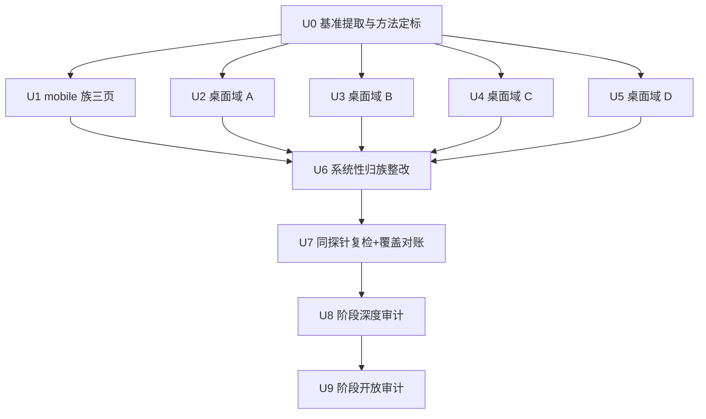

# 复刻页 UX 保真路线图（Replication UX Fidelity: 上游商城移动端对齐 + 二十一页渲染面深修）

> Created: 2026-11-02（用户指令：目前生成的复杂页面 UI/UX 设计远远达不到要求；查看 ~/app/nop-app-mall 的 mobile 前端样式，对每个复杂页面逐个排查，彻底修复显示并确保交互正确）
> Status: **done**（2026-11-04 收口：U0-U9 全 done；U9 开放审计 round-1 Pass〔agent_0be03ec1，4 Minor 全处置〕+ round-2 复核确认〔agent_06ba0cfc〕+ closure audit approved〔agent_ba0ecee2〕。拟制期共识审查轨迹：agent_6bd768fd rounds 1-2、agent_6a96a31a rounds 3-4）
> Mission: `missions/replication-ux-fidelity.json`（draft，随首 plan 启动转 active）
> 拟制与共识流程：`docs/skills/roadmap-and-mission-authoring-with-consensus-review.md`；结构遵循 `docs/backlog/00-roadmap-authoring-guide.md`
> Sources:
>
> - 上游商城移动端（样式与交互基准）：`~/app/nop-app-mall-wt/nop-app-mall-master`——12 个 flux.yaml 页面（`app-mall-web/src/main/resources/_vfs/app/mall/mobile/`，`_dump/nop-app/app/mall/mobile/` 同源镜像）、next 壳商城品牌样式（`~/app/nop-chaos-next-wt/nop-chaos-next-master/apps/main/src/styles/index.css` L203 起 `.mall-*` 页面类）、TSX 对照实现（flux 仓 `apps/mall-mobile`，2026-10-30 `dc4d8bf97` 退役，git 历史可恢复——页面结构/交互细节的内容基准）
> - 审计方法沉淀（历史经验/提示词）：`docs/skills/visual-page-quality-inspection-prompt.md`（页面级渲染走查主方法）、`docs/skills/ux-design-pattern-audit-prompt.md`（源码 UX 模式）、`docs/skills/complex-component-display-operability-audit-prompt.md`（组件级显示/可操作）、`docs/skills/interaction-state-audit-prompt.md`（交互态）、`docs/backlog/visual-quality-roadmap.md`（一期）+ `visual-quality-r2-roadmap.md`（二期渲染面走查，121 页+139 控件，2026-09-24 收官）
> - 审计对象：business-page-replication roadmap 交付的二十一页（`apps/playground/src/complex-pages/`，W1-V3，2026-11-02 ★ 1.0 收口）
>
> Authority：
>
> - 本 roadmap 只改 flux 仓 playground 复刻页（schema/页面 CSS/host/e2e 断言）与必要的渲染器缺陷修复；不改上游 nop-app-mall 任何文件。
> - 渲染器级产品缺陷（组件族共性根因）→ 就地修复或登记 `existing-components-improvement-analysis.md`；新 type 缺口只登记不立项（retention 权威 amis-baseline-matrix）。
> - 与 visual-quality-r2 的关系：R2 方法全量复用（三步走查/A-H 评分卡/系统性 vs 局部归族/同探针复检），本 roadmap 是 R2 方法在复刻页族（R2 收官后新建的 21 页）上的补课轮，不是 R2 重启。

---

## 1. Purpose

复刻 1.0 以"页面能不能撑住真实业务交互"为验收标准（e2e 载荷级断言 + axe + focus），**视觉/UX 保真度从未被系统走查**——F1 统一验收只做单 viewport 快照目检（4 项观测级 residual 已现端倪：I1 双按钮对、I2 趋势量纲压扁、K2 看板横滚裁切、V3 围栏可视性）。用户判定当前 UI/UX "远远达不到要求"；另有主审 F1 评审期间目检观察——S1 画廊商品图为纯色占位大色块（当时未达 residual 登记阈值未入册，U1 走查时正式取证）。本 roadmap 以**上游商城移动端真实页面为样式与交互基准**，对二十一页逐页执行渲染面深修：显示彻底修复、交互正确性程序化锁定。

## 2. 诊断（为什么 1.0 全绿而 UX 不达标）

- **验收口径缺口（实证）**：R2 渲染面走查方法（三步 critique→grounding→取证、A-H 评分卡、双主题）2026-09-24 收官，21 个复刻页 2026-10-30 之后才建成（首条 replication 交付提交 `b10584279`，plan 810 M2）——**方法论存在但未应用到该页族**；F1 快照目检是单轮单 viewport 浅走查（visual-page-quality-inspection-prompt 明令禁止的"单轮看图打分"形态）。
- **无上游对标**：复刻页验收只有 e2e 断言（功能层），从未与上游真实页面（mall mobile 12 页/壳品牌样式）做过并排比对；mobile 族三页（W1/M3/S1）与真实商城首页/商品详情/购物车的形态差距无人度量。
- **快照证据已预警**：F1/F4 共登记 4 项观测级 residual（§1 所列），加上 §6 在册的 W3 透视列序与深色主题未验证（P2 MIN-5）等登记项，均为"非破损但远不达设计要求"形态——与用户体感一致；S1 占位色块为主审目检观察（未入册，U1 正式取证），非在册 residual。
- 结论：**覆盖面缺口 → 线性 roadmap**（步骤 1a）：R2 方法补课 + 上游基准引入 + 逐页深修 + 复检闭环。

## 3. Work Item Status

> **本文件唯一的动态状态区。** 状态流转：plan 通过 draft review → `todo`→`planned`；closure audit 通过 → `planned`→`done`。

| Work item                                         | 状态                                                                                                                                    | 依赖  | 说明                                                                                                                                                                                                                                                                                                                                |
| ------------------------------------------------- | --------------------------------------------------------------------------------------------------------------------------------------- | ----- | ----------------------------------------------------------------------------------------------------------------------------------------------------------------------------------------------------------------------------------------------------------------------------------------------------------------------------------- |
| U0 上游基准提取与方法定标                         | `done`（plan 845，2026-11-04 closure audit approved）                                                                                   | —     | 提取上游 mall mobile 样式/交互基准（12 个 flux.yaml 逐页结构 + 壳 `.mall-*` CSS 令牌 + TSX 对照 git 历史），沉淀 `docs/analysis/replication-ux/upstream-mall-mobile-baseline.md`（mobile 族逐页对标卡 + desktop 族设计令牌基准）；四份审计 skill 角色分工与评分卡模板定标；21 页分组 plan 拆分裁决                                  |
| U1 mobile 族三页深修（W1/M3/S1 对齐上游商城形态） | `done`（plan 846，2026-11-04 closure audit approved）                                                                                   | U0    | 与上游 home/goods-detail/cart 并排走查（375×667 双栏截图比对 + A-H 评分卡 + 三步法）；显示修复（S1 画廊占位色块〔U0 基准卡先行取证〕/画布留白/吸底栏形态等）+ 交互正确性（滑动/步进/求交/倒计时手感动检）；focused e2e `--retries=0` 复跑绿                                                                                         |
| U2 桌面域 A 深修：W2/W3/C1/C2/C3（5 页）          | `done`（plan 847，2026-11-04 closure audit approved）                                                                                   | U0    | 逐页渲染走查（浅/深双主题 + 交互中间态 + 三步法评分卡）+ 修复；e2e 复跑绿                                                                                                                                                                                                                                                           |
| U3 桌面域 B 深修：I1/I2/K1/K2/K3（5 页）          | `done`（plan 848，2026-11-04 closure audit approved）                                                                                   | U0    | 同 U2 口径（含 I1 双按钮对、I2 量纲压扁两项已知 residual 的根因修复）                                                                                                                                                                                                                                                               |
| U4 桌面域 C 深修：M1/M2/S2/O1/O2（5 页）          | `done`（plan 849，2026-11-04 closure audit approved）                                                                                   | U0    | 同 U2 口径。勘误附注（plan 848 U3 跨行记账）：原登记的「K2 横滚裁切」residual 已于 U3 取证裁决——K2 看板横滚可用（scrollable 链程序化取证，末列 scrollIntoView 全可见），真缺陷为列标题在 280px 列宽下截断，已就地修复（`repl-k2-kanban` 列 min-width 340 + e2e 视口 2520 物理前置裁决）；U4 不再承担该项，渲染器级 truncate 类归 U6 |
| U5 桌面域 D 深修：V1/V2/V3（3 页）                | `done`（plan 850，2026-11-04 closure audit approved）                                                                                   | U0    | 同 U2 口径（含 V3 围栏可视性 residual；V3 地图页分支 C 口径沿用）                                                                                                                                                                                                                                                                   |
| U6 系统性归族与设计系统层整改                     | `done`（plan 852，2026-11-04 closure audit approved：族 A/D 就地修+判别单测、族 B/E 登记、族 C/F replication.css 归族、209/209 全量绿） | U1-U5 | 跨页共性 findings 强制归族：复刻页共享 CSS（`replication.css` repl-\* 类）、壳 padding/页面框架、stat-tile/dialog/table 呈现共性——族级修复一次落地；组件族共性根因就地修复渲染器或登记 improvement-analysis                                                                                                                         |
| U7 同探针复检轮 + 覆盖对账                        | `done`（plan 851，2026-11-04 closure audit approved）                                                                                   | U6    | R2 复检机制：21/21 页以同一探针复检，零未处置 Major + 截图证据归档 + 逐页台账对账（不遗漏承诺）                                                                                                                                                                                                                                     |
| U8 阶段深度审计                                   | `done`（plan 853，2026-11-04 三组深审 verdict Pass + closure audit approved）                                                           | U7    | 对照 live repo 与上游基准核对修复保真度、断言真实性、评分卡证据                                                                                                                                                                                                                                                                     |
| U9 阶段开放审计                                   | `done`（plan 854，2026-11-04 开放审计 round-1 Pass + round-2 复核确认 + closure audit approved）                                        | U8    | 独立 fresh 子 agent 开放评审；通过后本 roadmap 收口                                                                                                                                                                                                                                                                                 |

## 4. 验收标准（每页 pass/fail 判据，程序化）

1. **渲染走查**：`visual-page-quality-inspection-prompt.md` 三步法（自由 critique → 维度 grounding → 逐条程序化取证）+ A-H 评分卡全维度记录；浅/深双主题 + 交互中间态（hover/focus/error/loading/空态）取证；**禁止单轮看图打分**。
2. **上游对标（U1 强制，U2-U5 令牌级）**：S1 与上游 goods-detail 逐页并排截图比对，主要区块形态/间距体系/品牌令牌对齐（允许内容差异，不允许形态/层级/密度代差）；W1/M3 为工业移动页、上游 mall 12 页无对应页——对齐口径为**移动形态/组件级基准**（导航/吸底栏/触控目标 ≥44px/品牌令牌/列表密度），〔勘误 2026-11-04 U9 m-9-2：判据对齐为 WCAG 24px 底线 + 上游 40px 既有形态豁免（u1 F-W1-2 口径），44px 为原始提案值未落地〕U0 基准卡固化该裁决；desktop 族对齐 `.mall-*`/`replication.css` 令牌基线。
3. **显示修复**：走查 findings 无未处置 Blocker/Major；Minor 当场修或登记 residual（带 Why Not Blocking）。
4. **交互正确**：修复后该页 focused e2e `--retries=0` 全绿（交互断言不得为视觉修复而弱化；确需调整断言须逐条裁决记录）；交互态审计（`interaction-state-audit-prompt.md`）覆盖 loading/error/empty/成功反馈四态。
5. **复检闭环**：U7 同探针复检零新增 fail；覆盖对账 21/21 uncovered=0。

## 5. Framework / Platform Reuse

| 能力                                   | 提供方                                                                                                       | 用途               |
| -------------------------------------- | ------------------------------------------------------------------------------------------------------------ | ------------------ |
| 页面级渲染走查方法                     | `visual-page-quality-inspection-prompt.md`（R2 全套探针/helpers）                                            | U1-U7 主方法       |
| 源码 UX 模式 / 组件可操作 / 交互态审计 | `ux-design-pattern-audit` / `complex-component-display-operability-audit` / `interaction-state-audit` prompt | 组件级深挖补充     |
| 上游样式基准                           | mall 12 flux.yaml + next 壳 `.mall-*` CSS + TSX git 历史                                                     | U0 基准卡、U1 对标 |
| 多模态读图 + 程序化取证                | 执行 agent 读截图评审 + `getComputedStyle`/locator 取证                                                      | 全程               |
| e2e 设施                               | 21 页 focused spec + replication helpers + axe 分支 A/B/C                                                    | 交互正确性回归门   |
| 设计系统整改通道                       | `replication.css` / 渲染器修复 / improvement-analysis 登记                                                   | U6 归族落地        |

## 6. Current Baseline（live 核对 2026-11-02）

- 二十一页均在 `apps/playground/src/complex-pages/`（schema JSON 18 页 + host override 3 页 mobile）〔勘误 2026-11-04 plan 845：host override 实为 4 页——W1/M3/S1 mobile + K1 desktop host，schema-only 17 页；权威清单见 `docs/analysis/replication-ux/upstream-mall-mobile-baseline.md` §1〕；页面级 CSS 落点 `replication.css`（repl-\* 类，浅色硬编码已由 P2 MIN-5 登记在案）；dev server 以 strict 校验启动（playwright webServer 同款环境）。
- 上游基准实证存在：mall mobile 12 页 flux.yaml（`app-mall-web/.../_vfs/app/mall/mobile/`）；next 壳 `index.css` L203-260+ `.mall-page-bg/.mall-brand-header/.mall-brand-title/.mall-brand-notice` 等商城品牌类；TSX 对照在 flux 仓 git 历史（`dc4d8bf97` 退役提交）。
- 已知 UX 预警（F1/F4 登记）：I1 双按钮对、I2 趋势量纲、W3 透视列序、V3 围栏可视性、K2 横滚裁切、replication.css 深色主题未验证（P2 MIN-5）——均在册 residual；另有 S1 占位色块为主审目检观察（未入册——见 §2，U1 正式取证）。
- mobile 渲染器族能力已注册（pull-refresh/infinite-scroll/swipe-cell/countdown/floating-panel/image-viewer/wheel-picker 等）；壳品牌机制为 next 仓所有，flux playground 侧无 `.mall-*` 类——对齐方式由 U0 裁决（令牌移植 vs 等价类）。
- 复检基础设施：R2 固化探针仍在仓（`tests/e2e/helpers/`：`visual-contrast.ts`/`form-actions-alignment.ts`/`overlay-actions-alignment.ts`/`interaction-state-probes.ts` 四件 + `visual-assert.ts`/`visual-theme.ts`），U7 同探针复检直接复用。

## 7. Phase Details

> 每个工作项 = 一个 execution plan（U0 先行；U1-U5 可两批并行；U6-U9 串行）。plan 内 phase 划分、Exit Criteria、Failure Paths 按 `docs/plans/00-plan-authoring-and-execution-guide.md`；发现处置遵循 Anti-Slacking（live 缺陷不得降级 follow-up）。

- **U0**：交付基准卡 + 方法定标 + 分组裁决。Exit：基准卡落档（mobile 族逐页对标卡 ≥3 页、令牌表、TSX 对照要点）；四 skill 分工表；U1-U5 plan 拆分与依赖图落档。
- **U1**：mobile 族三页（最重差距面先行）。Exit：三页并排比对记录 + A-H 评分卡终态达标 + e2e 绿 + 修复 diff 清单。
- **U2-U5**：桌面域四批（5/5/5/3 页）。Exit：逐页评分卡 + findings 处置表 + e2e 绿。
- **U6**：归族整改。Exit：共性 findings 归族表（族→修复落点→验证）；族级修复落地；无"只修实例"残留。
- **U7**：复检对账。Exit：复检报告零未处置 Major；21/21 台账 uncovered=0；截图归档 `_tmp/ux-fidelity/`。
- **U8/U9**：审计。Exit：报告落档、verdict Pass、roadmap 收口。

### 依赖图

（U1 与 U2-U5 两批可并行；表格 §3 依赖列为权威。）

## 8. Cross-Cutting

- **不遗漏承诺**：21 页程序化枚举清单进 U7 对账；每页走查/修复/复检三态台账。
- **交互不回退**：视觉修复不得弱化 e2e 断言；断言调整须逐条裁决记录；修复批 e2e `--retries=0` 复跑为硬门。
- **每 plan 收口自动提交一次**（用户常设指令）。
- **字母后缀拆批预授权**：任一 work item 执行中超一个 plan 容量（如 U6 归族 findings 总量过大），按字母后缀滚动拆批（R2 先例 R2-1a-d/R2-2a-c），不逐次人工重启。
- **共享工作树纪律**：并行会话在途（835/836/839-841 等）——文件级暂存、plan 编号避让、提交前 `git status` 复核自有触达面。
- **审计纪律**：U8 深审 + U9 开审（独立 fresh 子 agent），先例 R5/R6、D5/D6、P1/P2、F3/F4。

## 9. Rules

- 本文件是状态索引与粗分解；每个工作项由其 execution plan 承载；状态变更只发生在 §3。
- 修复不得引入后端依赖；mock 数据面允许为视觉完善调整形态但不得破坏 e2e 载荷断言。
- 视觉评审截图为评审证据（`_tmp/` 归档）；pass/fail 判据一律程序化（AGENTS.md 2026-08-28 快照政策）。
