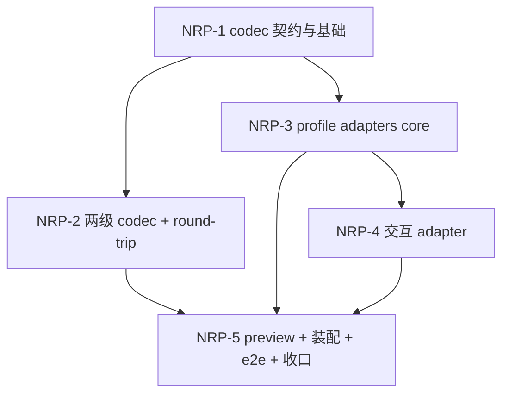

# Report Designer · nop-report Profile Roadmap

> 本文件按 `docs/skills/roadmap-and-mission-authoring-with-consensus-review.md` 产出；mission 档 `missions/report-designer-nop-report.json`；每次修订须经独立子 agent 共识审查（该 skill 步骤 4）。
> Created: 2026-10-17（用户下达：nop-chaos-flux 中已有 report designer，需要完善它作为报表设计器）
> 设计种子：`docs/plans/640-nop-report-profile-plan.md`（Plan Status 已改为 `superseded`；其 Phase 1–7 为 NRP-1…NRP-5 各 work item 起草计划时的详细 scope / exit criteria 种子，勿与本 roadmap 的 §5 状态列重复维护）
> 事实基线：2026-10-17 live 全仓走查（`packages/report-designer-core`、`packages/report-designer-renderers`、`packages/spreadsheet-core`、`apps/playground`、`docs/architecture/report-designer/*` 逐项核对，证据以文中文件路径为准）
> Authority 关系：
>
> - 通用设计器架构权威：`docs/architecture/report-designer/design.md`；adapter seam 权威：`docs/architecture/report-designer/contracts.md`；`nop-report` 适配权威：`docs/architecture/report-designer/nop-report-profile.md`；codec 权威：`docs/architecture/report-designer/codec-design.md`；inspector 权威：`docs/architecture/report-designer/inspector-design.md`；页面 contract 权威：`docs/components/report-designer-page/design.md`。
> - 本文件只管 **`nop-report` profile 的落地编排**（把通用设计器收口为可用报表设计器）。通用 report designer core/renderers 的具体实现细节不在此处；**带区/分组头语义、二进制 xlsx/CSV 导入导出、Excel 完整样式模型等不在本路线图范围**（见 §9 Cross-Cutting）。
> - 状态流转沿用主 roadmap 规则：`todo` → `planned`（draft review 通过）→ `done`（closure audit 通过后回写）；§5 Phases 总表（内联状态列）是唯一权威动态区。

---

## 1. Purpose

本文件是 **`nop-report` Report Designer** 的编排层。回答：通用 report designer 已落地到什么程度、离"可用的 `nop-report` 报表设计器"还差哪些 work item、以及它们如何被 AI 按 closed loop 依次收口。

通用设计器（spreadsheet core + report-designer core + renderers）是真实且经审计的实现；缺的是让它服务于 `nop-report` 的 **profile 层**。本路线图即 profile 落地队列。

## 2. 基础支撑（已存在、可直接复用，禁止重建）

| 共享件                                                                                                                                                                      | 位置                                                                                                                                                                          | 现有消费者/证据                                    |
| --------------------------------------------------------------------------------------------------------------------------------------------------------------------------- | ----------------------------------------------------------------------------------------------------------------------------------------------------------------------------- | -------------------------------------------------- |
| report designer 会话内核（metadata 平面、命令分发、undo/redo、inspector schema 解析、field source 加载、readonly gate）                                                     | `packages/report-designer-core/src/core.ts`、`core-dispatch.ts`、`runtime/*.ts`                                                                                               | 通用设计器本体                                     |
| adapter seam（`FieldSourceProvider`/`FieldDropAdapter`/`PreviewAdapter`/`TemplateCodecAdapter`/`ExpressionEditorAdapter`/`ReferencePickerAdapter`/`ReportDesignerProfile`） | `packages/report-designer-core/src/adapters.ts:19,27,41,59,88,98,103,169`                                                                                                     | 已定义，待解析服务填充                             |
| 元数据平面（workbook/sheet/row/column/cell/range 六级）                                                                                                                     | `packages/report-designer-core/src/types.ts:34,359`（`ReportSemanticDocument`、`getTargetMeta`）                                                                              | cell 用 `address` 身份                             |
| 通用 renderers（page/field-panel/inspector-shell/inspector/toolbar + canvas）                                                                                               | `packages/report-designer-renderers/src/renderers.tsx`、`report-spreadsheet-canvas.tsx`                                                                                       | 5 个已注册 renderer                                |
| spreadsheet 运行时（60+ 命令、公式引擎、merge/resize/undo/sort/filter/freeze/find）                                                                                         | `packages/spreadsheet-core/src/commands-*.ts`、`formula/formula-engine.ts`                                                                                                    | 真实可用                                           |
| editor-core 会话内核 + WorkbenchShell + manifest/host 投影                                                                                                                  | `packages/editor-core`、`packages/flux-react/src/workbench/`                                                                                                                  | 见 `editor-designer-standardization-roadmap.md` §2 |
| editor-core 会话迁移（report/spreadsheet 已迁）                                                                                                                             | `docs/plans/2026-10-04-547-editor-designer-p12-spreadsheet-editor-core-plan.md`、`docs/plans/2026-10-04-548-editor-designer-p13-report-editor-core-plan.md`（均 `completed`） | 本路线图不重复迁移                                 |
| ui 基元                                                                                                                                                                     | `packages/ui/src/index.ts`                                                                                                                                                    | 全部渲染器                                         |

## 3. 现状基线（2026-10-17 live 走查，只读事实；冲突以代码为准）

- **通用 report designer 已真实落地且经审计**：core 命令/元数据/undo/inspector 解析/field source 加载/readonly 均有实现（`packages/report-designer-core`）；renderers 注册 5 个（`packages/report-designer-renderers/src/renderers.tsx`）。
- **`nop-report` profile 不存在**：`Xpt*Model` 在 `packages/`/`apps/` 零代码命中；`nop-report` 仅作为 renderer 的 CSS/标记前缀与 MIME（`report-field-panel.tsx:22` 的 `application/x-nop-report-field`、`report-designer-toolbar.tsx:81`、`page-renderer.tsx:639`、`inspector-shell-renderer.tsx:40`）与一个 core 测试的 namespace key（`packages/report-designer-core/src/__tests__/document-and-metadata.test.ts:101-109`）出现。
- **无生产 `TemplateCodecAdapter`**：live import/export 走 `noCodecConfigured`（`packages/report-designer-core/src/runtime/codec-commands.ts:19-22`）。
- **`ExpressionEditorAdapter`/`ReferencePickerAdapter` 无实现、无消费点、且 profile 无引用选择字段**：`registry.ts:16-17` 只构造 `expressions`/`references` map 且从未被读取；`ReportDesignerProfile`（`adapters.ts:169-178`）有 `codecId?`/`previewId?`/`inspectorSchemaId?`/`expressionEditorId?` 但**无 `referencePickerId?`**，`registry.ts:32-41` 也无对应 resolver。
- **demo 为 mock**：`apps/playground/src/pages/report-designer-demo.tsx`（自建 shell + 静态字段源 + 本地 drop adapter）、`report-designer-host-demo.tsx`（走生产 page renderer + stub preview）。
- **owner-doc drift**：`config-schema.md:198-199,219-226` 描述的 `ReportDesignerConfig.expressions/adapters`、`FieldSourceConfig.mode/itemTemplate/dragPayload` 在 live `types.ts:135-157` 不存在；`inspector-design.md:114-127` 用 `target`/`selection` 而 live canonical 投影用 `selectionTarget`（同文 `:243` 已用 `selectionTarget`）。
- **codec 方向前提失效**：`codec-design.md:477-479`（plan 477 裁决）采纳 hucre 作 codec 层依赖；本项目经用户裁定改为**纯 TS codec、不引 hucre**，该前提需就地勘误。
- **显式不在范围（见 §9）**：带区/分组头 canvas 语义（`docs/audits/visual-quality/report-designer.md` 已 deferred）、二进制 xlsx/CSV 导入导出、Excel 完整样式模型（`nop-report-profile.md:170-187` 差距表）。

**主要 gap（本路线图落点）**：profile（codec + field source + field drop + inspector schema + expression/reference adapter + preview）全部缺失；demo/测试为 mock。

## 4. 数据/格式契约（跨 work item 的裁定基线）

- **codec 外部信封**：绑定 `nop-report` 的 XDSL workbook 模型（`/nop/schema/excel/workbook.xdef`，等价 `ExcelWorkbook + Xpt*Model` 的序列化形态）；二进制 `.xpt.xlsx <-> 模型信封` 由后端承担，本路线图不实现二进制解析。
- **codec 实现策略**：纯 TS、**不引 hucre**（就地勘误取代 plan 477 裁决）。
- **身份规则**：前端 sheet 一律用稳定 `sheetId`（codec 维护 ↔ external name）；cell 语义 key 一律 `address`；`rowParent`/`colParent` 保留原始地址表示，不擅自规范化。
- **无损保真**：未知字段/`props`/`raw` 必须 round-trip 不丢；spreadsheet 侧未知字段载体在 NRP-1 裁定（`codec-design.md:123` 要求视图信息不回写）。

## 5. Phases 总表

| Phase | Work item                             | 内容（交付边界）                                                                                                                                                                                                                                                | 依赖                | 复用                                                           | 状态   |
| ----- | ------------------------------------- | --------------------------------------------------------------------------------------------------------------------------------------------------------------------------------------------------------------------------------------------------------------- | ------------------- | -------------------------------------------------------------- | ------ |
| P0    | **NRP-1 codec 契约与基础**            | `ExcelWorkbookLike`/`XptWorkbookLike` 中间类型；`packages/report-designer-nop-report` 包骨架；codec 方向就地勘误（纯 TS 取代 hucre）；spreadsheet 侧 unknown/props 载体裁定；`config-schema.md`/`inspector-design.md` owner-doc drift 收敛                      | 无                  | `codec-design.md` §3/§8；AGENTS「Adding New Packages」         | `done` |
| P1    | **NRP-2 两级 codec + round-trip**     | `SpreadsheetCodec`（`SpreadsheetDocument <-> ExcelWorkbookLike`）、`ReportSemanticCodec`（`ReportSemanticDocument <-> XptWorkbookLike`）、组合 `NopReportTemplateCodec`；round-trip/unknown/merge 判别性测试；接入 import/export 命令（去 `noCodecConfigured`） | NRP-1               | `adapters.ts:59`、`runtime/codec-commands.ts`                  | `done` |
| P2    | **NRP-3 profile adapters core**       | `nop-report` field source provider（数据集→字段树）+ field drop adapter（→`cellMeta['nop-report'].model` 的 `field`/`ds` patch）+ inspector schema（cell Basic + cell XPT + sheet/workbook）                                                                    | NRP-1               | `adapters.ts:19,27`、`runtime/inspector-panels.ts`             | `done` |
| P3    | **NRP-4 交互 adapter**                | expression editor adapter + reference picker adapter（`rowParent`/`colParent` 地址选择）的**实现 + 消费路径**；`referencePickerId?` 加法与 resolver                                                                                                             | NRP-3               | `adapters.ts:88,98`、`runtime/registry.ts`                     | `done` |
| P4    | **NRP-5 preview + 装配 + e2e + 收口** | preview adapter（沿用单 owner/abort 序列）；`createNopReportProfile`/`registerNopReportAdapters` 装配；demo 换真实形状信封；端到端 e2e；owner-doc 收口                                                                                                          | NRP-2、NRP-3、NRP-4 | `runtime/preview-commands.ts`、`report-designer-host-demo.tsx` | `done` |

执行顺序建议：**NRP-1 → NRP-2（codec 线）与 NRP-3（adapter 线）可并行 → NRP-4 → NRP-5 收口**。

## 6. Phase Details（交付边界，无实现步骤）

- **NRP-1**：只产出类型/包骨架/契约勘误/载体与 drift 裁定；不改通用 core 行为（许可的向后兼容加法除外，需在对应 plan 显式记录）。
- **NRP-2**：round-trip 声称必须有判别性测试（旧实现必挂）；错误走 `CodecDiagnostic` 分级，不抛裸异常到命令层。
- **NRP-3**：字段拖放只产生标准化 designer command，不直接改 document；range drop 首版裁定为单 cell（range 显式 deferred 或实现批量 patch，二者取一并记录）。
- **NRP-4**：expression/reference adapter 的消费路径是修复项（当前 map 无消费者）；`referencePickerId?` 为向后兼容加法。
- **NRP-5**：e2e 用程序化断言（非仅截图）；owner-doc 收敛为最终设计状态（`docs/architecture/` 只写最终态，不写演进叙事）。
- **Owner doc 归属**（§5 表不设列，此处统一）：NRP-1 → `codec-design.md`/`config-schema.md`/`inspector-design.md`；NRP-2 → `codec-design.md`；NRP-3/NRP-5 → `nop-report-profile.md`；NRP-4 → `inspector-design.md` + `contracts.md`（adapter seam 权威，`referencePickerId?` 加法需在此登记）；NRP-5 → `docs/components/report-designer-page/design.md`（如契约变更）。
- **粒度确认**：NRP-2/NRP-3/NRP-5 是三条较宽的 work item，按 §Rule 3 各须由单个 plan 收口；起草对应 plan 时若发现确实无法单 plan 收口，须先经人工确认再拆分（不得由 AI 自行增殖 work item）。

## 7. 依赖图

## 8. Cross-Cutting

- **基线核对 live**：每条 baseline 声称必须对照 live code；本文件初版已由独立子 agent 逐项核对（见 §11 审查记录）。
- **codec 无损红线**：任何"导入导出保真/round-trip"声称必须点名判别性测试。
- **许可边界**：只对版参考 hucre/Jasper/hucre 类项目；**不引 hucre**、不引第三方二进制 xlsx 库为运行时依赖（本路线图初版）；如后续需要，另经人工确认并修订 §4。
- **owner-doc 纪律**：`docs/architecture/` 只描述当前最新设计状态；每 work item 收口同步受影响 owner doc。
- **测试策略档**：NRP-2/NRP-3/NRP-4/NRP-5 代码线一律 `必须自动化`；NRP-1 含类型/包骨架（本地 typecheck）+ 纯文档勘误。
- **提交纪律**：`feat(report-designer-nop-report): <description>`（纯文档项 scope 改 `docs`）；与 mission `commitFormat` 逐字符一致。
- **每 work item 一个 execution plan**；closure audit 由独立 fresh 子 agent 执行，通过后才回写 §5 状态。

## 9. 范围排除（明确不在本路线图）

- **带区/分组头/`expandType` canvas 语义渲染**：`docs/audits/visual-quality/report-designer.md` 已显式 deferred；本路线图只在 inspector 层编辑 XPT 字段。
- **二进制 `.xpt.xlsx` / CSV 的 TS 侧解析生成**：由后端或 successor 承担。
- **Excel 完整样式模型**（styleId 注册表、条件格式、图片/图表/pivot）：见 `nop-report-profile.md:170-187`，归后续 plan。
- **`report-designer-renderers` 纳入 UI 一致性 gate 扫描集**：独立治理项。
- **通用 report designer core/renderers 的既有实现筛选**：已由既有审计/plan 覆盖，本路线图不重复。

## 10. Rule

1. 本文件是编排层：契约细节看 §Authority 各 owner doc；不重述业务规则、不写实现步骤/复选框。
2. 状态只更新 §5 表（Phases 总表内联状态列）；冲突以本表为准；依赖以 §5 表与 §7 图一致，表优先。
3. **work item 粒度 = 一个 plan 能完成**；超出须拆分或经人工确认。
4. **无 Loop Rule**：本路线图为线性 roadmap（NRP-1→…→NRP-5），不自行派生新 work item；新增/删除/重排 work item 一律须人工确认并触发共识审查（本 Rule 6）。
5. 完成的 work item 须同步受影响 owner doc（`codec-design.md`/`config-schema.md`/`inspector-design.md`/`contracts.md`/`nop-report-profile.md`/`report-designer-page/design.md`）与 daily log。
6. **closure audit 由独立 fresh 子 agent 执行**，执行 session 不得自审、不得自行勾签 audit gate；审计未通过不得回写 §5 `done`。
7. 本文件或 mission 的任何修订（含新增/删除/重排 work item）须经独立子 agent 共识审查（`docs/skills/roadmap-and-mission-authoring-with-consensus-review.md` 步骤 4）。
8. 范围排除（§9）如需解禁，属结构性变更，先经人工确认再修订本文件。

## 11. 共识审查记录

> 每次修订追加一轮记录。由独立 fresh session 执行（review-only）。

- Round 1（`ses_eb5e1f27bffeHOdg1Zm7uQkWPi`，独立 fresh session）：verdict `revised`——1 Blocker（B1 `moduleDir` 指向尚不存在的 `packages/report-designer-nop-report`，mission-check 拒收）+ 1 Major（M1 种子计划 640 单向引用）+ 5 Minor。已修：B1 → `moduleDir` 改 `.`（全仓 roadmap 惯例）；M1 → 头部加「设计种子」指针；m1（补 `NRP3→NRP5` 依赖边）、m2（NRP-4 owner doc 增 `contracts.md`）、m3（§6 增粒度确认）、m4（§Rule 4 显式「无 Loop Rule」）、m5（547/548 用全文件名）全部修正。
- Round 2（`ses_eb5d67f7dffeLSelMHL9UTuOdZ`，独立 fresh session）：verdict **`approved`**（0 Blocker / 0 Major）——`mission-check.mjs` 通过（`moduleDir` = `.` 合规，与 10 个先例一致）、`roadmap-check.mjs` 通过；B1/M1/m1–m5 全部确认修复；§5 表↔§6↔§7 图↔Rule↔mission 内部一致；baseline 抽样复核仍成立。非阻塞观察：`auditsDir` `docs/audits/report-designer-nop-report` 尚未创建（validator 不校验，先例同此，按需创建）。
