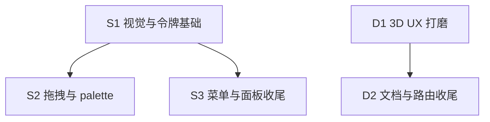

# SCADA 与 3D 控件 UX 补充修正 Roadmap

> Last Updated: 2026-10-06
> Source: `docs/analysis/2026-10-05-designer-ai-ux-comparative-analysis.md`（S1–S16 画布标准）/ `docs/backlog/industrial-hmi-component-audit-roadmap.md`（HCA 治理边界）/ 基线探查（2026-10-06，证据到文件行号，见 Current Baseline）/ 商业与开源产品对标（2026-10-06 WebSearch，见 Current Baseline 对标小节）
> 前序批次: plans 526–529（flow/page/report/word designer + AI 控件同口径修正，全部 completed）

## Purpose

本文件是 SCADA 编辑器与 3D 渲染器两个复杂控件「UI/UX 补充修正」轨道的编排层：把 plans 526–529 已验证的修正口径（选中态视觉公式、拖拽反馈闭环、右键菜单、过渡动效、语义令牌、空态、检索）延伸到这两个未覆盖面，同时**显式排除 HCA 治理已交付的维度**（见 Current Baseline 的不重复清单）。工作项粒度 = 一份执行计划可收口。

## Framework / Platform Reuse

- **选中态/视觉公式**：plans 526 的 `--fd-node-selected-ring/shadow` 令牌与显式规则模式（designer-theme.css）。
- **拖拽 ghost**：plans 527 的 `setPaletteDragGhost` 模式（typeof + try/catch 双守卫、离屏 fixed、pointer-events:none、清理）。
- **右键菜单**：`page-designer-context-menu.tsx` 组件模式（viewport 钳制 / Escape / 外点 / 方向键导航，items 子内构建）。
- **过渡常量**：`PD_OVERLAY_TRANSITION` 外观属性限定模式（几何属性不入 transition）。
- **面板调宽**：WorkbenchShell `leftResizable/rightResizable` + 本地 useState（会话内有效）。
- **palette 检索**：`matchesPaletteQuery`/`matchesReportFieldQuery` 纯函数 + 空态 + 清除模式（勘误 2026-10-06：该模式由 plan 526 落库，非 527——git a0e50285a）。
- **既有栈**：leafer-ui `@leafer-in/editor`（EditBox/EditSelect/框选内建）、WorkbenchShell 三栏、`@nop-chaos/ui`（Input/Skeleton/Button）、i18n 双 locale 纪律。

## Current Baseline（2026-10-06 探查）

**SCADA 编辑器**（`packages/flux-renderers-industrial/src/editor`，leafer-ui 2.2.9，136 源文件）：

- 选中视觉 = leafer Editor 插件默认 EditBox（`editor-engine.ts:78,89`，零定制）；运行态覆盖物 `engine/interaction-overlay.ts:15-18` 硬编码 hex（hover `#2f6fed` / selected `#ff7f2a` 等），无 ring/shadow 公式。
  - **勘误（2026-10-06，plan 530 S1 落地）**：上行为 S1 立项时基线——本行两项均已收敛：覆盖物 hex → `--ind-*` 语义令牌（ring+浅填充+软阴影公式 + 120ms 过渡，`engine/interaction-tokens.ts` + 双表令牌块）；EditBox 经 appConfig `editor:{}` 接 `--ind-node-selected-ring` 定制（不再零定制）。契约见 `design-architecture.md` §10.1。
- palette 拖入无 ghost/落点指示（`editor-palette.tsx:36-39`、`scada-editor-canvas.tsx:400-443`）；图元位移无网格/对齐吸附（仅连线有钱锚点吸附 `anchor-snap.ts:53-56`）；drop 后不自动选中。
- 全包无右键菜单（grep 0 命中）；全包无 CSS transition；`styles.css` 用 `--nop-*` + hex fallback（非 hsl 令牌惯例）。
- palette 24 图元平铺，无搜索/分组折叠；WorkbenchShell 可拖宽但未传回调（不持久化）；空态纯文案。
- 方向键 nudge 已存在（`scada-editor-canvas.tsx:494-503`）但逐节点多 undo entry（与 HCA P2-4 批量单 diff 纪律不一致）。

**3D 渲染器**（`packages/flux-renderers-3d`，three 0.186.0，24 源文件）——**运行态渲染器，非编辑器**（无选中/gizmo/属性编辑；prop 全 `editorType:'code'`）：

- 无 `setPixelRatio`（HiDPI 发糊风险，`scene-manager.ts` rendererFactory）；初始 aspect 硬编码 800/600。
- WebGL 不可用与加载失败共用同一 error UI，无差异化；hover 固定高亮色 `0x2b4c7e` 可与用户材质冲突、MeshBasicMaterial 无反馈、无 cursor:pointer；canvas 无 role/aria-label/焦点路径。
- 灯色/height 等 3 处硬编码；`__flux_three_handles` 生产暴露；文档状态过时（v4「评审中」）；工业适配器无演示路由。

**HCA 已覆盖（本 roadmap 不重复）**：交互正确性、undo 事务粒度与逆计算、a11y/aria（canvas wrapper guard）、i18n、性能基线（I14/E9.2）、序列化校验拆分、连线锚点吸附算法、错误码统一。UI 视觉公式/动效/令牌/检索/菜单/空态形态不在 HCA 口径内——即本 roadmap 的空间。

**商业/开源产品对标（2026-10-06）**：取证方式如实声明——本环境 `git clone`（FUXA、three.js）与 raw 源码拉取被网络策略阻断，deepwiki 抓取 429，故对标结论以 WebSearch 返回的官方文档/权威二手来源为据，未逐行核对源码、未取得截图；源码级与截图级比对待网络可达时补做。五组对标及各自的可迁移结论：

- **FUXA**（开源 web SCADA/HMI，frangoteam/FUXA）：定制 SVG 编辑器 + 拖放式 gauge/图元管理；图元以库形态组织且有社区生态（FUXA-SVG-Widgets：静态/动态图元分类、数据绑定接口、参数导出约定）。→ 印证 S2 的 palette 分组/检索/拖放反馈闭环是行业标准形态，而非锦上添花。
- **Ignition Perspective 8.3**（Inductive Automation，商业）：8.3 新 drawing canvas 把「网格 + 参考线 + 吸附行为」作为一级能力，支持从标尺拖出自定义参考线；layering/alignment 工具在官方教学体系（Inductive University）中为独立课程。→ S2 吸附体系应包含自定义参考线的评估项；S3 层级菜单应对齐 layering 语义。
- **Siemens WinCC**（V7/V8 Graphics Designer、TIA Basic/Comfort、Unified，商业）：设计期从符号库放置图元，Inspector 内以「Dynamization」绑定标签（动画/动态对话框/动态 SVG）；Faceplate 把标签+动画+脚本封装为可复用对象；设计态与运行态视觉一致性是官方文档与社区 FAQ 的显式议题。→ 印证 S1 设计态覆盖物视觉与运行态绑定分离的形态；符号库分类惯例可作 S2 palette 条目元信息参照。
- **Spline**（商业，浏览器 3D 设计工具）：Figma 式即时交互、真实材质/纹理、实时协作、网页嵌入导出。→ 浏览器内 3D 视口的质感锚点：D1 的 HiDPI 清晰渲染、hover 反馈、优雅降级以此为基准水位。
- **three.js editor**（mrdoob/three.js 官方示例级编辑器）：outliner 场景树（选择/重命名/重父级）、TransformControls 平移/旋转/缩放 gizmo（W/E/R 快捷键）、GridHelper+轴线视口参考。→ 本包 3D 为运行态渲染器（无编辑器），outliner/gizmo 形态**不纳入** D1/D2 交付范围，仅作为未来 3D 编辑器立项时的形态参照，防止误扩 scope。

## Phase Status

| Work Item                                                         | 状态   | 计划                                                       |
| ----------------------------------------------------------------- | ------ | ---------------------------------------------------------- |
| S1 SCADA 编辑器视觉与令牌基础                                     | `done` | `docs/plans/530-scada-visual-token-foundation-plan.md`     |
| S2 SCADA 拖拽便捷性与 palette                                     | `done` | `docs/plans/531-scada-drag-palette-ux-plan.md`             |
| S3 SCADA 菜单与面板收尾                                           | `done` | `docs/plans/532-scada-menu-panel-plan.md`                  |
| D1 3D 渲染器 UX 打磨                                              | `done` | `docs/plans/533-three-renderer-ux-plan.md`                 |
| D2 3D 文档一致性与演示路由收尾                                    | `done` | `docs/plans/534-three-docs-demo-plan.md`                   |
| G1 演示丰富度与薄桥接收敛（符号库 24→37 + scene 双形态 + 双画廊） | `done` | `docs/plans/559-scada-3d-bridge-and-demo-richness-plan.md` |

## Phases

| Phase                          | 状态   | Owner Doc                                                      | 依赖           | 复用                                                        | 计划                                                   |
| ------------------------------ | ------ | -------------------------------------------------------------- | -------------- | ----------------------------------------------------------- | ------------------------------------------------------ |
| S1 SCADA 编辑器视觉与令牌基础  | `done` | `docs/components/industrial-hmi-editor/design-architecture.md` | —              | 526 选中态令牌模式                                          | `docs/plans/530-scada-visual-token-foundation-plan.md` |
| S2 SCADA 拖拽便捷性与 palette  | `done` | 同上 + `design-toolbox.md`                                     | S1（令牌基础） | 527 ghost 模式、526 alignment 模式                          | `docs/plans/531-scada-drag-palette-ux-plan.md`         |
| S3 SCADA 菜单与面板收尾        | `done` | 同上 + `design-property-panel.md`                              | S1             | `page-designer-context-menu` 模式、WorkbenchShell resizable | `docs/plans/532-scada-menu-panel-plan.md`              |
| D1 3D 渲染器 UX 打磨           | `done` | `docs/components/threejs-integration/design-renderer.md`       | —              | 529 reduced-motion/空态模式、语义令牌                       | `docs/plans/533-three-renderer-ux-plan.md`             |
| D2 3D 文档一致性与演示路由收尾 | `done` | `docs/components/threejs-integration/design.md`                | D1             | —                                                           | `docs/plans/534-three-docs-demo-plan.md`               |

## Phase Details

- **S1 SCADA 编辑器视觉与令牌基础**：`interaction-overlay.ts` 覆盖物 hex → `--ind-*` 语义令牌（light/dark 双块，对齐 designer-theme 惯例）；运行态选中/hover/press 升级 ring+浅填充双层公式 + 120ms 过渡；leafer Editor EditBox 选中样式定制能力评估（theme 最小定制或包裹层视觉，产出一页裁定）；`styles.css` 选中/hover/面板反馈 transition 补齐（几何属性排除）；对标（WinCC Dynamization 形态）：覆盖物仅承担设计态选择/悬停视觉，不侵入运行态绑定路径，状态区分度以商业 HMI 三态（hover/selected/press）为水位；e2e：computed 视觉断言（对齐 flow-designer-ux-visual 口径）。
- **S2 SCADA 拖拽便捷性与 palette**：palette 拖入 ghost（527 双守卫模式）；画布 drop 落点指示（对齐 527 落点指示体系）+ drop 后自动选中；图元位移网格/对齐吸附（526 alignment 模式移植到 leafer 坐标系，吸收既有连线吸附阈值惯例），对标增补（Ignition 8.3）：自定义参考线（对标尺拖出 guide）作吸附体系评估项，可为一页裁定后再定是否入交付；方向键 nudge 批量单 undo entry（对齐 P2-4 纪律，仅改 UX 入口不碰 HCA10 事务语义）；palette 搜索过滤（纯函数 + 空态 + 清除）与分组折叠，条目元信息（分组/类型徽标）参照 FUXA-SVG-Widgets 与 WinCC 符号库的分类惯例。
- **S3 SCADA 菜单与面板收尾**：画布右键/键盘上下文菜单（图元态：删除/复制/层级；空白态：粘贴/全选/适应画布；viewport 钳制 + Escape/外点/方向键，readOnly 收敛），层级操作对齐 Ignition layering 语义（置顶/上移/下移/置底）；WorkbenchShell 宽度回调接线（会话内持久，对齐 528 裁决）；编辑器空态升级（图标 + 标题 + 引导 CTA）。
- **D1 3D 渲染器 UX 打磨**：`setPixelRatio(devicePixelRatio)` + 初始 aspect 修正（消除首帧错比例/HiDPI 发糊）；WebGL 不可用差异化降级（独立文案/图标，与加载失败分离）；hover 反馈完备化（高亮色可配/默认与材质解耦、MeshBasicMaterial 反馈、hoverable cursor:pointer）；canvas role/aria-label/焦点路径；灯色与 height 默认值令牌化/常量化收尾；加载骨架视觉规格对齐 529 模式；视口质感以 Spline 为浏览器 3D 基准水位（不引入 gizmo/outliner——运行态渲染器边界，见对标小节 three.js editor 条目）；单测与 e2e 断言随项落地。
  - **勘误（2026-10-06，plan 533 D1 落地）**：本行「默认与材质解耦」交付形态 = MeshBasicMaterial 白提亮通道**默认启用**（反馈通道与材质类型解耦）；emissive 默认色值保留现值 0x2b4c7e（可配，色值属美学而非耦合）；「消除首帧错比例」实为初始化健壮性缺陷（init 末尾 resizeToContainer 覆盖 aspect，用户不可见错比例首帧）。契约见 design-renderer.md「视口质感契约」节。
- **D2 3D 文档一致性与演示路由收尾**：`threejs-integration-analysis.md`「评审中」过时状态勘误、v2–v4 中间稿标注归档；工业适配器/重连管理器演示路由补齐（domain-route-entries + demo 页）；`__flux_three_handles` 生产暴露决策记录；深色模式/视觉回归覆盖方式按 2026-08-28 政策做一次对齐评估（结论可为一页裁定）。
  - **勘误（2026-10-06，plan 534 D2 落地）**：「analysis「评审中」」前提不成立——analysis 文档全文无评审中标记（头部为 I0.1 调研收口）；「评审中」仅存在于 v2/v3/v4 三份中间稿（已就地归档勘误）。

## Dependency Graph

## Cross-Cutting

- **HCA 边界纪律**：各 plan 起草前先对照 HCA work item 表把「已治理维度」写入 Non-Goals；执行中若发现交互正确性/undo 语义问题，登记后移交（不扩 scope）。
- **参照池**：2026-10-06 已完成一轮商业/开源对标（FUXA / Ignition Perspective 8.3 / Siemens WinCC / Spline / three.js editor；结论、可迁移项与来源链接见 Current Baseline 对标小节），各 plan 起草时引用该小节并入各自 Current Baseline；526–529 分析报告 S1–S16 仍为主参照；源码级与截图级比对因网络策略未完成，各 plan 执行中如需逐行证据先补做该取证（不以此阻塞 plan 起草）。
- **验证纪律**：全量门禁（typecheck/build/lint/test/check）+ 对应 e2e 家族（scada-_ / three-canvas-_）+ 新增 computed-style 程序化断言（不落截图判据）；逐 plan 提交，full-green 时标题显式标注。
- **工作区协调**：提交按文件精确 add——当前工作区存在另一会话未提交的 cron-editor 文档改动（`docs/components/index.md`/`roadmap.md`/`amis-baseline-matrix.md`/`examples.manifest.json`/`docs/backlog/cron-scheduling-roadmap.md`），本 roadmap 的 index/指针登记待该会话落盘后补做。

## Rule

- 状态机与闭环遵循 `docs/backlog/00-roadmap-authoring-guide.md`（todo → planned → done；done 前置 = closure audit 通过）。
- 每个 work item 立计划前先读 `docs/plans/00-plan-authoring-and-execution-guide.md`；同一 work item 的多能力合并且过宽才拆。
- AI 按本文件顺序取第一个 `todo` 执行，不改序、不新增工作项；结构性调整须人工确认。
