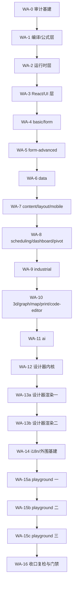

# 临时方案与坏味道逐模块审计路线图（Workaround & Code-Smell Audit Roadmap）

> 最后更新：2026-10-10（拟制）
> 按 `docs/skills/roadmap-and-mission-authoring-with-consensus-review.md` 流程产出；配套 mission：`missions/workaround-code-smell-audit.json`
> 来源：`docs/skills/workaround-code-smell-audit-prompt.md`（2026-10-10 新立的临时方案/重复代码/坏味道审计方法）+ 2026-10-10 用户要求"对每个模块都使用该提示词仔细审计，生成审计报告，据报告拟制修改计划进行修正"
> 先例：`docs/backlog/component-audit-roadmap.md`（逐组件审计+自动修复闭环、CX-n 共性机制）、`docs/backlog/interaction-state-quality-roadmap.md`（分批战役、台账、先红后绿）

## 目的

本文件是"逐模块临时方案取证审计 + 据报告修复"轨道的阶段索引与状态面，按 `docs/backlog/00-roadmap-authoring-guide.md` 拟制：AI 或维护者读完 Phase Status 即知哪些工作项未开始（`todo`）、已立 plan（`planned`）、已完成（`done`）。

背景：仓库已有多条审计轨道（组件契约 component-audit、DOM 结构 dom-structure、视觉 visual-quality、交互状态 interaction-state），但没有一条以"**这段代码是在解决问题，还是只是把问题按住了**"为中心。临时方案（症状特判、静默兜底、时序贿赂、类型绕行、复制粘贴式增长）的共同风险是根因未修、出口缺失、事实上转正。本轨道对全部 41 个包 + playground 应用层（约 31 万行非测试源码）逐批执行 `docs/skills/workaround-code-smell-audit-prompt.md` 的取证协议，每批产出审计报告并据报告修正。

**审计报告 → 修改计划的映射**（用户要求的两段式在本轨道的落法）：

1. **批内发现**：每个 WA-n 工作项 = 一份 plan，内含"审计 → 报告 → 修复"闭环（自动修复契约见下节）。报告即 `docs/audits/workaround-code-smell/<批次>/report.md`，P0/P1 单点行为缺陷在该 plan 内先红后绿修复。
2. **跨批共性 / 结构性问题**：审计报告中裁定为"同根因影响 ≥2 模块、跨包机制、公共 API / 包边界 / 编译期语义"的发现，**不**在批内硬修——以 `CX-n`（共性重构）工作项插入本表，**拟制独立修改计划**（独立 draft review + closure audit）后修正。这就是"根据报告发现的问题拟制修改计划"的载体。

本文是编排层，**不是 execution plan、不是审计方法文档**；方法看 prompt，执行纪律看 plan guide。

## Phase Status

> **这是全文件唯一的动态状态区。更新状态只改这里。**
> 状态流转：plan 通过独立 draft review → `todo` 改 `planned`；plan 通过 closure audit → `planned` 改 `done`（不得提前）。一个 plan 对应本文一个工作项；**执行顺序 = 本列表顺序**（AI 不得重排、不得跳项）。单个工作项执行中证实无法被一个 plan 收口时，经人工确认拆分为 successor 工作项（component-audit 先例），不得静默缩水验收口径。

- WA-0. 审计基建（模块清单程序化枚举 + findings 台账 + 审计报告模板 + 字面/模式扫描脚本化基线）: `todo`（plan: —）
- WA-1. 编译与公式层审计批（flux-core + flux-formula + flux-compiler，约 19.9k 行）: `todo`（plan: —）
- WA-2. 运行时层审计批（flux-action-core + flux-runtime，约 20.5k 行）: `todo`（plan: —）
- WA-3. React 渲染层与 UI 库审计批（flux-react + ui，约 17.8k 行）: `todo`（plan: —）
- WA-4. 基础与表单渲染器审计批（flux-renderers-basic + flux-renderers-form，约 21.5k 行）: `todo`（plan: —）
- WA-5. 表单进阶渲染器审计批（flux-renderers-form-advanced，约 17.3k 行）: `todo`（plan: —）
- WA-6. 数据展示渲染器审计批（flux-renderers-data，约 22.1k 行）: `todo`（plan: —）
- WA-7. 内容/布局/移动渲染器审计批（flux-renderers-content + flux-renderers-layout + flux-renderers-mobile，约 11.7k 行）: `todo`（plan: —）
- WA-8. 调度与企业排程审计批（flux-renderers-scheduling + flux-renderers-dashboard + flux-renderers-pivot，约 17.1k 行）: `todo`（plan: —）
- WA-9. 工业画布渲染器审计批（flux-renderers-industrial，约 21.4k 行）: `todo`（plan: —）
- WA-10. 轻型可视化与打印/代码编辑审计批（flux-renderers-3d + flux-renderers-graph + flux-renderers-map + flux-print-core + flux-print-renderers + flux-code-editor，约 12.7k 行）: `todo`（plan: —）
- WA-11. AI 渲染器审计批（flux-renderers-ai，约 12.6k 行）: `todo`（plan: —）
- WA-12. 设计器内核层审计批（editor-core + page-designer-core + flow-designer-core + report-designer-core + spreadsheet-core + word-editor-core，约 17.0k 行）: `todo`（plan: —）
- WA-13a. 设计器渲染层审计批一（flow-designer-renderers + page-designer-renderers，约 14.0k 行）: `todo`（plan: —）
- WA-13b. 设计器渲染层审计批二（report-designer-renderers + spreadsheet-renderers + word-editor-renderers，约 15.7k 行）: `todo`（plan: —）
- WA-14. i18n 与外围基建审计批（flux-i18n + nop-debugger + flux-bundle + tailwind-preset + theme-tokens，约 11.5k 行）: `todo`（plan: —）
- WA-15a. playground 审计批一（complex-pages + taskflow-designer-lib + designer-hosts + ai + env + `src/` 根级散文件（App/main/route 等，约 2.5k 行）；注：`*-replica/` 目录仅含 CSS、`schemas/` 仅含 JSON，非 TS 审计对象；复刻页 schema 与行为面（`complex-pages/page-schemas/*.json` + `complex-pages/shared/mock-backend-*.ts`）随 complex-pages 在本批范围内；合计约 13.9k 行）: `todo`（plan: —）
- WA-15b. playground 审计批二（pages 域 demo 页目录，约 20.1k 行）: `todo`（plan: —）
- WA-15c. playground 审计批三（component-lab 组件实验场，约 17.6k 行）: `todo`（plan: —）
- WA-16. 收口复检与门禁固化（跨批共性裁决对账 + 转正清单清零对账 + 复检轮 + 静态门禁扩展评估）: `todo`（plan: —）

行数口径：2026-10-10 live 实测非测试源码行数（`find <pkg>/src -name "*.ts" -o -name "*.tsx" | grep -v test | xargs wc -l`），用于批次体量参考；批次内审计对象清单以 WA-0 枚举器输出为准，不手抄。

## 框架/平台复用

以下能力已存在，**不得重建**，只做组装：

| 能力                     | 提供方                                                                                                                                     | 说明                                                                                                               |
| ------------------------ | ------------------------------------------------------------------------------------------------------------------------------------------ | ------------------------------------------------------------------------------------------------------------------ |
| 审计方法与分类法         | `docs/skills/workaround-code-smell-audit-prompt.md`                                                                                        | 九类信号 A–I + W1–W6 判定基准 + §5 取证协议 + §3 重复代码两步协议 + §6 报告格式，所有批次统一口径                  |
| 台账与枚举机制先例       | interaction-state IS-0（`docs/audits/interaction-state/`）、visual-quality R2-0                                                            | 状态机模式照搬（本轨道：`pending → found → fixed → verified` + 去向四态），落 `docs/audits/workaround-code-smell/` |
| 概念级重复与结构维度扫描 | `docs/skills/code-refactor-discovery-prompt.md`                                                                                            | 划界用：概念级重复、文件过大、过度拆分等结构维度**不在本轨道重复立案**（见 Cross-Cutting）                         |
| 重构执行方法             | `docs/skills/test-first-implementation-prompt.md`、`docs/skills/code-refactor-prompt.md`                                                   | 批内修复与 CX-n 修改计划的执行方法                                                                                 |
| 废弃/清理流程            | `docs/skills/deprecated-feature-cleanup.md`                                                                                                | 转正临时层（I 类）删除时走 `@deprecated` + 文档记录在先流程                                                        |
| 既有静态门禁（线索源）   | `pnpm check:audit-*` 族（suspects / async-failure-paths / hardcoded-type-dispatch 等，live 16 项，见基线节）、`check:oversized-code-files` | 输出作候选线索源；已登记 pre-existing 红不重复立案，但可被本审计升级定性                                           |
| git 考古                 | `git log -L` / `git blame -L`                                                                                                              | 临时方案出生 commit 与出口状态溯源（prompt §5 第 3 步）                                                            |
| 计划生命周期             | `docs/plans/00-plan-authoring-and-execution-guide.md`、`missions/workaround-code-smell-audit.json`                                         | draft review / closure audit 纪律与 mission 驱动                                                                   |
| 保护区域与授权           | `docs/context/ai-autonomy-policy.md` + mission description                                                                                 | 保护区代码变更授权与结构性重构人工确认边界                                                                         |

## 自动修复机制（Auto-Remediation Contract）

每个 WA-n 审计批工作项的 plan 是「审计 → 报告 → 修复 → closure」一体化闭环，**审计与修复之间无人工握手门禁**（保护区域授权见 mission description）：

1. **审计产出**：对本批模块全量执行 prompt §5 取证协议（字面扫描 → 模式扫描 → git 考古 → 重复块识别 → 抽读走读 → 误报排除），产出审计报告 `docs/audits/workaround-code-smell/wa-<N>/report.md`——逐条发现按 prompt §6 模板（类别、位置、严重度、被按住的根因、违约基准 W1–W6、风险、重构方向、ROI 裁定），汇总含转正清单、重复热区、Top 重构建议、误报排除清单。所有发现全量登记台账 `docs/audits/workaround-code-smell/ledger.md`（ID `WA-<pkg短名>-<seq>`，如 `WA-runtime-001`——**台账发现 ID 与工作项 ID `WA-0`…`WA-16` 是两个命名空间**，状态机 `pending → found → fixed → verified`；不修的走显式去向：`watch-only` / `successor-required` / `withdrawn` / `n-a`，零静默）。
2. **自动修复范围**：P0/P1 且满足"单点、行为可测、非结构性"的发现，由执行 agent 在**同一个 plan 内**自动修复（不等批量、不推给收口）；P2 修复成本低（约 15 分钟内）当场修，否则裁决 `watch-only` 或入 CX-n；P3 仅记录。**结构性发现**（公共 API、包边界、编译期机制、保护区契约）与跨批共性发现一律不在批内硬修——以 CX-n 拟制独立修改计划（见第 7 条）。
3. **Test-first 纪律（先红后绿）**：每个修复项先写钉住现有正确行为的回归测试（临时方案存在往往意味着该行为当前无测试约束），红 → 重构 → 绿；并按 prompt §7 验证**临时方案本体已删除**（特判分支、延迟、断言、注释化石），不得"只加新层不清旧层"。契约/公共层修复必须 "Must automate"。删除面涉公共 API 时走 `deprecated-feature-cleanup.md` 流程。
4. **验证门禁**：每次修复后运行受影响包的 `pnpm --filter <pkg> typecheck/build/lint/test`；全部通过才继续下一个发现。
5. **台账更新**：修复后台账行标 `fixed` + 引用 commit/plan，复检确认后标 `verified`；批 closure 前 P0/P1 不得残留 `found` 未处置。
6. **Closure 门禁**：批完成时由**独立子 agent**（fresh session）跑 closure audit；pass 后本表该行标 `done`，并按 `fix(workaround-audit): <description>` 提交。
7. **共性发现拟制修改计划（CX-n，执行中动态调整本表）**：发现**共性临时方案模式**（同一根因影响 ≥2 模块，或跨包/公共层机制，如公共 helper、field-frame、编译期机制、重复基础设施的多份手写）时，执行 agent 不得只修当前批、也不得默认囤积到 WA-16，必须**主动**：
   - a. 在 Phase Status 插入新工作项（编号 `CX-n`——**本 roadmap 命名空间，与 component-audit 轨道历史 CX-1..13 无涉，引用时带 roadmap 名**；命名含「共性重构」前缀，注明根因、受影响模块清单、建议处理时机），或合并进已有同类 CX 项并更新其覆盖范围；
   - b. CX-n 走正常 plan 生命周期：独立 draft review 通过后 `todo → planned`，执行后独立 closure audit 通过才标 `done`——这就是"根据报告发现的问题拟制修改计划"的正式载体；
   - c. 触及公共 API、包边界或编译期机制的**结构性重构**，插入后**执行前仍需人工确认**；不改签名/导出/包边界/编译期语义的纯行为修复不视为结构性，无需人工确认；
   - d. 插入/合并时同步更新 Phase Status 与依赖图（或注明「依赖以表 Dependencies 列为准」），并在 daily log 记录根因与决策。
8. **中断恢复**：plan 中断后由 mission-driver 扫描 unfinished plans 恢复，以台账当前状态为恢复点，不重复已闭合发现。

## 当前基线

> 2026-10-10 live 实测（拟制时基线；各批执行时以 WA-0 枚举器复测为准。计数命令逐条列出，均含 `grep -v "\.test\.\|__tests__"` 排除测试）。

- **模块清单**：`packages/` 下 41 个包（`ls packages/ | wc -l` 实测）+ `apps/playground`；非测试源码合计约 **31 万行**（packages 258,396 行 + playground 51,611 行；统计命令 `find <范围> -name "*.ts" -o -name "*.tsx" | grep -v "\.test\.\|__tests__" | xargs wc -l | tail -1`）；批次划分见 Phase Status（行数为该次实测值）。
- **字面标记基线（非测试 src，live grep 实测）**：`grep -rnE "TODO|FIXME|HACK|WORKAROUND" packages/*/src apps/playground/src --include="*.ts" --include="*.tsx" | grep -v "\.test\.\|__tests__"` = **1 处**；中文临时标记 `grep -rnE "临时|先这样|暂时|绕过" …` = **13 处**（`grep -v test` 简写口径实测同值）——本仓注释纪律严格，字面标记稀少，**审计重心在无标记的隐式临时方案**（特判、兜底、延迟、断言、复制粘贴）。
- **模式候选基线（非测试 src，live grep 实测）**：`as any|@ts-ignore`（packages+playground，同上口径）= **46 处**；`setTimeout(`（packages-only 同口径）= **72 处**（含 playground 89 处；候选，逐个人工核对，禁止按 grep 定案）；>500 行非测试源文件 **105 个**（超限治理以 `check:oversized-code-files` 登记清单口径为准，本轨道不重复其立案）。
- **既有门禁线索源**：`check:audit-*` 族 **16 项**（`grep -o '"check:audit-[^"]*"' package.json | wc -l` 实测）——输出作候选线索源；已登记 pre-existing 红不重复立案，但可被本审计升级定性。
- **五门禁基线**：2026-10-10 full-green（`pnpm typecheck` / `build` / `lint` / `test` / `check` 全部 exit 0，见 `docs/logs/2026/10-10.md`）。
- **已收敛模式（不重复立案清单，按证据强度分三档：live 可证 / 出处为历史教训需复核 / 显式排除）**：
  - **live 可证档**（各批只验证未复发、不重新立案）：echarts/ol/zxing 手写库加载缓存 → `createLazyLibLoader`（commit c21e2dea9 + `docs/architecture/renderer-lazy-loading.md`）、重库静态 import → 懒包装（同 doc）、boolean cancelled/disposed → AbortController（`flux-runtime/src/abort-signal-helpers.ts` 在盘）。
  - **出处为历史教训档**（`docs/skills/code-refactor-discovery-prompt.md` 维度 5/5.5 历史教训，成文时点状态；批内引用前必须先 live 复核收敛仍在位，复发则按新发现立案）：strip errors 六份合一、ajax 执行逻辑两份合一、surface 生命周期两份合一、`name` vs `dataPath` 等双词汇统一。
  - **明确不按已收敛处理**：`flux-runtime` 的 `form-runtime*.ts` 文件族（live 21 个平铺文件）——历史教训记载过"19 文件合并为 5–6 模块"的意图，但 live 未呈现该收敛结果；WA-2 必须对其做全量 H 类（复制粘贴式增长）取证，不得按已收敛跳过。
- **多轮密集审计过的包**：flux-renderers-ai / scheduling / mobile 等已经历组件契约与交互状态轮密集审计（P0/P1 已闭包）；本轨道的增量价值在**临时方案取证维度**（此前无轨道覆盖），不是重跑旧维度。
- **交叉轨道**：interaction-state（`docs/audits/interaction-state/`）、visual-quality-r2、dom-structure 各有在案 watch/残差；本轨道发现与之交叉时登记转发，不扩范围、不重复修复。

## Work Item Details

> 粗粒度交付范围；取证步骤、判定基准、报告格式一律引用 prompt，不在此复述。

### WA-0 — 审计基建

- 模块清单程序化枚举：生成 41 包 + playground 三族批次的对象清单（包 × 非测试源码行数 × 文件清单 × 字面/模式扫描基线计数），落 `docs/audits/workaround-code-smell/inventory/`，带再生成命令。
- findings 台账 `docs/audits/workaround-code-smell/ledger.md`：ID 规则 `WA-<pkg短名>-<seq>`（如 `WA-runtime-001`）、状态机、去向四态、对账命令。**对账口径**：`uncovered` = 枚举清单中未出现在任何批次报告覆盖声明里的模块/文件；`未处置` = 台账仍处 `pending`/`found` 的行；对账命令须输出可机器判定的计数（`audited / uncovered / findings / found / fixed / verified / watch / withdrawn / n-a`），**uncovered=0 且未处置=0 为 WA-16 关闭前置**。
- 审计报告模板：按 prompt §6 单条发现模板 + 汇总五项固化为 `docs/audits/workaround-code-smell/report-template.md`。**批次报告目录命名钉死为小写批次号**：`docs/audits/workaround-code-smell/wa-1/` … `wa-16/`（CX-n 项报告目录 `cx-<n>/`）。
- 不做产品代码修改。

### WA-1 – WA-15c — 逐批审计（方法同构，范围不同）

每批交付：

- 对本批模块执行 prompt §5 全量取证，产出 `docs/audits/workaround-code-smell/wa-<N>/report.md`（目录命名见 WA-0）+ 台账全量登记。
- 批内 P0/P1 单点行为缺陷先红后绿修复（自动修复契约 §2–§4）；临时方案本体删除验证。
- 共性/结构性发现以 CX-n 拟制独立修改计划（契约 §7）；P2/P3 显式裁决零静默。
- 批次范围与行数见 Phase Status 行；批内对象清单以 WA-0 枚举器输出为准。

批次排序依据：核心管线（编译 → 运行时 → React/UI）先行——下层修复后，上层批次不再把下层缺陷当成"只能靠临时方案绕"的既定事实；渲染器族按稳定 → 进阶 → 重型排序；设计器内核先于设计器渲染层；playground 作为纯消费者最后审计（其对 renderer 临时方案的"消费侧复制"归属裁定见 Cross-Cutting）。

### WA-16 — 收口复检与门禁固化

- 跨批共性裁决对账：全部 CX-n 与 successor 项状态对账，转正清单（W2 无出口项）清零或有显式去向。
- 复检轮：对已修 `verified` 项抽样重放取证协议（同探针复检先例：interaction-state IS-9）。
- 静态门禁扩展评估：可静态检测子集（如 TODO/FIXME 无出口扫描、`as any` 增量禁令、归一化重复块扫描）评估纳入 `pnpm check` 链；不可静态检测的记录豁免理由。
- 台账对账 uncovered/未处置 = 0；汇总审计总结报告。

## Dependency Graph

执行顺序 = Phase Status 列表顺序（线性）；插入的 CX-n 项按其声明位置插入队列，不改变既有相对顺序。依赖图表达信息依赖（下层批次沉淀的已收敛模式与共性种子是上层批次输入）；与列表冲突时以列表为准。

## Cross-Cutting

- **归属裁定规则**：playground demo / 复刻页是 renderer 契约的消费者。demo 侧的临时方案（复制粘贴、特判、假数据兜底）先裁定归属：若根因是 renderer 契约缺失或能力不足，修 renderer 优先（renderer 批已收口的以 CX-n 或 successor 落）；若 demo 自身接线偷懒，修 demo。裁定结论写进台账。
- **类别清扫强制**：修任一临时方案实例必 grep 全类兄弟（同模式在 ≥2 处即升级 CX-n）；只修实例不扫类别 = closure 拒绝。
- **先红后绿**：每条 P0/P1 修复先把现有正确行为钉进回归测试（红），重构转绿；禁止只修不加测试、禁止放松断言换绿（G 类测试迁就在本轨道自身同样禁止）。
- **全量登记零静默**：批次发现一律进台账；P2/P3 允许不修，但必须走显式去向四态（`watch-only` / `successor-required` / `withdrawn` / `n-a`）+ 理由。
- **与其他轨道与提示词的划界**：概念级重复（同名不同处的同一想法）、文件过大、过度拆分、包边界违规等结构维度归 `code-refactor-discovery-prompt.md`，本轨道不重复立案（已在台账登记的交叉发现转发不扩范围）；交互/视觉/DOM 契约问题转发对应轨道。同源重复审计间的误报排除清单互通（前批误报排除结论后批直接引用）。
- **保护区纪律**：保护区全集以 `docs/context/ai-autonomy-policy.md` Protected Areas 表为准（含 `packages/flux-core/src/`、Schema/contract validation、`packages/ui/src/index.ts`、Renderer 定义字段、样式契约、认证/安全边界）；代码变更授权见 mission description；`ui/src/index.ts` 公共导出变更维持 ask-first（须先说明理由）；结构性重构执行前人工确认（契约 §7c）。
- **AI 行为边界**：AI 读本表取第一个 `todo` 执行，不重排优先级、不发明新工作项；结构性调整（增删重排工作项）除 CX-n 预授权机制外，标记给人工复核。
- **更新规则**：按 `docs/backlog/00-roadmap-authoring-guide.md`（状态流转 draft review → `planned`、closure audit → `done`；Phase Status 列表与依赖图冲突时以列表为准；状态陈旧比没有状态更糟）。

## Rule

1. 每个工作项一个 plan，plan `> Source:` 指向本表对应行 + `docs/skills/workaround-code-smell-audit-prompt.md`；plan 遵循 `docs/plans/00-plan-authoring-and-execution-guide.md`（含 Test Strategy 档位声明：批内修复均属"必须自动化"档）。
2. 状态流转只有两条边：独立 draft review pass → `planned`；独立 closure audit pass → `done`。draft review 与 closure audit 均由独立子 agent（fresh session）执行，executor 不得自审自批。
3. 本 roadmap / mission 的每次结构性修订（新增/删除/重排工作项，CX-n 预授权插入除外）经独立共识审查（`roadmap-and-mission-authoring-with-consensus-review.md` 步骤 4）。
4. 提交格式：`fix(workaround-audit): <description>`；closure 回写与证据同 commit（plan guide 回写同 commit 纪律）。
5. 全量仓库验证（`pnpm typecheck`/`build`/`lint`/`test`/`check`）属 plan Closure Gates，逐批 plan 收口时执行一次；批内增量验证用 `pnpm --filter <pkg>`。
6. 本轨道为**线性一次性战役**（覆盖面问题，非反复复发问题）：全部工作项 `done` + WA-16 收口后，本表归档；后续防回退靠 WA-16 沉淀的静态门禁与既有 `check:audit-*` 族，不建持续闭环飞轮（选型依据：`roadmap-and-mission-authoring-with-consensus-review.md` 步骤 1——临时方案是否复发待 WA-16 复检轮实证，若复发再评估闭环轨道）。

## 共识审查记录

> 按 `docs/skills/roadmap-and-mission-authoring-with-consensus-review.md` 步骤 4 纪律记录每轮独立审查。

### R1 — revised → 修订完成

- Reviewer / Agent: 独立 fresh 子 agent（agent_76b87212-336c-4024-af66-203615fe4fc5，review-only）
- Verdict: `revised`（1 Blocker + 2 Major + 9 Minor；六维度：合规 PASS、一致性 MINOR、事实基础 FAIL、mission 对齐 PASS、门禁纪律 PASS、遗漏风险 MINOR）
- 修正对照（全部在位，本记录同 commit）：
  - **B1**：三处"约 24 万行"改为"约 31 万行（packages 258,396 + playground 51,611）"，基线节补精确统计命令。
  - **M1**：已收敛清单重构为三档（live 可证 / 出处为历史教训需复核 / 明确不按已收敛处理）；删除失实的"form-runtime 19 文件并 5–6 模块"，显式写明 live 21 个 `form-runtime*.ts`、WA-2 必须全量取证。
  - **M2**：`as any|@ts-ignore` 46 处与 `setTimeout(` 72 处均补精确命令与 scope（拟制者原命令实测可复现；含 playground 口径 89 处一并注明）；`check:audit-*` 12 项改为 16 项（附计数命令）。
  - **m1–m9**：去向三态→四态（3 处）；保护区列举改为"以 Protected Areas 表为准"并补认证/安全边界；WA-15a 剔除 CSS-only `*-replica/` 与 JSON-only `schemas/` 并把根级散文件（约 2.5k 行）显式划入；批次报告目录钉死小写 `wa-<N>`；WA-0 补 `uncovered`/`未处置` 操作性定义与对账命令输出契约；Phase Status 头补"无法一个 plan 收口经人工确认拆分"泄压阀；CX-n 声明本表命名空间；台账发现 ID 与工作项 ID 消歧（`WA-runtime-001` 例）；"表格赢"改"列表为准"措辞。
- 未采纳：mission `commands` 补 `"check": "pnpm check"`（Minor m9 尾项）——维持与既有 mission 先例一致的 4 命令口径；全量 `pnpm check` 由 roadmap Rule 5 归入各批 plan Closure Gates，不进 mission-driver 逐修复循环。

### R2 — delta 复审：revised → 修正完成

- Reviewer / Agent: 独立 fresh 子 agent（agent_3c9026ee-a9c7-4740-bbb9-d4d0952efe09，review-only）
- Verdict: `revised`（R1 十二项修正 11 项半确认在位且计数全部可独立复现；新发现 1 Major + 2 Minor）
- 修正对照（全部在位，本记录同 commit）：
  - **Major-1**：WA-15a 注记"复刻页行为面在 `pages/` 下归 WA-15b"系伪交叉引用（R2 实测 `pages/` 无 replica 内容；复刻页 schema/行为面实为 `complex-pages/page-schemas/*.json` + `complex-pages/shared/mock-backend-*.ts`）——改为"随 complex-pages 在本批范围内"。
  - **Minor-1**：WA-15a 合计 13.7k 改 13.9k（实测 13,863；与 15b/15c 精确三分 playground 51,611）。
  - **Minor-2**：已收敛清单"分两档"改"分三档"，与列表结构一致。
- 观察项采纳：字面标记命令的 `grep -v test` 简写与节头口径声明统一为全称（双口径实测同值 1/13，不影响可复现性，见基线节）。

### R3 — delta 复审：approved（共识达成）

- Reviewer / Agent: 独立 fresh 子 agent（agent_9929e977-a4d8-450f-adcb-1c142584a555，review-only）
- Verdict: `approved`（零 Blocker / 零 Major / 零 Minor）——R2 全部四项修正在位且计数可独立复现（13,863 / 20,134 / 17,614 / 51,611 精确三分、1 / 13 / 46 / 41 / 258,396 实跑吻合），残留 grep（`归 WA-15b` / `13.7k` / `分两档` / `24 万行` / `三态`）仅存于审查记录引文、正文零残留，Phase Status 20 项与依赖图 20 节点线性链零漂移，mission JSON 解析正常且 roadmapPath / commitFormat 未漂移。共识达成，本表可按 Phase Status 顺序进入 WA-0 执行（plan 拟制 → 独立 draft review）。
