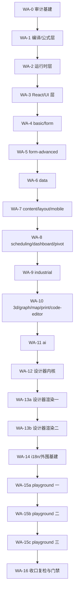

# 临时方案与坏味道逐模块审计路线图（Workaround & Code-Smell Audit Roadmap）

> 最后更新：2026-10-10（拟制）
> 按 `docs/skills/roadmap-and-mission-authoring-with-consensus-review.md` 流程产出；配套 mission：`missions/workaround-code-smell-audit.json`
> 来源：`docs/skills/workaround-code-smell-audit-prompt.md`（2026-10-10 新立的临时方案/重复代码/坏味道审计方法）+ 2026-10-10 用户要求"对每个模块都使用该提示词仔细审计，生成审计报告，据报告拟制修改计划进行修正"
> 先例：`docs/backlog/component-audit-roadmap.md`（逐组件审计+自动修复闭环、CX-n 共性机制）、`docs/backlog/interaction-state-quality-roadmap.md`（分批战役、台账、先红后绿）

## 目的

本文件是"逐模块临时方案取证审计 + 据报告修复"轨道的阶段索引与状态面，按 `docs/backlog/00-roadmap-authoring-guide.md` 拟制：AI 或维护者读完 Phase Status 即知哪些工作项未开始（`todo`）、已立 plan（`planned`）、已完成（`done`）。

背景：仓库已有多条审计轨道（组件契约 component-audit、DOM 结构 dom-structure、视觉 visual-quality、交互状态 interaction-state），但没有一条以"**这段代码是在解决问题，还是只是把问题按住了**"为中心。临时方案（症状特判、静默兜底、时序贿赂、类型绕行、复制粘贴式增长）的共同风险是根因未修、出口缺失、事实上转正。本轨道对全部 41 个包 + playground 应用层（约 31 万行非测试源码）逐批执行 `docs/skills/workaround-code-smell-audit-prompt.md` 的取证协议，每批产出审计报告并据报告修正。

**审计报告 → 修改计划的映射**（用户要求的两段式在本轨道的落法）：

1. **批内发现**：每个 WA-n 工作项 = 一份 plan，内含"审计 → 报告 → 修复"闭环（自动修复契约见下节）。报告即 `docs/audits/workaround-code-smell/<批次>/report.md`，P0/P1 单点行为缺陷在该 plan 内先红后绿修复。
2. **跨批共性 / 结构性问题**：审计报告中裁定为"同根因影响 ≥2 模块、跨包机制、公共 API / 包边界 / 编译期语义"的发现，**不**在批内硬修——以 `CX-n`（共性重构）工作项插入本表，**拟制独立修改计划**（独立 draft review + closure audit）后修正。这就是"根据报告发现的问题拟制修改计划"的载体。

本文是编排层，**不是 execution plan、不是审计方法文档**；方法看 prompt，执行纪律看 plan guide。

## Phase Status

> **这是全文件唯一的动态状态区。更新状态只改这里。**
> 状态流转：plan 通过独立 draft review → `todo` 改 `planned`；plan 通过 closure audit → `planned` 改 `done`（不得提前）。一个 plan 对应本文一个工作项；**执行顺序 = 本列表顺序**（AI 不得重排、不得跳项）。单个工作项执行中证实无法被一个 plan 收口时，经人工确认拆分为 successor 工作项（component-audit 先例），不得静默缩水验收口径。

- WA-0. 审计基建（模块清单程序化枚举 + findings 台账 + 审计报告模板 + 字面/模式扫描脚本化基线）: `done`（plan: `docs/plans/560-workaround-audit-wa0-infra-plan.md`，closure audit 2026-10-11 通过）
- WA-1. 编译与公式层审计批（flux-core + flux-formula + flux-compiler，约 19.9k 行）: `done`（plan: `docs/plans/561-workaround-audit-wa1-compile-formula-plan.md`，closure audit 2026-10-11 approved；产出 CX-1/CX-2 两共性工作项）
- WA-2. 运行时层审计批（flux-action-core + flux-runtime，约 20.5k 行）: `done`（plan: `docs/plans/562-workaround-audit-wa2-runtime-plan.md`，closure audit 2026-10-11 approved；10 findings=fixed 1+CX-3/4/5 去向 6+watch-only 3，产出共性工作项 CX-3/CX-4/CX-5）
- WA-3. React 渲染层与 UI 库审计批（flux-react + ui，约 17.8k 行）: `done`（plan: `docs/plans/563-workaround-audit-wa3-react-ui-plan.md`，closure audit 2026-10-11 approved；21 findings=fixed→verified 4+CX-6/7/8/9 去向 11+watch-only 6，产出共性工作项 CX-6/CX-7/CX-8/CX-9）
- WA-4. 基础与表单渲染器审计批（flux-renderers-basic + flux-renderers-form，约 21.5k 行）: `done`（plan: `docs/plans/564-workaround-audit-wa4-basic-form-plan.md`，closure audit 2026-10-11 R2 approved；18 findings=fixed→verified 2+CX-10/11/12 去向 8+watch-only 7+n-a 1，产出共性工作项 CX-10/CX-11/CX-12）
- WA-5. 表单进阶渲染器审计批（flux-renderers-form-advanced，约 17.3k 行）: `done`（plan: `docs/plans/565-workaround-audit-wa5-form-advanced-plan.md`，closure audit 2026-10-11 R2 approved；10 findings=fixed→verified 1+CX-13/14+CX-11 扩围去向 6+watch-only 3，产出共性工作项 CX-13/CX-14）
- WA-6. 数据展示渲染器审计批（flux-renderers-data，inventory 22,319 行/114 文件）: `done`（plan: `docs/plans/566-workaround-audit-wa6-data-plan.md`，closure audit 2026-10-11 R1 0B/1M/2m→修正后收口；12 findings=fixed→verified 7+CX-11/13 扩围去向 2+watch-only 3，产出共性工作项 CX-13/CX-11 扩围登记）
- WA-7. 内容/布局/移动渲染器审计批（flux-renderers-content + flux-renderers-layout + flux-renderers-mobile，约 11.7k 行）: `done`（plan: `docs/plans/567-workaround-audit-wa7-content-layout-mobile-plan.md`，closure audit 2026-10-12 R1 approved[0B/0M/2m 随收口修正]；14 findings=fixed→verified 10+CX-11 扩围/CX-15 拟制去向 2+watch-only 2，执行期披露批内回归 WA-content-009 当场修复，产出共性工作项 CX-15+CX-11 扩围登记）
- WA-8. 调度与企业排程审计批（flux-renderers-scheduling + flux-renderers-dashboard + flux-renderers-pivot，约 17.1k 行）: `done`（plan: `docs/plans/568-workaround-audit-wa8-scheduling-dashboard-pivot-plan.md`，closure audit 2026-10-12 R1 approved[0B/0M/2m 随收口修正]；13 findings=fixed→verified 8+successor-required 1[002 接线]+watch-only 4，装载收敛批内修+接线显式登记，产出 CX-15/CX-11 扩围登记）
- WA-9. 工业画布渲染器审计批（flux-renderers-industrial，约 21.4k 行）: `done`（plan: `docs/plans/569-workaround-audit-wa9-industrial-plan.md`，closure audit 2026-10-12 R1 approved[0B/0M/6m 随收口修正]；8 findings=fixed→verified 6+watch-only 2+008 余量同行挂账，零新增 CX[001/002 为 wa-8 dashboard-001 同型判例引用]）
- WA-10. 轻型可视化与打印/代码编辑审计批（flux-renderers-3d + flux-renderers-graph + flux-renderers-map + flux-print-core + flux-print-renderers + flux-code-editor，约 12.7k 行）: `done`（plan: `docs/plans/570-workaround-audit-wa10-viz-print-code-editor-plan.md`，closure audit 2026-10-12 R1 approved[0B/0M/6m 随收口修正]；6 findings 全 P3=fixed→verified 6+reactive 门禁 watch+CX-15 扩围 +2；reactive-render-reads 历批首次点亮 16/16 全豁免零立案；graph/map 零立案）
- WA-11. AI 渲染器审计批（flux-renderers-ai，inventory 12,478 行/72 文件[批内 +3 共享件/−1 测试骨架迁移后口径]）: `done`（plan: `docs/plans/571-workaround-audit-wa11-ai-renderers-plan.md`，closure audit 2026-10-12 R1 approved[0B/0M/3m 随收口修正]；8 findings=verified 6+watch-only 2[均公共面留人工]，零新增 CX、转发 WA-15a 一项）
- WA-12. 设计器内核层审计批（editor-core + page-designer-core + flow-designer-core + report-designer-core + spreadsheet-core + word-editor-core，inventory 17,108 行/103 文件）: `done`（plan: `docs/plans/572-workaround-audit-wa12-designer-cores-plan.md`，closure audit 2026-10-12 R1 issues[0B/1M/2m：M1 word-001 完成度 3/4 声称失实→补转方案 A]→delta 复核 approved[0B/0M/0m]；13 findings=verified 11+successor-required 1[spreadsheet-002]+watch-only 1[spreadsheet-003]，产出共性工作项 CX-18）
- WA-13a. 设计器渲染层审计批一（flow-designer-renderers + page-designer-renderers，inventory 14,225 行/84 文件）: `done`（plan: `docs/plans/573-workaround-audit-wa13a-designer-renderers-1-plan.md`，closure audit 2026-10-12 R1 0B/1M/3m→修正后收口；14 findings=verified 12+CX-16 去向 1+watch-only 1，产出共性工作项 CX-16）
- WA-13b. 设计器渲染层审计批二（report-designer-renderers + spreadsheet-renderers + word-editor-renderers，inventory 15,707 行/97 文件）: `done`（plan: `docs/plans/574-workaround-audit-wa13b-designer-renderers-2-plan.md`，closure audit 2026-10-12 approved[0B/1M/2m→修正后 delta 复核 0B/0M/0m 收口]；27 findings=verified 20+CX-17 去向 1+WA-12 转发 1+watch-only 5，产出共性工作项 CX-17）
- WA-14. i18n 与外围基建审计批（flux-i18n + nop-debugger + flux-bundle + tailwind-preset + theme-tokens，inventory 12,023 行/41 文件）: `done`（plan: `docs/plans/575-workaround-audit-wa14-i18n-infra-plan.md`，closure audit 2026-10-12 R1 approved[0B/0M/3m 随收口修正]；12 findings=verified 12[fix 执行派驻 agent 实施含三处授权内偏离披露]，零新增 CX、转发 WA-15a 注记 1 条）
- WA-15a. playground 审计批一（complex-pages + taskflow-designer-lib + designer-hosts + ai + env + `src/` 根级散文件（App/main/route 等，约 2.5k 行）；注：`*-replica/` 目录仅含 CSS、`schemas/` 仅含 JSON，非 TS 审计对象；复刻页 schema 与行为面（`complex-pages/page-schemas/*.json` + `complex-pages/shared/mock-backend-*.ts`）随 complex-pages 在本批范围内；合计约 13.9k 行）: `done`（plan: `docs/plans/576-workaround-audit-wa15a-playground-1-plan.md`，closure audit 2026-10-12 R1 approved[agent_bc35079a，0B/0M/1m：批集合计数 22→23 修正]；13 findings=verified 9+successor-required 4[cpages-002/003→CX-19、pgai-003→CX-20、pgroot-003 死依赖]；产出共性工作项 CX-19/CX-20；转发 WA-15b 三项在案[ai-conversations-demo 接线半边+ai-hitl-demo init 半边+pages/ toast.error 族 12 处]；watch 5 条报告落字；隔离五门禁全链 exit 0）
- WA-15b. playground 审计批二（pages 域 demo 页目录，约 20.1k 行）: `done`（plan: `docs/plans/577-workaround-audit-wa15b-playground-2-plan.md`，closure audit 2026-10-12 R1 approved[agent_fc9316d2，0B/0M/2m 随收口修正]；9 findings=verified 7+successor-required 2[001→CX-19 扩围、008→CX-20 扩围]；承接转发四项全部收口[①③本体+②删调用裁定+④无关联落字]；CX-19/CX-20 扩围登记；watch 6 条报告落字；隔离五门禁全链 exit 0+双哨兵 ai 850/flux-react 550）
- WA-15c. playground 审计批三（component-lab 组件实验场，约 17.6k 行）: `done`（plan: `docs/plans/578-workaround-audit-wa15c-playground-3-plan.md`，closure audit 2026-10-12 R1 approved[agent_edcc7623，0B/0M/0m]；5 findings=verified 3+successor-required 2[001→CX-20 第三波[含执行期 dialog:106 承重位点并入]、005 死导出 index 导出面条款阻却]；CX-19 不触发裁定[135 页 kit-first 刻意模板全豁免]；watch 5 条报告落字；隔离五门禁全链 exit 0；**reconcile uncovered 0——全库 49 模块 audited 归零**）
- CX-1. 共性重构：编译公式层复制沉积收敛批（WA-1 批发现 WA-formula-001 状态提交策略块 4 份跨包逐字重复 ~110 行——formula/evaluate.ts ↔ compiler/runtime-value-compilation.ts，8181fff2a 提取时复制未共享，object key 检查已单向/双向分叉；WA-core-002 value-adapter in/out/validate 三联 ~95 行双份——ccc4ac7ed cq-4 Phase 2 整段复制，formatIssues 接缝单侧生效；根因=两次"提取"均选择复制而非共享原语；受影响模块 flux-formula + flux-compiler + flux-core；修复方向=flux-core 增 commitCompositeState 共享原语（4 份收敛）+ value-adapter 内部 buildActionBackedMethods 骨架提取（零 API 变更）；均非结构性增量，契约 §7c 无需人工确认；~250 行冗余 + 漂移面消除）: `done`（plan: `docs/plans/579-cx1-compile-formula-dedup-plan.md`，closure audit 2026-10-12 R1 issues[0B/1M/2m]→delta 复核 approved[agent_723a47e3]；WA-formula-001+WA-core-002 双双 verified；净删 ~148 行；行为保持=特征化 16 条先钉后改前后同绿+双哨兵+加验 form-advanced 1150；needsRebuild 两轴分叉保留归 follow-ups）
- CX-2. 共性重构：`CompiledTemplate.repeatedTemplates` 转正空壳契约字段移除（WA-1 批发现 WA-core-001，I 类转正：Plan 40 未竟特性的契约壳先行发布——出生 c6a3245a2 自述 transitional，`repeatedTemplates.set` 全历史零填充 6 个月+，W2 无出口；受影响模块 flux-core 契约（types/node-identity.ts）+ flux-compiler 三处空构造 + flux-react 守卫分支；修复方向=deprecated-feature-cleanup 流程（`@deprecated` + 文档记录在先）后删字段/伴生类型/空构造/守卫分支；**公共 API 删除属结构性重构，执行前人工确认**）: `done`（plan: `docs/plans/580-cx2-repeated-templates-removal-plan.md`，closure audit 2026-10-12 R1 approved[agent_51d458c3，0B/0M/4m 随收口修正]；draft review fail[0B/3M/4m]→全修；人工确认门=用户 goal 指令显式记录落字 plan 授权链条目[时间/渠道/引语/可撤回四要素]；WA-core-001 verified；边界改判=RepeatedTemplateId/InstanceFrame 活体保留[wa-1 报告勘误注记]；判别测试先红后绿）
- CX-3. 共性重构：form-runtime 族复制沉积收敛批（WA-2 批发现 WA-runtime-002/003/004/005 四组同根因——summary 五计数器 3 份 ~110 行（ef50cb72a 出生即复制，owned 版 emptySummary 已缺失、status 版已退化为全量重算）；FieldState 键级更新语义 8 份 ~150 行（87d5587ce 迁移定形后六个写入点各自手写变体，dirty 变体键集已分叉、field-ops 同文件孪生对 20 行逐字）；ScopeRef store 装配骨架 2 份 ~50 行（e9fad5eb0 modularize 复制，Plan 552 门控修复单侧落地先例已发生）；cascade 深度守卫五件套 2 份 ~40 行（7353e3a39 复制，上限 200 vs 100 依据不可考）；根因=机制落地时复制而非提取共享原语且无收敛登记；受影响模块 flux-runtime（包内）；修复方向=form-store 导出 summary 原语（包内模块导出）+ 提取 patchFieldStateInMap 单一原语（吸收五键条件/dirty graft/键清除/空态回收四变体）+ createStoreBackedScopeAdapter 工厂 + createCascadeGuard 工厂；~340 行冗余 + 漂移面消除；均零公共 API 变更，非结构性，契约 §7c 无需人工确认；处理时机=WA-16 收口前，不阻断批次线性审计）: `done`（plan: `docs/plans/581-cx3-form-runtime-dedup-plan.md`，closure audit 2026-10-13 R1 approved[agent_43ed0626，0B/0M/2m]；WA-runtime-002/003/004/005 四行 verified；净删 ~248 行[11 写入形+3 summary+2+2 全闭]；行为保持=特征化 18 条先钉+动态判别 5 组变异恰红→sha256 恢复；执行期披露=隔离 check 首跑逮 knip 10 条新命中→收私修复[plan 571 先例]→终态全绿；漂移语义零统一归 follow-ups）
- CX-4. 共性重构：表达式错误判别码化与三处嗅探收敛（WA-2 批发现 WA-runtime-001，H+A 类——flux-formula evaluator 错误通道无机器可读判别码（evaluator.ts:57 裸 `new Error(message)`），flux-runtime 三个消费点被迫按 `cause.message === 'Cannot access member of null or undefined'` 字符串嗅探识别"scope 未发布"（node-runtime.ts:92-98 命名谓词 + formula-data-source-controller.ts:61-68 逐字副本 + api-data-source-controller-state.ts:139-152 内联副本+NODE_ENV warn 特判）；出生 994bf58a6 症状性 message → e0fcebbf3 复制第二份；跨包字符串契约无类型保护，文案一改三处静默失明，漂移已现（内联版独有 warn 分支）；修复方向=flux-formula 错误判别（Error 子类/code 字段/导出哨兵常量至 flux-core 三选一，契约评审定）+ flux-runtime 三处收敛单一共享谓词；**包间契约变更属结构性重构，执行前人工确认**；处理时机=WA-16 收口前，可与 CX-1 同窗口）: `done`（plan: `docs/plans/582-cx4-error-discrimination-plan.md`，closure audit 2026-10-13 R1 approved[agent_9a55bc67，0B/0M/3m]；契约评审三选一裁定=Error 子类方案[UnpopulatedScopeAccessError，message 逐字不变向后兼容+单层谓词防吞错面扩大]；人工确认门=用户 goal 指令显式记录落字 plan 授权链条目；WA-runtime-001 verified；三消费点收敛单一谓词+warn 分支原位；CX-3 遗留 oversized 随批修复[测试文件拆分+untracked 盲区教训登记]）
- CX-5. 共性重构：abort 信号组合原语下沉 flux-core（WA-2 批发现 WA-action-core-002——flux-action-core `mergeAbortSignals`（action-execution.ts:92-137，双信号手写监听+cleanup）↔ flux-runtime `composeAbortSignals`（abort-signal-helpers.ts:18-54，n 信号+native 快路径+AbortSignalLike 桥接）双实现 ~40 行；根因=共享原语家在 flux-runtime 而层级位于其下的 flux-action-core 不可反向导入（e68fe452f 层级约束下手写第二份）；修复方向=flux-core 增 `composeAbortSignals(signals): { signal, cleanup }` 超集 API（同时满足两用例），两包各自薄封装收敛；**flux-core 新增公共工具=公共面变更，执行前人工确认**；处理时机=WA-16 收口前，可与 CX-1 同窗口）: `done`（plan: `docs/plans/583-cx5-abort-compose-primitive-plan.md`，closure audit 2026-10-13 R1 approved[agent_8fd5e55d，0B/0M/2m informational]；张力点三处裁定[①reason 透传②四短路留薄壳③detachable 方案 B]落地原语；人工确认门=用户 goal 指令显式记录落字 plan 授权链条目；WA-action-core-002 verified；AbortSignalLike 上移 flux-core+runtime re-export 零改导入面）
- CX-6. 共性重构：flux-core 基础原语导出批（WA-3 批发现 WA-react-007/008——`isTemplateNode` 16 行逐字双份（render-nodes.tsx:57-72 ↔ dialog-host-surface.tsx:32-47，27cbdada1 同 commit 双落；上游 flux-core 只导出 isSchema/isSchemaArray 无 TemplateNode 结构守卫）+ deep-equality 无共享原语（flux-react 手写 39 行带环保护副本，全仓 ≥7 份对照：industrial/page-designer-core/report-designer-core/spreadsheet-core 等，环保护语义已分叉）；修复方向=flux-core 导出 `isTemplateNode` + `utils/object.ts` 导出环安全 `deepEqual`，各消费点收敛；**公共导出新增=公共面变更，执行前人工确认**；处理时机=WA-16 收口前）: `done`（plan: `docs/plans/584-cx6-core-primitive-exports-plan.md`，closure audit 2026-10-13 R1 approved[agent_6b7d2fb2，0B/0M/3m]；isTemplateNode 落 utils/schema.ts[与 isSchema 族同域]+deepEqual 落 utils/object.ts[=flux-react 份逐字语义四钉]；家族裁定=仅自份收敛 3 份副本/5 调用点，#2-#7 分叉现状保持；人工确认门=用户 goal 指令显式记录落字 plan 授权链条目；WA-react-007/008 双双 verified）
- CX-7. 共性重构：React 运行时跨包契约缺口收敛批（WA-3 批发现 WA-react-004/005 两条"按住"型——①ScopeRef 无来源/处置自省通道→flux-react useHostScope 用 id 前缀字符串约定双写+读取 flux-runtime cast 挂载的未登记 `__fdDisposed__` 标志（4a5f95662 症状性 message，runtime 改 id 方案即静默失效）；②ReactionHandle 缺配置 API→runtime 猴补 `_setBindingsProvider`/`__setScopeOverride`/`__setIgnoreWritesTo`/`__setLoadCallbacks` 四通道、react 侧 cast+可选调用消费（双侧 12 处 cast，方法改名即静默 no-op，W4）；修复方向=flux-core ScopeRef 增 origin 自省或导出 isHostProjectionScope 判别 helper + ReactionHandle 增显式 configure() 通道；**包间公共契约变更，执行前人工确认**；处理时机=WA-16 收口前）: `done`（plan: `docs/plans/585-cx7-react-runtime-contract-plan.md`，closure audit 2026-10-13 R1 approved[agent_adb1e187，0B/0M/3m]；B1=审计漏计的第四消费点 crud-renderer-load.ts 入 scope 同批收敛/B2=configure 落 flux-core types[新件 renderer-reaction-handle-types.ts 按仓规拆分 export * 回流]；HostProjectionScopeRef origin/disposed+isHostProjectionScope+configure per-key present 语义落地；旧通道全仓零残留；人工确认门=用户 goal 指令显式记录落字 plan 授权链条目；WA-react-004/005 双双 verified）
- CX-8. 共性重构：flux-react 包内复制沉积收敛批（WA-3 批发现 WA-react-001/002/003——StrictMode 延迟 dispose 骨架 6 份跨 3 文件 ~75 行（d1dce1e20→5b267f6f9 复制链，actionScope 版守卫已单侧漂移）、workbench 左右面板 resize 镜像 ~100 行（af3805e49 一次落两份，宽度字面另双编码 ×2）、dialog-host DialogView/DrawerView 视觉壳残差 ~70 行（5a8baa1ca 双写；cq-3 生命周期已收敛此为残差，isTopmost 抑制单侧存在）；修复方向=提取 `useDeferredDispose` hook + `createPanelResizer(side)`/`ResizablePanelSlot` + `SurfaceChromeShell`（children-as-function）+ 宽度常量收敛；~245 行冗余+漂移面消除；包内零公共 API 变更，非结构性，契约 §7c 无需人工确认；处理时机=WA-16 收口前；WA-4 批增补：form.tsx StrictMode 延迟 dispose 骨架（HEAD :80-81/:113-125，mountedFormRef+queueMicrotask）为同型第 7 份，扩围一并收敛[2026-10-13 plan 586 执行裁定：第 7 份位点物理在 flux-renderers-form=整包并行在途，排除归在途批收口后独立小批或下一触点顺带]）: `done`（plan: `docs/plans/586-cx8-flux-react-dedup-plan.md`，closure audit 2026-10-13 R1 approved[agent_4d1c577f，0B/0M/4m]；useDeferredDispose 收敛 5 份同型[第 6 份异型 render-nodes 原位保留]/panel-resizer 参数表+宽度常量单一来源/SurfaceChromeShell 含第 4 块镜像[isTopmost 单侧保持]；执行期 knip 两轮收私 11 条+disposer ref 快照配对披露；WA-react-001/002/003 三行 verified）
- CX-9. 共性重构：ui 包复制沉积与补偿层收敛批（WA-3 批发现 WA-ui-001/002/003/004——Base UI 1.3.0 焦点缺陷补偿层（手写 Tab 环游+初始焦点回退两层、4 模态面只接 2、tabbable 双枚举可见性判定已分叉、无上游升级退出出口）、toolbar alignment↔text-format 全文件孪生 ~35 行+clipboard 文件内 ×4（pressed 样式手写绕开 Button 变体表）、zIndex 装配四胞胎 ~40 行逐字（540cb8e40）、media-query 订阅三代并存（SSR null/false 契约相反）；修复方向=useSurfaceFocusWrap 下沉+tabbable 合一+上游升级出口登记、toolbar 数据驱动原语、overlay-z-index 内部共享模块、media 订阅原语归一（use-mobile 委托化保布尔契约）；~175 行+补偿层收敛；包内为主非结构性，**toolbar 导出合并路径涉 ui/src/index.ts ask-first 需人工确认**[2026-10-13 plan 587 实证：四控件全仓零消费+根导出本无→原语包内私有，门不触发]；处理时机=WA-16 收口前）: `done`（plan: `docs/plans/587-cx9-ui-consolidation-plan.md`，closure audit 2026-10-13 R1 approved[agent_00a7bee4，0B/0M/2m+1xm]；useSurfaceFocusWrap 打包两层[B 形统一=漂移修复申报]+4 面接通双层口径 4/4[三面申报增量]+createOverlayZIndex 工厂禁单例+media 归一布尔契约保持；上游升级退出出口双落；执行期 R3-U9 mock 适配+knip 收私披露；WA-ui-001/002/003/004 四行 verified）
- CX-10. 共性重构：flux-renderers-basic 包内复制沉积收敛批（WA-4 批发现 WA-basic-003/004/005——container.tsx 可点击/非可点击全树复制 ~52 行（67-101↔121-155 逐字仅缩进差，同 commit flex.tsx 单树反例在旁）；loop↔recurse itemData scratch-scope 求值双实现已漂移（P14 性能修复 23ee9a323 单侧落地，recurse 保留 plan 2026-09-28-6 明文点名的 per-item create/dispose 热点）；loop↔recurse Provider 脚手架孪生 ~30 行；修复方向=container 折叠单树+interactiveProps（flex 先例）+ 提取 scratch 求值与 StructuralLoopScopeProvider 共享原语；~107 行冗余+recurse 性能热点消除；包内零公共 API 变更，非结构性，契约 §7c 无需人工确认；处理时机=WA-16 收口前）: `done`（plan: `docs/plans/588-cx10-basic-consolidation-plan.md`，draft review 2026-10-13 有条件通过[0B/2M/7m]——M1=四代同传 flex 单树先例失实勘误[真先例=notice-bar.tsx]+flex 双树残差 follow-up/M2=recurse 热点归因勘误；closure audit 2026-10-14 R1 approved[agent_a15dac87，0B/0M/1m informational]；三组收敛=container interactiveProps 单树[不带 disabled 门，flex 不动]+useItemDataScratchEvaluator[loop 侧逐字上移；recurse per-item create/dispose 热点消除=申报增强，HEAD 旧 recurse 判别恰 1 红]+StructuralLoopScopeProvider[8-deps useMemo+renderBody 条件展开禁显式 undefined 键，变异恰 2 红=嵌套继承钉]；动态判别 2 组恰红→恢复双留证[执行会话+审计员亲手各一]；basic 72 文件/666 用例+双哨兵 react 580/580+ai 850/850 精确同数+index.tsx 零变更；隔离五门禁(HEAD 2c355f9a1+本批 11 路径)首跑全链 exit 0(日志 \_tmp/cx10-gates-\*)；执行期披露=前序会话中断残留 provider 探针变异[显式 undefined 键]由执行会话恢复终态+新共享件两类型预防性收私[未消费导出]；台账 WA-basic-003/004/005 三行 verified(220 findings=found 71+verified 149/未处置 0/violations 0)；主工作树并行会话在途文件未带入,提交严格限定本批 12 路径(隔离 11+dev log)；roadmap CX-10 done+dev log 10-14 条目）
- CX-11. 共性重构：form 渲染器消费侧契约缺口与复制沉积收敛批（WA-4 批发现 WA-form-001/003/004/006——FieldFrame 注入 aria 引用链 9 份同构 cast+消费矩阵 3 档漂移+choice 族整链丢弃（上游 flux-react field-frame cloneElement 注入无契约声明，6bbece7d2 a11y sweep 后仍扩散）；getFocusTarget querySelector 惯用形 ×12（ui 原语不 forward 可聚焦 ref 的补偿层，与 WA-ui-006 同根因方向）；useInputComponentHandle 注册样板 ~19 份 ~180 行（resetValue 三变体+plan 549 死控制事故已兑现+单选 checkbox 无 handle）；date 族六块双实现 ~70 行（clamp 镜像注释自认复制）；修复方向=flux-react 导出 FieldFrame 注入类型+resolveFieldAriaErrorRefs helper、ui 可聚焦原语 forwardRef（或 data-focus-target 契约）、useStandardFieldHandle 默认值层、date/ 共享模块；**WA-form-001 涉 flux-react 公共导出（执行前人工确认）、WA-form-003 涉 ui 公共面（ask-first）**；处理时机=WA-16 收口前；WA-5 批扩围：WA-fadv-002（writeFieldValue 写原语，validate 深度三派收敛）+ WA-fadv-006（getFocusTarget 族 12→16）+ WA-fadv-007（injected-aria 第 10 份，6bbece7d2 sweep 主动写入——扩围依据升级为"sweep 主动扩散"）+ WA-6 批扩围：WA-data-012（tree-focus-nav.ts:8 getVisibleTreeItems + tree-renderer.tsx ×5 调用位——族计数再扩 1 定义+5 调用）+ WA-7 批扩围：WA-layout-004（wizard-renderer.tsx:148-155 焦点定位 querySelector，20-09 APG 注释在案——族计数再扩 1 定义位）+ WA-8 批扩围：WA-scheduling 跨引用（use-gantt-keyboard updateRowAria——族计数再扩 1 位点））: `done`（plan: `docs/plans/589-cx11-form-consumer-contract-plan.md`，draft review 2026-10-14 R1 fail[1B/2M/5m]→R2 fail[1M/2m]→R3 pass[0B/0M/2m 已折入]——B1=choice 族「悬空 aria」否证重定性双通道[source-error 通道禁并入注入链]/M1=G1b 普查 5 文件 6 份实例+cid 限定/loadingId 两裁定项/M3=writeFieldValue 参数面 trigger+validatePath+owner；审查员形态裁定=G1b 纯工厂/G2 两形皆可；closure audit 2026-10-14 R1 approved[agent_6ba66e08，0B/0M/3m 注记级]；G1a=FieldFrameInjectedAria+resolveFieldFrameErrorRefs 上移 flux-react（index 精确 +2）+10 cast 位点收敛[renderers aria cast 零残留]/G1b=source-error-refs 工厂 6 实例+select-mobile 接线收敛[tree-controls id 串逐字保持+loadingId 腿排除落 Deferred]/G2=use-standard-field-handle 21 位点/G3=date clamp 三形收敛[执行期披露=date-utils 737 超限→拆 date-clamp.ts 690+48+input-number 局部 clamp 非等价不收敛]/G4=write-field-value 26 位点 9 文件[普查修正 20/7→26/9 落 Deferred；validateSubtree ×10 留 successor]/G5=queryFocusTarget 补偿族 ×6[ui forwardRef 归 successor 合流 WA-ui-006]+跨包邻接显式 watch；判别 5 组恰红→sha1 恢复[执行会话]+审计员亲手 source-error 后缀变异恰 4 红→sha1 逐字节恢复；form 123/1113[基线+17 钉]+fadv 166/1159[+9 钉]+react 哨兵 580/580 精确同数+basic 72/666 零触碰；隔离五门禁诚实轨迹[首跑 oversized 红→拆分→knip 红→收私→终态全链 exit 0，日志 _tmp/cx11-gates-*]；台账七行 verified(220 findings=found 64+verified 156/未处置 0/violations 0)；人工确认门=用户 goal 指令四要素落字 plan 授权链[flux-react +2 公共导出]；主工作树并行会话在途 14 文件零触碰[内容 hash 前后一致]，提交严格限定本批 47 路径；roadmap CX-11 done+dev log 10-14 条目）
- CX-12. 共性重构：dialog/drawer 受控 open 编译期通道接线（WA-4 批发现 WA-basic-001——use-surface-renderer 运行时正则回读 raw schema（check:audit-runtime-raw-schema-reads [high]×2 live），而同包 palette 已用 compileOpenBinding（SchemaFieldRule.compile）编译期捕获且注释自证避开门禁（33cb4f9ab 知道正解未回移 dialog/drawer，正则文法包内 3 处复制）；修复方向=compileOpenBinding 并入 sharedSurfaceFields、use-surface-renderer 改读 resolved binding、删除 extractControlledOpenPath 与 2 处 raw read；**Renderer 定义字段契约变更，执行前人工确认**；处理时机=WA-16 收口前）: `done`（plan: `docs/plans/590-cx12-surface-open-binding-plan.md`，draft review 2026-10-14 R1 fail[0B/1M/2m]→R2 pass；closure audit 2026-10-14 R1 approved[agent_f716cd2f，0B/0M/2 informational]；接线=新件 surface-open-binding.ts 收拢三符号[palette 字符串值逐字保持]+sharedSurfaceFields 规则项接通 dialog/drawer+use-surface-renderer 包装消费+删 extractControlledOpenPath 与 2 raw read[门禁本批对象 0]+schema 类型放宽 boolean|string；**申报语义改判**=undefined 值简单表达式→controlled-closed（palette 同型，R1 M1 裁定，判别钉 vs HEAD 红腿 1 failed 实证）；正则「3 处」勘误 live 2 份；判别=path→undefined 变异恰 5 红→sha256 恢复双留证[执行+审计员]；basic 73/671[基线+5 钉]+react 580+ai 850 精确同数+index 零导出；隔离五门禁首跑全链 exit 0(日志 \_tmp/cx12-gates-\*)；台账 WA-basic-001 verified(220 findings=found 63+verified 157/未处置 0)；人工确认门=用户 goal 指令四要素落字 plan 授权链；主工作树在途 14 文件零触碰，提交严格限定本批 10 路径；roadmap CX-12 done+dev log 10-14 条目）
- CX-13. 共性重构：Tree 族收敛批（WA-5 批发现 WA-fadv-004/005——form 包 schemas.ts HEAD:183-248 `InputTreeSchema`↔`TreeSelectSchema` 15 键 ×2 双声明（唯一实质差异 placeholder，文档不对称漂移已现：clearable 单侧无文档、childrenSource/searchSource 文档写 executeSource 而 live 为 dispatch）镜像出 tree-controls.tsx 双 renderer ~200 行逐字级重复（aa2afdf3c 包提取搬运）+ tree-control-sources 弃 executeSource 改手写 dispatch 补偿层（上游 source-executor.ts:29-33 `...ctx` 覆盖序 live 在案）；修复方向=TreeSchemaBase 提取（两接口 extends）+ useTreeControlPipeline 吸收双 renderer + source-executor 改 `scope: ctx.scope ?? scope` 后补偿收薄 + schemas 文档修正 + c3-5-schema-contract-honesty 守卫随 extends 链升级（收敛前置工作量）；**涉 flux-renderers-form 公共导出 + flux-runtime 行为修复，执行前人工确认**；WA-6 批扩围：WA-data-006（crud-schema.ts ↔ schemas.ts Crud*/Table* 列配置声明镜像 ×5 接口 ~40 行——18908624d 同 commit 双落出生即平行词汇，Crud* extends Table* 公共导出面不变，声明层收敛手法与守卫升级同款）；处理时机=WA-16 收口前）: `todo`（plan: —；执行前人工确认门）
- CX-14. 共性重构：flux-renderers-form-advanced 包内复制沉积收敛批（WA-5 批发现 WA-fadv-001——repeatable-items 容器骨架 5 份 ~450 行（combo/input-table/array-field/array-editor/key-value 双订阅+keys+add/remove/move+结果码协议，`9e97ba665` 双落+`aa2afdf3c` 携带；cq-3 去重波 `5ad81bbf2` 止步 item-view 层的直接证据）；漂移已兑现 3 处（minItems 缺省 0/1 两派、combo 双 add 路径 validateSubtree/validateField、焦点恢复 refs/rAF 两派）；修复方向=cq-3 续波提取 `useArrayContainerController`（参数 validateDepth/focusRestore）+ 同 tick 双操作用例移植；包内零公共 API 变更，非结构性，契约 §7c 无需人工确认；处理时机=WA-16 收口前）: `todo`（plan: —）
- CX-15. 共性重构：渲染器包测试支撑收敛批（WA-7 批发现 WA-mobile-001——`createMockRendererProps` 跨包副本 ×5（mobile/content/ai/graph/map，mobile 8f947df9b 先落、content 0997e3a47 两日后复制，**漂移已兑现**：content 种 meta 默认值/mobile 不种，同名同约工具两派语义）+ `contract-honesty.test.ts` 骨架 ×3（cq-5 `4ee46b668` test-placement 波次一次写入，content↔layout 逐字、scheduling 已分叉 diff 154 行）+ content/test-support-runtime.tsx 同族；修复方向=共享 renderer 测试工具（flux-react 测试出口或 workspace test-utils 包）承载 createMockRendererProps+createTestRuntime/TestRuntimeProvider+contract-honesty 参数化 harness（definitions 入参化）+ meta 种子语义拍板一派；涉跨包共享测试基建，非生产面；WA-8 批扩围：WA-dashboard-002（dashboard test-support 生产契约定义表三抄——dashboard-editor 定义 fields 表 12 项逐字抄自 dashboard-editor-definitions.ts ×2 份，测试支撑表以 {...base} 派生收敛）；WA-10 批扩围：graph/map createMockRendererProps 副本 +2（drift 证据：graph 版缺 node.scope）；处理时机=WA-16 收口前）: `todo`（plan: —）
- CX-16. 共性重构：设计器上下文菜单壳跨包共享批（WA-13a 批发现 WA-pager-001——page-designer-renderers/page-designer-context-menu.tsx ↔ flow-designer-renderers/designer-context-menu.tsx 上下文菜单孪生骨架 ~45 行（钳制/外点关闭/Escape/roving-focus 近逐字；plan 526/527 同波各自出生；已漂移 :not([disabled]) 选择器位点）；修复方向=useContextMenuShell 共享 hook（归属 @nop-chaos/ui 或 designer 共享层，两包消费）+ 参数化菜单项模型；涉跨包共享面新增，执行前人工确认归属；处理时机=WA-16 收口前）: `todo`（plan: —）
- CX-17. 共性重构：拖拽 ghost 共享原语批（WA-13b 批发现 WA-reportr-003，唯一 P1——setDragImage 拖拽 ghost 三包三份同日互抄：report-designer-renderers/report-field-panel.tsx:10-47 ↔ page-designer-renderers/palette-panel.tsx:22-57 ↔ industrial/palette-drag-ghost.ts:9-33，plan 527/531/528 同期各自出生；漂移已兑现=report 版独有 Not-implemented DOM 防御分支；修复方向=共享 setDragGhost home（@nop-chaos/ui 或 designer 共享层），考古链 dd72a80b3→da067c238→25b60edc2 随案引用；跨包归属需人工确认；处理时机=WA-16 收口前）: `todo`（plan: —；执行前人工确认门）
- CX-18. 共性重构：report↔spreadsheet 跨包 editor-domain 孪生并案批（WA-12 批发现三构件同根因[P1.2/P1.3 同日双波互抄，1928b710e/fbd3cb6c2 复制链互证]——①快照切片族三符号[slice/selector/equal] spreadsheet-core 侧导出[WA-reportr-008 承接；wa-12 转发评估「应导出」结论成立：SpreadsheetRuntimeSnapshot 已居 core 且 report-designer-core 已依赖，spreadsheet-renderers 三符号改消费 core 单源]②editor-core-adapter deepEqual 逐字孪生 15 行[report↔spreadsheet，home=editor-core 共享判等工具或 flux-core]③undo/redo 操作时点骨架孪生 ~30 行×2[home=editor-core 域工具层]；随案评估两项 watch 微注记——readonly 门类型化统一[report 门 wa-12 已类型化、spreadsheet READ_ONLY_COMMANDS 未]与 spreadsheet command-handlers handle\* 66 条 registry 导出关键字收私批；涉 spreadsheet-core/spreadsheet-renderers 公共导出面新增与跨包归属决策，执行前人工确认；处理时机=WA-16 收口前）: `todo`（plan: —；执行前人工确认门）
- CX-19. 共性重构：复刻 mock 骨架单源化批（WA-15a 批发现 WA-cpages-002/003 同车——七域 fetcher-branch 骨架族 7 份手写[antdpro/cal/linear/notion/airtable/stripe/sundial-branch：read 闭包逐字 ×6/patch 解包 ×6/paginate 四胞胎/asNumber 三胞胎/端点计数钩子五份两形/e2e 钩子两形，归一探针 83 窗跨 6 文件对]——七个复刻 plan[2b3fa8d9a→ab7b98687，2026-08-29→08-30]各自照抄上一批 precedent 落骨架，提取动作从未做；**漂移已兑现**：未知端点回退语义三态并存[airtable/notion `{status:1,ok:false}` vs linear/sundial null[showcase-env 兜底 `{status:0,data:null}` 静默] vs stripe/antdpro 混合]+e2e 钩子两形；微惯用形随车[WA-cpages-003：orderId 提取 ×8/状态标签映射 ×4/占位记录构造三胞胎]；修复方向=`shared/mock-backend-replica-kit.ts`（createReplicaBranch+readParam 闭包+paginateRows+unwrapPatch+占位记录工厂+opt-in 钩子工厂）七 branch 改薄壳+每域回退语义判别测试钉住统一裁定+showcase-env 内联分页三连/未知端点 warn（watch #2 随车裁定）；playground 域基础设施零公共 API 变更，非结构性，契约 §7c 无需人工确认；处理时机=第 8 个复刻域来之前必须完成（建议 WA-15b/15c 收口波随车或独立小批；WA-pgroot-003 死依赖删除可随本批 knip 基线重立顺带）；WA-15b 批扩围：WA-pages-001（pages 域 demo 页装配骨架族 50+ 份[registry bootstrap/env stub fetcher 四形态/console.info notify 臂并存，逐字探针 886 对]——demo-env 工厂提取与 replica-kit 同族同批））: `todo`（plan: —）
- CX-20. 共性重构：flux-core StreamApiRequest.data 类型工效批（WA-15a 批发现 WA-pgai-003[归属升级 renderer/core 契约缺失]——`as unknown as StreamApiRequest['data']` 三份同字面 cast[playground ai/mock-ai-env.ts:159 ↔ coverage-connectors.ts:115 ↔ openai-connector.ts:52，旁证 stream-impl.ts:310 facade 收窄]；根因=ExecutableApiRequest.data?: SchemaValue 的 SchemaObject 索引签名要求 vs 宿主构造 JSON body[interface 数组字段]类型不可直赋——StreamApiRequest body 语义是「JSON 请求体」而非 schema 数据树，core 未给该语义可用类型；运行时零缺陷[值恒为合法 JSON body]，但每个新 AI 连接器必第 4 份 cast；修复方向=flux-core 为 StreamApiRequest 收窄/覆写 data 类型（`unknown`/JsonValue 变体，契约评审拍板）→ 三 cast 自然消亡+core 类型面判别测试；**flux-core 契约面=保护区，执行前人工确认**；处理时机=WA-16 收口前；WA-15b 批扩围：WA-pages-008（schema/registry 边界 cast 族 93 处[as never ×79+as any 族 ×14]——SchemaObject 索引签名 vs 宿主字面量类型工效缺口，同根因扩展至 SchemaInput/registry 面）；WA-15c 批扩围第三波：WA-clab-001（schema 字面尾缀 cast 63 处双峰=59 可机械去除[剥离 tsc 实证]+4 承重位点[ChatToolCall interface 嵌入 ×3/button 函数值 prop ×1；执行期新增 dialog-lab-page:106 editSubmitProbeLoadDict——mock dict 数据 value number vs DictBean string 契约冲突承重亚族]））: `todo`（plan: —；执行前人工确认门）
- WA-16. 收口复检与门禁固化（跨批共性裁决对账 + 转正清单清零对账 + 复检轮 + 静态门禁扩展评估）: `todo`（plan: —）

行数口径：2026-10-10 live 实测非测试源码行数（`find <pkg>/src -name "*.ts" -o -name "*.tsx" | grep -v test | xargs wc -l`），用于批次体量参考；批次内审计对象清单以 WA-0 枚举器输出为准，不手抄。

## 框架/平台复用

以下能力已存在，**不得重建**，只做组装：

| 能力                     | 提供方                                                                                                                                     | 说明                                                                                                               |
| ------------------------ | ------------------------------------------------------------------------------------------------------------------------------------------ | ------------------------------------------------------------------------------------------------------------------ |
| 审计方法与分类法         | `docs/skills/workaround-code-smell-audit-prompt.md`                                                                                        | 九类信号 A–I + W1–W6 判定基准 + §5 取证协议 + §3 重复代码两步协议 + §6 报告格式，所有批次统一口径                  |
| 台账与枚举机制先例       | interaction-state IS-0（`docs/audits/interaction-state/`）、visual-quality R2-0                                                            | 状态机模式照搬（本轨道：`pending → found → fixed → verified` + 去向四态），落 `docs/audits/workaround-code-smell/` |
| 概念级重复与结构维度扫描 | `docs/skills/code-refactor-discovery-prompt.md`                                                                                            | 划界用：概念级重复、文件过大、过度拆分等结构维度**不在本轨道重复立案**（见 Cross-Cutting）                         |
| 重构执行方法             | `docs/skills/test-first-implementation-prompt.md`、`docs/skills/code-refactor-prompt.md`                                                   | 批内修复与 CX-n 修改计划的执行方法                                                                                 |
| 废弃/清理流程            | `docs/skills/deprecated-feature-cleanup.md`                                                                                                | 转正临时层（I 类）删除时走 `@deprecated` + 文档记录在先流程                                                        |
| 既有静态门禁（线索源）   | `pnpm check:audit-*` 族（suspects / async-failure-paths / hardcoded-type-dispatch 等，live 16 项，见基线节）、`check:oversized-code-files` | 输出作候选线索源；已登记 pre-existing 红不重复立案，但可被本审计升级定性                                           |
| git 考古                 | `git log -L` / `git blame -L`                                                                                                              | 临时方案出生 commit 与出口状态溯源（prompt §5 第 3 步）                                                            |
| 计划生命周期             | `docs/plans/00-plan-authoring-and-execution-guide.md`、`missions/workaround-code-smell-audit.json`                                         | draft review / closure audit 纪律与 mission 驱动                                                                   |
| 保护区域与授权           | `docs/context/ai-autonomy-policy.md` + mission description                                                                                 | 保护区代码变更授权与结构性重构人工确认边界                                                                         |

## 自动修复机制（Auto-Remediation Contract）

每个 WA-n 审计批工作项的 plan 是「审计 → 报告 → 修复 → closure」一体化闭环，**审计与修复之间无人工握手门禁**（保护区域授权见 mission description）：

1. **审计产出**：对本批模块全量执行 prompt §5 取证协议（字面扫描 → 模式扫描 → git 考古 → 重复块识别 → 抽读走读 → 误报排除），产出审计报告 `docs/audits/workaround-code-smell/wa-<N>/report.md`——逐条发现按 prompt §6 模板（类别、位置、严重度、被按住的根因、违约基准 W1–W6、风险、重构方向、ROI 裁定），汇总含转正清单、重复热区、Top 重构建议、误报排除清单。所有发现全量登记台账 `docs/audits/workaround-code-smell/ledger.md`（ID `WA-<pkg短名>-<seq>`，如 `WA-runtime-001`——**台账发现 ID 与工作项 ID `WA-0`…`WA-16` 是两个命名空间**，状态机 `pending → found → fixed → verified`；不修的走显式去向：`watch-only` / `successor-required` / `withdrawn` / `n-a`，零静默）。
2. **自动修复范围**：P0/P1 且满足"单点、行为可测、非结构性"的发现，由执行 agent 在**同一个 plan 内**自动修复（不等批量、不推给收口）；P2 修复成本低（约 15 分钟内）当场修，否则裁决 `watch-only` 或入 CX-n；P3 仅记录。**结构性发现**（公共 API、包边界、编译期机制、保护区契约）与跨批共性发现一律不在批内硬修——以 CX-n 拟制独立修改计划（见第 7 条）。
3. **Test-first 纪律（先红后绿）**：每个修复项先写钉住现有正确行为的回归测试（临时方案存在往往意味着该行为当前无测试约束），红 → 重构 → 绿；并按 prompt §7 验证**临时方案本体已删除**（特判分支、延迟、断言、注释化石），不得"只加新层不清旧层"。契约/公共层修复必须 "Must automate"。删除面涉公共 API 时走 `deprecated-feature-cleanup.md` 流程。
4. **验证门禁**：每次修复后运行受影响包的 `pnpm --filter <pkg> typecheck/build/lint/test`；全部通过才继续下一个发现。
5. **台账更新**：修复后台账行标 `fixed` + 引用 commit/plan，复检确认后标 `verified`；批 closure 前 P0/P1 不得残留 `found` 未处置。
6. **Closure 门禁**：批完成时由**独立子 agent**（fresh session）跑 closure audit；pass 后本表该行标 `done`，并按 `fix(workaround-audit): <description>` 提交。
7. **共性发现拟制修改计划（CX-n，执行中动态调整本表）**：发现**共性临时方案模式**（同一根因影响 ≥2 模块，或跨包/公共层机制，如公共 helper、field-frame、编译期机制、重复基础设施的多份手写）时，执行 agent 不得只修当前批、也不得默认囤积到 WA-16，必须**主动**：
   - a. 在 Phase Status 插入新工作项（编号 `CX-n`——**本 roadmap 命名空间，与 component-audit 轨道历史 CX-1..13 无涉，引用时带 roadmap 名**；命名含「共性重构」前缀，注明根因、受影响模块清单、建议处理时机），或合并进已有同类 CX 项并更新其覆盖范围；
   - b. CX-n 走正常 plan 生命周期：独立 draft review 通过后 `todo → planned`，执行后独立 closure audit 通过才标 `done`——这就是"根据报告发现的问题拟制修改计划"的正式载体；
   - c. 触及公共 API、包边界或编译期机制的**结构性重构**，插入后**执行前仍需人工确认**；不改签名/导出/包边界/编译期语义的纯行为修复不视为结构性，无需人工确认；
   - d. 插入/合并时同步更新 Phase Status 与依赖图（或注明「依赖以表 Dependencies 列为准」），并在 daily log 记录根因与决策。
8. **中断恢复**：plan 中断后由 mission-driver 扫描 unfinished plans 恢复，以台账当前状态为恢复点，不重复已闭合发现。

## 当前基线

> 2026-10-10 live 实测（拟制时基线；各批执行时以 WA-0 枚举器复测为准。计数命令逐条列出，均含 `grep -v "\.test\.\|__tests__"` 排除测试）。

- **模块清单**：`packages/` 下 41 个包（`ls packages/ | wc -l` 实测）+ `apps/playground`；非测试源码合计约 **31 万行**（packages 258,396 行 + playground 51,611 行；统计命令 `find <范围> -name "*.ts" -o -name "*.tsx" | grep -v "\.test\.\|__tests__" | xargs wc -l | tail -1`）；批次划分见 Phase Status（行数为该次实测值）。
- **字面标记基线（非测试 src，live grep 实测）**：`grep -rnE "TODO|FIXME|HACK|WORKAROUND" packages/*/src apps/playground/src --include="*.ts" --include="*.tsx" | grep -v "\.test\.\|__tests__"` = **1 处**；中文临时标记 `grep -rnE "临时|先这样|暂时|绕过" …` = **13 处**（`grep -v test` 简写口径实测同值）——本仓注释纪律严格，字面标记稀少，**审计重心在无标记的隐式临时方案**（特判、兜底、延迟、断言、复制粘贴）。
- **模式候选基线（非测试 src，live grep 实测）**：`as any|@ts-ignore`（packages+playground，同上口径）= **46 处**；`setTimeout(`（packages-only 同口径）= **72 处**（含 playground 89 处；候选，逐个人工核对，禁止按 grep 定案）；>500 行非测试源文件 **105 个**（超限治理以 `check:oversized-code-files` 登记清单口径为准，本轨道不重复其立案）。
- **既有门禁线索源**：`check:audit-*` 族 **16 项**（`grep -o '"check:audit-[^"]*"' package.json | wc -l` 实测）——输出作候选线索源；已登记 pre-existing 红不重复立案，但可被本审计升级定性。
- **五门禁基线**：2026-10-10 full-green（`pnpm typecheck` / `build` / `lint` / `test` / `check` 全部 exit 0，见 `docs/logs/2026/10-10.md`）。
- **已收敛模式（不重复立案清单，按证据强度分三档：live 可证 / 出处为历史教训需复核 / 显式排除）**：
  - **live 可证档**（各批只验证未复发、不重新立案）：echarts/ol/zxing 手写库加载缓存 → `createLazyLibLoader`（commit c21e2dea9 + `docs/architecture/renderer-lazy-loading.md`）、重库静态 import → 懒包装（同 doc）、boolean cancelled/disposed → AbortController（`flux-runtime/src/abort-signal-helpers.ts` 在盘）。
  - **出处为历史教训档**（`docs/skills/code-refactor-discovery-prompt.md` 维度 5/5.5 历史教训，成文时点状态；批内引用前必须先 live 复核收敛仍在位，复发则按新发现立案）：strip errors 六份合一、ajax 执行逻辑两份合一、surface 生命周期两份合一、`name` vs `dataPath` 等双词汇统一。
  - **明确不按已收敛处理**：`flux-runtime` 的 `form-runtime*.ts` 文件族（live 21 个平铺文件）——历史教训记载过"19 文件合并为 5–6 模块"的意图，但 live 未呈现该收敛结果；WA-2 必须对其做全量 H 类（复制粘贴式增长）取证，不得按已收敛跳过。
- **多轮密集审计过的包**：flux-renderers-ai / scheduling / mobile 等已经历组件契约与交互状态轮密集审计（P0/P1 已闭包）；本轨道的增量价值在**临时方案取证维度**（此前无轨道覆盖），不是重跑旧维度。
- **交叉轨道**：interaction-state（`docs/audits/interaction-state/`）、visual-quality-r2、dom-structure 各有在案 watch/残差；本轨道发现与之交叉时登记转发，不扩范围、不重复修复。

## Work Item Details

> 粗粒度交付范围；取证步骤、判定基准、报告格式一律引用 prompt，不在此复述。

### WA-0 — 审计基建

- 模块清单程序化枚举：生成 41 包 + playground 三族批次的对象清单（包 × 非测试源码行数 × 文件清单 × 字面/模式扫描基线计数），落 `docs/audits/workaround-code-smell/inventory/`，带再生成命令。
- findings 台账 `docs/audits/workaround-code-smell/ledger.md`：ID 规则 `WA-<pkg短名>-<seq>`（如 `WA-runtime-001`）、状态机、去向四态、对账命令。**对账口径**：`uncovered` = 枚举清单中未出现在任何批次报告覆盖声明里的模块/文件；`未处置` = 台账仍处 `pending`/`found` 的行；对账命令须输出可机器判定的计数（`audited / uncovered / findings / found / fixed / verified / watch / withdrawn / n-a`），**uncovered=0 且未处置=0 为 WA-16 关闭前置**。
  - 勘误（plan 560 draft review R1 裁定，2026-10-11）：`未处置` 精化为 **`pending` 行 + 无显式去向的 `found` 行**——`found` 带去向四态之一即已显式处置。理由：上行原字面定义与本表自动修复契约 §5「批 closure 前 P0/P1 不得残留 `found` 未处置」的偏正结构矛盾（该句预设 found 行可已处置），且 strict 读法下任何合法 watch-only 行都使 WA-16「未处置=0」数学上不可满足，与去向四态零静默设计矛盾。
- 审计报告模板：按 prompt §6 单条发现模板 + 汇总五项固化为 `docs/audits/workaround-code-smell/report-template.md`。**批次报告目录命名钉死为小写批次号**：`docs/audits/workaround-code-smell/wa-1/` … `wa-16/`（CX-n 项报告目录 `cx-<n>/`）。
- 不做产品代码修改。

### WA-1 – WA-15c — 逐批审计（方法同构，范围不同）

每批交付：

- 对本批模块执行 prompt §5 全量取证，产出 `docs/audits/workaround-code-smell/wa-<N>/report.md`（目录命名见 WA-0）+ 台账全量登记。
- 批内 P0/P1 单点行为缺陷先红后绿修复（自动修复契约 §2–§4）；临时方案本体删除验证。
- 共性/结构性发现以 CX-n 拟制独立修改计划（契约 §7）；P2/P3 显式裁决零静默。
- 批次范围与行数见 Phase Status 行；批内对象清单以 WA-0 枚举器输出为准。

批次排序依据：核心管线（编译 → 运行时 → React/UI）先行——下层修复后，上层批次不再把下层缺陷当成"只能靠临时方案绕"的既定事实；渲染器族按稳定 → 进阶 → 重型排序；设计器内核先于设计器渲染层；playground 作为纯消费者最后审计（其对 renderer 临时方案的"消费侧复制"归属裁定见 Cross-Cutting）。

### WA-16 — 收口复检与门禁固化

- 跨批共性裁决对账：全部 CX-n 与 successor 项状态对账，转正清单（W2 无出口项）清零或有显式去向。
- 复检轮：对已修 `verified` 项抽样重放取证协议（同探针复检先例：interaction-state IS-9）。
- 静态门禁扩展评估：可静态检测子集（如 TODO/FIXME 无出口扫描、`as any` 增量禁令、归一化重复块扫描）评估纳入 `pnpm check` 链；不可静态检测的记录豁免理由。
- 台账对账 uncovered/未处置 = 0；汇总审计总结报告。

## Dependency Graph

执行顺序 = Phase Status 列表顺序（线性）；插入的 CX-n 项按其声明位置插入队列，不改变既有相对顺序。依赖图表达信息依赖（下层批次沉淀的已收敛模式与共性种子是上层批次输入）；与列表冲突时以列表为准。

## Cross-Cutting

- **归属裁定规则**：playground demo / 复刻页是 renderer 契约的消费者。demo 侧的临时方案（复制粘贴、特判、假数据兜底）先裁定归属：若根因是 renderer 契约缺失或能力不足，修 renderer 优先（renderer 批已收口的以 CX-n 或 successor 落）；若 demo 自身接线偷懒，修 demo。裁定结论写进台账。
- **类别清扫强制**：修任一临时方案实例必 grep 全类兄弟（同模式在 ≥2 处即升级 CX-n）；只修实例不扫类别 = closure 拒绝。
- **先红后绿**：每条 P0/P1 修复先把现有正确行为钉进回归测试（红），重构转绿；禁止只修不加测试、禁止放松断言换绿（G 类测试迁就在本轨道自身同样禁止）。
- **全量登记零静默**：批次发现一律进台账；P2/P3 允许不修，但必须走显式去向四态（`watch-only` / `successor-required` / `withdrawn` / `n-a`）+ 理由。
- **与其他轨道与提示词的划界**：概念级重复（同名不同处的同一想法）、文件过大、过度拆分、包边界违规等结构维度归 `code-refactor-discovery-prompt.md`，本轨道不重复立案（已在台账登记的交叉发现转发不扩范围）；交互/视觉/DOM 契约问题转发对应轨道。同源重复审计间的误报排除清单互通（前批误报排除结论后批直接引用）。
- **保护区纪律**：保护区全集以 `docs/context/ai-autonomy-policy.md` Protected Areas 表为准（含 `packages/flux-core/src/`、Schema/contract validation、`packages/ui/src/index.ts`、Renderer 定义字段、样式契约、认证/安全边界）；代码变更授权见 mission description；`ui/src/index.ts` 公共导出变更维持 ask-first（须先说明理由）；结构性重构执行前人工确认（契约 §7c）。
- **AI 行为边界**：AI 读本表取第一个 `todo` 执行，不重排优先级、不发明新工作项；结构性调整（增删重排工作项）除 CX-n 预授权机制外，标记给人工复核。
- **更新规则**：按 `docs/backlog/00-roadmap-authoring-guide.md`（状态流转 draft review → `planned`、closure audit → `done`；Phase Status 列表与依赖图冲突时以列表为准；状态陈旧比没有状态更糟）。

## Rule

1. 每个工作项一个 plan，plan `> Source:` 指向本表对应行 + `docs/skills/workaround-code-smell-audit-prompt.md`；plan 遵循 `docs/plans/00-plan-authoring-and-execution-guide.md`（含 Test Strategy 档位声明：批内修复均属"必须自动化"档）。
2. 状态流转只有两条边：独立 draft review pass → `planned`；独立 closure audit pass → `done`。draft review 与 closure audit 均由独立子 agent（fresh session）执行，executor 不得自审自批。
3. 本 roadmap / mission 的每次结构性修订（新增/删除/重排工作项，CX-n 预授权插入除外）经独立共识审查（`roadmap-and-mission-authoring-with-consensus-review.md` 步骤 4）。
4. 提交格式：`fix(workaround-audit): <description>`；closure 回写与证据同 commit（plan guide 回写同 commit 纪律）。
5. 全量仓库验证（`pnpm typecheck`/`build`/`lint`/`test`/`check`）属 plan Closure Gates，逐批 plan 收口时执行一次；批内增量验证用 `pnpm --filter <pkg>`。
6. 本轨道为**线性一次性战役**（覆盖面问题，非反复复发问题）：全部工作项 `done` + WA-16 收口后，本表归档；后续防回退靠 WA-16 沉淀的静态门禁与既有 `check:audit-*` 族，不建持续闭环飞轮（选型依据：`roadmap-and-mission-authoring-with-consensus-review.md` 步骤 1——临时方案是否复发待 WA-16 复检轮实证，若复发再评估闭环轨道）。

## 共识审查记录

> 按 `docs/skills/roadmap-and-mission-authoring-with-consensus-review.md` 步骤 4 纪律记录每轮独立审查。

### R1 — revised → 修订完成

- Reviewer / Agent: 独立 fresh 子 agent（agent_76b87212-336c-4024-af66-203615fe4fc5，review-only）
- Verdict: `revised`（1 Blocker + 2 Major + 9 Minor；六维度：合规 PASS、一致性 MINOR、事实基础 FAIL、mission 对齐 PASS、门禁纪律 PASS、遗漏风险 MINOR）
- 修正对照（全部在位，本记录同 commit）：
  - **B1**：三处"约 24 万行"改为"约 31 万行（packages 258,396 + playground 51,611）"，基线节补精确统计命令。
  - **M1**：已收敛清单重构为三档（live 可证 / 出处为历史教训需复核 / 明确不按已收敛处理）；删除失实的"form-runtime 19 文件并 5–6 模块"，显式写明 live 21 个 `form-runtime*.ts`、WA-2 必须全量取证。
  - **M2**：`as any|@ts-ignore` 46 处与 `setTimeout(` 72 处均补精确命令与 scope（拟制者原命令实测可复现；含 playground 口径 89 处一并注明）；`check:audit-*` 12 项改为 16 项（附计数命令）。
  - **m1–m9**：去向三态→四态（3 处）；保护区列举改为"以 Protected Areas 表为准"并补认证/安全边界；WA-15a 剔除 CSS-only `*-replica/` 与 JSON-only `schemas/` 并把根级散文件（约 2.5k 行）显式划入；批次报告目录钉死小写 `wa-<N>`；WA-0 补 `uncovered`/`未处置` 操作性定义与对账命令输出契约；Phase Status 头补"无法一个 plan 收口经人工确认拆分"泄压阀；CX-n 声明本表命名空间；台账发现 ID 与工作项 ID 消歧（`WA-runtime-001` 例）；"表格赢"改"列表为准"措辞。
- 未采纳：mission `commands` 补 `"check": "pnpm check"`（Minor m9 尾项）——维持与既有 mission 先例一致的 4 命令口径；全量 `pnpm check` 由 roadmap Rule 5 归入各批 plan Closure Gates，不进 mission-driver 逐修复循环。

### R2 — delta 复审：revised → 修正完成

- Reviewer / Agent: 独立 fresh 子 agent（agent_3c9026ee-a9c7-4740-bbb9-d4d0952efe09，review-only）
- Verdict: `revised`（R1 十二项修正 11 项半确认在位且计数全部可独立复现；新发现 1 Major + 2 Minor）
- 修正对照（全部在位，本记录同 commit）：
  - **Major-1**：WA-15a 注记"复刻页行为面在 `pages/` 下归 WA-15b"系伪交叉引用（R2 实测 `pages/` 无 replica 内容；复刻页 schema/行为面实为 `complex-pages/page-schemas/*.json` + `complex-pages/shared/mock-backend-*.ts`）——改为"随 complex-pages 在本批范围内"。
  - **Minor-1**：WA-15a 合计 13.7k 改 13.9k（实测 13,863；与 15b/15c 精确三分 playground 51,611）。
  - **Minor-2**：已收敛清单"分两档"改"分三档"，与列表结构一致。
- 观察项采纳：字面标记命令的 `grep -v test` 简写与节头口径声明统一为全称（双口径实测同值 1/13，不影响可复现性，见基线节）。

### R3 — delta 复审：approved（共识达成）

- Reviewer / Agent: 独立 fresh 子 agent（agent_9929e977-a4d8-450f-adcb-1c142584a555，review-only）
- Verdict: `approved`（零 Blocker / 零 Major / 零 Minor）——R2 全部四项修正在位且计数可独立复现（13,863 / 20,134 / 17,614 / 51,611 精确三分、1 / 13 / 46 / 41 / 258,396 实跑吻合），残留 grep（`归 WA-15b` / `13.7k` / `分两档` / `24 万行` / `三态`）仅存于审查记录引文、正文零残留，Phase Status 20 项与依赖图 20 节点线性链零漂移，mission JSON 解析正常且 roadmapPath / commitFormat 未漂移。共识达成，本表可按 Phase Status 顺序进入 WA-0 执行（plan 拟制 → 独立 draft review）。
