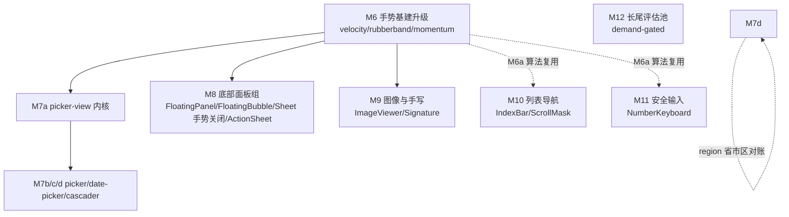

# Mobile Native Components Roadmap（移动端原生组件扩展 M6–M12）

> Last Updated: 2026-10-19（M6 `done`；M7–M11 经人确认转 `todo` 进入执行队列：人指令"执行 mobile-roadmap 直到彻底完成，每个工作项拟制一个计划，每计划完成自动提交"；M12 维持 demand-gated `proposed` 不排期）
> Source: `docs/analysis/2026-10-19-mobile-advanced-libs-deep-research.md`（vant / antd-mobile / nutui / arco-design-mobile / tdesign-mobile-react / framework7 / ionic-framework / swiper / embla / use-gesture / zarm 源码调研）
> 关联：`mobile-roadmap.md`（M0–M5 已完成：响应式基线 + 首批 5 个移动原生组件，状态以该文件为准）、`roadmap.md`（主组件 roadmap）

## Purpose

本文是 `flux-renderers-mobile` 包**第二批移动端原生交互组件**（M6–M12）的全局状态索引。第一批（M5：pull-refresh/infinite-scroll/swipe-cell/countdown/notice-bar）见 `mobile-roadmap.md`。架构红线（不建 `*-mobile` 双实现、只有移动原生交互组件进本包等）与 `mobile-roadmap.md` 完全一致。

## Current Baseline（2026-10-19 调研结论摘要）

- Flux 现有移动原生组件 5 个 + `useTouch`（delta + 10px 方向锁，无速度/橡皮筋/惯性）。
- 缺口共识矩阵（≥3 库同时实现的 = 高频共识）：**Picker 滚轮家族**（8/11 库）、**ActionSheet**（7）、**ImageViewer 手势预览**（6）、**SearchBar**（6，判定为通用组合不进本包）、**IndexBar**（4）、**NumberKeyboard**（4）、FloatingPanel / Signature / FloatingBubble（2 库但交互价值高）。
- 手势基建四流派（自研 touch / use-gesture+弹簧 / scroll-snap / 全局仲裁）：Flux 属第一派，推荐「自研骨架 + 吸收 velocity/rubberband/momentum 三个纯函数（<2kB）」，**不引入 use-gesture/react-spring 依赖**（+15kB、5 组件迁移、库年余未更新）。
- 可移植算法与精确公式（rubberband `(d·dim·c)/(dim+c·d)`、velocity 170ms 采样窗、动量减速度 0.003、`nearest` 吸附、滚动穿透位掩码锁等）逐条见调研报告 §5。

## Phase Status

> 全文件唯一动态状态区。状态流转同其他 roadmap；**可标记单位是 work item（M6/M7/…），不是单组件子项（M6a/M7b…）**；子项是同一 work item 的拆解说明，不是独立打勾单位。一个 work item = 一个 execution plan 的交付范围。

- M6 手势基建升级（velocity/rubberband/momentum 纯函数层 + useLockScroll + 手势仲裁决策 + 现有 5 组件手感升级，4 子项 M6a~M6d）: `done`（2026-10-19，plan `docs/plans/664-mobile-m6-gesture-infrastructure-plan.md`，closure audit 两轮 R1 issues→R2 approved；iOS 分段 spinner 裁决 optimization candidate 落该 plan Deferred 节）
- M7 Picker 滚轮家族（picker-view 内核 + picker/date-picker/cascader 派生，4 子项 M7a~M7d）: `todo`（2026-10-19 人确认转 `todo`）
- M8 底部面板组（FloatingPanel + FloatingBubble + Sheet/Drawer 小屏手势下拉关闭 + ActionSheet 形态决策，4 子项 M8a~M8d）: `todo`（2026-10-19 人确认转 `todo`）
- M9 图像与手写组（ImageViewer 手势预览 + Signature，2 子项）: `todo`（2026-10-19 人确认转 `todo`）
- M10 列表导航组（IndexBar + ScrollMask 渐隐增强，2 子项）: `todo`（2026-10-19 人确认转 `todo`）
- M11 安全输入组（NumberKeyboard + verification-code/passcode 联动，2 子项）: `todo`（2026-10-19 人确认转 `todo`）
- M12 长尾评估池（SwipeLoad/tapHold/swipe-back/sortable/barrage/water-mark，demand-gated 不排期）: `proposed`（demand-gated，任一项需真实需求 + 人确认后才转 `todo`）

## Work Items

### M6 — 手势基建升级

> 现状缺口：`useTouch` 仅 delta + 方向锁，无速度追踪/橡皮筋/惯性；主流库已把这些沉淀为共享纯函数层。M6 是 M7/M8/M9 的算法底座，且顺带完成现有组件手感升级。

| Work item | 内容                                                                                                                                                                                                                                                               | 依赖 |
| --------- | ------------------------------------------------------------------------------------------------------------------------------------------------------------------------------------------------------------------------------------------------------------------ | ---- |
| **M6a**   | `useTouch` → 增强层（velocity 170ms 采样窗 + flick 判定〔embla DragTracker 模式〕、rubberband 纯函数 `(d·dim·c)/(dim+c·d)`、momentum rAF 可打断插值〔TDesign quartEaseOut 路线〕、nearest 锚点吸附、click 防穿透打标、supports-passive 探测），向后兼容现有 5 组件 | —    |
| **M6b**   | `useLockScroll`（vant 式方向位掩码 + 计数 + strict/局部模式），供 mobile 自定义 surface（bottom-sheet/floating-panel/picker 弹出容器）使用；Radix 弹层已有基础锁不动                                                                                               | —    |
| **M6c**   | 手势仲裁轻量方案决策（同屏 pull-refresh/swipe-cell/carousel 竞争的优先级约定；评估是否需要 ionic GestureController 式 capture 独占，先出决策记录再实施）                                                                                                           | —    |
| **M6d**   | 现有组件手感升级接入：swipe-cell（velocity 投掷 + overswipe 超滑触发 + K-map 松手决策）、pull-refresh（rubberband 阻尼统一 + iOS 分段 spinner 进度评估）                                                                                                           | M6a  |

### M7 — Picker 滚轮家族

> 共识度最高（8/11 库）、算法密度最高的缺口。`picker/design.md` 已 retained 立约，实施时按调研结论升级内核路线（rAF + quartEaseOut 可打断，schema 中途变更需 stopMomentum）；vant/arco/nutui 惯性参数组（300ms/15px 触发、减速度 0.003）为默认手感基线。

| Work item | 内容                                                                                                | 依赖 |
| --------- | --------------------------------------------------------------------------------------------------- | ---- |
| **M7a**   | picker-view 滚轮内核（单列滚轮：惯性 + 吸附 + 越界回弹 + transitionend 对齐 emit + 受控值回写抑制） | M6a  |
| **M7b**   | picker（单列/多列弹出形态，接 z-index 栈 + safe-area + useLockScroll）                              | M7a  |
| **M7c**   | date-picker / time-picker（纯配置派生年月日时分列，arco「一个内核支撑 4 组件」结构）                | M7a  |
| **M7d**   | cascader（级联列联动；与 missing-components roadmap L2.2 region 省市区的 mobile wheel 分支对账）    | M7a  |

### M8 — 底部面板组

| Work item | 内容                                                                                                                        | 依赖 |
| --------- | --------------------------------------------------------------------------------------------------------------------------- | ---- |
| **M8a**   | FloatingPanel（锚点多档拖拽面板 + 「面板未满屏拖面板/满屏滚内容」滚动仲裁 + 局部滚动锁）                                    | M6   |
| **M8b**   | FloatingBubble（可拖拽悬浮球 + 四边吸边，rubberband + nearest）                                                             | M6a  |
| **M8c**   | Sheet/Drawer 小屏手势下拉关闭（ui 层增强：`(t<300&&d>20)\|\|d>h/2` 速度判定 + breakpoints 半开档位 + backdrop 随 progress） | —    |
| **M8d**   | ActionSheet 形态决策落地（ui Sheet 派生 vs mobile renderer，list/grid 形态 + safe-area；先出决策记录）                      | —    |

### M9 — 图像与手写组

| Work item | 内容                                                                                                                         | 依赖 |
| --------- | ---------------------------------------------------------------------------------------------------------------------------- | ---- |
| **M9a**   | ImageViewer 手势预览（双指以触点为不动点缩放 matrix + 双击 1↔2 + 横翻 + 下滑关闭 + 缩放态冻结横翻仲裁 + iOS 缩放防模糊补偿） | M6   |
| **M9b**   | Signature 签名（canvas + 笔迹平滑 + undo + 导出 png + 表单字段接入；vant 2026-03 undo 增强为基线）                           | —    |

### M10 — 列表导航组

| Work item | 内容                                                                                                           | 依赖 |
| --------- | -------------------------------------------------------------------------------------------------------------- | ---- |
| **M10a**  | IndexBar 字母索引（从尾向头锚点定位 + sticky 顶推 transform + 侧栏非 passive touchmove/elementFromPoint 定位） | —    |
| **M10b**  | ScrollMask 滚动渐隐（tabs/横向滚动容器两端「还有内容」提示；通用件落 ui/basic 层，不占 mobile 包红线）         | —    |

### M11 — 安全输入组

| Work item | 内容                                                                                                                | 依赖 |
| --------- | ------------------------------------------------------------------------------------------------------------------- | ---- |
| **M11a**  | NumberKeyboard 数字键盘（自绘虚拟键盘：乱序防窥/小数点/确认键布局；zarm keyboard+keyboard-picker 金融级形态为参照） | —    |
| **M11b**  | 与 verification-code/passcode 输入联动契约（已有 `verification-code` 渲染器对账，避免双实现）                       | M11a |

### M12 — 长尾评估池（demand-gated 不排期）

> 不进执行队列；任一项需有真实项目需求（demand）并经人确认后才立项转 `todo`。

- SwipeLoad 行程确认（arco 独有，抖音式滑动解锁）
- tapHold 长按原语（f7 全局 touch 模块；context-menu/多选触发器）
- swipe-back 边缘右滑返回（ionic priority 101；依赖路由体系，Flux 单页渲染器场景弱）
- sortable 列表拖拽排序（f7/ionic reorder；桌面通用需求，评估归主 roadmap 而非 mobile 包）
- barrage 弹幕、water-mark 水印（vant/nutui/zarm 有；demand-gated 长尾）

## Dependency Graph

> 实线 = 硬依赖；虚线 = 对账/复用关系。M7b–M7d 依赖 M7a 内核；M10/M11 依赖 M6a 的算法层但不硬阻塞。

## Cross-Cutting

| 关注点           | 说明                                                                                                                          |
| ---------------- | ----------------------------------------------------------------------------------------------------------------------------- |
| design.md 先行   | 每个新组件在 plan 内先立 design.md（对齐 M5 先例），含 schema 契约、markers、事件 payload、i18n key                           |
| 归属红线         | 仅移动原生交互组件进 `flux-renderers-mobile`；M10b 走 ui/basic；M8c 走 ui 层；通用件（SearchBar/BackTop/Ellipsis 等）不进本包 |
| Playground + e2e | 每个 work item 完成 playground 演示页 + Playwright `setViewportSize` e2e（对齐 mobile-roadmap Cross-Cutting）                 |
| 手感基线         | 惯性参数组以 vant/arco/nutui 同参为默认（300ms/15px 触发、减速度 0.003）；实现路线用 rAF 可打断，不用 CSS transition          |
| 零依赖纪律       | 不引入 use-gesture/react-spring/better-scroll；算法以纯函数吸收进共享层                                                       |

## Rule

- 本文档是状态索引，不是 execution plan；工作项增删/优先级重排需人确认。
- 全部 M6–M12 为 AI 起草提案（`proposed`），**需人确认逐项转 `todo` 后才进执行队列**；AI 不得自行转换。
- 每个 work item = 一个 execution plan 的交付范围；plan 通过 closure audit 后标 `done`，不得提前。
- 任何工作项若演变为新建 `*-mobile` 双实现或引入 mobileUI 标志位，必须回到人确认。
- 依据文档：`docs/analysis/2026-10-19-mobile-advanced-libs-deep-research.md`（缺口共识矩阵 §6、归属判定 §7、可移植算法 §5）。
